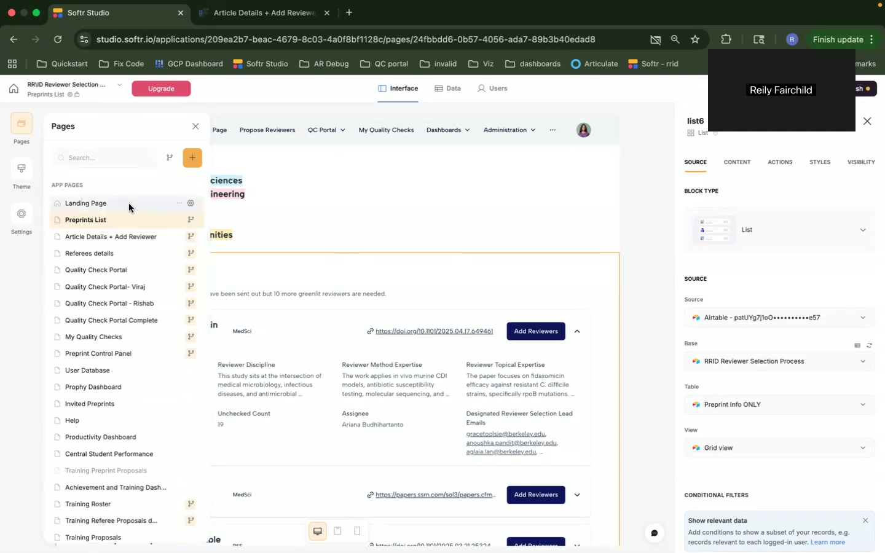
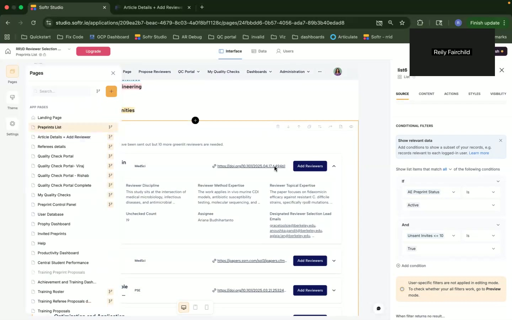
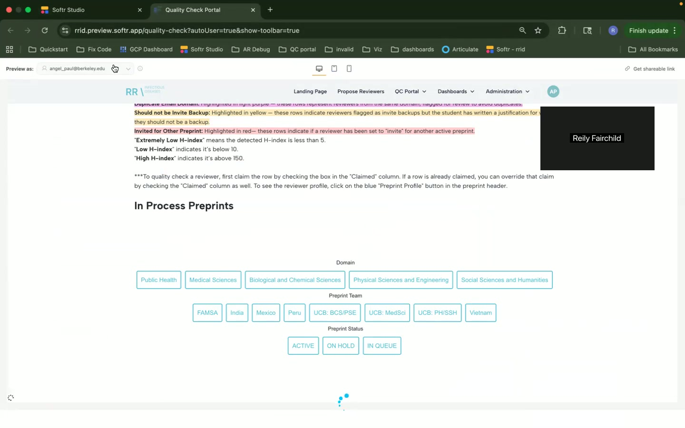

# RID Software Application Personas, User Stories, and User Journeys

## User Personas

### Persona 1: Emily the Student
- **Role:** Student
- **Background and Context:** Emily is a graduate student involved in a research project as part of her coursework. She needs to engage in peer review activities to fulfill her course requirements. 
- **Goals and Motivations:** Earn course credit by participating in peer reviews and gain insight into the research publication process.
- **Pain Points and Challenges:** Limited experience with academic peer review processes and a steep learning curve for new software.
- **Technical Skill Level:** Intermediate; comfortable using web applications.
- **How They Would Use This Application:** Emily uses the application primarily to propose and review potential peer reviewers for academic preprints.

### Persona 2: John the Assistant Editor
- **Role:** Assistant Editor
- **Background and Context:** John is an assistant editor at a research journal. He is responsible for quality checking submissions and overseeing the peer review process.
- **Goals and Motivations:** Ensure high-quality review processes and improve journal reputation.
- **Pain Points and Challenges:** Managing multiple submissions simultaneously and ensuring timely reviews.
- **Technical Skill Level:** Advanced; proficient with various publishing and data management tools.
- **How They Would Use This Application:** John uses the platform to assign and evaluate peer reviewers, quality check submissions, and manage editorial workflows.

### Persona 3: Dr. Sarah the Central Team Lead
- **Role:** Central Team Lead
- **Background and Context:** Dr. Sarah oversees the editorial team at RID. She coordinates efforts between editors and manages the successful operation of the peer review system.
- **Goals and Motivations:** Maintain and oversee a smooth, efficient publication process and ensure proper training and productivity of the team.
- **Pain Points and Challenges:** Balancing workloads across the team and addressing any issues with onboarding processes or system discrepancies.
- **Technical Skill Level:** Expert; extensive experience in academic publishing settings.
- **How They Would Use This Application:** Dr. Sarah accesses reports and dashboards to monitor productivity, oversees training dashboards, and updates system settings as required.

## User Stories and Feature Mapping

### User Story 1: Landing Page Access
- **As a** Emily the Student, **I want to** access the landing page **so that** I can start using the application.
  - **Acceptance Criteria:** Landing page loads with the appropriate login options.
  - **Priority:** High
  - Related Pages/Features: Landing Page

### User Story 2: Proposal Submission
- **As a** John the Assistant Editor, **I want to** evaluate proposals of peer reviewers **so that** I can ensure their appropriate assignment to manuscripts.
  - **Acceptance Criteria:** Proposals can be approved, rejected, or flagged for further review easily.
  - **Priority:** High
  - Related Pages/Features: Article Details and Add Reviewers

### User Story 3: Quality Checking
- **As a** Dr. Sarah the Central Team Lead, **I want to** access the quality check portal **so that** I can oversee and intervene if necessary in the peer review process.
  - **Acceptance Criteria:** Clear view on proposals needing quality checks, with options to adjust as necessary.
  - **Priority:** High
  - Related Pages/Features: Quality Check Portal

### Feature Mapping
- **Emily's Features:** Input reviewer proposals, view progress on proposals, access peer review instructions.
- **John's Features:** Evaluate peer reviewer proposals, quality check portal access, proposal management.
- **Dr. Sarah's Features:** Productivity dashboards, system updates and settings, team coordination dashboards.

### Workflows Spanning Multiple Pages
- **Peer Review Proposal Workflow:** Starts from landing page, navigates to preprint lists, inputs proposed reviews on the article details page, and ends in the quality check portal.

## User Journeys

### User Journey 1: Proposing a Peer Reviewer
1. **Entry Point:** Landing Page
2. **Task Flow:**
   - Navigate to the ‘Propose Peer Reviewer’ feature.
   - Fill out the necessary forms with proposed reviewer details.
   - Submit or save the proposal for later.
3. **Exit Point:** Submit proposal and receive confirmation.
4. **Decision Points:** Option to save for later or directly submit proposals after reviewing entered details.

### User Journey 2: Quality Check Process
1. **Entry Point:** Quality Check Portal
2. **Task Flow:**
   - View list of in-process preprints.
   - Select preprint and review proposed reviewers.
   - Approve, reject, or flag proposals for follow-up.
3. **Exit Point:** Update the status of preprint proposals and confirm submitted checks.
4. **Decision Points:** Evaluate each reviewer proposal for eligibility and conflicts of interest.

## Screenshots and Context

1. **[00:47] Landing Page:** Allows students and assistant editors access to proposing peer reviewers by listing all available functions.

2. **[04:57] Details Page for Preprint:** Emily and John use this page to input or review proposed peer reviewers on specific preprints.

3. **[14:52] Quality Check Portal:** Dr. Sarah’s primary tool for overseeing the quality of proposed reviewers.

This document captures essential personas, user stories, and workflows relevant to the RID software application, aiming to improve task efficiency for academic peer review processes.