# Enriched Linear Walkthrough - Comprehensive Analysis

This document provides a comprehensive walkthrough enriched with visual analysis of all screenshots.

It goes beyond the speaker's narration to identify Softr interface components, Airtable integrations, and UI details.


## Chapter 1: Overview of the RID Reviewer Selection Softr Application Structure and Landing Page

This chapter provides an overview of the Softr application used for the RID (Research Integrity Digest) Reviewer Selection process. The walkthrough will cover the application's structure, focusing on the purpose of different pages and how they relate to the overall workflow. The emphasis will be on the top-level navigation and landing page, outlining the key functionalities and access points for different user roles.

### Key Takeaways

-   The Softr application is structured with pages grouped into categories: App Pages, badge system-related pages, and Utility Pages.
-   The landing page provides different views tailored to different user roles (e.g., students, assistant editors).
-   The application facilitates three primary workflows: inputting peer reviews, quality checking peer reviewers, and tracking overall productivity.
-   The landing page uses a Feature Grid block to present key actions with clear descriptions and call-to-action buttons.
-   The application leverages Airtable as its data source, managing reviewer information, preprints, and other relevant data.

### Detailed Description

The application, built with Softr, is designed to streamline the RID Reviewer Selection process. The Softr interface is visible in the screenshots and shows the Softr Studio environment used for building and managing the application.

The left-hand navigation panel in Softr Studio provides access to the application's pages, theme settings, and other configurations. The application pages are organized into groups. 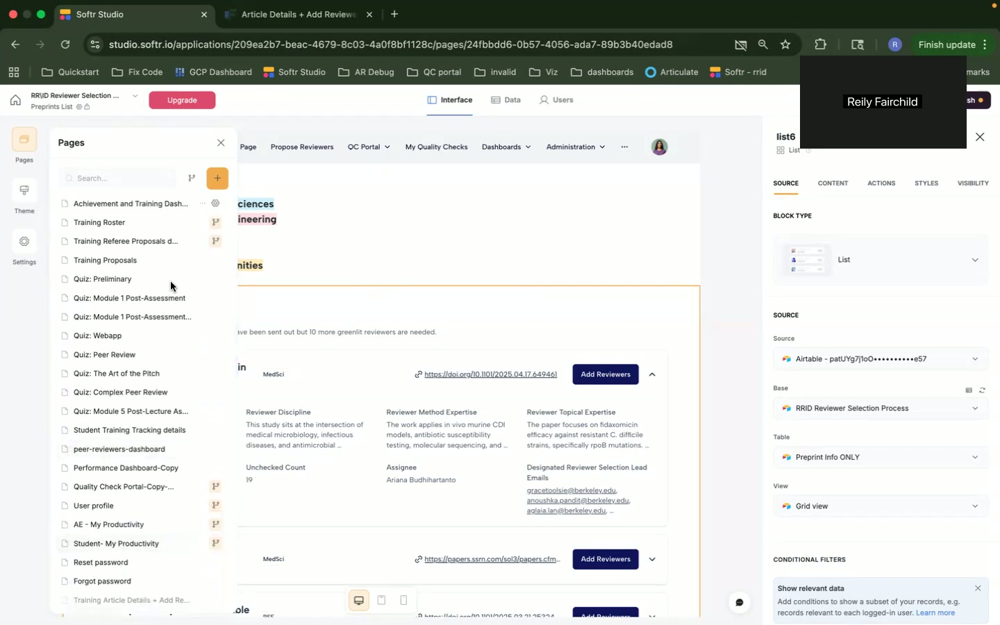 shows the "Pages" section of the Softr Studio, listing various pages such as "Landing Page", "Preprint List", "Article Details + Add Reviewer", "Quality Check Portal", "My Quality Checks" and more, categorized under the heading "APP PAGES." Below this are pages related to the badge system (mentioned but not detailed in this chapter) and "UTILITY PAGES" such as "Log in," "Sign up," "Account Settings," and other common pages that Softr typically manages.

The top navigation bar in the application itself provides quick access to different sections: "Propose Reviewers," "QC Portal," "My Quality Checks," "Dashboards," and "Administration" 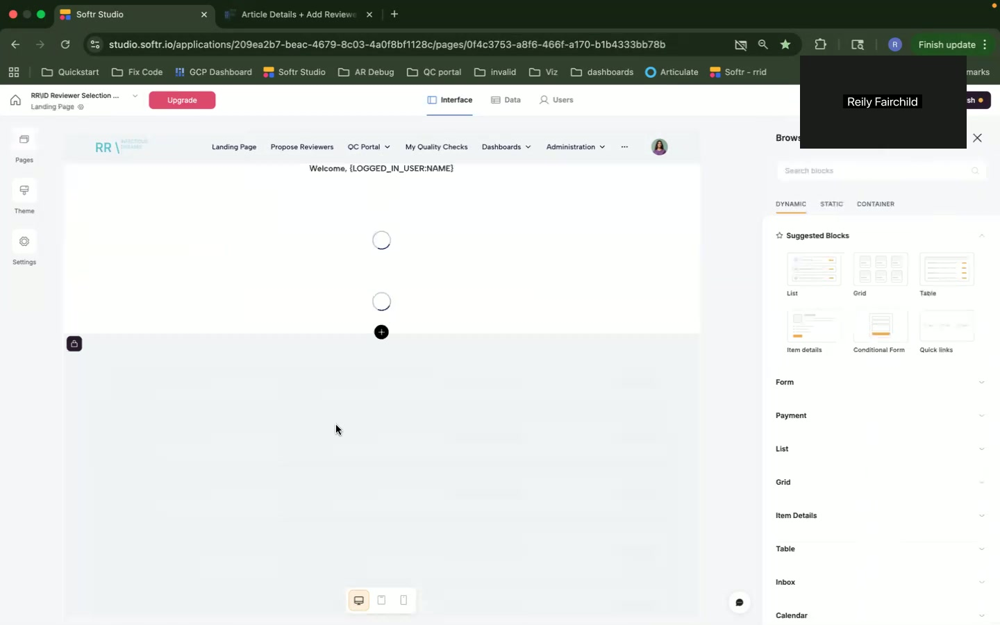. This suggests different areas of the application focusing on reviewer proposals, quality control, personal tasks/checklists, data visualizations, and administrative functions.

The landing page adapts to different user roles, providing a customized experience. For example, students see a view tailored to their tasks, while assistant editors see a view relevant to their quality checking responsibilities. The landing page uses a Feature Grid block, which consists of four distinct sections: "Find a Preprint", "Input Peer Reviewers", "Quality Checks", and "Progress Review".  Each section includes a descriptive title, a short text description, a background image consisting of flowing blue/purple curved lines, and a call-to-action button.  The "Find a Preprint" section links to an external Softr site dedicated to the preprint pitching process.

The underlying data for the application appears to be stored in Airtable, as evidenced by the "Airtable" source configuration shown in the Softr Studio interface. The data is organized into tables, such as "Preprint Info ONLY".

The "Pages" menu 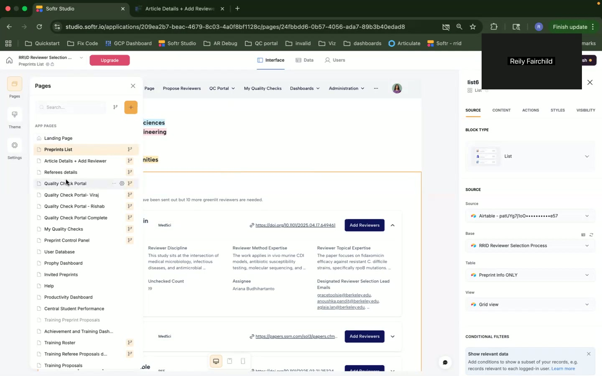  includes various pages related to quizzes, performance, and user profiles, suggesting that the application tracks user progress and provides personalized experiences. The existence of "Utility Pages" indicates that Softr is handling user authentication and account management functionalities.

### Important UI Elements and Interactions

The primary UI element visible on the landing page is the Feature Grid block.

*   **Feature Grid Sections (Find a Preprint, Input Peer Reviewers, Quality Checks, Progress Review):** These sections are individual containers holding the title, description, and call-to-action button. The call-to-action buttons navigate the user to relevant sections of the application or, in the case of "Find a Preprint," to an external site.
*   **Call-to-Action Buttons:** These buttons prompt the user to take specific actions, such as "Go to Preprints" (for finding preprints) or accessing the preprint list to input peer reviews.
*   **Top Navigation Menu:** Provides access to the main sections of the application ("Propose Reviewers," "QC Portal," etc.).  It likely contains role-based visibility controls to show/hide menu items based on the logged-in user's permissions.
*   **Left Navigation Panel (Softr Studio):** Used by administrators or developers to navigate and manage the application's pages, settings, and integrations within the Softr Studio. Includes a search bar to easily find pages.

Users interact with the interface by clicking on the call-to-action buttons in the Feature Grid or using the top navigation menu to access different sections of the application. The landing page's design is intended to guide users toward their primary tasks based on their roles.

The Softr Studio interface allows developers to configure the Feature Grid block, customizing the title, description, image, and button for each section. The Airtable integration allows the application to dynamically display data from the Airtable base, creating a data-driven user experience. 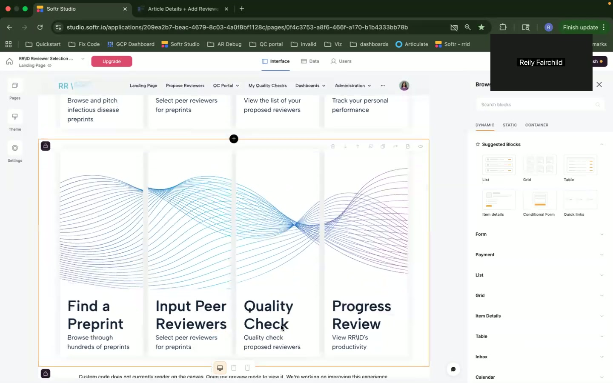 shows configuration options for a single item within the feature grid, specifically the "Find a Preprint" section. Options include the image, title, description, and button text ("Go to Preprints") along with the link associated with the button.

The speaker mentions that clicking the "Input Peer Reviewers" button navigates to the "Preprint List" page, indicating a direct link between the landing page and the preprint management workflow.

### Notable Timestamps

*   **[00:00-00:10]:** The speaker introduces the walkthrough and outlines its focus on the top-level sections of the application.  The UI shows the full Softr Studio interface. 
*   **[00:28-00:40]:** The speaker distinguishes between "App Pages", badge system related pages, and "Utility Pages" managed by Softr. This highlights the layered structure of the application. 
*   **[00:47-00:52]:** The speaker navigates to the landing page, revealing the initial dashboard. 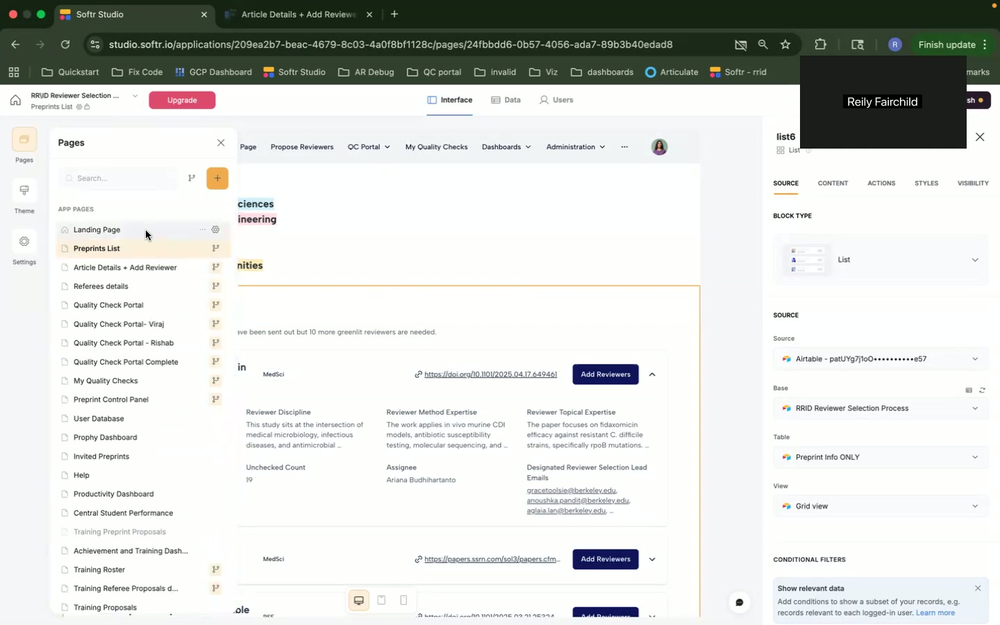
*   **[01:06-01:15]:** The speaker mentions the tailored views for students and assistant editors, showing the landing page and the features that each role would see. 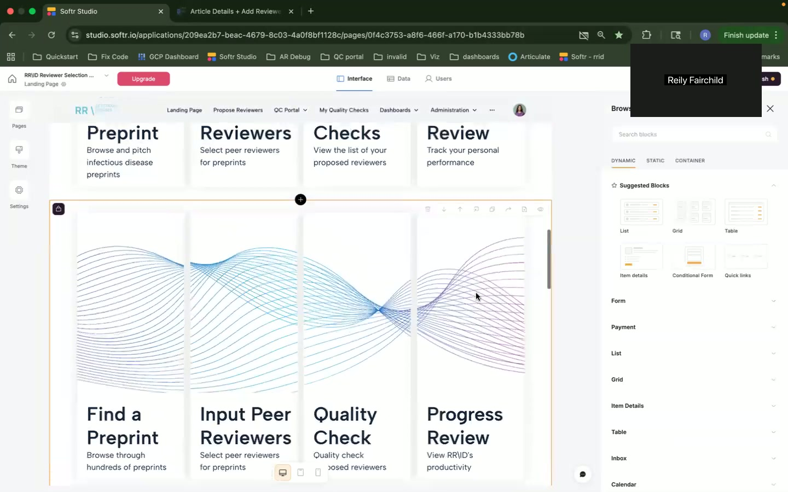
*   **[01:36-01:43]:** The speaker explains the three main workflows facilitated by the application: inputting peer reviews, quality checking reviewers, and monitoring productivity.  This is visually represented by the "Input Peer Reviewers," "Quality Checks," and "Progress Review" features on the landing page. 
*   **[01:52-02:06]:** The speaker explains that "Find a Preprint" is an external link, directing users to a separate Softr site handling the preprint pitching process. 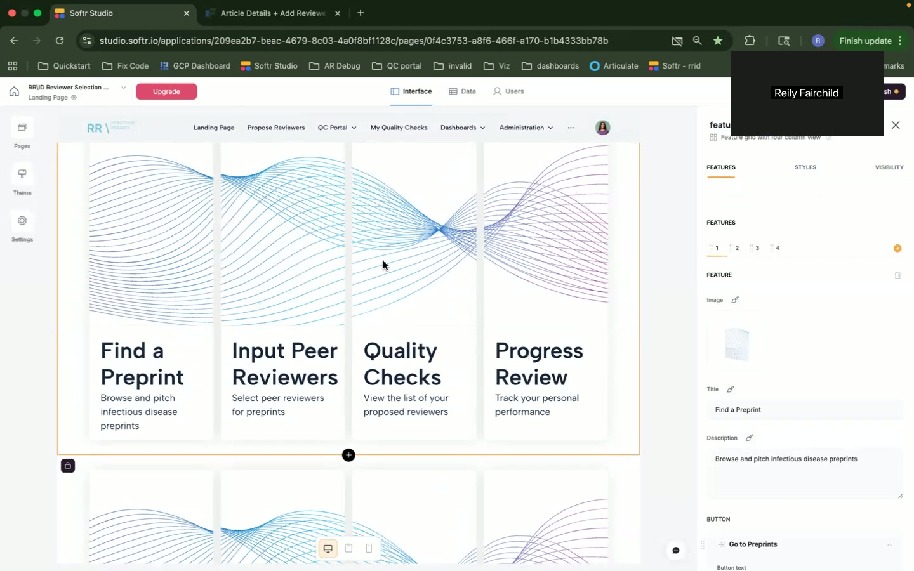
*   **[02:06-02:28]:** The speaker uses the "Input Peer Reviewers" button as an example, demonstrating how to trace a UI element's link to a specific page (the "Preprint List" page) within the Softr Studio environment.  This showcases the Softr's internal page linking mechanism.

---


## Chapter 2: Exploring Preprint Lists and Role-Based Visibility

### Key Takeaways
- Softr is being used to manage preprints and their review process, with different lists tailored to different user roles (students, assistant editors, central team).
- The platform uses Airtable as its backend database to store and manage preprint data, including metadata, review status, and assignments.
- Conditional filters are heavily used to control the visibility of preprints in different lists based on user roles, preprint status, and other criteria.
- The UI presents preprints in a list format, providing key information such as title, author, discipline, and links to the preprint itself, along with an "Add Reviewers" button.
- The "Add Reviewers" button's presence or absence is dynamically controlled based on user roles and preprint status, demonstrating role-based access control.

---

### Detailed Description

This chapter delves into the "Preprints List" section of the Softr application, showcasing how it organizes and displays preprints based on their status and the user's role. The application leverages Softr's list functionality, connected directly to an Airtable base, to present a dynamic and filtered view of preprint data. The primary goal is to facilitate the peer review process by guiding users (students, assistant editors, and central team members) to the appropriate preprints requiring their attention.

The UI consists of a main content area displaying the list of preprints and a right-hand sidebar displaying the Softr Studio configuration panel. The main area is segmented into different lists, each representing a specific queue or category of preprints. The screenshots show lists like "Active Preprints," "Preprints in Queue," "Prioritized Selected Preprint," "Prioritized To Pitch(Editorial) Preprint," and "Assistant Editor Preprint Spotlight." Each list item (preprint) displays key metadata, including the title, corresponding author, discipline (e.g., MedSci, PH, BCS), reviewer expertise details, and links to the preprint document.  The key interactive element, the "Add Reviewers" button, is conditionally displayed, dictating the user's ability to initiate the reviewer assignment process.

The right-hand sidebar reveals the underlying Softr configuration for the currently selected list block. We can see the "Source" tab, which confirms that the data source is an Airtable base named "RRID Reviewer Selection Process", utilizing the "Preprint Info ONLY" table. The view selected seems to dynamically change depending on the Preprint List name. For example, the Active Preprint list uses "Grid View" as it's view. Other lists, like "Prioritized To Pitch" uses "Non-Complete Articles."

The most important aspect of this section is the conditional filtering applied to each list. Softr’s conditional filters allows the application to show or hide preprints based on various criteria such as user role, preprint status (e.g., active, in queue, on hold), and whether additional invites are needed. This mechanism ensures that users only see the preprints relevant to their responsibilities and authorization level.

The design follows a clean and organized layout, prioritizing information clarity and ease of navigation. The use of distinct list titles helps users quickly identify the appropriate queue for their tasks. The "Add Reviewers" button stands out visually, providing a clear call to action. The application appears well-structured, leveraging Softr's capabilities to create a dynamic and role-based user experience.

### Important UI Elements and Interactions

The following UI elements and interactions are crucial to understanding the functionality of the "Preprints List" section:

*   **Preprint Lists:** Each list (e.g., "Active Preprints," "Preprints in Queue") is a Softr list block connected to the Airtable database. Each list is configured with different conditional filters, tailoring the content to specific user roles and preprint statuses. 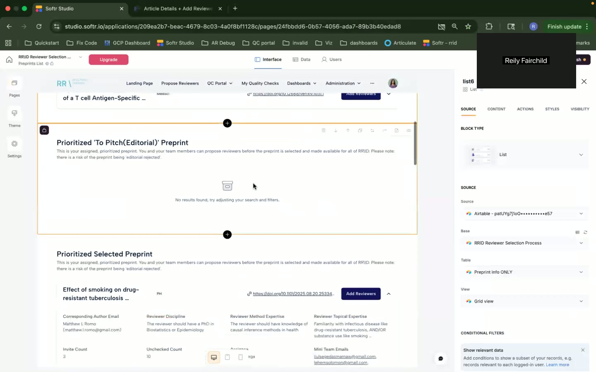
*   **Preprint Cards:** Each preprint is displayed as a card within the list. These cards contain key metadata fields such as:
    *   Title of the preprint
    *   Corresponding Author Email
    *   Reviewer Discipline
    *   Reviewer Method Expertise
    *   Reviewer Topical Expertise
    *   Invite Count
    *   Unchecked Count
    *   Assignee
    *   A URL linking to the original preprint document.
*   **"Add Reviewers" Button:** This button initiates the reviewer assignment process. Its visibility is dynamically controlled based on user role and preprint status.  For example, the "Preprints in Queue" list does *not* display the "Add Reviewers" button by default because it is configured to restrict access to Central and Staff roles.  The "Add Reviewers" button appears when the user belongs to the "Central" or "Staff" group as shown in the visibility settings. 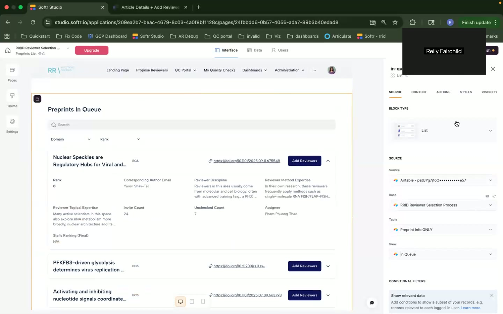
*   **Domain Filters:** There are Domain filter buttons such as BCS, PSE, MedSci, PH and SSH which likely filter the lists based on the scientific domain of the preprint.  This allows users to easily filter preprints relevant to their expertise.
*   **Search Bar:** A search bar allows users to find specific preprints within the "Preprints in Queue" list. This functionality is likely implemented using Softr's built-in search capabilities.
*   **Softr Studio Configuration Panel:** The right-hand sidebar provides access to Softr Studio's configuration options for the selected list block. This panel allows administrators to:
    *   Define the Airtable data source (base, table, view).
    *   Configure conditional filters.
    *   Customize the appearance of the list.
    *   Define user roles and visibility settings.

The primary user interaction involves browsing the different preprint lists and clicking the "Add Reviewers" button for relevant preprints. The conditional visibility of this button ensures that users are guided to the appropriate preprints for their role and responsibilities.  The search bar allows users to quickly locate specific preprints if they know the title or other identifying information.

The application distinguishes between user roles by dynamically controlling the visibility of different preprint lists and the "Add Reviewers" button. Students may only have access to certain lists or preprints, while assistant editors and central team members have broader access.

### Notable Timestamps

*   **02:50:**  Introduction to "Active Preprints" list and its visibility to all users. This list represents preprints that are currently open for peer review.
*   **03:05:** 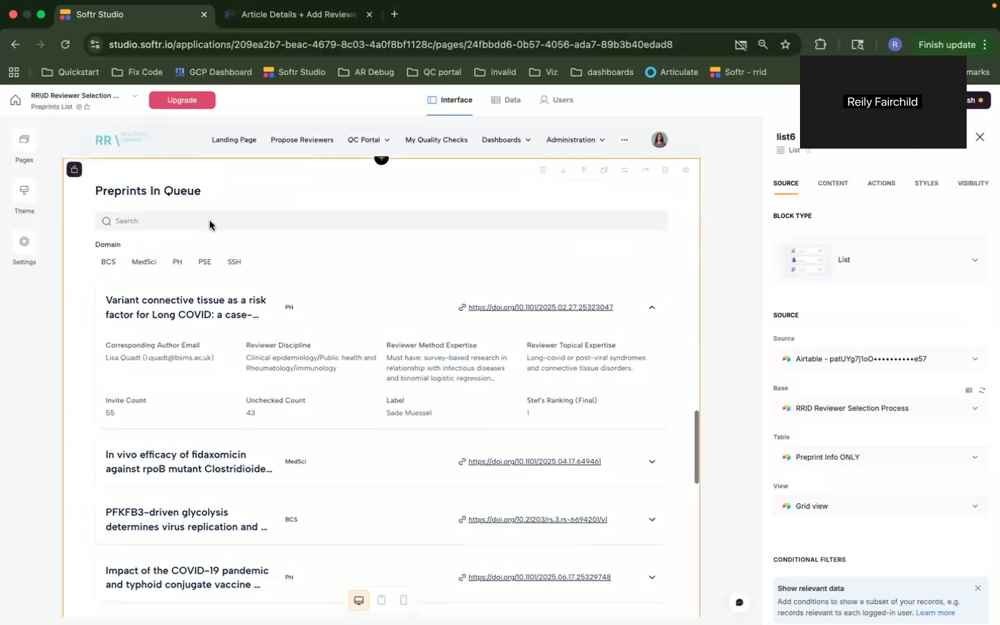 Explanation of the "Preprints in Queue" list and the absence of the "Add Reviewers" button for certain user roles.
*   **03:17:**  Demonstration of how the "Add Reviewers" button is conditionally displayed based on user roles. The Visibility tab shows that only Central and Staff user groups have access to this specific list.
*   **03:31:** 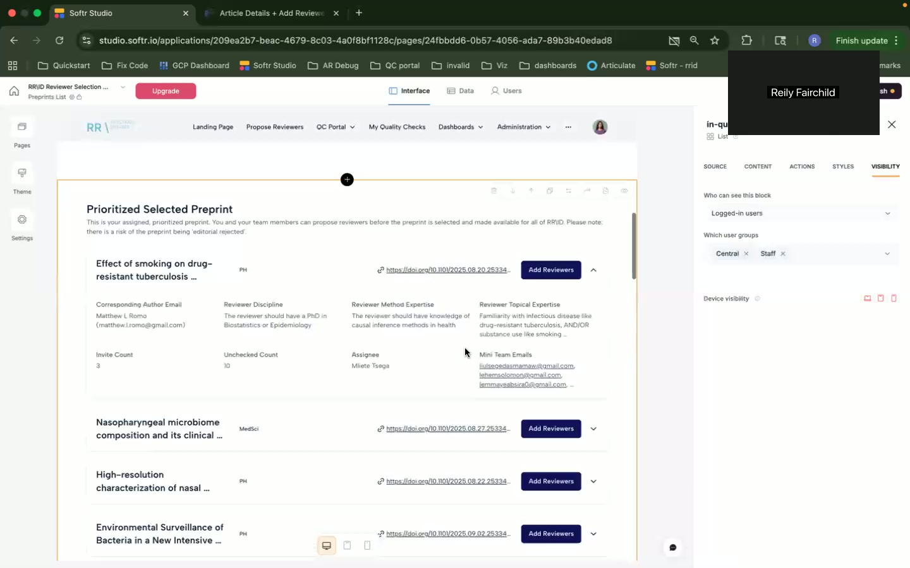 Introduction to the "Prioritized Selected Preprint" list and the use of conditional filters to target specific teams.
*   **03:42:** 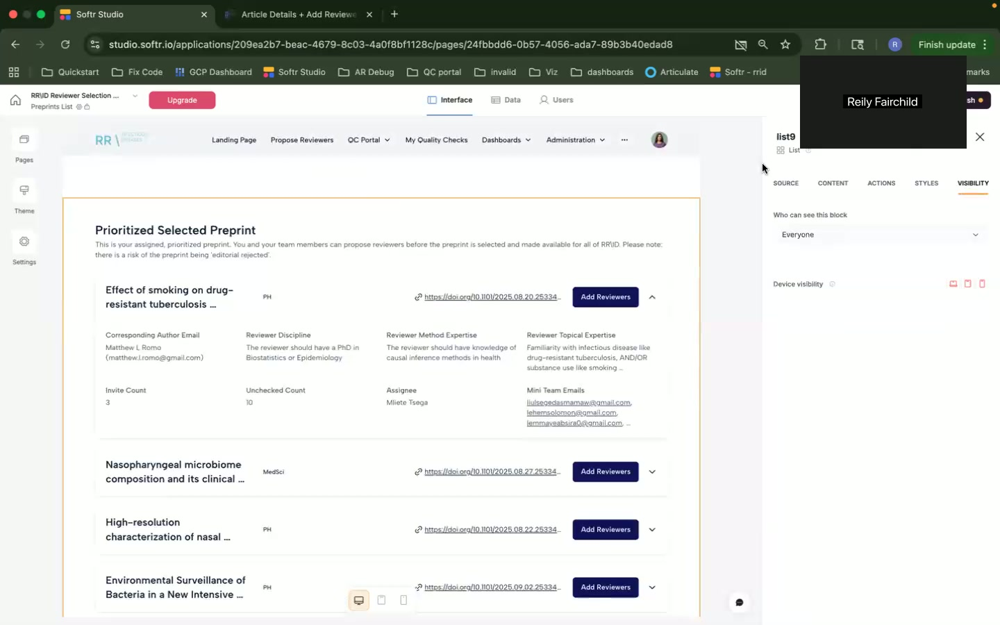 Detailed view of the conditional filters applied to the "Prioritized Selected Preprint" list, showcasing how visibility is controlled based on email addresses and preprint status. The filters use "Mini Team Emails" and compare against the current user's email address.
*   **04:09:** 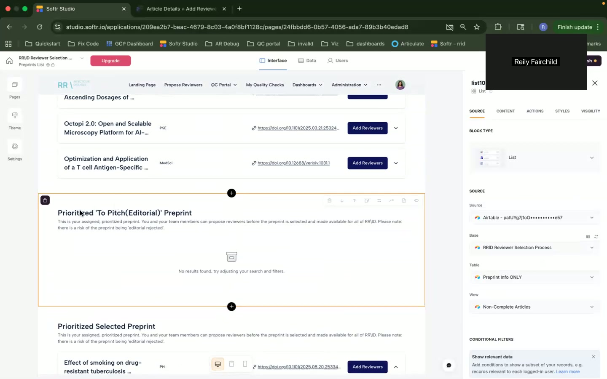 The "Prioritized To Pitch(Editorial) Preprint" shows up with no results, indicating that no preprints currently match the conditional filter requirements.
*   **04:20:** 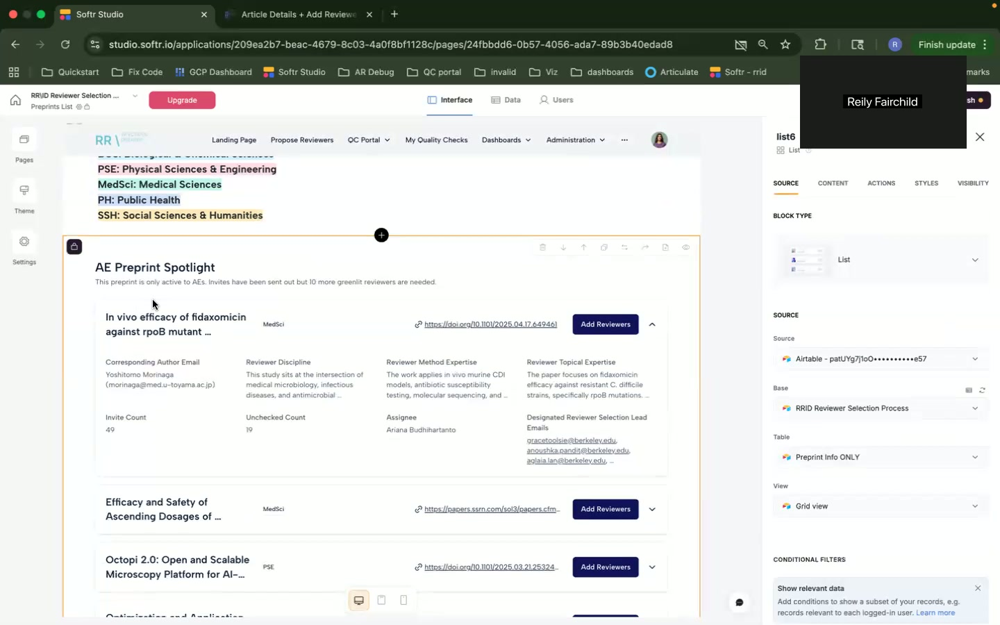 Explanation of the "Assistant Editor Preprint Spotlight" list and its purpose in highlighting preprints that are close to reaching the required number of reviews.

---


## Chapter 3: Examining Preprint Details and Reviewer Proposal Workflow

This chapter dives into the "Article Details + Add Reviewer" page of the Softr application, focusing on how users can view preprint information and propose reviewers for the preprints. It covers the detailed view of a selected article, the AI-suggested reviewer lists, conflict of interest checks, and the final reviewer proposal form.

### Key Takeaways

*   The "Article Details + Add Reviewer" page in the Softr application displays detailed information about a preprint, dynamically filtered via URL parameters containing the preprint ID.
*   The page features multiple lists sourced from Airtable, including AI-suggested reviewers (both claimed and unclaimed), and allows the management of team members associated with the article.
*   A crucial function is the "Check for COI" feature, enabling users to input a reviewer's name and email to flag potential conflicts of interest before formally proposing them. This COI check is specifically designed as a "basic info only" check and doesn't directly impact the main quality check process.
*   The final step involves a comprehensive "Propose a Reviewer" form, capturing extensive details about the proposed reviewer and any potential conflicts of interest. This form feeds into the editorial process, aiming to improve the quality and objectivity of peer reviews.
*   The application showcases a well-integrated workflow, leveraging Softr's dynamic list and form elements connected to Airtable for managing and displaying data related to preprints and reviewers.

---

### Detailed Description

The "Article Details + Add Reviewer" page serves as a central hub for managing the review process for individual preprints. This page appears to be dynamically generated within Softr, displaying information specific to a selected preprint. The selection of the preprint is achieved via a URL parameter, allowing the application to filter and display relevant data. The page contains various interactive elements, including lists, forms, and buttons, all connected to Airtable for data management. The UI showcases a clean and organized design, leveraging Softr's built-in components to present complex data in an accessible manner. Navigation is straightforward, with clear call-to-action buttons and logical sections for different aspects of the review process.

The page leverages multiple Softr list blocks, connected to different Airtable tables to display information. These lists appear to be customizable with conditional filters, enabling the display of relevant data based on specific criteria. The forms within the page, such as the "Check for COI" and "Propose a Reviewer" forms, are also configured to write data back to Airtable, facilitating a seamless workflow for managing reviewer proposals and conflict of interest checks. The Softr application appears to be configured using the drag-and-drop interface, with data sources and conditional filters configured in the side panel. The UI design and the data interactions are handled entirely within the Softr environment, showcasing the platform's capabilities for building data-driven applications.

### Important UI Elements and Interactions

1.  **Preprint Details Block:** 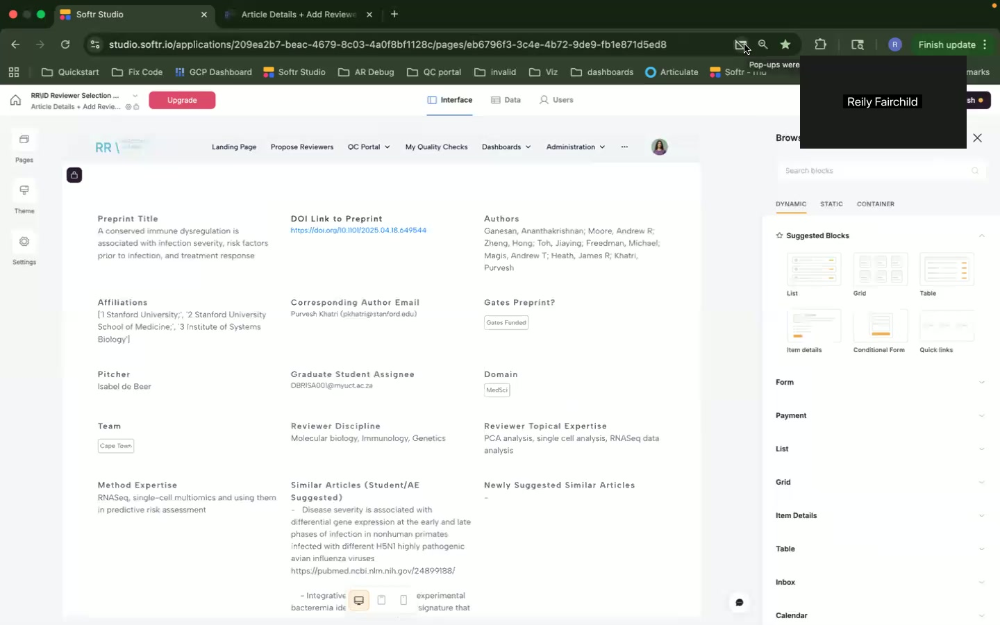 This is the initial block that displays crucial information about the selected preprint. It includes fields like:
    *   Preprint Title: The title of the research paper.
    *   DOI Link to Preprint: A hyperlink to the DOI of the preprint.
    *   Authors: The list of authors for the preprint.
    *   Affiliations: The institutional affiliations of the authors.
    *   Corresponding Author Email: The email address of the author to contact.
    *   Gates Preprint?: Indicates whether the preprint is funded by the Gates Foundation (displays "Gates Funded").
    *   Pitcher: Possibly the name of the person who pitched this paper for review.
    *   Graduate Student Assignee: The assigned graduate student.
    *   Domain: Subject area of the paper (e.g., "MedSci").
    *   Reviewer Discipline: Categories related to the paper (e.g., "Molecular biology, Immunology, Genetics").
    *   Reviewer Topical Expertise: Detailed expertise description (e.g. "PCA analysis, single cell analysis, RNAseq data analysis").
    *   Method Expertise: Research methods used (e.g., "RNASeq, single-cell multiomics and using them in predictive risk assessment").
    *   Similar Articles (Student/AE Suggested): List of similar articles.
    *   Newly Suggested Similar Articles: Another list of similar articles.

2.  **"Add Similar Articles" and "Find Similar Articles" Buttons:** These buttons likely trigger actions related to adding or finding relevant similar articles. The speaker mentions "(Prophy AI Suggested)", suggesting AI integration to find relevant articles. 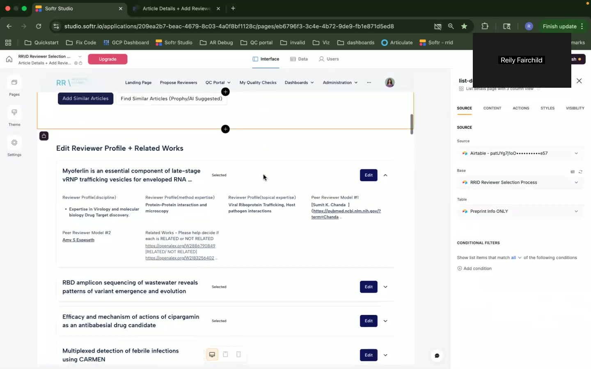

3.  **"Edit Reviewer Profile + Related Works" List:** This displays a list of reviewer profiles with related works. Each entry likely allows the user to view or edit the reviewer's profile and their related works.  The Edit buttons likely open a modal window or a separate page for modifying the reviewer profile. The data for these entries appears to be pulled from the Airtable base "RRD Reviewer Selection Process", specifically from the "Preprint Info ONLY" table based on the settings on the right side of the Softr Studio interface. 

4.  **Mini Team Emails and AE Assignee Email:** This section shows the email addresses associated with the team working on the preprint. It includes a button labeled "Add/Remove Team Members," which allows users to modify the team associated with the article.

5.  **Stats: Greenlit, Unchecked, Proposed:** These display numerical summaries. "Greenlit" likely indicates papers approved for the next stage, "Unchecked" represents preprints that have not yet been reviewed, and "Proposed" shows the total number of proposed reviewers. These appear to be pulling data from Airtable table "Rapid Review/Infectious Diseases" and Team_Preprints". 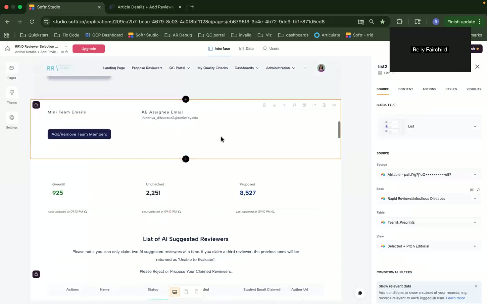

6.  **List of AI Suggested Reviewers:** This section presents a table of AI-suggested reviewers for the preprint. It includes:
    *   **Actions:** A "Evaluate" button to proceed with evaluating the suggested reviewer.
    *   **Name:** The name of the suggested reviewer.
    *   **Status:** The current status of the reviewer, such as "Claimed" or "Unclaimed".
    *   **PubMed:** A PubMed link, possibly to view the reviewer's publications.
    *   **Student Email Claimed:** The email address of the student who claimed the reviewer (if applicable).
    *   **Author Url:** A URL to the author's profile or website. 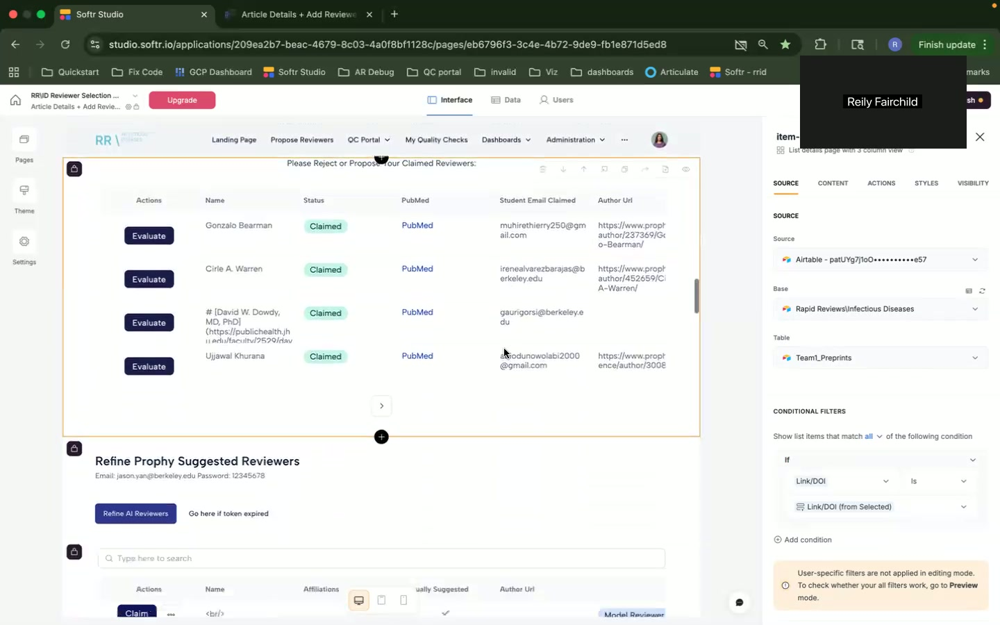
    The table shows potential reviewers, where each entry allows a user to "Claim" the reviewer. The table columns include "PubMed," "Affiliations," "Manually Suggested," and "Status." The status can be "Unclaimed" or "Unable to Evaluate". This list is also linked to an Airtable base called "Rapid Review/Infectious Diseases," from the "Team_Preprints" table.

7.  **Refine Prophy Suggested Reviewers:** This appears to be a section for refining the AI's reviewer suggestions. It includes a field for "Email" and "Password," hinting at a login requirement for refining the suggestions. The "Refine AI Reviewers" button initiates the refinement process.  There's also a "Go here if token expired" link.

8.  **Check for COI (Conflict of Interest):** 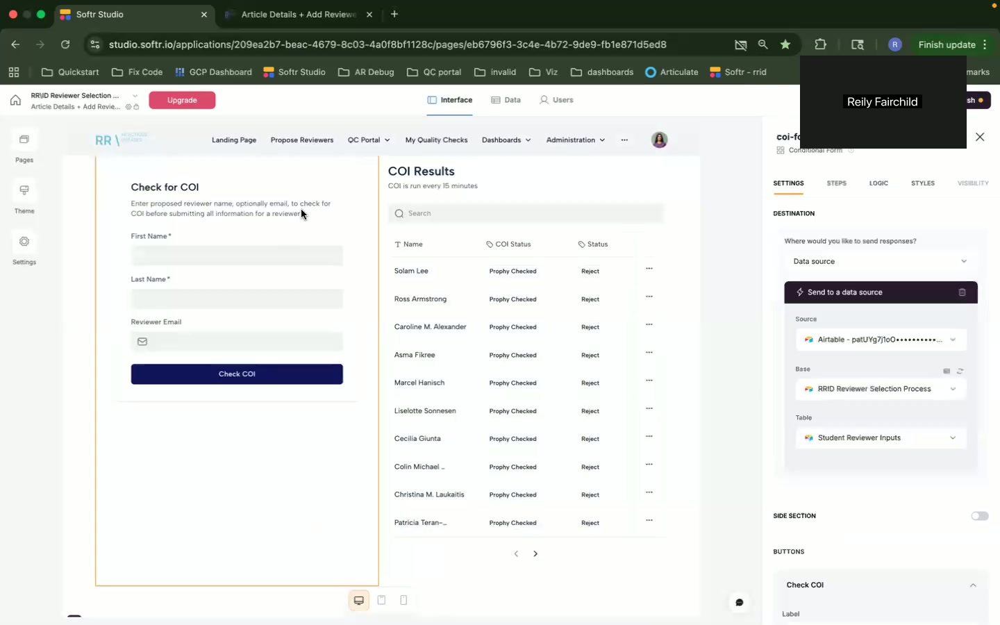 This form allows users to enter a potential reviewer's first name, last name, and email to check for any conflicts of interest before submitting the reviewer for a review.
    *   **First Name:** Input field for the reviewer's first name.
    *   **Last Name:** Input field for the reviewer's last name.
    *   **Reviewer Email:** Input field for the reviewer's email address.
    *   **Check COI Button:** Triggers the conflict of interest check.
    The "COI Results" table displays the results of previous COI checks. It includes:
    *   **T Name:** The name entered for the reviewer.
    *   **COI Status:** Indicates whether a conflict of interest was found (e.g., "Prophy Checked").
    *   **Status:** The status of the COI check (e.g., "Reject"). The settings panel on the right indicates that this form sends data to the "Student Reviewer Inputs" table in the "RRD Reviewer Selection Process" Airtable base.

9.  **Propose a Reviewer Form:** 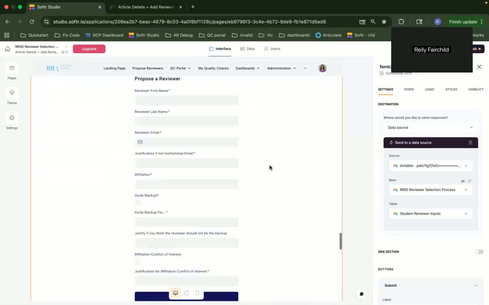 This form is used to officially propose a reviewer for the preprint. It gathers detailed information about the proposed reviewer, including:
    *   **Reviewer First Name:** Input field for the reviewer's first name.
    *   **Reviewer Last Name:** Input field for the reviewer's last name.
    *   **Reviewer Email:** Input field for the reviewer's email address.
    *   **Justification if not Institutional Email:** Text area to justify the use of a non-institutional email address.
    *   **Affiliation:** Input field for the reviewer's affiliation.
    *   **Invite Backup?:** Checkbox to indicate whether to invite a backup reviewer.
    *   **Invite Backup for...:** Input field to specify the reason for inviting a backup reviewer.
    *   **Justify if you think the reviewer should not be the backup:** Text area to justify not using the primary reviewer as a backup.
    *   **Affiliation Conflict of Interest:** Text area to disclose any affiliation-related conflicts of interest.
    *   **Justification for Affiliation Conflict of Interest:** Text area to justify any affiliation-related conflicts of interest.
    *   **Submit:** Button to submit the reviewer proposal.
    This form also sends data to the "Student Reviewer Inputs" table in the "RRD Reviewer Selection Process" Airtable base, as seen in the settings panel on the right of the Softr Studio interface.

### Notable Timestamps

*   **Displaying Preprint Details (05:33):**  The screenshot illustrates how the preprint details are presented, including the title, DOI, authors, and affiliations. The arrangement resembles a structured data display, likely driven by fields in the linked Airtable record.

*   **AI-Suggested Reviewers List (06:07):**  This screenshot highlights the AI-suggested reviewer list, showing the reviewer's name, status, and an action button to claim the reviewer. The presence of "Claimed" and "Unclaimed" statuses indicates a workflow for managing reviewer assignments.

*   **Conflict of Interest Check Form (06:35):**  This screenshot showcases the form used to check for conflicts of interest. The form includes fields for first name, last name, and email, and the results are displayed in a table to the right. The "Steps" tab on the right in Softr studio reveals the form has logic setup in the backend. Hidden fields like "Hidden: Date of Proposal" and "Hidden: Preprint ID (pulled)" suggest additional behind-the-scenes logic being applied.

*   **Propose a Reviewer Form (07:16):**  The screenshot displays the comprehensive form for proposing a reviewer, including various fields for capturing detailed information about the reviewer and potential conflicts of interest. This showcases the application's focus on thoroughness in the reviewer selection process.

---


## Chapter 4: Dynamic Form Validation and Reviewer Matching using Custom Code

### Key Takeaways

- The Softr application employs custom JavaScript code embedded within specific pages to enhance form validation and reviewer matching. This code retrieves data from Airtable and dynamically adjusts the user interface based on the data.
- The custom code performs client-side validation of the "Propose a Reviewer" form, preventing submission if potential matches are found between the entered reviewer information and existing data from authors or proposed reviewers.
- The code identifies key form elements (first name, last name, email, submit button) using DOM manipulation and then performs string comparisons and other checks to determine possible matches.
- The "Claim" and "Evaluate" buttons are used for managing suggested reviewers. The "Evaluate" button, in particular, retrieves data from the "Reviewer Selection Process" table within Airtable, suggesting a deeper integration of the AI referee system.
- The application utilizes Airtable as its primary data source, with multiple tables involved in reviewer selection, student input, and potentially other related processes.

---

### Detailed Description

This chapter delves into the custom code implementation within the Softr application, focusing on how it enhances form validation and facilitates reviewer matching. The speaker highlights a crucial aspect of the application: the use of custom JavaScript embedded within specific pages, particularly the "Article Details + Add Reviewer" page, to perform dynamic checks and validations. This showcases the flexibility of Softr in allowing developers to extend its capabilities through custom code.

 shows the navigation to the "Article Details + Add Reviewer" page. Upon selecting this page, the application interface displays the "Propose a Reviewer" form. The speaker mentions the custom code is embedded within this page via Pages -> Settings -> Custom Code. This area allows for inserting code into the `<head>` or `<body>` tags of the page.

The custom code, as seen in 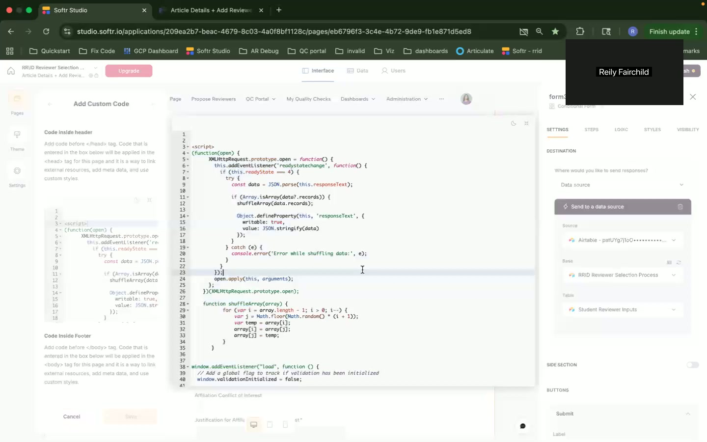, serves multiple purposes.  Firstly, it fetches relevant data from Airtable. The speaker mentions retrieving "proposed reviewers for the preprint" as well as "recent reviewers."  This data is then utilized for matching against the information entered into the "Propose a Reviewer" form.

The code, shown in 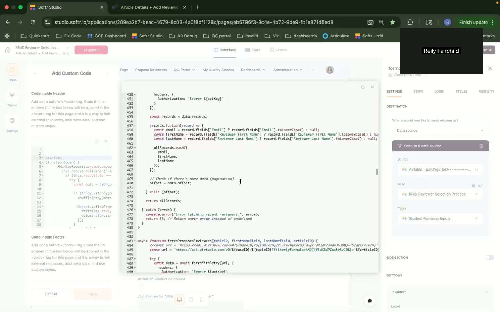, also performs DOM manipulation to identify and interact with the form elements. It attempts to locate the submit button and various input fields like "first name," "last name," and "email."  This process, as described by the speaker, is "hacky and not reliable," indicating a potential area for future improvement. The code includes fallback mechanisms for identifying the submit button, suggesting the interface may use various button types.

The core functionality revolves around checking for potential matches between the entered reviewer information and existing data. The code, in 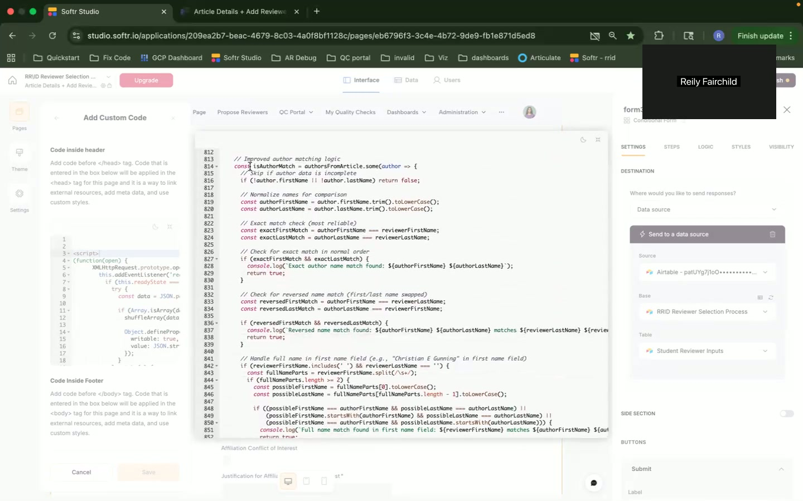, appears to implement different matching algorithms, including author matching and reviewer matching.  If a match is detected, the code provides real-time feedback to the user and prevents them from proceeding.  The speaker mentions that the "next button" is disabled in case of a match.

The "Propose a Reviewer" form, visible in 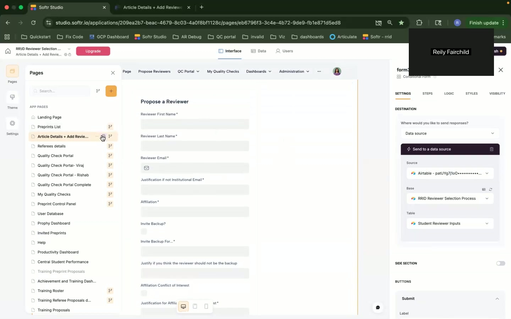, is connected to an Airtable data source, evident in the right-hand side panel under "Destination" where "Send to a data source" is selected. The Airtable base is identified as "Airtable - pat0Yg7sJo*******" and the table is "Student Reviewer Inputs".  The form includes fields such as "Reviewer First Name," "Reviewer Last Name," "Reviewer Email," "Justification if not institutional Email," "Affiliation," "Invite Backup?," "Invite Backup For...," "Justify if you think the reviewer should not be the backup," and "Affiliation Conflict of Interest."

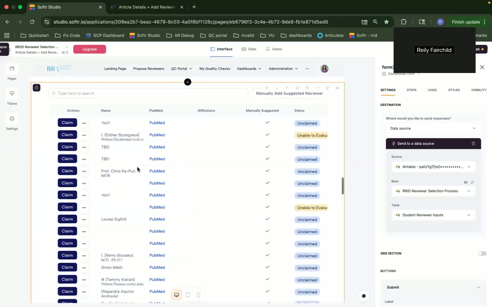 depicts a list of "Manually Add Suggested Reviewer" entries. Each entry has actions associated with it: "Claim" and "Unable to Evalute".  The "Claim" button likely signifies that a user is taking responsibility for contacting or managing that specific reviewer. The "Unable to Evaluate" button suggests the reviewer cannot be used or is no longer valid.

The speaker also refers to a table called "referees," identified as the "Reviewer Selection Process" table in Airtable.  This table, which is linked to the "Evaluate" button, is likely the core component of the AI referee system mentioned previously.

### Important UI Elements and Interactions

**Propose a Reviewer Form:**

*   **Fields:** "Reviewer First Name," "Reviewer Last Name," "Reviewer Email," "Justification if not institutional Email," "Affiliation," "Invite Backup?," "Invite Backup For...," "Justify if you think the reviewer should not be the backup," and "Affiliation Conflict of Interest." These are standard text input fields, dropdowns, and checkboxes.
*   **Submit Button:** Though the speaker describes logic to locate it via custom code, a standard "Submit" button is expected at the bottom of the form to send the data to the Airtable "Student Reviewer Inputs" table. The custom code dynamically disables this button based on matching logic.
*   **Data Source:** Airtable - table "Student Reviewer Inputs"

**Reviewer List Table (Manually Added Suggested Reviewers):**

*   **Columns:** This table displays information about suggested reviewers, including "Actions," "I," "PubMed," and "Affiliations," "Manually Suggested," and "Status". The "I" column's meaning is unclear. "PubMed" likely refers to publications indexed in PubMed. "Affiliations" are the reviewer's institutional affiliations.
*   **Claim Button:** Allows users to claim a suggested reviewer.
*   **Unable to Evaluate Button:**  Marks a suggested reviewer as unable to be evaluated.

**Reviewer Selection Process Table (Airtable):**

*   This table isn't directly visible in the screenshots in terms of its structure, but it's crucial because it provides the underlying data for the "Evaluate" action mentioned by the speaker.

**Custom Code Panel:**

*   **Code Editor:** Allows for entering and modifying JavaScript code.
*   **Save/Cancel Buttons:** Controls for saving or discarding changes to the code.

**Interactions:**

*   Users fill out the "Propose a Reviewer" form.
*   The custom JavaScript code validates the form in real-time.
*   If the validation succeeds (no matches found), the user can submit the form.
*   If the validation fails (matches found), the user receives feedback and the form cannot be submitted until changes are made.
*   Users can "Claim" or mark a "Manually Added Suggested Reviewer" as "Unable to Evaluate".

### Notable Timestamps

*   **07:53:**  Shows the Softr interface navigating to Pages -> Settings -> Custom Code to configure the JavaScript on the "Article Details + Add Reviewer" page.
*   **08:31:**   Displays a segment of the custom JavaScript code, illustrating the logic for finding the form submit button using XPath.
*   **09:17:**   Shows the JavaScript code responsible for performing matching between the proposed reviewer information and existing data.
*   **09:22:** 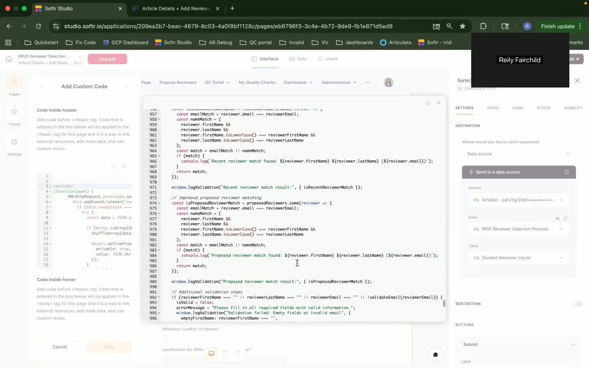 Illustrates how the custom code connects back to the Airtable datasource.
*   **09:54:**  Depicts the "Manually Add Suggested Reviewer" list and the actions associated with each entry ("Claim" and "Unable to Evaluate").
---


## Chapter 5: Evaluating and Managing AI-Suggested Reviewers

### Key Takeaways
- The application presents a list of AI-suggested reviewers pulled from an Airtable database.
- Users can evaluate the AI-suggested reviewers using information pre-filled from the Airtable, including name, email, affiliations, and other relevant details.
- Referees can be marked as "Unable to Evaluate" or "Rejected," influencing subsequent steps in the review process and providing feedback on the AI suggestions.
- Actions taken on reviewers update related Airtable tables.
- The "Evaluate" button directs the user to a details page with pre-populated information from the Airtable database.

---

### Detailed Description

This chapter focuses on how users, presumably assistant editors, interact with the AI-suggested reviewers within the Softr application. The workflow involves evaluating the suggestions provided by the AI and acting accordingly. The main interface is an "Article Details + Add Reviewer" page within the Softr Studio, specifically the "Referees details" section.  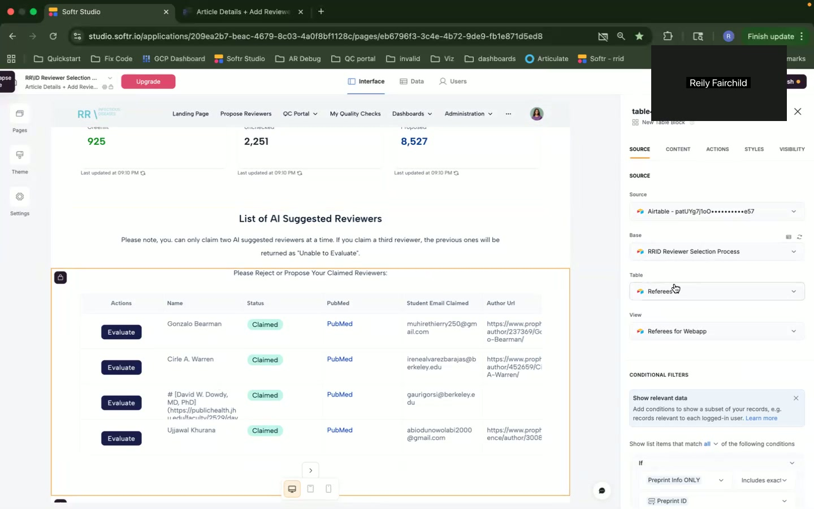

The user is presented with a list of AI Suggested Reviewers in a table format. The table displays key information such as the reviewer's name, whether they've been "Claimed," related PubMed articles, student email, and an author URL. Above the table is a descriptive text, "Please note, you can only claim two AI suggested reviewers at a time. If you claim a third reviewer, the previous ones will be returned as 'Unable to Evaluate'."

Each row in the table has an "Evaluate" button under the "Actions" column. Clicking this button navigates the user to another page containing detailed information about the reviewer. The speaker explains that this navigation uses pre-filled details derived directly from the corresponding Airtable record. 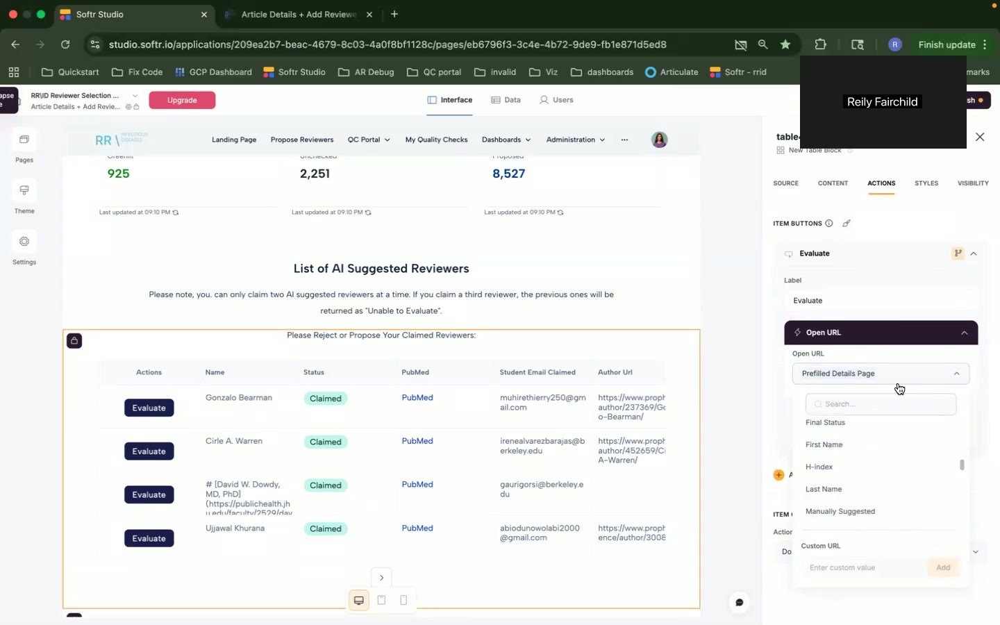

The Airtable integration is a core part of this process. The "Table Block" settings in the Softr editor reveals that the source of the data for the list of AI suggested reviewers is an Airtable base named "RR&D Reviewer Selection Process" and the table used is called "Referees". There is a "Referees for Webapp" view that is selected. This view may be filtered or sorted in a specific way.

The details page for each referee shows comprehensive information about the reviewer, including name, email, ORCID, author URL, affiliations, student email, H-index, and any "Reject/Unable to Evaluate Explanation". The UI layout on this details page is organized into distinct blocks to display the reviewer's information clearly. Below the reviewer's details are buttons for "Unable to Evaluate" and a "Reject Reviewer" form.  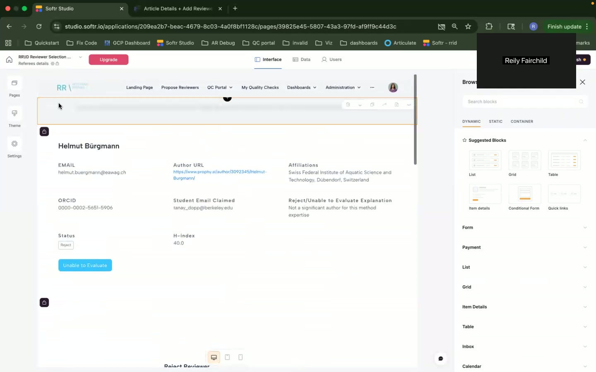

The "Reject Reviewer" section reveals a text input field for "Justification for Student Reject," implying that this feature is specifically used when student reviewers are deemed unsuitable. Submitting this form logs the rejection and the provided justification.

The Softr Studio interface allows configuring which action happens when a user clicks "Evaluate". Under the "Actions" tab for the table block, the "Item on Click" action is configured to "Open URL" with the sub-option "Prefilled Details Page". The "Prefilled Details Page" dropdown allows a user to select the page in Softr to navigate to. Fields like "Final Status", "First Name", and "H-Index" can be passed from the Airtable to the details page.

### Important UI Elements and Interactions

**1. List of AI Suggested Reviewers Table:**  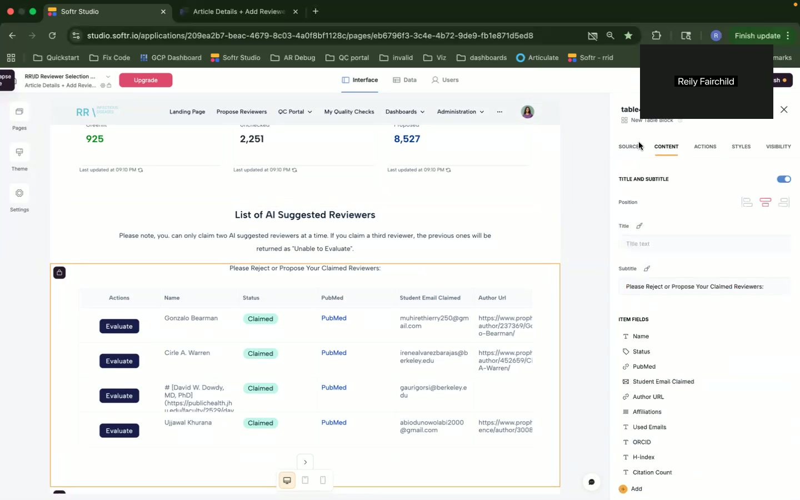
   - **Columns:** Actions, Name, PubMed, Student Email Claimed, Author URL. Additional fields can be added.
   - **Rows:** Each row represents an AI-suggested reviewer.
   - **"Evaluate" Button:**  Navigates the user to the reviewer details page.
   - **"Claimed" Label:** Indicates whether the reviewer has already been claimed. This may have an impact on whether the user can evaluate or claim the reviewer.

**2. "Evaluate" Button Configuration (Softr Studio):**
   - **Location:** "Actions" Tab -> "Item Buttons" -> "Evaluate"
   - **Functionality:** Opens a pre-filled details page (a URL within the Softr App). This leverages Softr's ability to pre-populate forms and page elements with data from the Airtable record.

**3. Reviewer Details Page:** 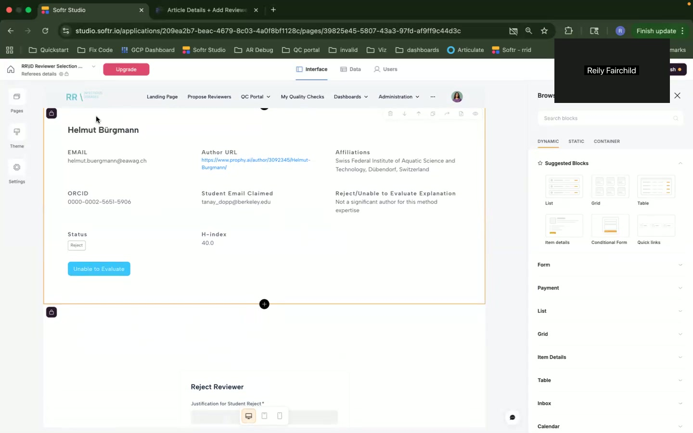
   - **Display Elements:** Dynamically populated fields showing reviewer's details. These fields are derived from the linked Airtable record.
   - **"Unable to Evaluate" Button:** A button allowing the user to indicate they cannot evaluate the reviewer. Likely updates a status field in Airtable.
   - **"Reject Reviewer" Form:**
        - **Justification for Student Reject (Text Input):**  A required field for providing a reason for rejecting the student reviewer.
        - **Submit Button:**  Submits the rejection justification and updates the Airtable record.

**4. Role-Based Differences (Inferred):**
   - The "Justification for Student Reject" field suggests that the interface is tailored for assistant editors evaluating student reviewers. The speaker mentions "assistant editors" in the narration.

**5. Data Flow & Airtable Integration:**
   - The data displayed in the "List of AI Suggested Reviewers" and the "Reviewer Details Page" is pulled directly from the Airtable base "RR&D Reviewer Selection Process," specifically the "Referees" table.  Actions taken on the reviewers (e.g., rejecting) are likely reflected in the Airtable data, triggering updates in other parts of the application.

### Notable Timestamps

- **10:18**:  The speaker introduces the "List of AI Suggested Reviewers" and mentions the need for consistent naming conventions.  
- **10:37**: The speaker explains that clicking the "Evaluate" button opens a URL and that the pre-filled details are pulled from Airtable.  
- **10:53**: Shows the "Item on Click" action for the "Evaluate" button set to "Open URL" and "Prefilled Details Page" configured.  
- **11:13**: Mentions that the detail URL is pre-filling information.  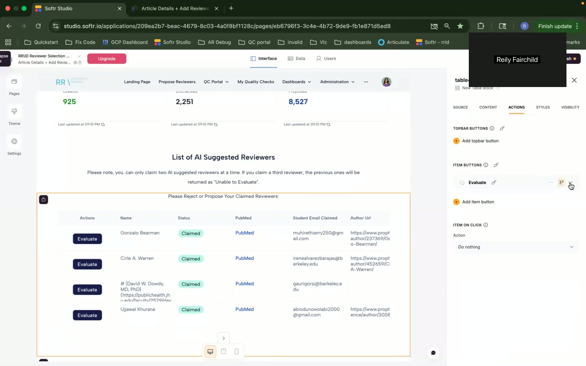
- **11:31**:  The speaker transitions to the reviewer details page, highlighting the presented information.  
- **11:54**: Focuses on the "Unable to Evaluate" and "Reject Reviewer" options, and the data flow related to rejections. 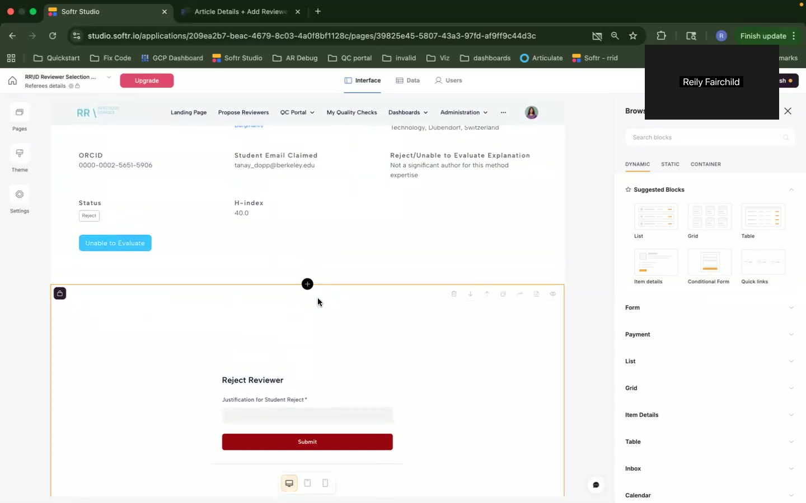
- **12:11**: Explains that rejecting a reviewer flags them in the "student reviewer inputs" table. 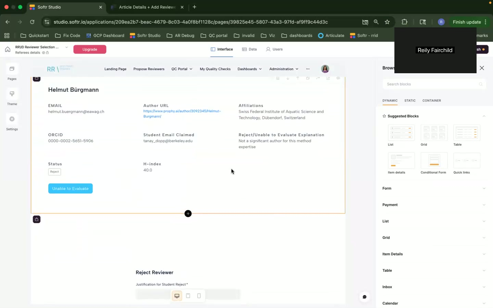

---


## Chapter 6: Reviewer Proposal and Quality Check Workflow

### Key Takeaways
- The Softr application incorporates logic to propose relevant reviewers for preprints based on various criteria, including expertise and past involvement.  Automations are in place to minimize the proposal of recently invited reviewers to avoid redundancy, though race conditions can occur.
- Proposed reviewers are managed via the "Quality Check Portal" accessible to assistant editors and the central team. This portal presents the data retrieved from Airtable in a custom-built user interface within Softr.
- The Quality Check Portal offers different views: one for "In Process Preprints", another for "Complete Preprints," and "My Quality Checks" which is specifically for student users.
- The user interface of the Quality Check Portal is implemented using custom code within a Softr block to display data from Airtable. The speaker notes that the UI has room for improvement.

---

### Detailed Description

This chapter focuses on how proposed reviewers are selected and managed within the Softr application. The speaker explains the logic behind proposing reviewers, including mechanisms to avoid proposing authors of the pre-print (since the data originates from Profi), and automated processes to prevent redundant invitations to reviewers.  The speaker notes the implementation of custom code to handle edge cases, specifically to address race conditions where multiple reviewers might be proposed for the same preprint simultaneously.

The central piece of functionality showcased is the "Quality Check Portal," which serves as the primary interface for assistant editors and the central team to review and manage proposed reviewers.  Multiple variations of the portal exist, targeting different stages of the preprint review process and different user roles. There are dedicated portals for in-process preprints, completed preprints, and a personalized view for students ("My Quality Checks").

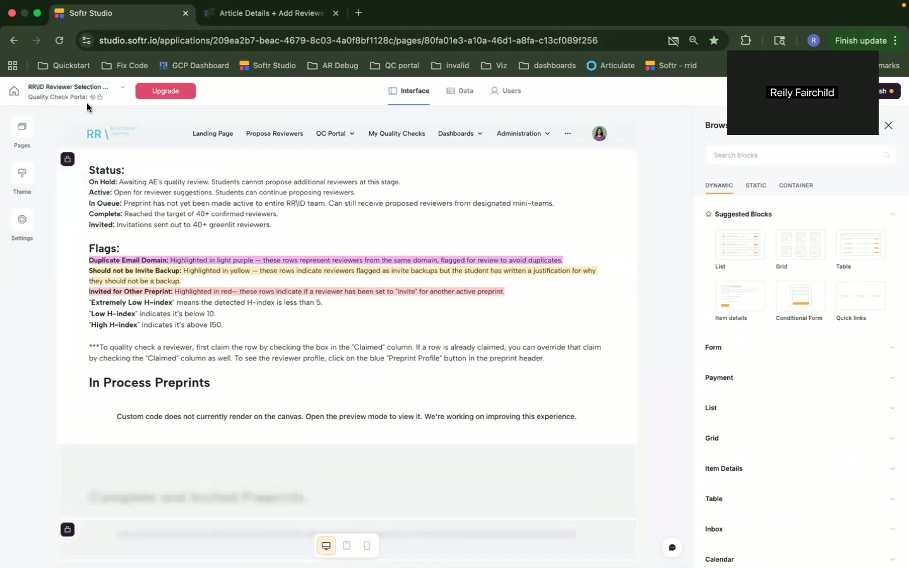 shows the navigation menu within the Softr editor with the "Quality Check Portal" page selected.  Several other "Quality Check Portal" pages are also listed, followed by "My Quality Checks". These multiple entries signify tailored views or filters applied to the same underlying data, catering to different user roles and workflow stages.  The right pane in the editor displays information about the selected page.  Notably, the "Browse Blocks" panel shows options to add different types of blocks - List, Grid, Table, Form, and other dynamic and static elements.

The speaker emphasizes that the UI in the Quality Check Portal is custom-built, implying that it's not a straightforward connection of Airtable data to a standard Softr list or table block. The presentation of the quality check table is "hardcoded" within a Softr field using custom scripts that pull data from Airtable and render it in the desired format.  This approach gives greater control over the look and feel of the UI, but also likely increases the development and maintenance effort.

The speaker mentions that the UI has "a lot of room for improvement," suggesting ongoing development to refine the user experience and improve data presentation.  The architecture separates the data source (Airtable) from the presentation layer (custom code within Softr), offering flexibility but also requiring more technical expertise.

### Important UI Elements and Interactions

The main interaction point described is accessing the different versions of the "Quality Check Portal" via the navigation menu in the Softr application. These include:

*   **Quality Check Portal:** The general portal for assistant editors and the central team, focusing on reviewing proposed reviewers for "In Process Preprints." The UI within this portal includes key information displayed as status flags at the top of the screen.
*   **Quality Check Portal - [Users]:**  The screenshots list "Quality Check Portal - Viraj" and "Quality Check Portal - Rishab", which likely represent test accounts or specific views tailored to individuals. 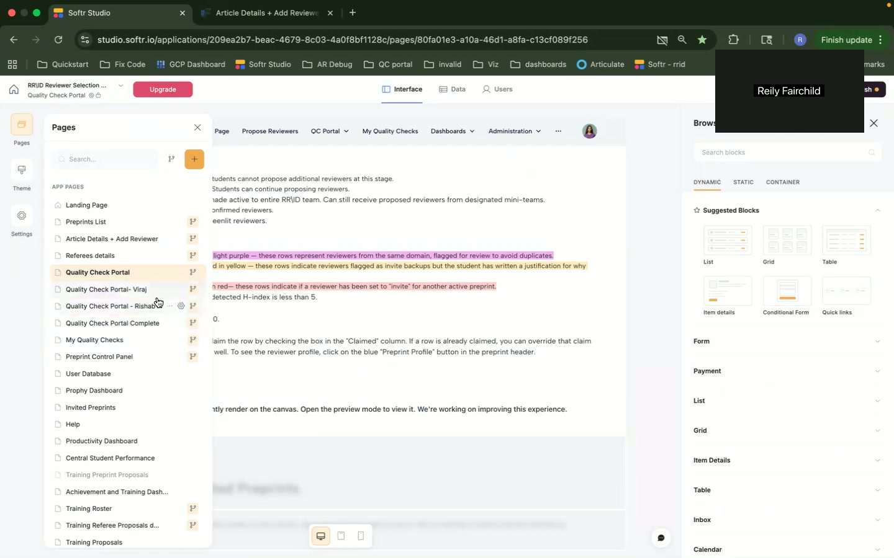
*   **Quality Check Portal Complete:** This view focuses specifically on completed preprints, which likely have a different set of review-related tasks or information to display.
*   **My Quality Checks:**  This portal is specifically designed for students and allows them to view and manage their assigned quality checks.

The "Quality Check Portal" page displays static content that provides guidance for users on the purpose of various flags and statuses in the system: 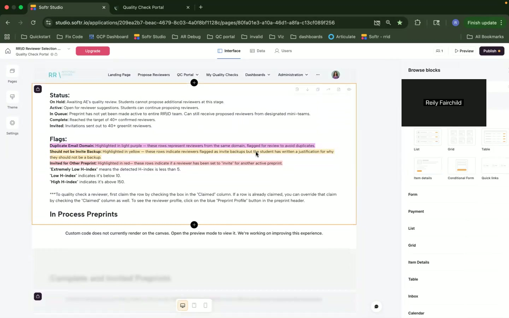

*   **Status Section:** Explains the meaning of different statuses such as "On Hold," "Active," "In Queue," and "Complete."  These represent different stages in the quality review process.  This section indicates that students are not allowed to propose additional reviewers when the status is On Hold.
*   **Flags Section:**  Explains the meaning of various flags used to highlight specific attributes of proposed reviewers.  Examples include "Duplicate Email Domain" (highlighted in light purple), "Should not be Invite Backup" (highlighted in yellow), and "Invited for Other Preprint" (highlighted in red). There are also flags related to "Extremely Low H-Index" and "High H-Index". These flags assist users in making informed decisions about the suitability of proposed reviewers.
*   **In Process Preprints:** A section dedicated to display a data table of preprints that are not yet complete. The speaker notes that custom code is used to display the data in this section, but it does not currently render on the canvas within the Softr editor.

While the screenshots don't show the precise interactive elements within the custom-built table in the Quality Check Portal (e.g., buttons, checkboxes), the speaker alludes to the ability to "claim" a row and view a reviewer's profile. The presence of flags suggests that these flags might be interactive filters or triggers for specific actions.

### Notable Timestamps

*   **12:51:** The speaker introduces the concept of selecting reviewers based on past proposals or recent reviews. 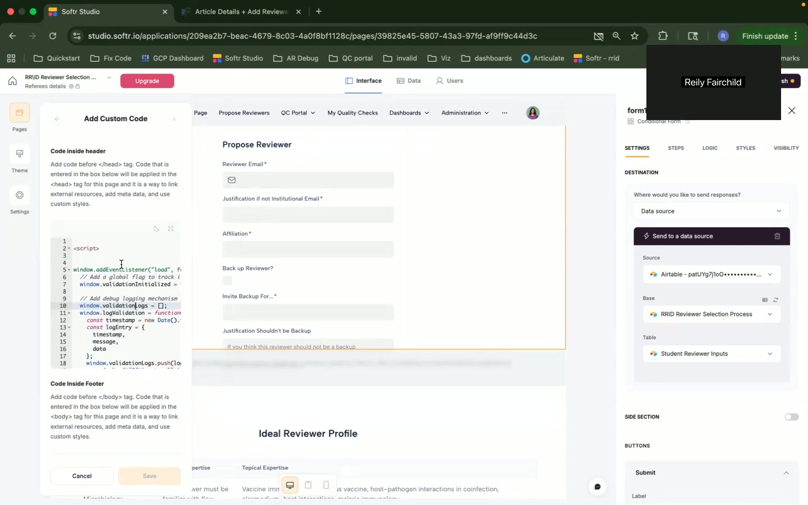 illustrates the page setup for "Propose Reviewer", showing the settings for the form.
*   **13:14:** The speaker mentions the existence of automations to avoid proposing reviewers who have been recently invited. 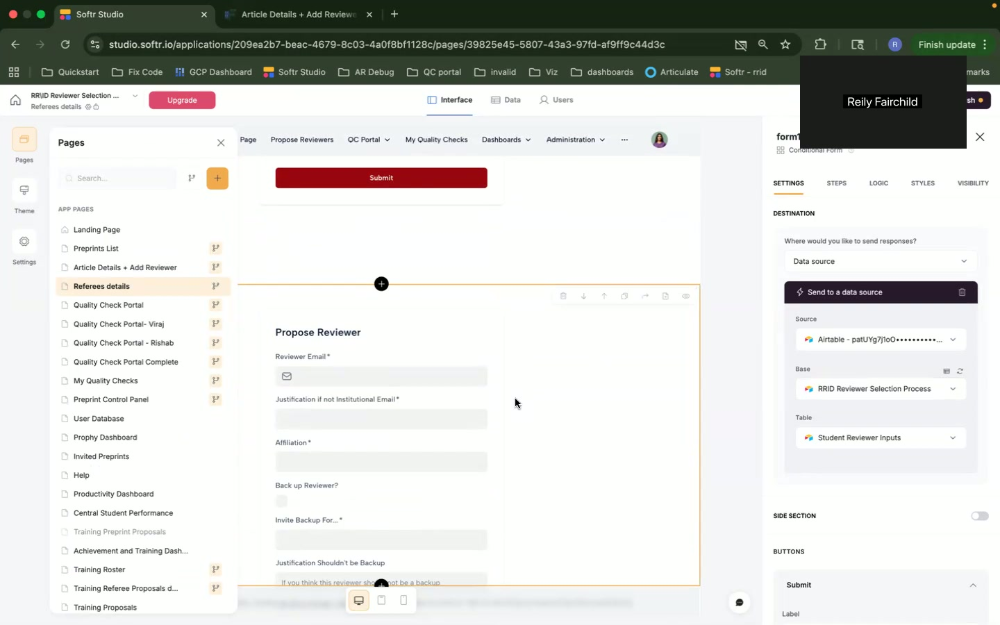
*   **13:32:** The speaker transitions into discussing where proposed reviewers are managed within Softr, highlighting the "Quality Check Portal". 
*   **13:45:** The speaker notes the existence of different variations of the "Quality Check Portal" for different testers and use cases. 
*   **14:09:** The speaker provides a preview of the "Quality Check Portal," emphasizing the custom nature of the UI. 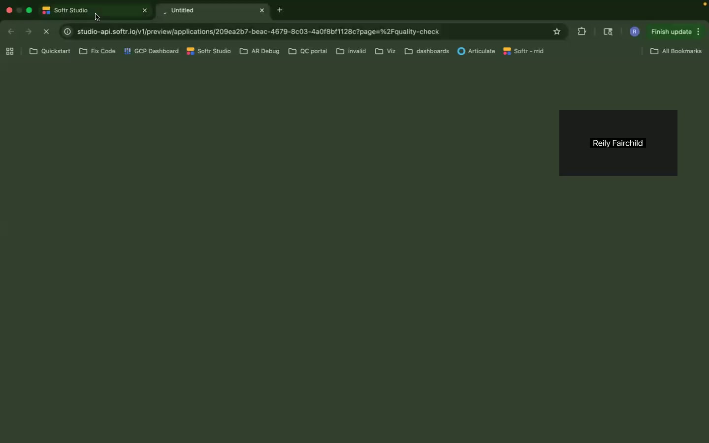
*   **14:28:** The speaker explicitly states that the quality check table is hardcoded within a Softr field. 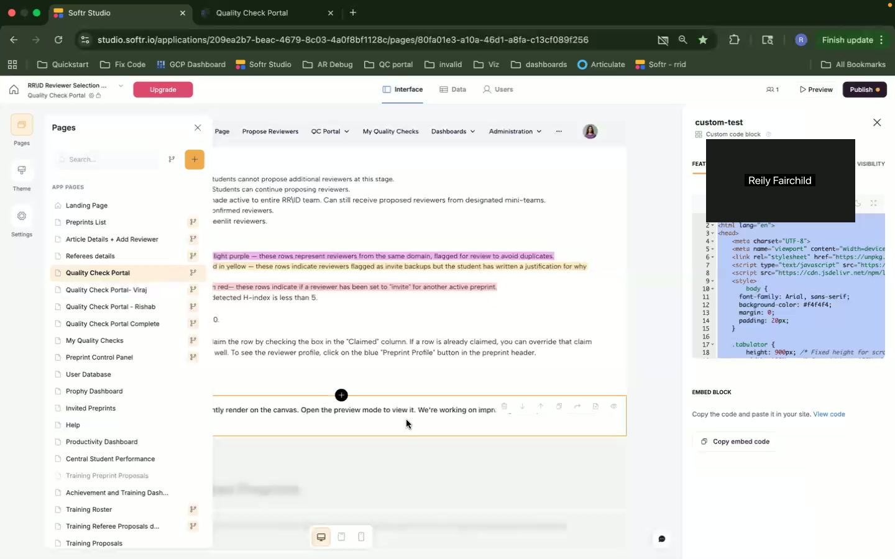
*   **14:37:** The speaker mentions that the HTML is rendered properly, indicating a successful integration of custom code. 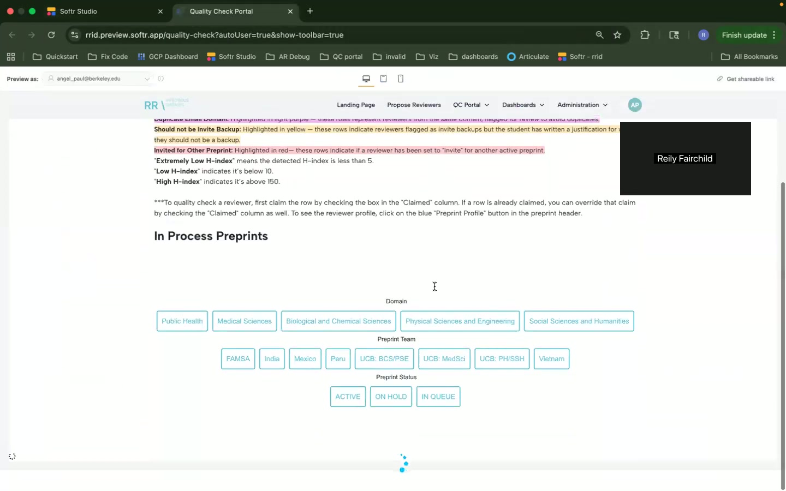

---


## Chapter 7: Central Team Management and Data Control

This chapter focuses on the administrative dashboards and functionalities available to the central team within the Softr application. These tools provide the central team with the ability to manage preprints, update user information, and monitor system performance, all without directly accessing the underlying Airtable database.

### Key Takeaways

- The central team has access to dedicated dashboards for managing preprints, including their status, ranking, and associated information.
- The application provides interfaces for the central team to safely update user data stored in Airtable, such as contact information, roles, and participation levels.
- The central team can control which data fields are editable within the Softr interface and define specific actions that can be performed on preprints and user records.
- Embedded Airtable interfaces provide the central team with high-level insights into the application's performance.
- An "Invited Preprints" feature exists (though currently unused), highlighting potential areas for future development related to reviewer assignment and follow-up.

---

### Detailed Description

The Softr application includes several dashboards and interfaces specifically designed for the central team to manage data and oversee operations. These tools are critical for maintaining data integrity, controlling application behavior, and monitoring overall performance. The central team can access these interfaces via the "Administration" tab located in the main navigation bar.

The primary function of these dashboards is to abstract the complexities of Airtable and provide a more user-friendly and secure environment for the central team to interact with application data. This is particularly important as the team grows, mitigating the risk of accidental errors or unauthorized modifications within the underlying database.

The dashboards leverage Softr's ability to create custom interfaces that interact directly with Airtable data. The design allows the team to selectively display, edit, and update information relevant to preprints, users, and system performance. By using Softr, the central team can avoid the need to constantly log into Airtable, simplifying their workflow and enhancing data security.

The UI components used within these dashboards are consistent with other parts of the application, making use of list views, tables, forms, and action buttons to provide a clear and intuitive user experience. Softr's block-based system allows for customization of these elements. For example, tables can be configured to display specific fields, include edit buttons, and even display expand buttons on hover.

The interfaces often include search and filtering capabilities, enabling the central team to quickly find specific records within large datasets. The use of conditional filters further refines data visibility, allowing users to focus on the most relevant information.

The Airtable integration is fundamental to these dashboards, with data being pulled directly from Airtable bases and tables. The screens show direct reference to Airtable bases, and Airtable views for filtering data. Softr acts as a secure and user-friendly intermediary between the central team and the raw data stored in Airtable. This separation of concerns provides a layer of protection and facilitates efficient data management.

---

### Important UI Elements and Interactions

The following UI elements and interactions are prominent in the central team dashboards:

1.  **List of Active and In Queue Preprints**:  This list displays a summary of preprints that are currently active or waiting for review. Key information displayed includes the preprint status, ranking, team performance metrics, and assigned individuals. The UI includes "Change Status" and "Editorial Reject" buttons, enabling the central team to directly manage the preprint's lifecycle. The "See More" button at the bottom of the list implies pagination or lazy loading to handle a potentially large number of preprints.  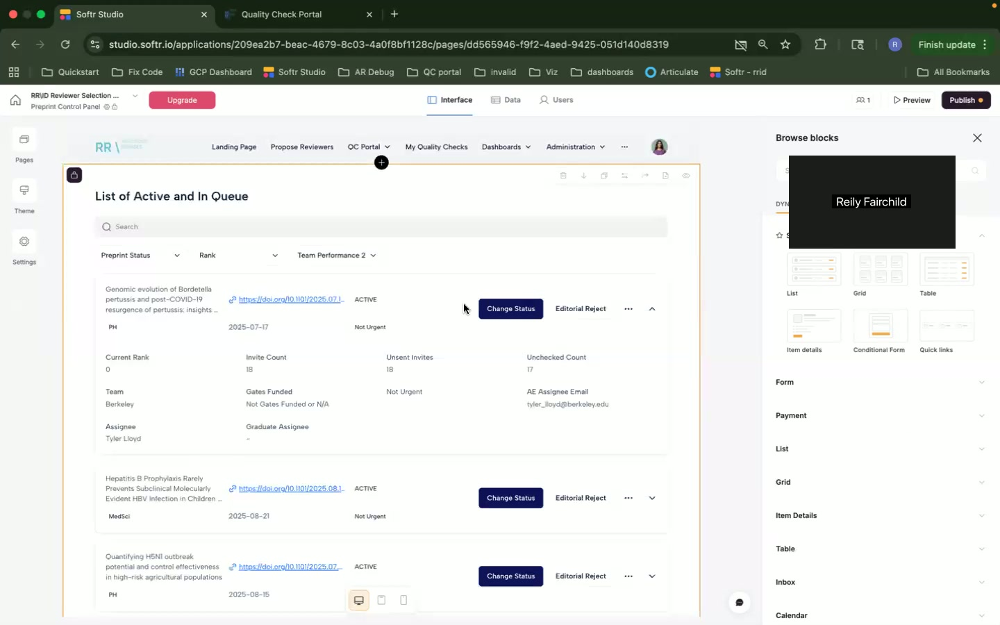

2.  **All Preprints**:  This list, located below the active queue, contains preprints that may need additional reviewers or that have received the requisite number of reviews for invitation. A "Add Reviewers" button is available for each preprint in this section.

3.  **Update Preprint Information**: A table allowing central team members to update key preprint metadata. This table includes columns such as status, title, DOI link, assigned team, domain, and reviewer. Importantly, an "Edit" button (within the 'Actions' tab when configuring the table block - 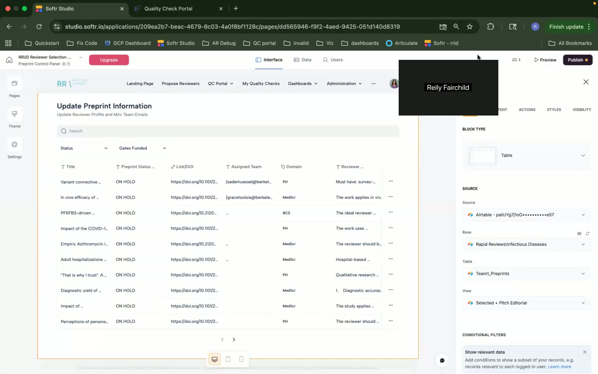) is available, which triggers a modal window for updating the data. The available fields within the edit modal are customizable via the Softr interface. 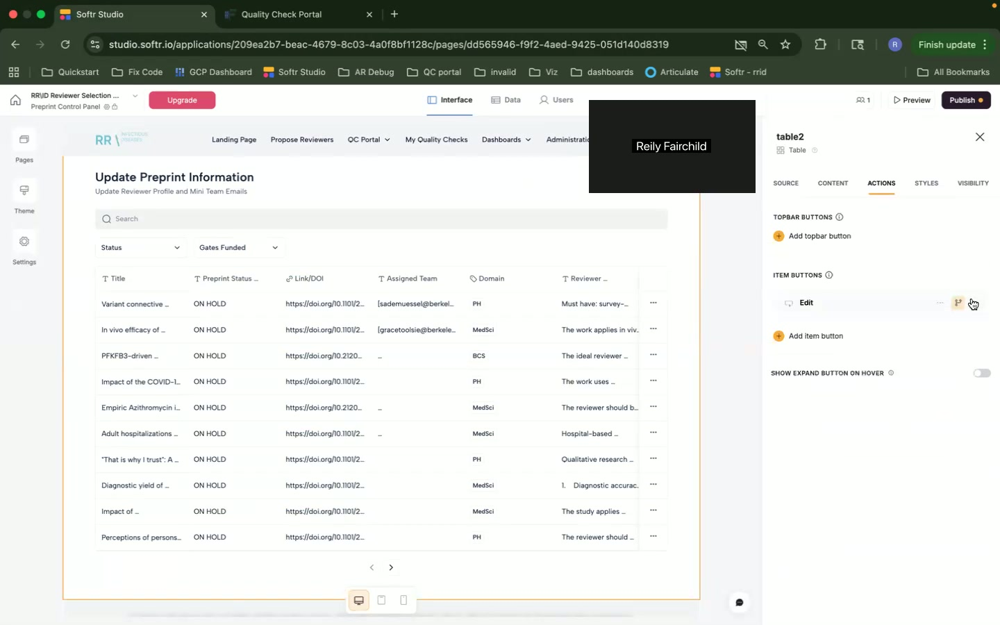 shows options like "Reviewer Profile(discipline)", "Reviewer Profile(method expertise)", "Domain", "Mini Team Emails", and "AE Assignee Email"

4.  **User Database Management**: A table displaying user information, including name, email, role, team, domain, and units. The central team can search for specific users by name or email, and can update user information by clicking "Update".  When editing a user record 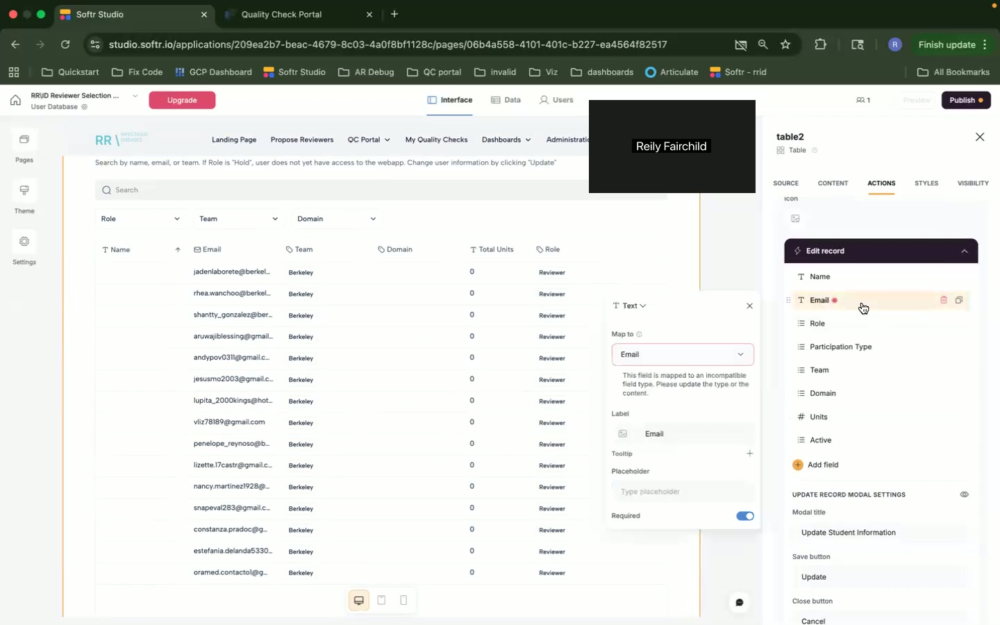 illustrates the field mappings that connect the Softr UI to the underlying Airtable data. This allows the central team to manage user roles, team assignments, and contact details without direct access to Airtable. There appears to be a validation error with the "Email" field shown in 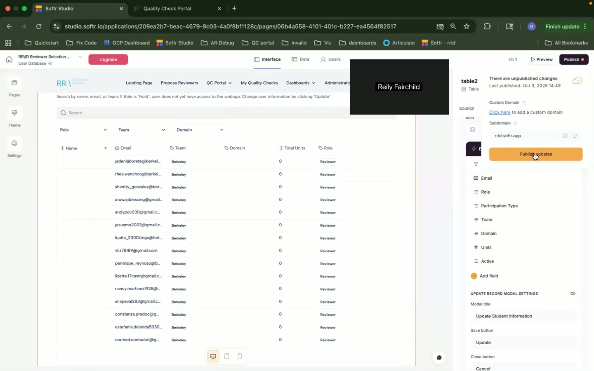.

5. **Profi Dashboard**: This appears to be an embedded Airtable interface for monitoring system performance metrics.

6. **Invited Preprints**: As noted by the speaker, this section is currently not in use, but represents a potential area for development related to reviewer assignment and follow-up automation.

The central team can interact with these elements through various actions:

*   **Changing preprint status**: Using the "Change Status" button to update a preprint's progress in the review process.
*   **Rejecting preprints**: Using the "Editorial Reject" button to remove a preprint from consideration.
*   **Adding reviewers**: Using the "Add Reviewers" button to assign reviewers to a preprint.
*   **Editing preprint information**: Clicking the "Edit" button in the "Update Preprint Information" table, which opens a modal form for modifying preprint metadata.
*   **Updating user information**: Clicking the "Update" button in the user table to modify a user's details.
*   **Searching for users**: Using the search bar above the user table to quickly locate specific user records.
*   **Filtering preprints**: Using filters on the table to narrow down the list of preprints being viewed.

The application implements role-based access control, ensuring that only authorized central team members can access and modify these administrative dashboards.

---

### Notable Timestamps

*   **15:34**: The speaker highlights that the student view is filtered to only show outcomes of *their* proposed reviewers, not other students.
*   **15:56**: The speaker states the "Preprint Control Panel" is only visible to the central team, which manages preprint information.  shows the "List of Active and In Queue" preprints.
*   **16:16**: The speaker emphasizes the central team's ability to control preprint status, ranking, and information.  This functionality is shown in 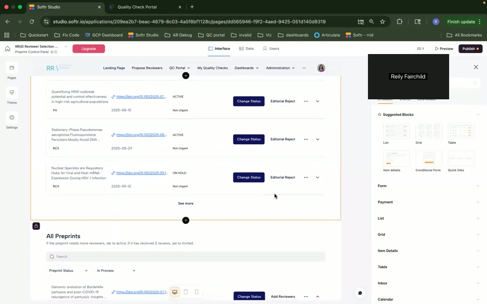 which shows an "Update Preprint Information" table.
*   **16:36**: The speaker explains how the central team configures editable fields within the Softr interface for preprints. The "Actions" tab in the Softr builder lets you define what fields in a table row can be edited.  This is illustrated in 
*   **16:47**: The speaker describes the user database management functionality, enabling the central team to update user data without accessing Airtable.  This is shown starting in 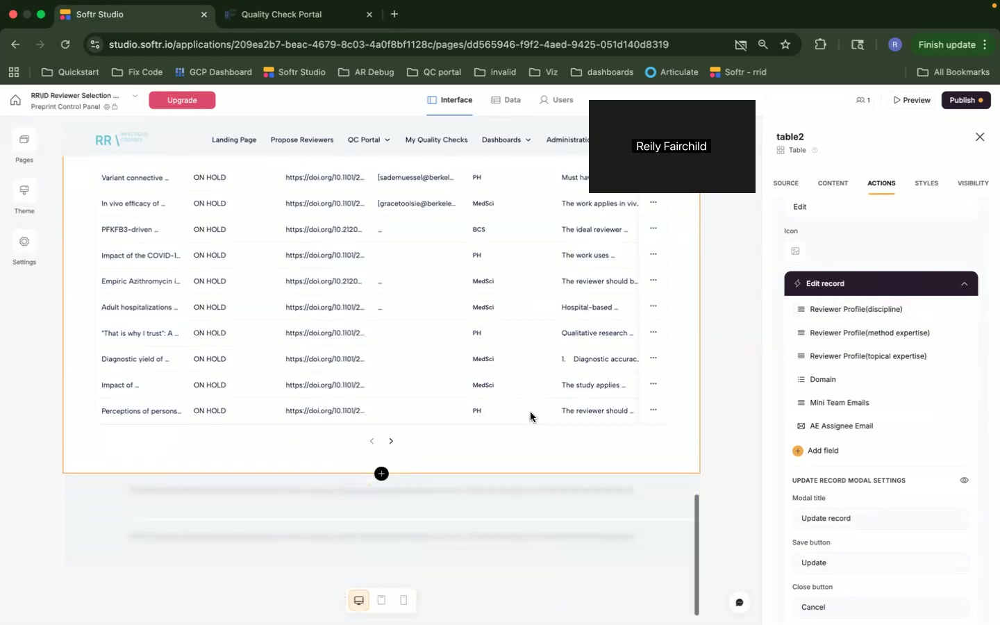
*   **17:38**: The speaker mentions the "Profi dashboard" which is an embedded Airtable interface.
*   **17:47**: The speaker states that the "Invited Preprints" feature is not really in use, but was an idea for improving automations related to finding and receiving reviews.

---


## Chapter 8: Central Team Dashboards: Productivity and Training

This chapter delves into the dashboards utilized by the central team, focusing primarily on productivity tracking and achievement/training progress. The speaker describes the intended functionality and data visibility for these roles. We will analyze the Softr UI and inferred Airtable integrations.

### Key Takeaways

- The central team utilizes several dashboards within the Softr application, including "Productivity Dashboard" and "Achievement and Training Dashboard."
- The "Productivity Dashboard" is intended to provide insights into student productivity, AE productivity, team performance, and domain performance. This dashboard relies heavily on embedded Airtable views and interfaces, indicated by "custom code" placeholders.
- The "Achievement and Training Dashboard" tracks onboarding progress and achievements related to RID-specific, reviewer proposal-specific, and preprint pitching-specific tasks. This dashboard is connected to a dedicated Airtable base.
- Some of the dashboards and specific views might be outdated, necessitating previewing and potential updates.

### Detailed Description

The chapter focuses on the "Productivity Dashboard" and "Achievement and Training Dashboard," both crucial for the central team's operational oversight. The "Productivity Dashboard" (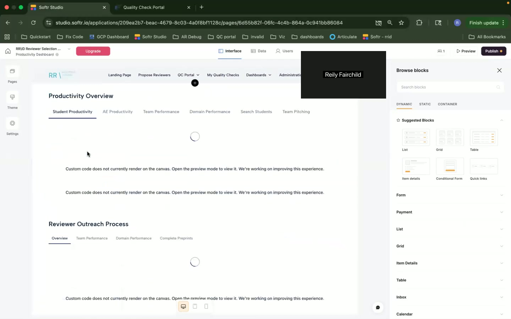) is designed to provide a comprehensive overview of various performance metrics.  This includes student productivity, Assistant Editor (AE) productivity, team performance, domain performance, and search functionality for students and team pitching data. The intended layout includes multiple tabs for "Student Productivity," "AE Productivity," "Team Performance," "Domain Performance," "Search Students," and "Team Pitching."  Beneath these top-level tabs, a secondary navigation likely provides further segmentation, as suggested by the "Overview," "Team Performance," "Domain Performance," and "Complete Preprints" tabs visible in the UI.

However, the screenshots reveal a critical detail: the "Productivity Dashboard" largely consists of placeholders indicating "Custom code does not currently render on the canvas. Open the preview mode to view it. We're working on improving this experience."  This strongly suggests that the dashboard components are implemented using embedded code, most likely leveraging Airtable embeds or interfaces. Examining the Softr studio interface, when the "Productivity Dashboard" is selected, the right-hand panel displays "custom-code9" with the following visible code:

```html
<iframe
  class="airtable-embed"
  src="https://airtable.com/embed/appdl6fXKjCj6f7n0?..."
  frameborder="0"
  onmousewheel=""
  style="width: 100%; height: 100vh; background:..."
>
</iframe>
```

This snippet confirms that Airtable embeds are the primary method of presenting data within this dashboard.  The code specifies the `src` attribute, pointing to a specific Airtable embed URL. This also reveals that the embed is styled to occupy 100% of the available width and viewport height (`height: 100vh`), ensuring a full-screen presentation within the dashboard panel.

The speaker explicitly mentions Airtable interfaces and views as the sources for these embeds.  This indicates a deliberate choice to leverage Airtable's data management capabilities and presentation flexibility within the Softr application.  Airtable's interfaces allow for curated data views and interactive elements tailored to specific user roles, while standard views offer a more direct representation of the underlying data tables.

The "Achievement and Training Dashboard" (), on the other hand, appears to be more directly connected to Airtable data dedicated to training progress. This is reflected in the speaker's comment that the dashboard is linked to an Airtable base named "training dashboard" (or similar). The intended functionality focuses on onboarding and continuous learning. The UI exhibits tabs for "My Overview," "RID Essentials," "Peer Reviewer Selection," "Preprint Pitching," and "Visualizations." The speaker highlights the presence of badges associated with different areas (RID-specific, reviewer proposal-specific, and preprint pitching-specific) indicating a gamified approach to tracking progress and achievement.  The screenshots show badges at the top of each tab, reinforcing this point ().

It is also important to note the existence of a "Help" page (), containing "Video Tutorials" and "Airtable and Softr Tutorial Videos."  This page suggests a concerted effort to provide users with readily accessible documentation and guidance, although the speaker notes that some of this material is outdated. The page lists tutorials like "Preprint Selection Portal", "How to Propose Reviewers", "Quality Check Portal (for AEs)" and "Quality Check Portal (for Students)". These titles suggest a variety of user roles and workflows supported by the application. The inclusion of Airtable tutorial videos, like "Intro to Airtable", "Airtable - Reviewer Selection", and "Airtable - User Base" highlights the importance of understanding Airtable for effective utilization of the Softr application.

Overall, the central team dashboards are designed to provide critical data insights and track training progress, primarily leveraging Airtable as the data backend and utilizing embeds to display information within the Softr interface.

### Important UI Elements and Interactions

**Productivity Dashboard:**

*   **Top-level Tabs:** "Student Productivity," "AE Productivity," "Team Performance," "Domain Performance," "Search Students," and "Team Pitching" - These act as primary navigation for different aspects of productivity.
*   **Secondary Tabs:** "Overview," "Team Performance," "Domain Performance," and "Complete Preprints" - Provide further filtering and data segmentation within the main tabs.
*   **Airtable Embeds:** Embedded Airtable views and interfaces display the actual data. The speaker suggests that the central team can preview these to understand the data and their roles.  The embedded code snippet reveals that the Airtable content is presented within an `<iframe>`, limiting direct interaction with the embedded elements from within the Softr interface.
*   **Message: "Custom code does not currently render on the canvas. Open the preview mode to view it. We're working on improving this experience."** This is a crucial element, suggesting that the Softr studio struggles to render the embedded content directly within the design environment. Users must rely on the preview mode to visualize the actual data.

**Achievement and Training Dashboard:**

*   **Top-level Tabs:** "My Overview," "RID Essentials," "Peer Reviewer Selection," "Preprint Pitching," and "Visualizations" - Organize training materials and progress tracking by category.
*   **Badges:** Visual indicators of achievement within each category. These provide immediate feedback on the user's progress.
*   **Underlying Airtable base:** The speaker mentions a dedicated Airtable base that populates the dashboard.

**General UI Elements:**

*   **Pages Menu:** Located on the left sidebar, allows navigation between different dashboards and sections of the application. The screenshot at  shows the list of available pages.
*   **Top Navigation:** "Landing Page", "Propose Reviewers," "QC Portal", "My Quality Checks", "Dashboards", "Administration" and "Data." - Provides quick access to different sections of the app.

**Interactions:**

*   Users likely interact with the dashboards primarily by navigating between tabs and viewing the embedded Airtable content.
*   The "Achievement and Training Dashboard" potentially allows for more direct interaction through links to training materials and tracking of completed tasks within the underlying Airtable base.
*   The speaker hints at role-based differences in access and data visibility, suggesting that the dashboards are tailored to the needs of different user groups within the central team (e.g., those tracking student productivity vs. those focusing on AE performance).

### Notable Timestamps

*   **18:02 - 18:09:** The speaker introduces the role of central team members (like "Angel") in updating reviews. This highlights the collaborative aspect of the platform, allowing for centralized tracking and intervention. 
*   **18:24 - 18:34:** The "Help" page is discussed, including outdated tutorial videos. This points to a need for maintaining up-to-date documentation to ensure effective user onboarding. 
*   **18:40 - 18:48:** Introduction of the "Productivity Dashboard" and its intended purpose in organizing various performance metrics. The screenshot shows the various tabs for accessing Student Productivity, AE productivity and other data.  
*   **19:07 - 19:19:** The speaker mentions custom code, revealing that the data is displayed using Airtable embeds. This highlights the reliance on Airtable for data management and visualization.  A snippet of the actual HTML embed code is visible in the right panel of the screen. 
*   **19:52 - 19:59:** Introduction of the "Achievement and Training Dashboard," which is connected to a dedicated Airtable base.  This suggests a more direct and structured approach to tracking training progress. 
*   **20:14 - 20:28:** Discussion of badges and training pillars, emphasizing the gamified aspect of onboarding and continuous learning.  The various badge categories for different reviewer specializations are visible.  

---


## Chapter 9: Tracking Progress and Configuring Header Navigation

This chapter delves into how the Softr application allows users to track their progress and how the header navigation is configured and customized within the Softr Studio environment. We'll examine the user interface elements related to progress tracking, specifically the dashboard displaying key performance indicators (KPIs) for students. Additionally, we'll explore the settings available for customizing the header navigation, including visibility and link arrangement.

### Key Takeaways

- The application enables students to track key metrics related to their performance, providing insights into their "green light rate" and progress towards passing requirements.
- The "Achievement and Training Dashboard" page provides a visual overview of student progress using badges and summary metrics.
- Softr Studio provides granular control over header navigation elements, including which user groups can view specific links and the order in which those links appear.
- The configuration panel for navigation allows for extensive customization of the application's top-level menu.
- The application leverages Airtable as its data source, displaying dynamic information retrieved from Airtable bases.

### Detailed Description

The chapter begins with a brief discussion of progress tracking and the potential for a deeper dive into "eduetech" aspects in a separate session.  The presenter then shifts the focus to demonstrating how students can track their progress and success within the application. This involves reviewing a student dashboard that showcases key metrics, indicating areas of accomplishment and areas needing improvement.  The discussion highlights the "green light rate" as a crucial performance indicator.  initially shows a blank canvas in Softr Studio, likely representing the area where a block will be added or configured. This transitions into a list of tasks that are being tracked.  shows a list of "To Do" and "Complete" items. The completion of items is shown with a badge.

The focus moves to a specific dashboard, the "Achievement and Training Dashboard". The UI reveals a section displaying "My Badges - RR\\ID and WebApp Essentials". This utilizes visually appealing circular badges labeled "RR\\ID Essentials" and "WEBAPP Essentials". These badges likely represent milestones or completed modules. Beneath the badges are links to "My Overview," "RR\\ID Essentials," "Peer Reviewer Selection," "Preprint Pitching," and "Visualizations," suggesting a tab-based navigation system within the dashboard.  The data source for this information is revealed to be Airtable, specified as "Airtable - pat07Yp7S0c*******sd57," providing insight into the application's backend integration.  Specific tables being used from the Airtable base includes the "Training Modules" table and "Student Training Tracking" table, based on the select boxes that are visible. Conditional filters are available to show records based on a subset of a user's records.

 shows an example of a student's progress metrics. The presenter emphasizes the importance of students receiving direct feedback in the form of easily understandable numbers that reflect their progress. The application interface is displaying data related to a specific student, "Rousselinne Gomez."  Her profile displays her name, email address, and a field for "Student" as her role. Below this are several important key metrics:

*   **Units:** 3
*   **Domain:** RM
*   **% Expected Greenlit Achieved:** 31
*   **Total Input (Proposed, CGI Checked, Student Reject):** 31
*   **Total Proposed & Student Reject:** 31
*   **Total Proposed:** 31
*   **Total Student Reject:** 0
*   **Total # Greenlits (%):** 29 (97%)
*   **Total # Reject (%):** 1 (3%)
*   **Total Greenlit - AI Supported:** 2
*   **Total Greenlit - not AI Supported:** 27
*   **Total Invite Backup:** 0
*   **Total Unchecked:** 0
*   **Preprints Selected:** 1
*   **Editorial Pitched Cumulative:** 1
*   **Total Preprints Claimed:** 1
*   **Team Pitched Cumulative:** 1

The UI provides clear indicators of a student's approval rate, rejection rate, and overall progress. This dashboard likely utilizes data aggregation and calculation features within Softr or Airtable to derive these KPIs from underlying data. The data displayed is highly specific and tailored to the individual student.

Finally, the discussion transitions to the header navigation. The speaker demonstrates how to access and modify the header settings within the Softr Studio.  shows the navigation customization panel, where you can define who has access to each navigation link.  The settings allow the administrator to control the visibility of navigation items based on user groups ("Staff" and "Central" are displayed as selected groups) and device type (desktop/mobile).   shows the full list of navigation items in the primary navigation, and enables the user to drag and drop to rearrange.

### Important UI Elements and Interactions

*   **List Blocks:** Used to display lists of tasks and modules with completion statuses. Users likely interact with these lists to mark items as complete or view details.
*   **Badge Elements:** Visual indicators of progress and completion, likely linked to data from Airtable.
*   **KPI Dashboard:** A dedicated page displaying key metrics related to student performance. Users likely access this dashboard to track their progress and identify areas for improvement.
*   **Navigation Menu:** The primary navigation menu allows users to access different sections of the application. The menu links include "Landing Page", "Propose Reviewers", "QC Portal", "My Quality Checks", "Dashboards", "Administration," "My Badges," "Log In," and "Sign Up".
*   **Navigation Configuration Panel:** A section within Softr Studio that allows administrators to customize the header navigation. This includes setting visibility rules based on user groups and device type, and reordering the menu items.
*   **"Add Profile Photo" Button:**  Located on the individual student's dashboard, allowing them to personalize their profile.
*   **Airtable Integration:** Evidenced by the "Airtable - pat07Yp7S0c*******sd57" identifier, this integration pulls data from specified Airtable bases and tables to populate the application's content.

Users interact with the interface primarily through clicking navigation links, viewing dashboards, and interacting with list elements. Administrators interact with the interface through the Softr Studio, configuring navigation, managing user access, and potentially modifying data within the linked Airtable base. The UI is designed to provide a clear and intuitive overview of progress and key performance indicators. The use of visual elements like badges and charts helps to make the data more accessible and engaging for users. The ability to customize the header navigation ensures that users have easy access to the most relevant sections of the application.

### Notable Timestamps

*   **20:37:**  Initial view of the Softr Studio, showing a blank canvas before a block is added to track "progress".
*   **20:48:**  Display of the "To Do" and "Complete" items.
*   **20:54:**  Introduction to the "Achievement and Training Dashboard" with badges representing completed modules.
*   **21:10:**  Focus shifts to displaying key metrics for a specific student, "Rousselinne Gomez".
*   **21:21:**  A closer look at the KPIs related to "green light rate" and other important metrics.
*   **21:37:**  Introduction to the header navigation configuration panel, showing visibility settings.
*   **21:45:**  Display of the list of navigation items, in the navigation customization panel.
*   **21:55:**  Final view of the navigation customization panel.

---

