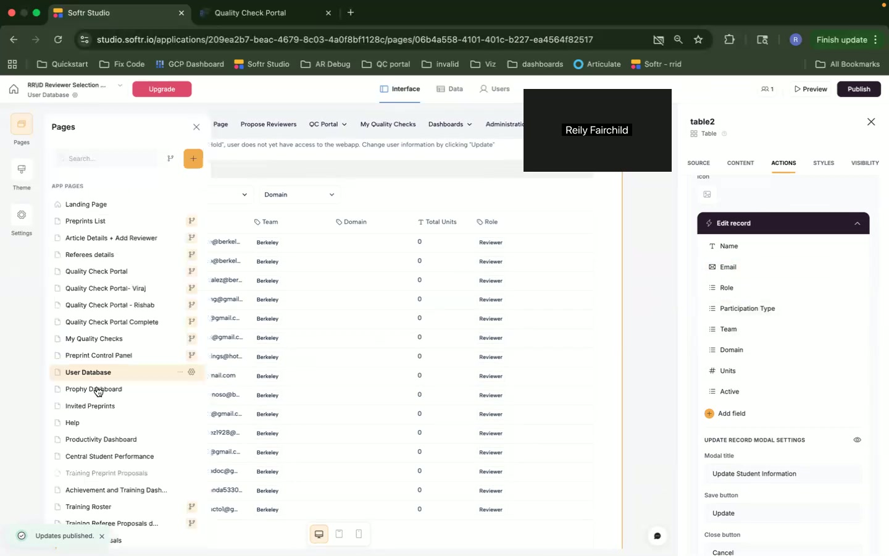
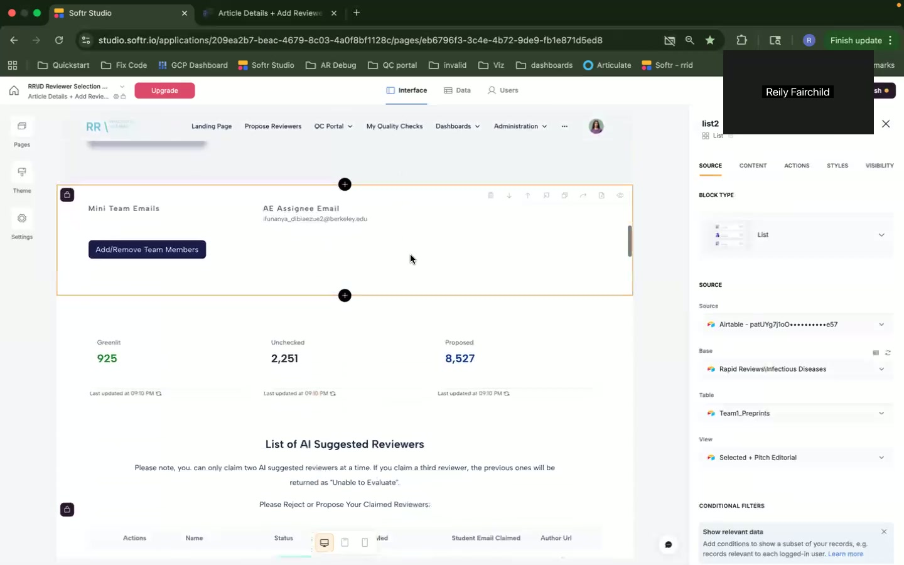
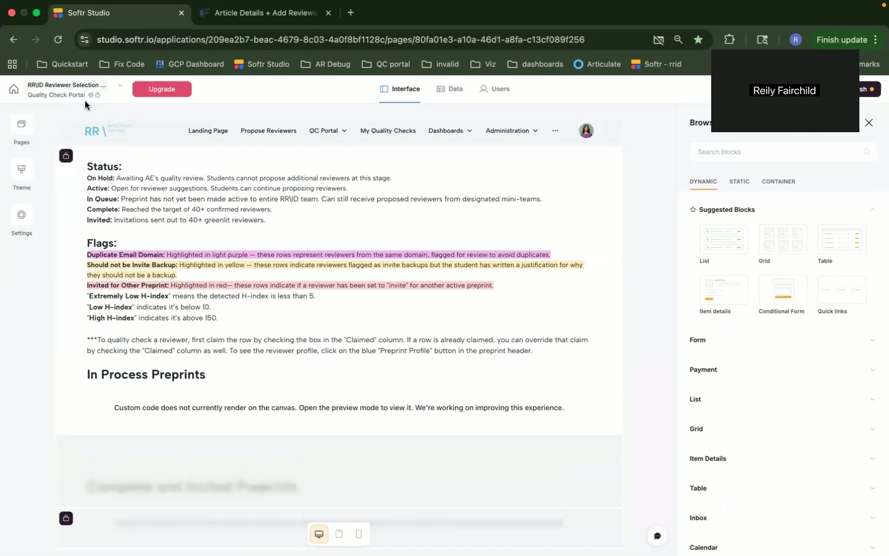
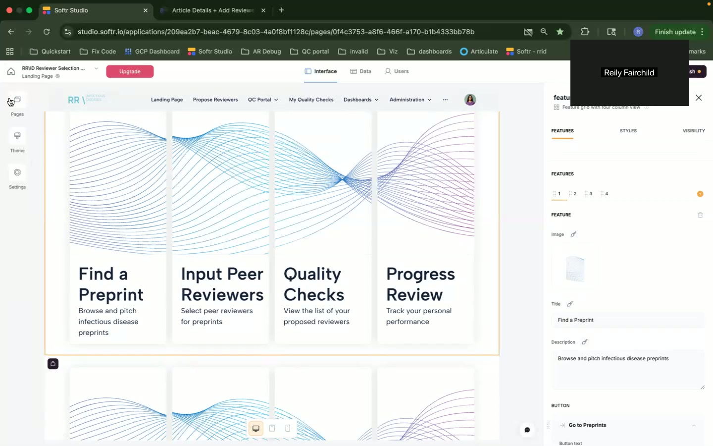
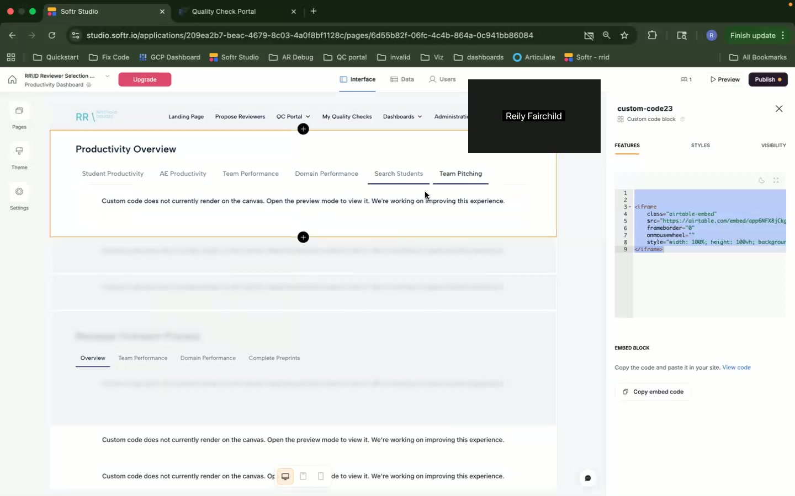
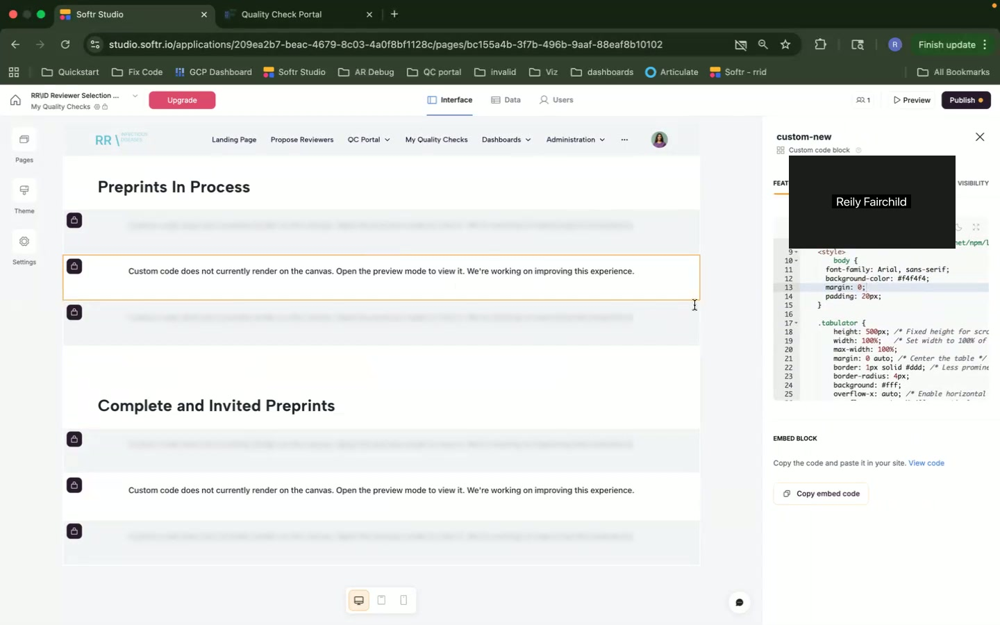

# Enriched Personas, User Stories, and User Journeys

Okay, here is a detailed analysis of the provided screenshots, creating user personas, user stories, feature mapping, and user journeys based on the visible UI elements of the Softr peer review management application.

**1. User Personas**

Based on the screenshots, I can identify at least three distinct user roles:

*   **Persona 1: The Administrator (Reily Fairchild):**

    *   **Role and Background:** Reily Fairchild appears to be an administrator or a super-user of the system.  The presence of the "Administration" navigation item and the ability to access and edit user data suggest a high level of access. The screen sharing window shows a profile picture/avatar. The admin likely works at an institution (inferred from the @berkeley.edu email domains visible in other screenshots).
    *   **Goals and Motivations:**
        *   To configure and manage the application effectively.
        *   To monitor the overall progress of the peer review process.
        *   To ensure data integrity and system stability.
        *   To optimize the workflow for all users.
    *   **Pain Points and Challenges:**
        *   Potential complexity in configuring the application.
        *   Ensuring all users understand the system.
        *   Managing user access and permissions.
        *   Troubleshooting technical issues.
    *   **Technical Skill Level:** High.  They need to be comfortable with UI/UX design principles within the Softr editor (the screenshots show modifications in real-time), data management, and potentially some coding (custom code blocks are visible).
    *   **How They Use the Application:**
        *   Customizing the application's appearance and functionality.
        *   Managing user accounts and permissions (can edit user records, )
        *   Monitoring application performance.
        *   Potentially configuring workflows.
        *   Publishing changes to the live application (the "Publish" button is visible).

*   **Persona 2: The AE Assignee (likely a Staff Member at Berkeley):**

    *   **Role and Background:** This user is responsible for assigning articles/preprints to reviewers.  The "AE Assignee Email" section ([]) suggests a specific role in the workflow.  This could be a staff member within a research group, department, or the institution's review board. The email address (e.g., "ruranczyk@berkeley.edu") implies an affiliation with a specific institution.
    *   **Goals and Motivations:**
        *   To efficiently assign articles to appropriate reviewers.
        *   To ensure a fair and balanced review process.
        *   To track the progress of reviews.
        *   To resolve any conflicts or issues that arise during the review process.
    *   **Pain Points and Challenges:**
        *   Identifying qualified reviewers for specific articles.
        *   Managing reviewer workload and availability.
        *   Resolving reviewer conflicts of interest.
        *   Following up with reviewers to ensure timely completion of reviews.
    *   **Technical Skill Level:** Moderate. They likely need to be comfortable using the application to search for reviewers, assign articles, and track progress. They may not need deep technical knowledge.
    *   **How They Use the Application:**
        *   Searching for reviewers based on expertise.
        *   Assigning articles to reviewers.
        *   Monitoring the status of reviews.
        *   Potentially communicating with reviewers through the application.

*   **Persona 3: The Reviewer (likely a Student):**

    *   **Role and Background:** The reviewer is responsible for evaluating preprints and providing feedback. The mention of "students" in the "Status" section ([]) indicates that students are likely involved in the review process, possibly as part of a course or research program.  The ability to "claim" preprints ([]) also points to reviewer roles. The term "Greentlit" is also associated with the Reviewer.
    *   **Goals and Motivations:**
        *   To provide constructive and helpful feedback on preprints.
        *   To gain experience in the peer review process.
        *   To contribute to the advancement of research.
        *   Potentially, to fulfill course requirements or earn credit.
    *   **Pain Points and Challenges:**
        *   Understanding the criteria for evaluating preprints.
        *   Providing clear and concise feedback.
        *   Managing their time effectively to complete reviews.
        *   Dealing with conflicting viewpoints or feedback.
    *   **Technical Skill Level:** Basic to Moderate. They need to be able to navigate the application, access preprints, and submit reviews.
    *   **How They Use the Application:**
        *   Accessing assigned preprints.
        *   Reading and evaluating preprints.
        *   Submitting reviews and feedback.
        *   Potentially communicating with other reviewers or the AE Assignee.
        *   Track their 'Greentlit' score/progress.

**2. User Stories**

Here are some user stories based on the identified personas and UI elements:

*   **User Story 1: As an Administrator, I want to customize the application's landing page, so that new users are greeted with a clear and informative introduction to the peer review process.**

    *   Acceptance Criteria:
        *   I can modify the text, images, and layout of the landing page.
        *   I can preview the changes before publishing them.
        *   The landing page is responsive and displays correctly on different devices.
    *   Priority: High
    *   Related Pages/Features: Landing Page editor ([]), Theme settings.

*   **User Story 2: As an AE Assignee, I want to quickly find potential reviewers based on their domain of expertise, so that I can efficiently assign preprints to the most qualified individuals.**

    *   Acceptance Criteria:
        *   I can search for reviewers by domain (e.g., "Berkeley").
        *   I can see a list of reviewers with their corresponding expertise.
        *   I can view reviewer profiles to get more information about their qualifications.
    *   Priority: High
    *   Related Pages/Features: Propose Reviewers page, User Database ([]).

*   **User Story 3: As a Reviewer, I want to easily access a list of preprints that have been assigned to me, so that I can start reviewing them promptly.**

    *   Acceptance Criteria:
        *   I can see a list of preprints assigned to me.
        *   The list includes key information such as the title, author, and abstract of each preprint.
        *   I can click on a preprint to view the full text and submit my review.
    *   Priority: High
    *   Related Pages/Features: My Quality Checks, Quality Check Portal.

*   **User Story 4: As an Administrator, I want to understand the productivity of students, so that I can make data-driven decisions for future planning.**

    *   Acceptance Criteria:
        *   I can view the performance of each student.
        *   I can see key metrics such as the number of preprints reviewed and the quality of their feedback.
    *   Priority: Medium
    *   Related Pages/Features: Productivity Dashboard ([]).

**3. Feature Mapping**

Here's a mapping of features to personas based on UI visibility:

*   **Administrator:**
    *   Landing Page customization
    *   Theme customization
    *   User management
    *   Productivity Dashboards (Student Productivity, AE Productivity, Team Performance, Domain Performance, Search Students, Team Pitching)
    *   Custom Code Blocks ([], [])
    *   Publishing
*   **AE Assignee:**
    *   Propose Reviewers
    *   Assign Reviewers (Add/Remove Team Members functionality)
    *   Review Status Tracking (Unchecked, Proposed counts)
    *   AI Suggested Reviewers
*   **Reviewer:**
    *   My Quality Checks
    *   Quality Check Portal
    *   Claiming Preprints
    *   Review Submission
    *   Preprint Access

**4. User Journeys**

Here are some user journeys based on the navigation and interactions visible in the screenshots:

*   **User Journey 1: Administrator Customizing the Landing Page**

    *   Entry Point: Softr Studio Dashboard.
    *   Task Flow:
        1.  Clicks on "Pages" in the left navigation.
        2.  Selects "Landing Page" from the list of pages.
        3.  Uses the right-hand panel (Softr editor) to modify the text, images, and layout of the landing page (e.g., modifying the title of the "Find a Preprint" feature).  This involves interacting with the "Features," "Styles," and "Visibility" tabs in the editor.
        4.  Previews the changes.
        5.  Clicks the "Publish" button to make the changes live.
    *   Exit Point: Softr Studio Dashboard or the live application.
    *   Decision Points: Whether to preview changes before publishing, choosing different layout options, selecting different images.

*   **User Journey 2: AE Assignee Assigning a Reviewer**

    *   Entry Point:  The "Propose Reviewers" page (accessible from the main navigation).
    *   Task Flow:
        1.  Searches for potential reviewers (likely by domain or keywords - although a search bar is not visible)
        2.  Reviews the list of AI Suggested Reviewers.
        3.  Examines reviewer profiles (not explicitly visible, but likely possible by clicking on a reviewer's name).
        4.  Adds or removes reviewers from a team (using the "Add/Remove Team Members" functionality).
        5.  Confirms the assignment.
    *   Exit Point: "Propose Reviewers" page or a page showing the status of the review process.
    *   Decision Points: Selecting the most appropriate reviewers based on their expertise and availability.  Accepting or rejecting AI-suggested reviewers.

*   **User Journey 3: Reviewer Accessing and Claiming a Preprint**

    *   Entry Point: Likely a notification (email or in-app) or the "My Quality Checks" page.
    *   Task Flow:
        1.  Navigates to the "My Quality Checks" or "Quality Check Portal" page.
        2.  Views a list of preprints that are available to be claimed/reviewed (possibly split into "Preprints in Process" and "Complete and Invited Preprints" sections).
        3.  Locates a preprint they want to review.
        4.  Clicks a button (implied, not explicitly visible) to "Claim" the preprint.
        5.  Accesses the full text of the preprint.
    *   Exit Point: The preprint viewing page.
    *   Decision Points: Choosing which preprint to claim.

**5. Screenshots and Context**

The screenshots are referenced above in each section. They provide the visual context for the personas, user stories, feature mapping, and user journeys.  Key observations from the screenshots are:

*   **Softr UI**: The application is built on Softr, which is evident from the Softr Studio interface and the right-hand editor panels.
*   **Airtable Integration**: The "Source" section in the editor shows that the data is sourced from Airtable (pat7gp7yYSc...e57, Base: Rapid Review Infectious Diseases), which suggests that the application is using Airtable as its backend database.
*   **Custom Code**: The presence of custom code blocks shows that the application is being customized beyond the standard Softr features. However, the custom code elements are not rendering in the canvas, this points to potential limitations in the development process.
*   **Peer Review Focus**: The application is centered around peer review of preprints, specifically focusing on infectious diseases.
*   **Student Involvement**: Students are actively involved in the review process.
*   **Workflow Stages**: Different statuses of preprints (On Hold, Active, In Queue, Complete) are displayed.
*   **Data Visualization**: Data visualization exists (Greentlit score).

This analysis should provide a solid foundation for understanding the users and workflows within this Softr peer review management application. Remember that this is based *only* on the provided screenshots, and more information would be needed for a truly comprehensive understanding.
