# Enriched Product Requirements Document (PRD)

Okay, here's a detailed PRD based on the provided Softr screenshots.

# Product Requirements Document: RRID Reviewer Selection System

## 1. Executive Summary

This document outlines the product requirements for a peer review management system called "RRID Reviewer Selection." Built on Softr and integrated with Airtable, the system aims to streamline the process of finding, proposing, and managing reviewers for preprints (and possibly published articles).  The system appears to focus on identifying appropriate reviewers based on the article's topic and various reviewer attributes. The system tracks preprint details, reviewer information, quality checks, and potentially reviewer performance. Key features include the ability to propose reviewers, claim articles for review, evaluate reviewers, and integrate with internal data such as training records.

## 2. Page-by-Page Specifications

### 2.1 Landing Page

*   **Purpose:** The landing page serves as the entry point for the application, providing an overview of the system's functionality and navigation to key features.
*   **URL/Navigation Path:**  `/` (Presumed based on its position in the sidebar menu.)
*   
*   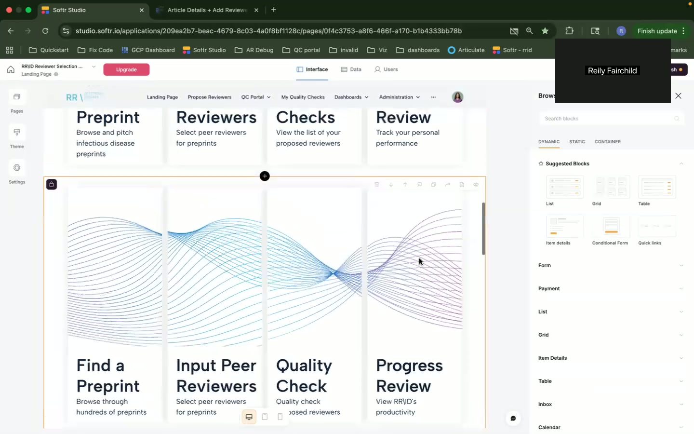
*   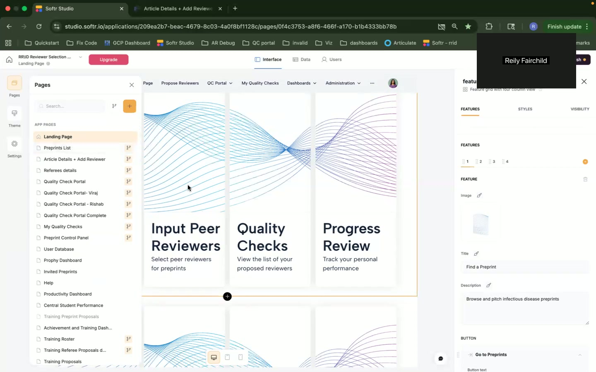
*   **Visual Layout:** The page is divided into four main sections arranged in a two-by-two grid:
    *   **Find a Preprint:** Provides access to browse preprints.
    *   **Input Peer Reviewers:**  Allows users to select peer reviewers for preprints.
    *   **Quality Checks:** Enables viewing a list of proposed reviewers and performing quality checks on them.
    *   **Progress Review:** Tracks the user's personal performance within the system.
*   **UI Components:** Each section contains:
    *   An icon (likely an SVG or image).
    *   A title (e.g., "Find a Preprint").
    *   A brief description (e.g., "Browse and pitch infectious disease preprints").
    *   A button (e.g., "Go to Preprints").
*   **Features and Functionality:** Each section acts as a navigational link to the corresponding feature of the application. The button triggers navigation.
*   **Data Displayed:** No specific data is displayed other than static text and icons.
*   **User Interactions:** Clicking on any of the four buttons redirects the user to the respective page.
*   **Business Logic:** The page simply acts as a dashboard and doesn't contain any complex logic.
*   **Edge Cases/Validation:**  N/A
*   **Airtable Integration Points:** None visible on this page.
*   **Softr-Specific Components:** Uses a Softr Feature Grid block (four columns).

### 2.2 Preprints List (Article Details + Add Reviewer)

*   **Purpose:** This page displays a list of preprints, allowing users to view details and propose reviewers.
*   **URL/Navigation Path:** `/article-details` (Presumed based on its position in the sidebar menu.)
*   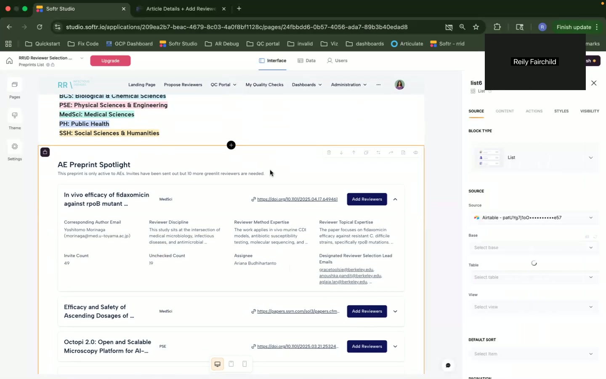
*   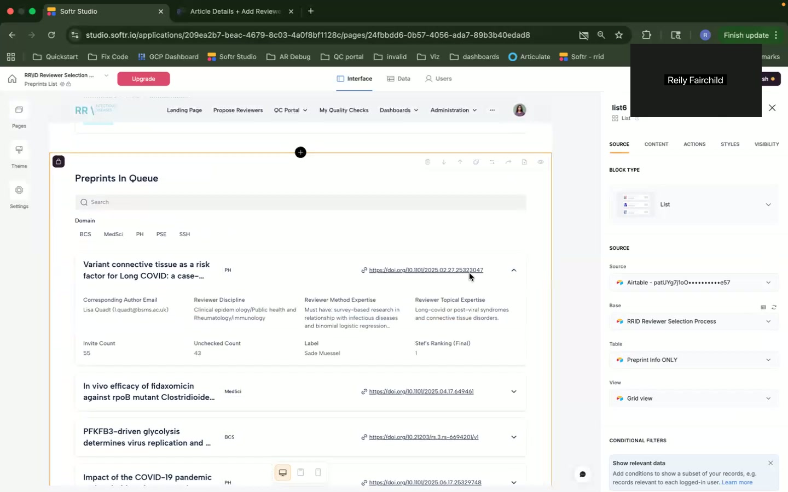
*   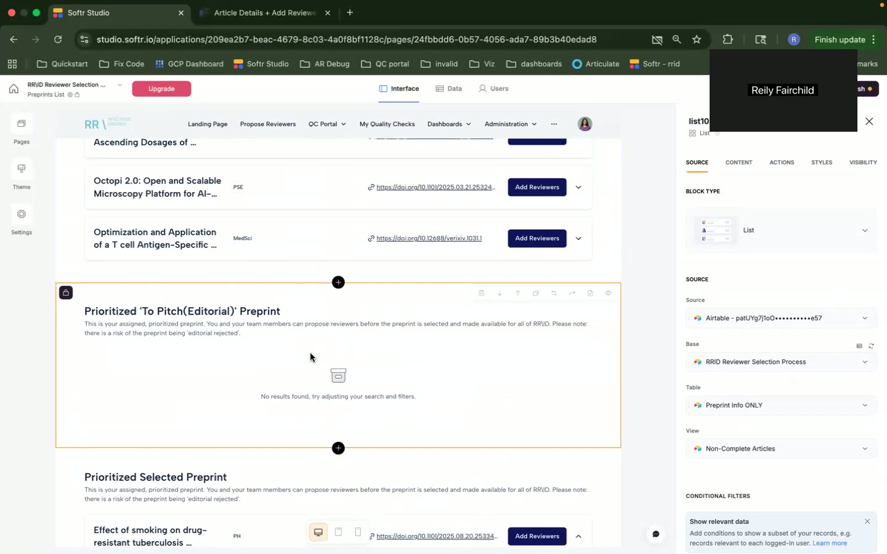
*   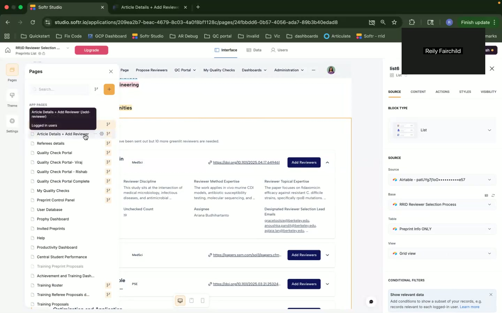
*   **Visual Layout:** The page is divided into the following sections:
    *   **Filters:** A search bar to filter by keyword. Domain filter options are visible: BCS, MedSci, PSE, SSH.
    *   **Preprint List:** A list of preprint items. Each item likely includes the title, the corresponding author, discipline, reviewer expertise, and more.
    *   **Prioritized Preprint Sections:** Sections dedicated to "Prioritized 'To Pitch(Editorial)' Preprint" and "Prioritized Selected Preprint".
*   **UI Components:**
    *   **Search Bar:** Text input for searching preprints.
    *   **Domain Filters:**  Checkboxes or buttons to filter preprints by Domain (BCS, MedSci, PSE, SSH).
    *   **List:** A Softr list component displaying preprints. Each list item likely contains fields such as:
        *   Preprint Title (likely a link).
        *   Corresponding Author Email
        *   Invite Count
        *   Unchecked Count
        *   Reviewer Discipline
        *   Reviewer Method Expertise
        *   Reviewer Topical Expertise
        *   Assignee
        *   Links (likely URL fields from Airtable)
        *   "Add Reviewers" Button
    *   **Text Labels:** For displaying data and providing descriptions.
*   **Features and Functionality:**
    *   **Filtering:** Users can filter the list of preprints by keywords and domain.
    *   **Viewing Details:** Clicking on a preprint title likely leads to a detailed view of the preprint (not shown in these screenshots).
    *   **Adding Reviewers:**  The "Add Reviewers" button allows users to propose reviewers for a specific preprint.
*   **Data Displayed:**
    *   Preprint title
    *   Corresponding author's name and email address
    *   Reviewer discipline
    *   Reviewer method expertise
    *   Reviewer topical expertise
    *   Invite Count
    *   Unchecked Count
    *   A link to the document.
    *   The name of the assignee.
*   **User Interactions:**
    *   Typing in the search bar filters the preprint list.
    *   Clicking on the domain filters filters the preprint list.
    *   Clicking on the "Add Reviewers" button likely opens a modal or navigates to a page for proposing reviewers.
    *   Clicking on a preprint title navigates to the preprint details page.
*   **Business Logic:** The list of preprints is filtered based on user input (search and domain). The "Add Reviewers" button triggers the workflow for proposing a reviewer. "Prioritized" articles are displayed separately, possibly based on criteria stored in Airtable.
*   **Edge Cases/Validation:**
    *   No results are displayed when search criteria don't match any preprints. The UI shows "No results found, try adjusting your search and filters."
*   **Airtable Integration Points:**
    *   The list is populated from an Airtable table named "Preprint Info ONLY" within the "RRID Reviewer Selection Process" base.
    *   The data source for the list is configured using the Airtable ID `airtable-patIg7gt9o*******os7`.
*   **Softr-Specific Components:** Softr List block, Search Bar, Filter (domain selection). Conditional filters based on user login may be implemented.

### 2.3 Propose a Reviewer

*   **Purpose:** This page provides a form for proposing a reviewer for a preprint.
*   **URL/Navigation Path:** `/propose-reviewer` (Presumed based on the tab title).
*   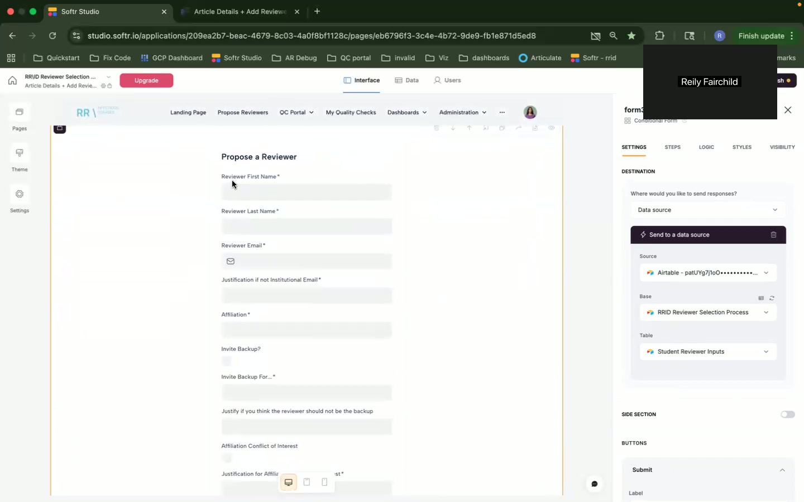
*   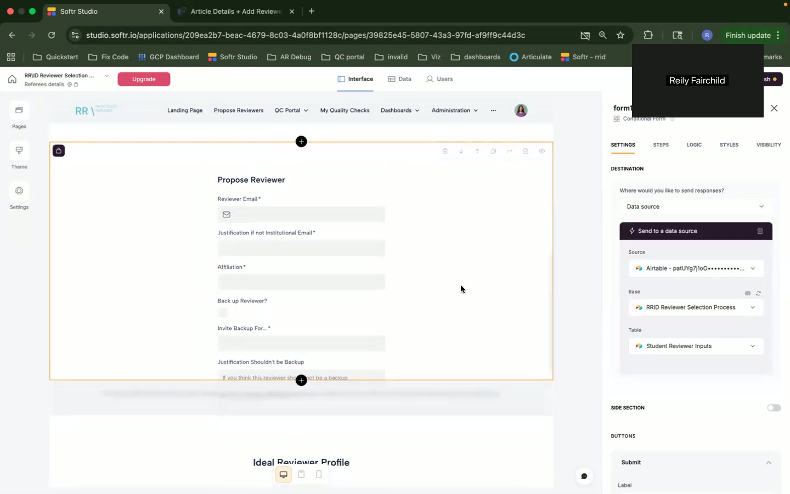
*   **Visual Layout:** The page consists of a form with several input fields, arranged vertically.
*   **UI Components:**
    *   **Form:** A Softr form component.
    *   **Text Input Fields:**
        *   Reviewer First Name (Required)
        *   Reviewer Last Name (Required)
        *   Reviewer Email (Required)
        *   Justification if not Institutional Email (Required)
        *   Affiliation (Required)
        *   Invite Backup? (Likely a select/dropdown/radio button)
        *   Invite Backup For... (Required if "Invite Backup?" is Yes)
        *   Justify if you think the reviewer should not be the backup (Required if "Invite Backup?" is No)
        *   Affiliation Conflict of Interest
        *   Justification for Affiliation Conflict of Interest
        *   Submit Button
*   **Features and Functionality:**
    *   **Proposing a Reviewer:** The form allows users to input information about a potential reviewer.
    *   **Form Validation:** Required fields are enforced. Logic dictates different required fields based on choices such as whether to invite a backup reviewer.
    *   **Data Submission:** Submitting the form saves the data to Airtable.
*   **Data Displayed:**  The form displays input fields for reviewer information.
*   **User Interactions:** Users enter reviewer information into the form fields and submit the form.
*   **Business Logic:** The form's validation logic enforces data requirements.  The form submission triggers an Airtable record creation.
*   **Edge Cases/Validation:**
    *   Required fields must be filled before submitting the form.
    *   Conditional logic governs what fields are required depending on answers (i.e. "Invite Backup?").
*   **Airtable Integration Points:**
    *   Form submissions are sent to the "Student Reviewer Inputs" table in the "RRID Reviewer Selection Process" base.
    *   The data source for the form is configured using the Airtable ID `airtable-patIg7gt9o*******os7`.
*   **Softr-Specific Components:** Softr Form block with configurable fields and validation rules.

### 2.4 Reviewers List

*   **Purpose:** This page displays a list of potential reviewers, likely pulled from the same Airtable database, possibly including details about their areas of expertise and contact information.
*   **URL/Navigation Path:** `/reviewers` or a similar route not explicitly named but implied in the workflow.
*   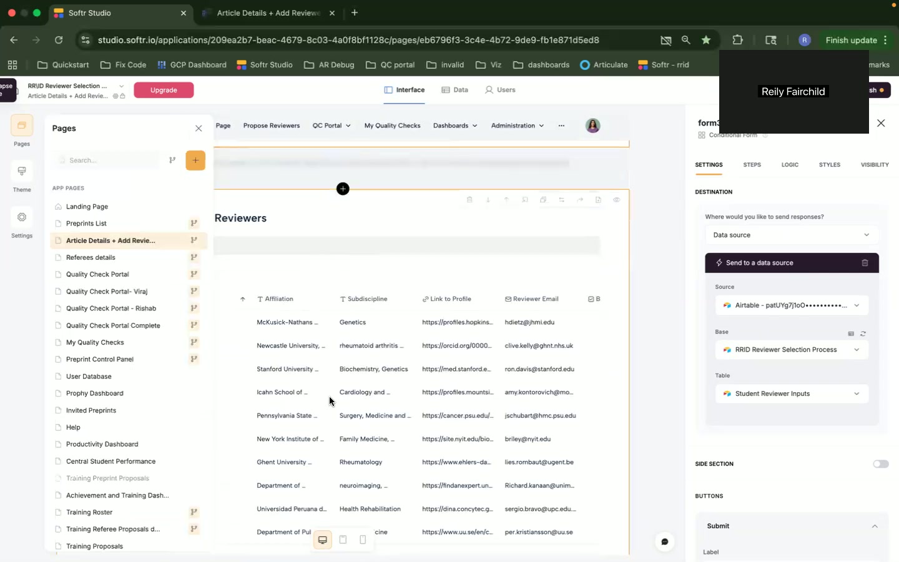
*   **Visual Layout:** The page is organized as a table (Softr Table component), displaying reviewer information in rows and columns.
*   **UI Components:**
    *   **Table:** A Softr table component.
    *   **Column Headers:**
        *   Affiliation
        *   Subdiscipline
        *   Link to Profile
        *   Reviewer Email
*   **Features and Functionality:**
    *   **Viewing Reviewers:** Users can view a list of potential reviewers.
    *   **Potentially Filtering/Sorting:** (Not explicitly visible, but standard for tables).
*   **Data Displayed:**
    *   Reviewer Affiliation (e.g., "McKnick-Nathans...")
    *   Reviewer Subdiscipline (e.g., "Genetics")
    *   Link to Profile (e.g., "https://profiles.hopkins...")
    *   Reviewer Email (e.g., "olive.kelley@ghbit.nhs.uk")
*   **User Interactions:**
    *   Clicking on "Link to Profile" likely opens the reviewer's profile in a new tab.
    *   Potentially sorting by column header (inferred).
*   **Business Logic:** The table likely pulls reviewer data from an Airtable table.
*   **Edge Cases/Validation:** None explicitly visible.
*   **Airtable Integration Points:**
    *   The table pulls data from an Airtable table (likely "Student Reviewer Inputs" or a related table) within the "RRID Reviewer Selection Process" base.
    *   The data source for the table is configured using the Airtable ID `airtable-patIg7gt9o*******os7`.
*   **Softr-Specific Components:** Softr Table block.

### 2.5 AI Suggested Reviewers

*   **Purpose:**  This page displays a list of AI-suggested reviewers for a particular article, allowing users to claim them or reject them.
*   **URL/Navigation Path:**  Implied as part of the "Article Details + Add Reviewer" workflow, possibly a modal or section within that page.
*   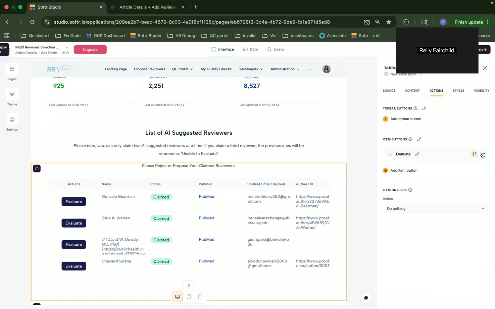
*   **Visual Layout:** The page displays key metrics and a list of suggested reviewers in a table format.
*   **UI Components:**
    *   **Metrics:** Displayed in the header; values dynamically pulled.
    *   **Table:** A Softr table component with columns for:
        *   Actions (Buttons for 'Evaluate').
        *   Name
        *   PubMed
        *   Student Email Claimed
        *   Author Url
    *   **Buttons:** "Evaluate" button next to each reviewer.
*   **Features and Functionality:**
    *   **Displaying AI Suggested Reviewers:** The core purpose of this page.
    *   **Evaluating Reviewers:** The "Evaluate" button leads to another page or modal (likely the one detailed in Section 2.6) where a user can provide feedback on the reviewer.
    *   **Claiming Reviewers:** Functionality to claim AI suggested reviewers.  Text indicates "Please Reject or Propose your Claimed Reviewers".
*   **Data Displayed:**
    *   Metrics at the top (numbers - e.g. 925, 2,251, 8,527, likely counts of something)
    *   Reviewer Name
    *   PubMed ID (or a link to PubMed)
    *   Student Email Claimed (likely indicating if a student claimed the reviewer)
    *   Author URL (likely the reviewer's profile URL)
*   **User Interactions:**
    *   Clicking "Evaluate" on a row initiates the evaluation process.
    *   Claiming is handled differently with the text implying a rejection is needed.
*   **Business Logic:**  The AI engine is separate. This page displays the result. There is logic around limiting the number of AI suggested reviewers a user can claim at one time ( "Please note, you can only claim two AI suggested reviewers at a time.").
*   **Edge Cases/Validation:** The UI will likely limit the number of claimed reviewers.
*   **Airtable Integration Points:** Data source for the table is likely Airtable.
*   **Softr-Specific Components:** Softr Table component, Softr Button (with custom actions).

### 2.6 Referee Details / Evaluate Reviewer

*   **Purpose:** This page displays details about a specific reviewer and allows a user to accept/reject or evaluate them.
*   **URL/Navigation Path:** Accessed from the "Evaluate" button on the "AI Suggested Reviewers" page.
*   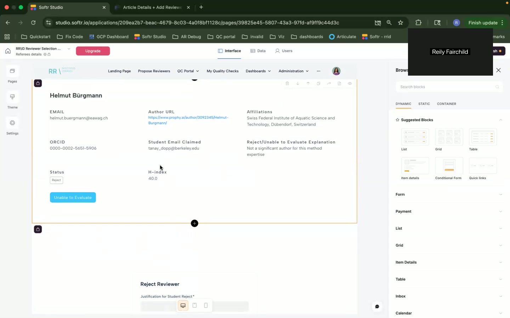
*   **Visual Layout:**  The page consists of individual data displayed with fields and descriptive text. A rejection justification form appears at the bottom.
*   **UI Components:**
    *   **Data Display Fields:**
        *   Helmut Burgmann
        *   Email
        *   Author URL
        *   ORCID
        *   Student Email Claimed
        *   Status (Reject)
        *   H-Index
        *   Affiliations
        *   Reject/Unable to Evaluate Explanation
    *   **Buttons:**
        *   Unable to Evaluate Button
    *   **Text Area:**
        *   Justification for Student Reject
*   **Features and Functionality:**
    *   **Reviewer Details:** Display all available data for a specific reviewer.
    *   **Reject/Unable to Evaluate:** Allows rejecting or marking a reviewer as "unable to evaluate"
    *   **Providing Justification:** Requires a text justification for a rejection.
*   **Data Displayed:** Various data points describing the reviewer, including contact information, affiliations, ORCID, H-Index, and the reason for rejection (if applicable).  The Status field indicates if the reviewer was previously rejected.
*   **User Interactions:**
    *   Reviewing displayed details of the reviewer.
    *   Clicking "Unable to Evaluate."
    *   Entering text in the justification textarea.
*   **Business Logic:**  A rejection workflow triggers an update to the reviewer's status.
*   **Edge Cases/Validation:**  Justification is required for rejection.
*   **Airtable Integration Points:** Data is fetched from and updated in Airtable, likely linked to the reviewers and the associated article.
*   **Softr-Specific Components:** Data display is likely achieved using individual Softr text blocks or a custom code block. Softr Form used for the rejection justification.

### 2.7 Claim Preprint

*   **Purpose:** To allow users to claim a preprint.
*   **URL/Navigation Path:**  Not explicitly shown, likely another modal accessed from the Preprints List page.
*   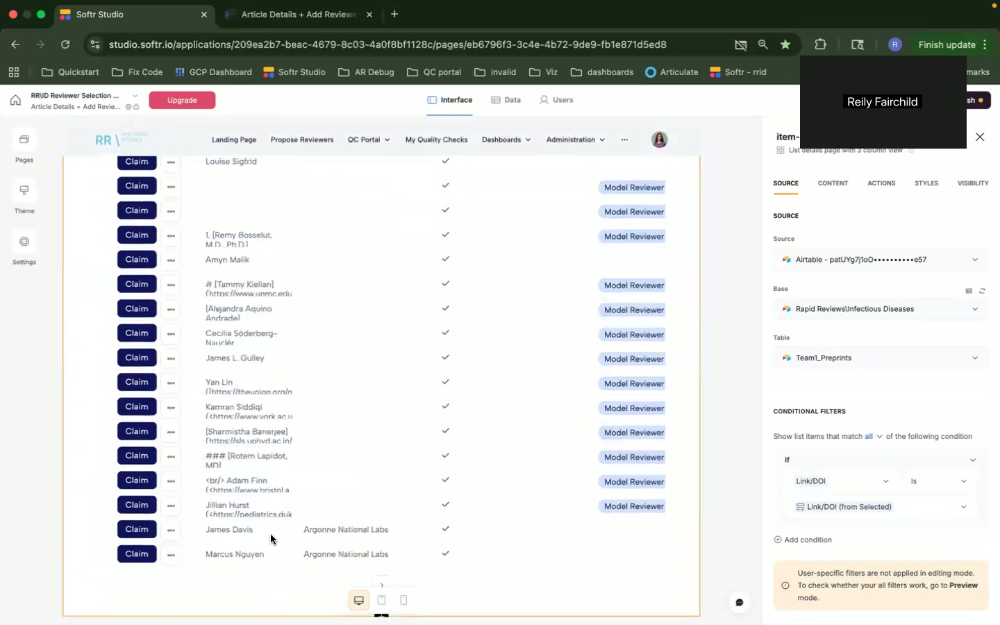
*   **Visual Layout:** Appears to be a list of preprints displayed with a button for claiming.
*   **UI Components:**
    *   List of Names (potential reviewers?) and an associated claim button.
*   **Features and Functionality:**
    *   Claiming a preprint for review.
*   **Data Displayed:**
    *   Names of potential reviewers/students.
*   **User Interactions:**
    *   Clicking "Claim" next to a reviewer.
*   **Business Logic:**  The claim functionality assigns the reviewer/student to the preprint.
*   **Edge Cases/Validation:**  Potentially limits to the number of preprints a student can claim.
*   **Airtable Integration Points:** The data is fetched and updated in Airtable, specifically relating to preprints and potential reviewers assigned.  The data source for the table is configured using the Airtable ID `airtable-patIg7gt9o*******os7`.  The table is "Team Preprint".  There is a filter on LinkDOI: `LinkDOI is LinkDOI (from Selected)`.
*   **Softr-Specific Components:** List, buttons (Claim).

## 3. Technical Requirements

*   **Platform:** Softr
*   **Database:** Airtable (tight integration is crucial)
*   **Authentication:** Softr's built-in user authentication.
*   **API:**  Airtable API (for data retrieval and updates)
*   **Third-Party Integrations:**
    *   PubMed API (inferred for fetching article details)
    *   AI engine for reviewer suggestions (integration details unknown)
*   **Security:** Data should be securely stored and transmitted. Access control should be implemented based on user roles (e.g., admin, reviewer, student).
*   **Performance:** The application should load quickly and respond to user interactions without significant delay.
*   **Scalability:** The system should be able to handle a growing number of preprints, reviewers, and users.

## 4. Data Models (Inferred)

Based on the UI and functionality, the following data models can be inferred:

*   **Preprint:**
    *   Title (Text)
    *   Corresponding Author (Text)
    *   Corresponding Author Email (Email)
    *   DOI (Text/URL)
    *   Abstract (Long Text)
    *   Domain (Single Select - BCS, MedSci, PSE, SSH)
    *   Invite Count (Number)
    *   Unchecked Count (Number)
    *   Reviewer Discipline (Text)
    *   Reviewer Method Expertise (Text)
    *   Reviewer Topical Expertise (Text)
    *   Assignee (Linked Record to User table)
    *   URL (URL)
    *   Status (Single Select - e.g., "In Queue", "Under Review", "Completed")
*   **Reviewer:**
    *   First Name (Text)
    *   Last Name (Text)
    *   Email (Email)
    *   Affiliation (Text)
    *   Subdiscipline (Text)
    *   Link to Profile (URL)
    *   ORCID (Text)
    *   H-Index (Number)
    *   Expertise (Long Text)
    *   Affiliation Conflict of Interest (Text)
    *   Status (Single Select - e.g., "Approved", "Rejected", "Pending")
    *   Justification for Rejection (Long Text)
*   **User:**
    *   Name (Text)
    *   Email (Email)
    *   Role (Single Select - e.g., "Admin", "Reviewer", "Student")
*   **Review Assignment:**
    *   Preprint (Linked Record to Preprint)
    *   Reviewer (Linked Record to Reviewer)
    *   Status (Single Select - e.g., "Assigned", "Completed", "Rejected")
    *   Date Assigned (Date)
    *   Date Completed (Date)
    *   Reviewer Feedback (Long Text)

## 5. User Workflows

*   **Adding a Reviewer to a Preprint:**
    1.  User navigates to the "Article Details + Add Reviewer" page.
    2.  User searches or filters for the desired preprint.
    3.  User clicks the "Add Reviewers" button for the selected preprint.
    4.  User is presented with a list of AI suggested reviewers.
    5.  User can:
        *  Choose an AI suggested reviewer and claim for evaluation.
        *  Propose a new reviewer by clicking a "Propose Reviewer" button and filling out the "Propose a Reviewer" form.
    6.  If proposing a new reviewer, the user fills out the form and submits it.
    7.  The reviewer is added to the "Student Reviewer Inputs" table in Airtable.
*   **Evaluating a Reviewer:**
    1. User navigates to the "Article Details + Add Reviewer" and selects "Add Reviewers" button.
    2.  The AI suggestions are displayed.
    3.  User clicks the "Evaluate" button next to the suggested reviewer.
    4.  User is redirected to the "Referee Details" page.
    5.  User reviews the reviewer's information and clicks "Unable to Evaluate" or adds a "Justification for Student Reject" and submits.
    6. The reviewer's status is updated in Airtable.
*   **Claiming a Preprint:**
    1. User navigates to the list of preprints.
    2. User clicks the "Claim" button next to a preprint they wish to review.
    3. The system assigns the preprint to the user.
*   **Admin Workflow for Adding Reviewers:**  The "Propose a Reviewer" form can be used by an admin to add reviewers to the system by manually entering their details.

This PRD provides a comprehensive overview of the RRID Reviewer Selection system based on the provided screenshots. Further details and refinements will be necessary as development progresses.
