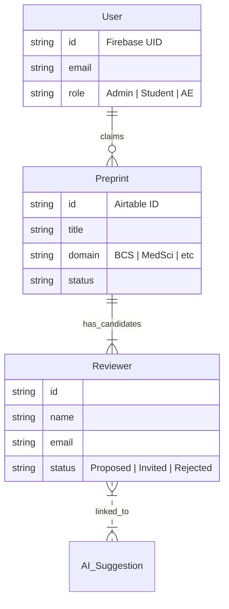

# System Architecture

## 1. High-Level Architecture

The new architecture decouples the frontend from the Airtable backend using a modern Next.js application. While Softr communicated directly with Airtable (often exposing API keys or relying on Softr's proxy), the new system will use Next.js Server Actions / API Routes to securely handle business logic and data transformation.

### Migration Strategy
- **Old System**: Softr (Frontend + Auth) <--> Airtable (Database + Automations)
- **New System**: Next.js (Frontend) + Firebase (Auth/Metadata) <--> Next.js Server Layer <--> Airtable (Core Database)

```mermaid
graph TD
    User[User (Admin/Student/AE)] -->|HTTPS| CDN[Vercel/Firebase Edge]
    CDN --> NextJS[Next.js 16 App]
    
    subgraph Frontend_Layer
        NextJS -->|Auth| FB_Auth[Firebase Auth]
        NextJS -->|UI Components| Shadcn[Shadcn/UI + Tailwind 4]
    end
    
    subgraph Backend_Layer
        NextJS -->|Server Actions| API[Internal API Layer]
        API -->|Read/Write| Airtable[Airtable Bases]
        API -->|Store Metadata/Cache| Firestore[Firebase Firestore]
        API -->|AI Processing| Gemini[Gemini Pro Model]
    end
    
    subgraph Data_Sources
        Airtable -->|Core Data| Reviews[Review Data]
        Airtable -->|Core Data| Users[User Roles]
        Firestore -->|App State| UserPrefs[User Preferences]
    end
```

## 2. Core Components

### Frontend (User Interface)
- **Framework**: Next.js 16 (App Router).
- **Language**: TypeScript.
- **Styling**: Tailwind CSS v4.0.
- **Components**: Shadcn/UI (based on Radix Primitives) for accessible, consistent design.
- **State Management**: React Query (or SWR) for data fetching and caching, critical for Airtable latency management.

### Backend (Server & Data)
- **Primary Database (Legacy/Business)**: **Airtable**.
    - We will continue to use the existing Airtable bases (Reviewer Selection Process, etc.) to minimize disruption to existing automations.
    - **Key Bases**: `appAYosfmfSuHWiBT` (Reviewer Selection), `app6NFX8jCkg5kKxi` (Users).
- **Secondary Database (App State)**: **Firebase Firestore**.
    - Used for data that doesn't fit neatly into Airtable or requires high-frequency access (e.g., user session state, temporary drafts, vector embeddings for AI).
- **Authentication**: **Firebase Authentication**.
    - Will replace Softr's auth.
    - Custom claims will map Firebase UIDs to Airtable Record IDs to maintain role-based access control (RBAC).

### Integration Layer
- **Airtable API Client**: A typed wrapper around the Airtable API to ensure type safety (Zod schemas matching the [Airtable Schema Report](schema/airtable_schema_report.md)).
- **Caching Strategy**: Implement aggressive caching (Next.js `unstable_cache` or Redis if needed) for read-heavy views like "Preprint Lists" to overcome Airtable's API rate limits (5 requests/sec).

## 3. Data Flow

### 3.1 Reading Data (e.g., "View Preprints")
1.  User visits `/preprints`.
2.  Server Component requests data.
3.  Integration Layer checks Cache.
4.  If miss, fetch from Airtable `Preprint Info ONLY` table.
5.  Transform Airtable records (raw JSON) -> Domain Entities (TypeScript Interfaces).
6.  Render page.

### 3.2 Writing Data (e.g., "Propose Reviewer")
1.  User submits Form (Client Component).
2.  Server Action `submitReviewerProposal(data)` is called.
3.  Validate data using Zod schema.
4.  Integration Layer posts to Airtable `Student Reviewer Inputs` table.
5.  Trigger Revalidation of related paths (`/preprints`, `/dashboard`).
6.  Return success/error to client.

## 4. Security & Permissions

- **Authentication**: Managed by Firebase.
- **Authorization**: 
    - **Role-Based**: Roles (Admin, AE, Student) are stored in Airtable's `Users` table (`app6NFX8jCkg5kKxi`).
    - **Middleware**: Next.js Middleware will intercept requests and verify roles via session cookies/tokens before rendering protected routes.
- **Environment Variables**: All Airtable API keys and Firebase secrets are stored in server-side environment variables, never exposed to the client.

## 5. Migration Plan

1.  **Setup**: Initialize Next.js repo, configure Firebase and Airtable clients.
2.  **Auth Migration**: Create mechanism to link existing Airtable users to new Firebase accounts (likely via email matching).
3.  **Read-Only Views**: Implement Dashboard and Preprint Lists first (Low risk).
4.  **Write Operations**: Implement "Propose Reviewer" and "Claim" workflows (Medium risk).
5.  **Complex Logic**: Port custom JS validation logic from Softr to Zod schemas (High risk).
6.  **Cutover**: Point DNS to Vercel/Firebase Hosting.

## 6. Diagrams

### 6.1 Data Model (Simplified)



