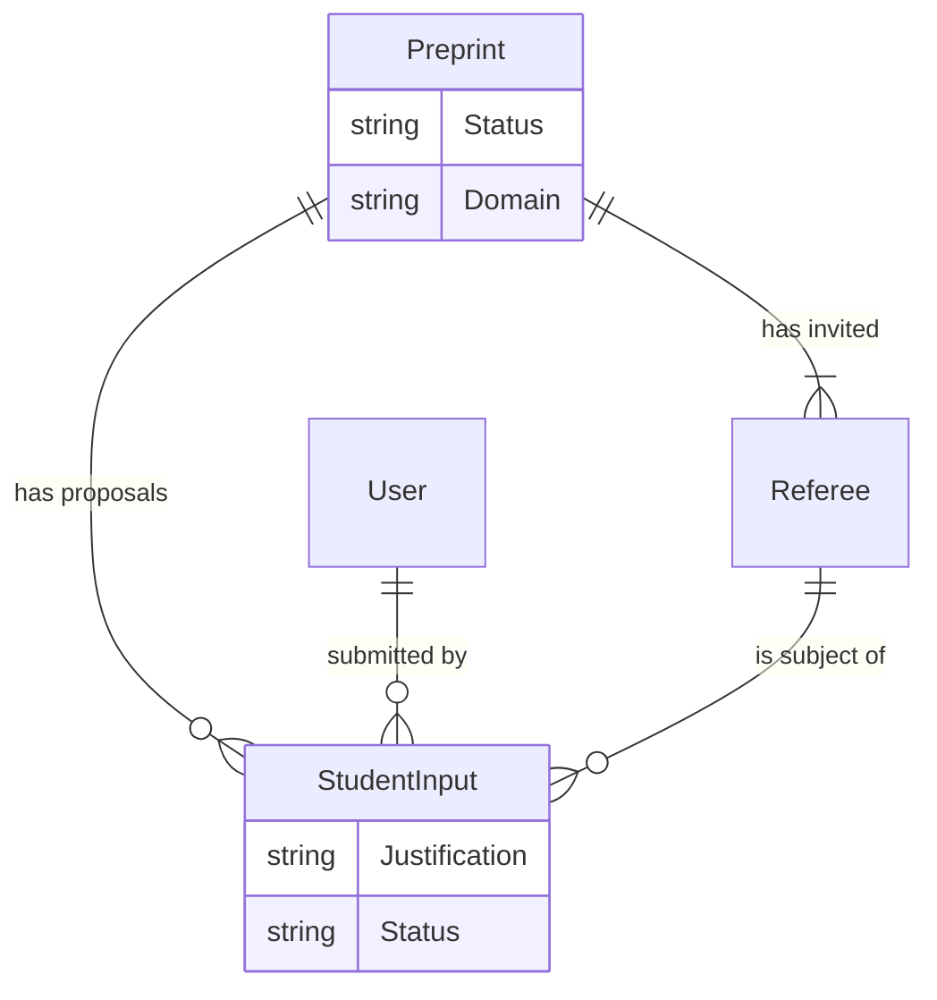

# Airtable Schema Report (Technical Reference)

## Overview
This document provides a technical breakdown of the Airtable schema for the **RRID Reviewer Selection System**. It is derived from the live Airtable base structure and serves as the definitive reference for:
1.  **Frontend Development**: Understanding available fields and data types for the Next.js application.
2.  **Backend Migration**: Planning a future migration to an alternative backend like Baserow.

**Source Base**: `RRID Reviewer Selection Process` (ID: `appAYosfmfSuHWiBT`)
**Last Extracted**: 2025-11-24

---

## 1. Key Tables

### 1.1 `Preprint Info ONLY` (`tbldJ5yPV3HeBsCKq`)
The central table storing preprint metadata and status.

**Primary Field**: `Preprint ID` (Formula: `RECORD_ID()`)

| Field Name | Type | Description / Options |
| :--- | :--- | :--- |
| **Preprint ID** | Formula | Unique Record ID. |
| **Title (from Selected)** | Lookup | Title of the preprint (multiline text). |
| **Domain** | Lookup | Scientific domain (BCS, PSE, MedSci, PH, SSH, etc.). |
| **Preprint Status** | Single Select | `ACTIVE`, `ON HOLD`, `DORMANT`, `COMPLETE`, `INVITED`, `DISCARDED`. |
| **Rank** | Single Select | Priority ranking (0-20, N/A). |
| **Invite Round** | Single Select | Current round of invites (1-5). |
| **AE Preprint Status** | Single Select | `Active`, `Not Active`. |
| **More Invites Needed?** | Formula | Logic determining if more reviewers are needed based on round/status. |
| **Invite Count** | Rollup | Count of invitations sent. |
| **Unchecked Count** | Rollup | Count of student proposals pending QC. |
| **Preprint Notes** | Single Line Text | Internal notes. |
| **In Process** | Single Select | `In Process`, `Editorial Reject`. |

### 1.2 `Student Reviewer Inputs` (Inferred)
Stores the raw proposals submitted by student reviewers.

| Field Name | Type | Description |
| :--- | :--- | :--- |
| **Reviewer Email** | Email | Email of proposed reviewer. |
| **First Name** | Single Line Text | |
| **Last Name** | Single Line Text | |
| **Affiliation** | Single Line Text | |
| **Status** | Single Select | `Pending QC`, `Greenlit`, `Redlit`. |
| **Preprint Link** | Link to Record | Links to `Preprint Info ONLY`. |
| **Student Link** | Link to Record | Links to `Users` table. |

### 1.3 `Referees` (Inferred)
Stores unique reviewer profiles to track history and avoid duplicates.

| Field Name | Type | Description |
| :--- | :--- | :--- |
| **Email** | Email | Unique identifier. |
| **Name** | Single Line Text | |
| **History** | Link to Record | Links to previous `Student Reviewer Inputs`. |

### 1.4 `Users` (`app6NFX8jCkg5kKxi`)
Stores user profiles and roles.

| Field Name | Type | Description |
| :--- | :--- | :--- |
| **Email** | Email | Login email. |
| **Role** | Single Select | `Student`, `Assistant Editor`, `Admin`. |
| **Active** | Checkbox | User status. |

---

## 2. Relationships

## 3. Automations (Inferred from usage)
- **Status Updates**: When `Invite Count` > Threshold, update `Preprint Status`.
- **COI Checks**: Scripts running periodically to flag `Student Reviewer Inputs` that match Authors or Recent Referees.
- **Gamification**: Rollups in `Users` table calculating "Greenlit" counts from `Student Reviewer Inputs`.

## 4. API Considerations
- **Rate Limits**: 5 requests per second per base.
- **Pagination**: 100 records per page.
- **Linked Records**: Returns an array of Record IDs. Need to fetch linked records separately or use `cellFormat=string` (limited).

