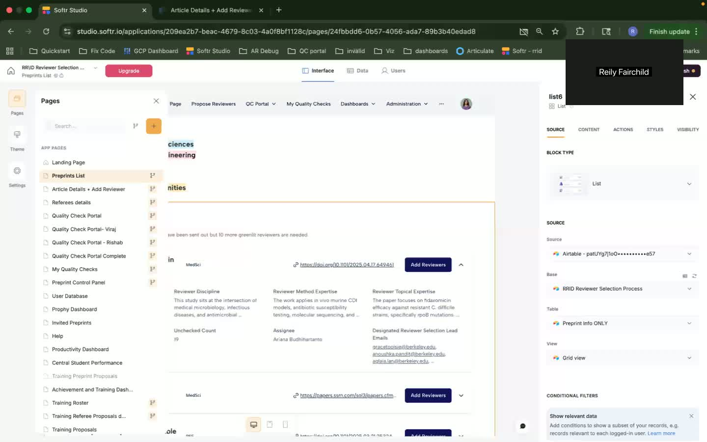
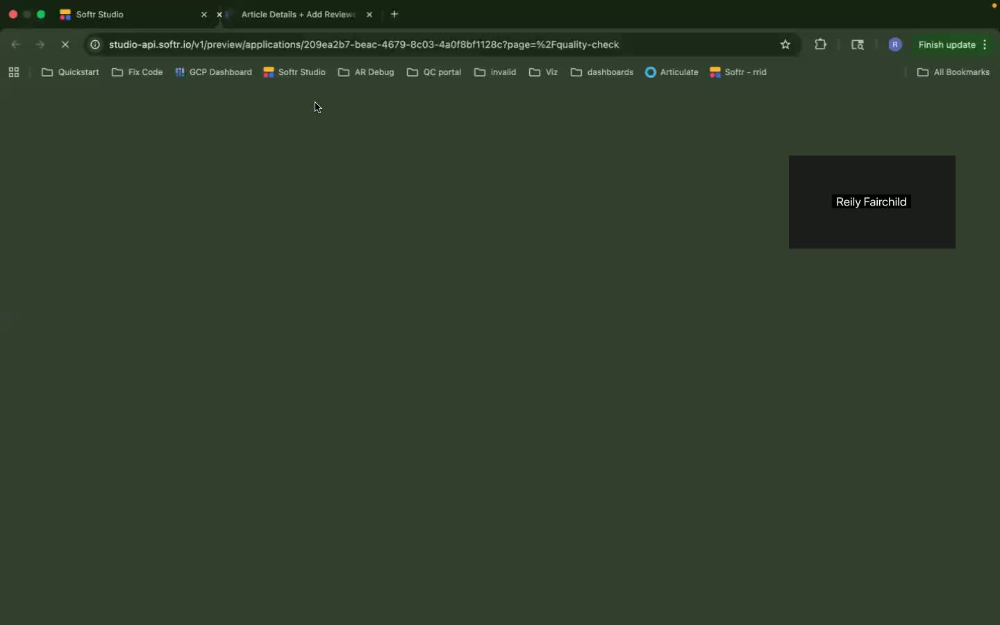
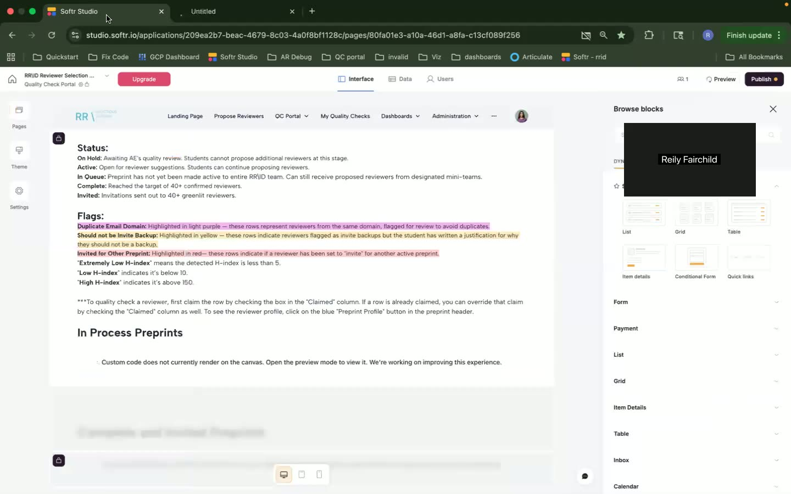
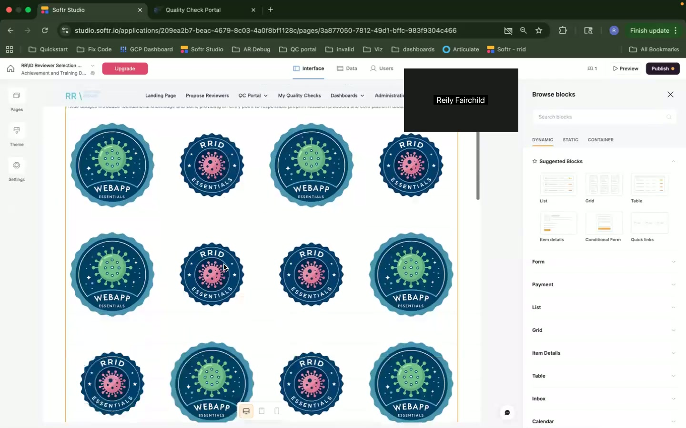

# Comprehensive Linear Walkthrough of Software Application

## Chapter 1: Introduction and Overview

### Key Takeaways
- The walkthrough provides a high-level overview of the software's functionalities.
- Main focus is on the top section features.
- Badge system and utility pages are briefly mentioned but not detailed.
- Software manages account settings and sign-ups autonomously.

### Detailed Description
The speaker begins by introducing the software application and setting the expectation of a tutorial walkthrough. The primary focus will be on functionalities at the top section of the application. The utility sections, such as the badge system and account settings, are briefly mentioned as areas not covered in detail.

### Important UI Elements and Interactions
- No specific UI elements are detailed at this stage, as the introduction is more general.

### Notable Timestamps
- **[00:00]** - Introduction to the walkthrough.

- **[00:40]** - Brief mention of utility features.

---

## Chapter 2: Views and User Roles

### Key Takeaways
- The software presents different views for students and assistant editors.
- Landing page features are discussed concerning efficiency of navigation.
- Channels of contribution to RID are introduced.

### Detailed Description
The speaker explains the presence of dual views in the application. Students and assistant editors access the software differently, and roles dictate the functionalities each can access. The general user flow from landing pages and contribution channels is discussed.

### Important UI Elements and Interactions
- **Landing Page:**
  - Includes buttons for navigation.
- **Views:**
  - Differentiation between student and editor views.

### Notable Timestamps
- **[00:47]** - Explanation of landing page efficiency.

- **[01:06]** - Introduction of user roles and views.

---

## Chapter 3: Preprint Management

### Key Takeaways
- Three primary channels for preprint management: inputting peer reviews, quality checking, and assessing productivity.
- There exists a separate site for certain processes.
- Preprints can be listed as active, in queue, or prioritized.

### Detailed Description
Discussion moves into the specific workflows related to preprint handling. The speaker elaborates on peer reviews, quality checks, and linking to external management sites. Various categorizations of preprints allow for effective management and prioritization.

### Important UI Elements and Interactions
- **Preprint List:**
  - Contains buttons to add reviewers for different preprints.
- **Visibility Settings:**
  - Options to propose or view reviewers based on roles.

### Notable Timestamps
- **[01:36]** - Introduction of three main preprint channels.

- **[02:14]** - Navigation through preprint list features.

- **[03:11]** - Explanation of visibility settings for preprints.

---

## Chapter 4: Article Details and Reviewer Management

### Key Takeaways
- The details page includes metadata and reviewer tools.
- AI-suggested reviewers are incorporated into workflow.
- Conflict of interest functionalities are highlighted.

### Detailed Description
The article details page is explored, detailing the metadata available such as title, DOI, authors, etc. The speaker highlights the use of AI to suggest reviewers and mechanisms to check conflicts of interest.

### Important UI Elements and Interactions
- **Article Details Page:**
  - Displays comprehensive information about each preprint.
- **Conflict of Interest Check:**
  - Includes inputs for names and emails.

### Notable Timestamps
- **[05:04]** - Description of article details and add reviewers interface.

- **[05:39]** - Review of metadata components and conflict management.

---

## Chapter 5: Reviewer Proposal Process

### Key Takeaways
- Custom scripts are used to manage the proposal process.
- UI provides feedback on potential conflicts or duplications.
- Workflows incorporate error management for data parsing issues.

### Detailed Description
The workflow for proposing reviewers includes checking conflicts of interest and handling duplicate proposals. The speaker explains the use of scripts for managing input fields and ensuring data integrity.

### Important UI Elements and Interactions
- **Proposal Form:**
  - Scripts run to highlight potential conflicts before submission.
- **Error Handling:**
  - Visual cues for data parsing issues.

### Notable Timestamps
- **[07:08]** - Start of proposed reviewer form discussion.

- **[08:04]** - Explanation of embedded scripts within the page.

---

## Chapter 6: Quality Check Portal

### Key Takeaways
- Quality checks are separated for in-process and completed preprints.
- Students and editors have different access levels.
- UI incorporates tools for visualization of preprint status.

### Detailed Description
The speaker delves into the portal where quality checks are performed. The role-based access ensures that students and editors can only interact with appropriate sections. There is mention of improvements in user interface designs to enhance usability.

### Important UI Elements and Interactions
- **Quality Check Portal:**
  - Displays preprint status and quality check outcomes.
- **Role-Based Access:**
  - Differentiates content visibility and edit capabilities.

### Notable Timestamps
- **[13:32]** - Introduction of quality check portal.

- **[14:09]** - Discussion on role-based access for students and editors.

---

## Chapter 7: Dashboard and Miscellaneous Features

### Key Takeaways
- Various dashboards track productivity and achievements.
- Training and achievements are linked to a badge system.
- Custom code is employed for enhanced data management and interactions.

### Detailed Description
This chapter discusses multiple dashboards used to monitor productivity and training achievements. The speaker points out the use of badges and custom code integration for improved data handling and interface responsiveness.

### Important UI Elements and Interactions
- **Productivity Dashboard:**
  - Tracks student and team performance with embedded data views.
- **Badge System:**
  - Awards based on user achievements and milestones.

### Notable Timestamps
- **[18:34]** - Description of dashboard functionalities.

- **[20:21]** - Explanation of badge system and student feedback mechanisms.

## Chapter 8: Navigation and Interface

### Key Takeaways
- Header navigation organizes access to key software sections.
- Role permissions dictate visibility and organization of navigation.

### Detailed Description
The speaker covers the layout of navigation menus and how it directs users efficiently throughout the software. Role permissions ensure only authorized users can access certain functionalities.

### Important UI Elements and Interactions
- **Header Navigation:**
  - Includes dropdowns and tabs for categorized access.

### Notable Timestamps
- **[21:37]** - Overview of header navigation and role-based access.

---

This document aims to provide a structured and comprehensive walkthrough of the software application as demonstrated in the video, both descriptive and technical, suitable for onboarding and training purposes.