# Enriched Linear Walkthrough - Comprehensive Analysis

This document provides a comprehensive walkthrough enriched with visual analysis of all screenshots.

It goes beyond the speaker's narration to identify Softr interface components, Airtable integrations, and UI details.

## Section 1: 00:00 - 21:55

## Softr Application Walkthrough: Pages and Functionality Overview

**Key Takeaways:**

The speaker is providing a high-level walkthrough of a Softr application designed for a reviewer selection process. The application includes various pages for different user roles (students, editors) and functions (landing page, proposing reviewers, quality checks, dashboards). The application heavily integrates with Airtable, using it as a primary data source for lists, forms, and dashboards. The speaker touches upon the organization of pages within the Softr Studio interface.

**Detailed Description:**

The screenshots show the Softr Studio interface, with the left sidebar displaying the "Pages" section and the main content area showcasing the design and configuration of each page. The application is named "RRID Reviewer Selection." The interface reveals a clear separation of concerns, with dedicated pages for landing, proposing reviewers, quality checks, dashboards, and administration. The dashboards provide data visualizations such as numerical summaries as well as more detailed lists and tables.

Airtable is central to the application, as evidenced by the numerous references to "Airtable" in the UI. Lists and forms on the pages are pulling data from specific Airtable bases and tables, and are sending data to Airtable bases and tables, connecting user input and stored data. The use of conditional filters is visible, showing how different data subsets are displayed based on certain conditions.

The screenshots indicate a complex workflow where users propose reviewers, and then these proposals undergo quality checks. There are different roles for students and assistant editors. The app also includes badge tracking, although the speaker states this is not the current focus.

The application uses a variety of UI elements, including lists, tables, forms, and dashboards. Code embedding is also present, though the speaker mentions that the custom code does not always render in the Softr Studio canvas.

**Important UI Elements and Interactions:**

*   **Pages Panel:** Left sidebar showing a list of app pages like "Landing Page," "Propose Reviewers," "QC Portal," "My Quality Checks," "Dashboards," "Administration," and others. Users can navigate between pages within the Softr editor by clicking on them.
*   **Content Area:** Displays the current page being edited. Includes UI elements, such as lists, forms, and buttons.
*   **Configuration Sidebar:** On the right, shows settings and options for the selected UI element. This includes data source settings (Airtable), conditional filters, and style customizations.
*   **Filters:** Screenshots show conditional filters, for example, filtering a list based on statuses like "selected" and "dormant" or by the need for additional invites.
*   **Data Display:** Data is presented in various ways, including lists, tables with sorting options and action buttons (e.g., "Evaluate," "Add Reviewers"), and numerical summaries.
*   **Forms:** Used for capturing user input, like when proposing a reviewer. Fields include names, email, justification, and affiliation. The forms use "Send to a data source" to write the inputs to Airtable.
*   **Buttons:** Actionable elements like "Check COI," "Submit," and "Evaluate."
*   **Custom Code Block:** Allows embedding code into the Softr application. However, the canvas is sometimes unable to render them properly.
*   **Navbar:** Contains links to other pages within the site. Includes RRID's logo.

**Notable Timestamps:**

*   **[00:00]:**  Introduction to the Softr application walkthrough. Shows landing page layout with "Find a PrePrint", "Input Peer Reviewers", etc.
*   **[00:23]:** Speaker specifies that the badge system will be passed over.
*   **[01:23]:** 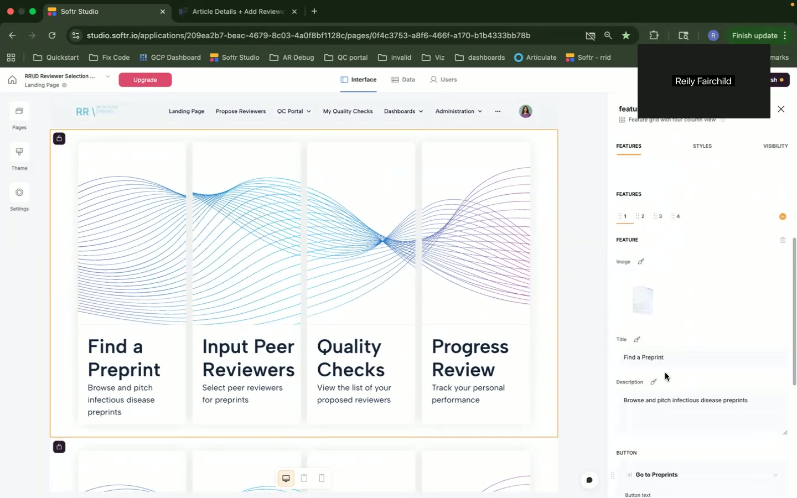 Shows a list of preprints and disciplines, including Add Reviewers button. Airtable is visible as the data source.
*   **[02:42]:** 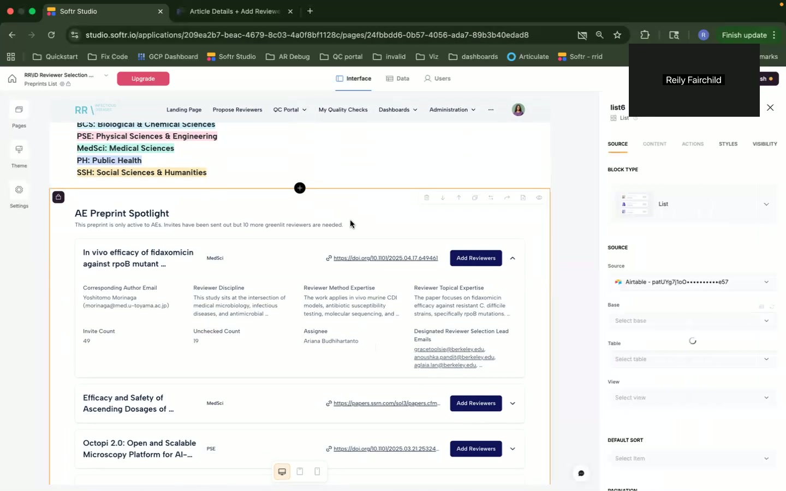 Prioritized Selected Preprint. Filters are visible on the right.
*   **[04:00]:** 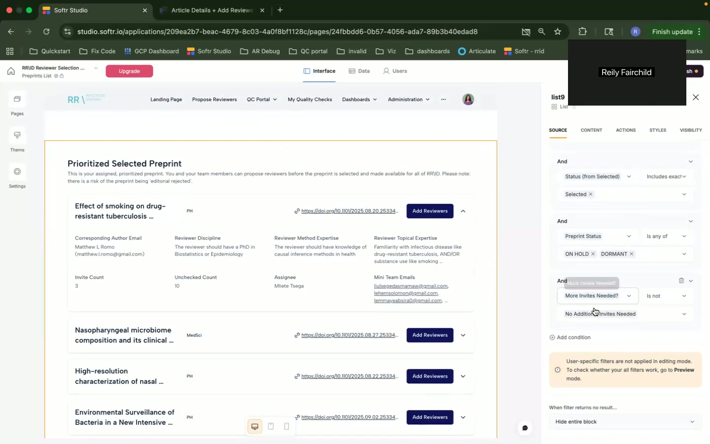 Pages panel displayed.
*   **[05:15]:** 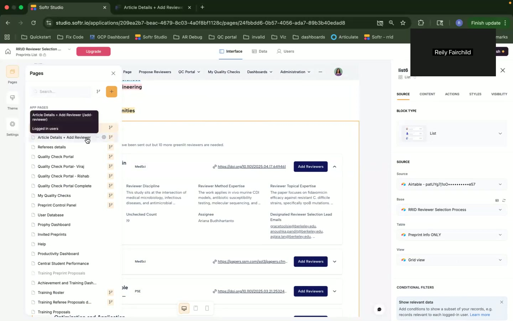 Shows the "Check for COI" page with a form. The side panel demonstrates configuration settings for the form.
*   **[06:35]:** 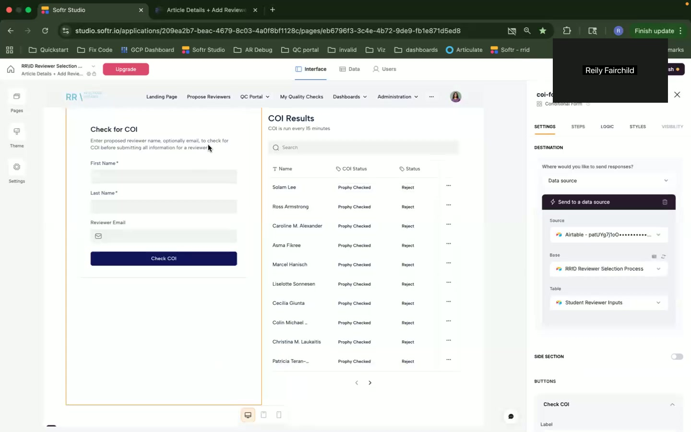 "Propose a Reviewer" form is displayed, indicating input fields for reviewer information.
*   **[07:53]:** 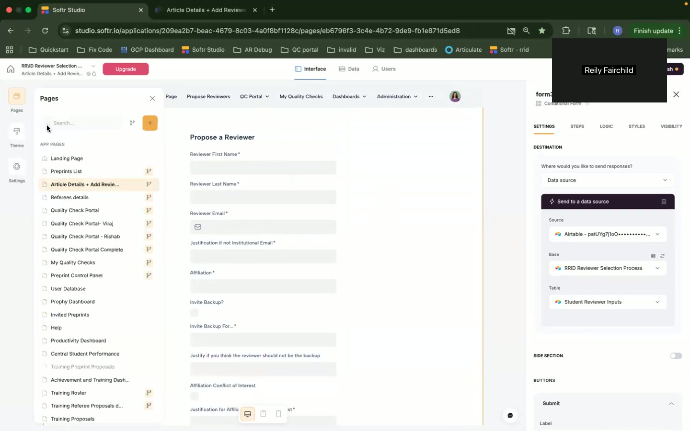 Custom code section, including Javascript for reviewer matching.
*   **[09:22]:** 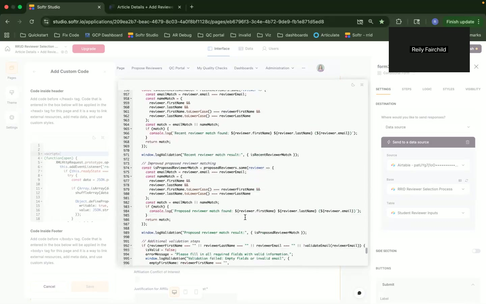 Table of AI suggested reviewers, including "Evaluate" buttons.
*   **[10:37]:**  Reviewer Details page with fields for name, email, and affiliations.
*   **[12:00]:** 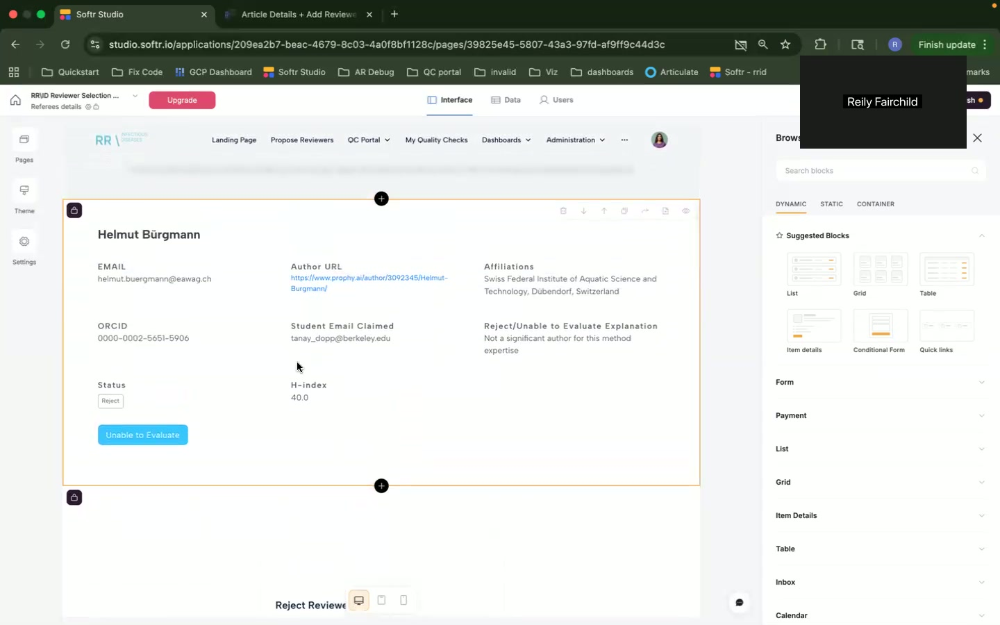 Form used to Propose Reviewer. Includes Submit Button.
*   **[13:05]:** 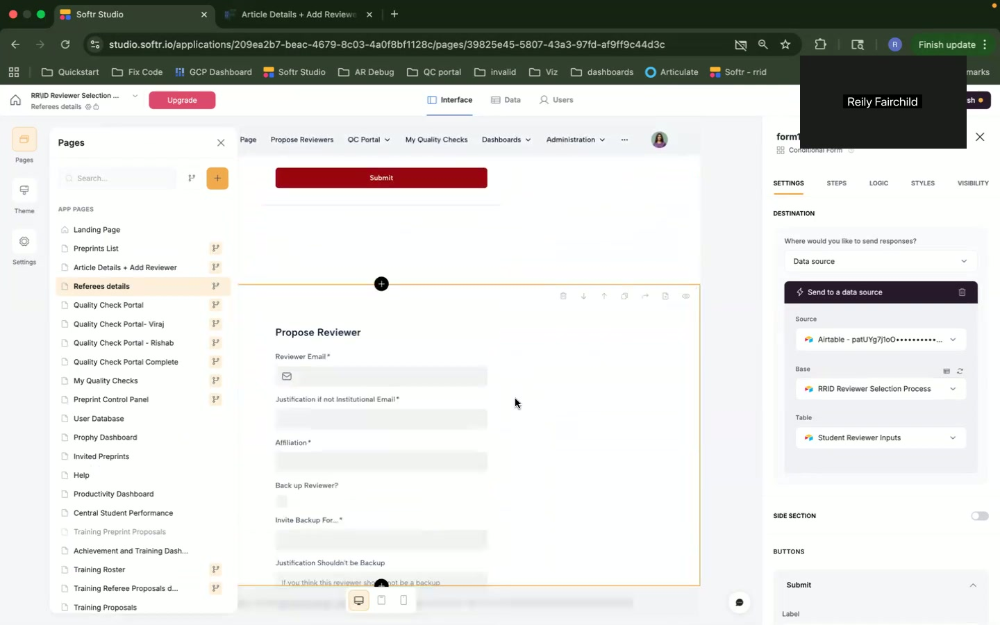 Quality Check Portal page, including status indicators.
*   **[14:14]:** 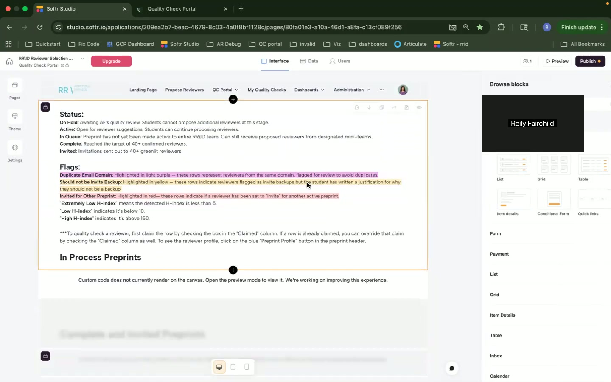 Quality Check Portal, shows custom code block issues with rendering.
*   **[15:34]:**  Table of Quality Checks with a column for the reviewer.
*   **[16:47]:** 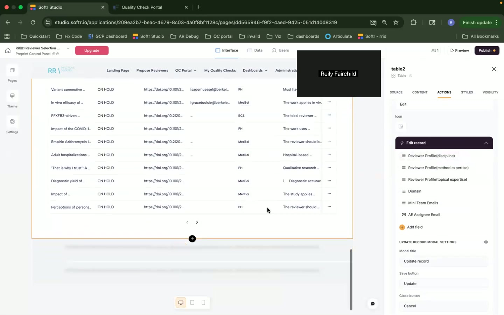 Detailed Quality Check Table.
*   **[18:09]:** 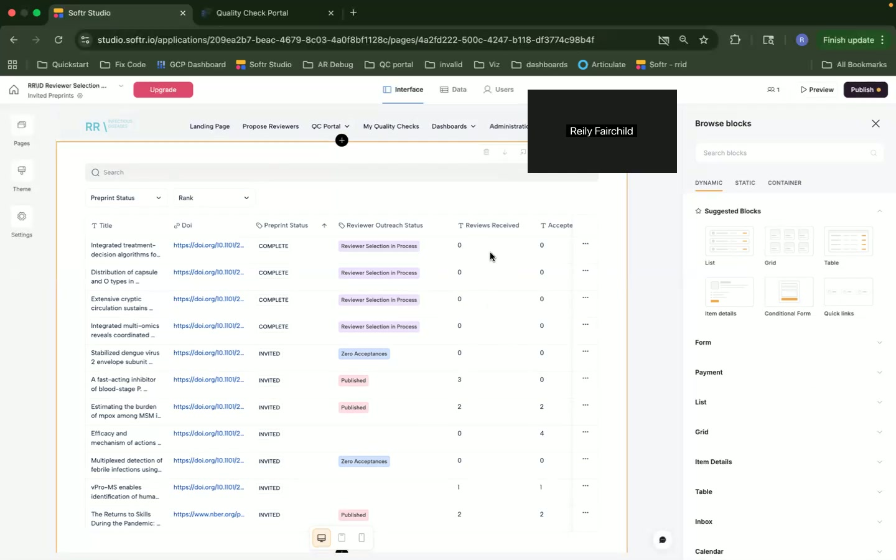 Productivity Overview page with tabs such as "Student Productivity" and code that fails to render.

