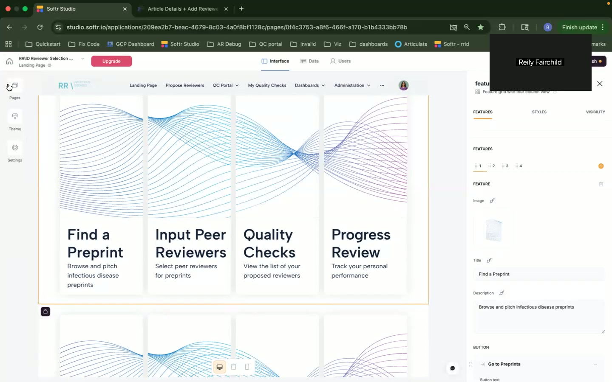
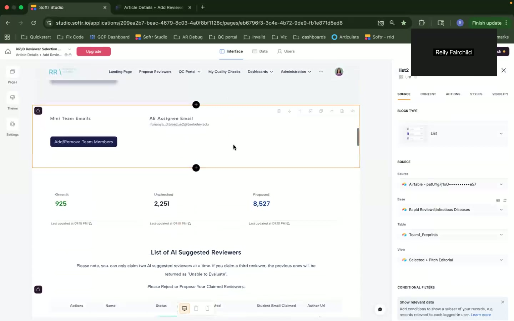
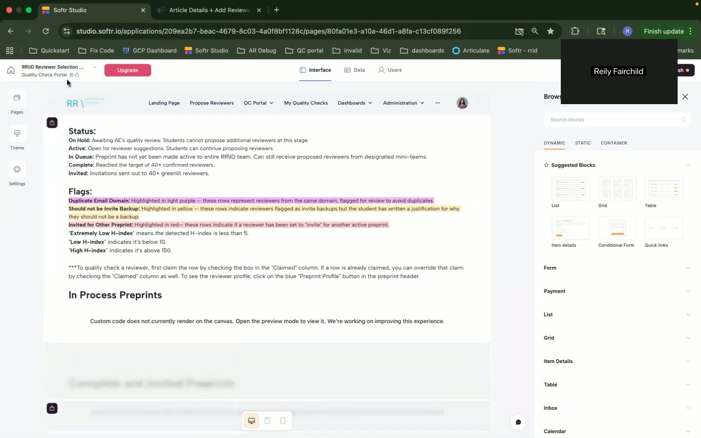
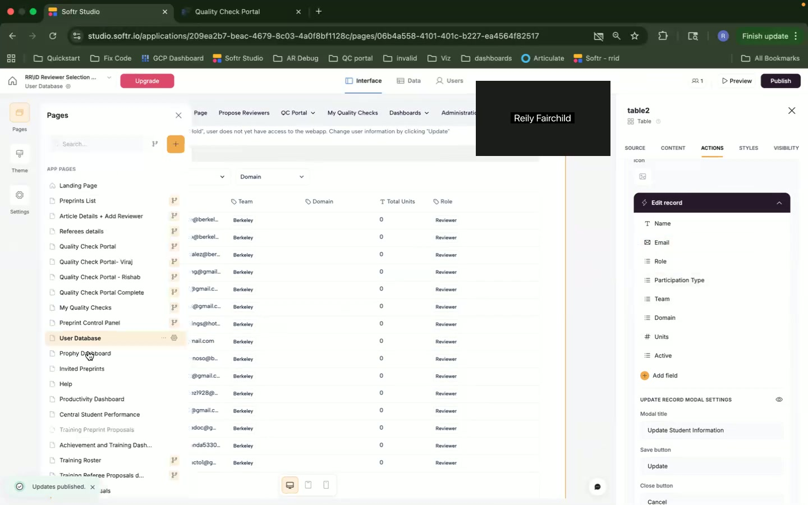
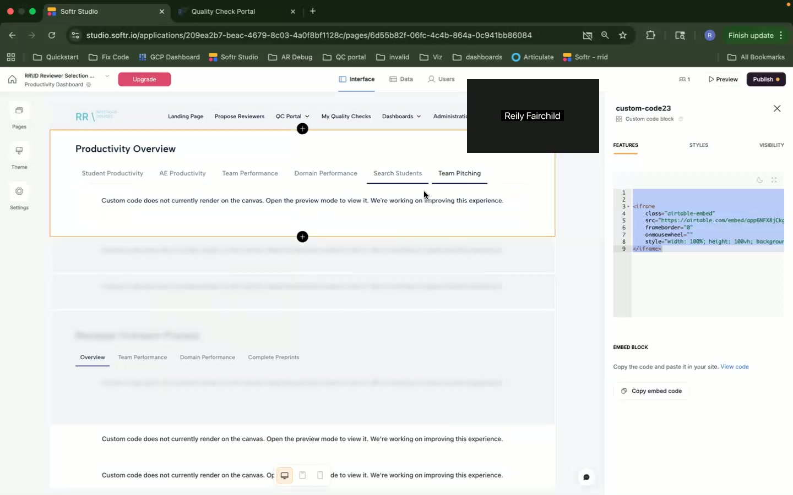
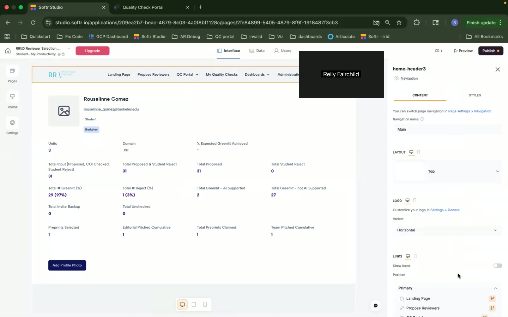

# Enriched Personas, User Stories, and User Journeys

Okay, let's dive into the Softr peer review management application screenshots and break down the user personas, stories, features, and journeys.

**1. User Personas**

Based on the screenshots, I can identify several distinct user roles:

*   **Persona 1: Admin/System Administrator (Reily Fairchild)**

    *   **Role and Background:** Reily Fairchild appears to be an administrator based on the UI elements visible in the screenshots. They likely have access to all parts of the application, including backend configuration, user management, and data management. The "studio.softr.io" URL reinforces the Softr-based system admin role.
    *   **Goals and Motivations:**
        *   Configure and maintain the application for optimal use by other users.
        *   Ensure data integrity and accuracy.
        *   Track user activity and system performance.
        *   Customize the platform to meet specific institutional needs.
    *   **Pain Points and Challenges:**
        *   Keeping the application up-to-date and resolving any technical issues.
        *   Managing user access and permissions.
        *   Understanding and implementing new features and integrations.
        *   Troubleshooting custom code issues, especially regarding canvas rendering.
    *   **Technical Skill Level:** High. They need to understand Softr configuration, Airtable integration (if applicable), custom code (HTML, CSS), and data management principles.
    *   **How they use the application:** They use the application by configuring the site through the studio interface and managing users and other aspects of the system. Access to "Pages," "Theme," "Settings" indicates control over site structure, branding, and general settings.  The ability to view and edit custom code blocks implies a high level of control and understanding.  Publish button access suggests deployment control.

    *   **Screenshots:** , , , , , ,  (all screenshots demonstrate this user's access to backend features and configurations).

*   **Persona 2: Student/Reviewer**

    *   **Role and Background:** A student or reviewer participates in the peer review process. Their primary role is to review preprints, provide feedback, and contribute to quality checks. The UI element "Student Email Claimed" suggests this user role.
    *   **Goals and Motivations:**
        *   Complete assigned peer reviews efficiently.
        *   Provide constructive feedback on preprints.
        *   Track their progress and contributions.
        *   Gain experience in the peer review process.
    *   **Pain Points and Challenges:**
        *   Understanding the review criteria and guidelines.
        *   Managing their workload and deadlines.
        *   Accessing and navigating the application effectively.
        *   Understanding technical terminology or complex workflows.
    *   **Technical Skill Level:** Moderate. They should be comfortable using web applications, navigating menus, and entering data.
    *   **How they use the application:** They use the application to "Find a Preprint," "Input Peer Reviewers," "Quality Checks," and "Progress Review" according to the Landing Page. Likely, they also view assigned preprints, submit reviews, and track their progress within the system. The ability to claim preprints likely also implies they can take ownership of reviewing them. They might also interact with "AI Suggested Reviewers."

    *   **Screenshots:**  (Landing Page indicates tasks),  ("List of AI Suggested Reviewers" and data related to reviewers),  (Status definitions and flags related to student activity),  (Student's productivity overview).

*   **Persona 3: AE Assignee (Area Editor Assignee)**

    *   **Role and Background:** This user is likely responsible for assigning Area Editors (AEs) to preprints for review. The "AE Assignee Email" field suggests this role. Their role probably involves managing the workflow of preprint assignments.
    *   **Goals and Motivations:**
        *   Assign appropriate AEs to preprints quickly and efficiently.
        *   Maintain a balanced workload for AEs.
        *   Track the progress of preprint assignments.
    *   **Pain Points and Challenges:**
        *   Finding suitable AEs for specific preprints.
        *   Managing AE availability and workload.
        *   Ensuring timely completion of assignments.
    *   **Technical Skill Level:** Moderate. They need to be comfortable with web applications and data management.
    *   **How they use the application:** They use the application to view preprint details, search for suitable AEs, and assign AEs to preprints. They likely monitor the status of assignments and follow up with AEs as needed.

    *   **Screenshots:**  ("AE Assignee Email" is visible).

*   **Persona 4: Team Member/Manager**

    *   **Role and Background:** This persona manages a team of reviewers, possibly a "Mini Team."  They may be responsible for adding or removing team members, or overseeing their work.
    *   **Goals and Motivations:**
        *   Manage their team members effectively.
        *   Track their team's progress and performance.
        *   Ensure quality of reviews.
    *   **Pain Points and Challenges:**
        *   Onboarding new team members.
        *   Monitoring team performance.
        *   Addressing performance issues.
    *   **Technical Skill Level:** Moderate
    *   **How they use the application:** They likely use the application to "Add/Remove Team Members". They might also see reports on each member of their team.

    *   **Screenshots:**  ("Add/Remove Team Members" is visible).

**2. User Stories**

*   **As a Student/Reviewer, I want to find preprints to review so that I can contribute to the peer review process.**

    *   Acceptance Criteria:
        *   I can easily search for preprints based on relevant criteria (e.g., keyword, domain).
        *   I can view details about each preprint before claiming it.
        *   The application provides clear instructions on the review process.
    *   Priority: High
    *   Related Pages/Features: Landing Page, Preprint Details Page, Search Functionality

    *   **Screenshot:** 

*   **As an AE Assignee, I want to assign AEs to preprints so that the review process can proceed.**

    *   Acceptance Criteria:
        *   I can search for AEs based on their expertise.
        *   I can view AE availability and workload.
        *   I can easily assign an AE to a preprint.
        *   The system sends a notification to the AE.
    *   Priority: High
    *   Related Pages/Features: Preprint Details Page, AE Profile Page, Assignment Feature, Notification System

    *   **Screenshot:** 

*   **As a Team Member/Manager, I want to add/remove team members so that the reviewer team can be adjusted as needed.**

    *   Acceptance Criteria:
        *   I can add/remove reviewers using the add/remove team members UI.
    *   Priority: Medium
    *   Related Pages/Features: Team Member Page, User Management

    *   **Screenshot:** 

*   **As an Admin, I want to check the status of preprints so that I can monitor the review workflow.**

    *   Acceptance Criteria:
        *   I can view a comprehensive list of preprints.
        *   I can filter preprints by status (On Hold, Active, In Queue, Complete, Invited).
        *   I can identify potential bottlenecks in the review process.
    *   Priority: High
    *   Related Pages/Features: Quality Check Portal, Preprint Status Filters

    *   **Screenshot:** 

*   **As an Admin, I want to monitor student productivity so I can identify and address any issues.**

    *   Acceptance Criteria:
        *   I can view student's data of contribution and productivity.
        *   I can see how productive the students are.
    *   Priority: Medium
    *   Related Pages/Features: Productivity Dashboard, student productivity

    *   **Screenshot:** 

**3. Feature Mapping**

| Feature                  | Admin           | Student/Reviewer | AE Assignee    | Team Member/Manager |
| :----------------------- | :------------- | :--------------- | :------------- | :------------- |
| User Management          | Visible        |                   |                   | Visible        |
| Preprint Search/Listing  | Visible | Visible         | Visible         |                   |
| AE Assignment          |                   |                   | Visible         |                   |
| Status Tracking          | Visible        | Visible         | Visible         |                   |
| Custom Code Editor       | Visible        |                   |                   |                   |
| Productivity Dashboard   | Visible        | Visible        |                   |                   |
| Theme Customization      | Visible        |                   |                   |                   |
| Data Source Management | Visible        |                   |                   |                   |
| AI Suggested Reviewers |                | Visible         |                |                |
| Add/Remove Team Members |                |                   |                | Visible         |

**4. User Journeys**

*   **Student/Reviewer - Finding and Claiming a Preprint:**

    *   Entry Point: Landing Page  ("Find a Preprint" button).
    *   Task Flow:
        1.  Click "Find a Preprint" on the Landing Page.
        2.  Browse the list of available preprints.  May use search/filter functionality (not visible, but implied).
        3.  Review preprint details.
        4.  "Claim" the preprint (button not explicitly visible, but workflow implied).
    *   Decision Point:  Decide whether the preprint matches their expertise and interest.
    *   Exit Point: Preprint claimed; redirect to review interface.

*   **Admin - Monitoring Preprint Status:**

    *   Entry Point: Quality Check Portal Navigation Item (My Quality Checks -> Quality Check Portal)
    *   Task Flow:
        1.  Navigate to the Quality Check Portal .
        2.  View the list of preprints and their status (On Hold, Active, etc.).
        3.  Use filters or search (not explicitly visible but highly likely) to find specific preprints or statuses.
    *   Decision Point: Identify preprints that are stuck or require attention.
    *   Exit Point: Identifies issues and takes action.

*   **Admin - Setting Up the Landing Page:**

    *   Entry Point: Pages -> Landing Page in Softr studio .
    *   Task Flow:
        1. Navigate to Pages -> Landing Page
        2. Edit different features using the four tabs: FEATURE, STYLES, VISIBILITY.
    *   Decision Point: Determine which features to add/modify in the landing page.
    *   Exit Point: Publish.

I have focused on what is directly inferred from the screenshots, but I can add more assumptions about potential workflows and features with additional information.