# Enriched Product Requirements Document (PRD)

# Product Requirements Document: RRID Reviewer Selection Portal

## 1. Executive Summary

This document outlines the requirements for a peer review management system built on Softr, leveraging Airtable as its database backend.  The application, "RRID Reviewer Selection," aims to streamline the process of selecting and managing reviewers for scientific preprints. The system allows users to browse preprints, propose reviewers, track the quality of reviews, and monitor reviewer performance. The application surfaces data from Airtable, displays it via list, grid, table and item detail views, and provides forms for data entry. It handles assigning reviewers to preprints, collecting reviewer suggestions, and tracking review status.  The core functionality centers around managing preprints and their associated review process.  It will also manage AI-generated reviewer suggestions and manual reviewer inputs.

## 2. Page-by-Page Specifications

### 2.1 Landing Page

*   **Purpose:**  The landing page serves as a central hub, providing users with an overview of the application and access to key features.
*   **URL/Navigation Path:** Root directory.
*   **Visual Layout:** The page is divided into four main sections presented as large tiles within a feature grid layout.
    *   "Preprint": Browse and pitch infectious disease preprints.
    *   "Reviewers": Select peer reviewers for preprints.
    *   "Checks": View the list of your proposed reviewers.
    *   "Review": Track your personal performance.
*   **UI Components:**
    *   Four large rectangular tiles, each acting as a link.
    *   Descriptive text under each title.
*   **Features and Functionality:**
    *   Each tile likely links to a dedicated page with more detailed information or functionality related to the tile's title. The tiles probably use the Softr "Features" grid.
*   **Data Displayed:** No actual data displayed on the page.  It's primarily navigational.
*   **User Interactions:** Users can click on the tiles to navigate to other pages.
*   **Business Logic:** N/A - pure navigation.
*   **Edge Cases/Validation:** N/A
*   **Airtable Integration Points:** None directly visible on the landing page.
*   **Softr-Specific Components:** Features Grid block.

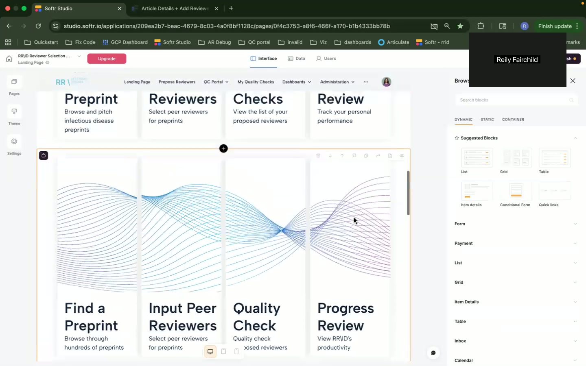
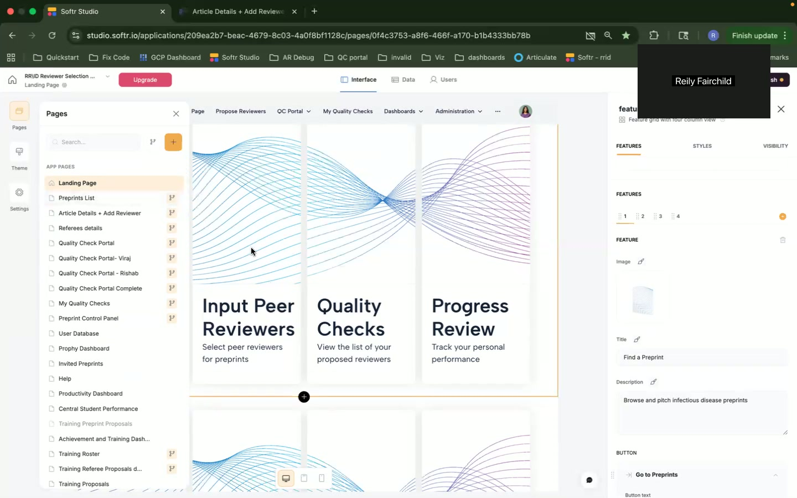

### 2.2 Preprints List

*   **Purpose:** To allow users to browse and search for preprints needing review.
*   **URL/Navigation Path:** Likely "/preprints" or from the "Find a Preprint" tile on the Landing Page.
*   **Visual Layout:**  A list of preprints.  There's a search bar at the top.
*   **UI Components:**
    *   Search bar.
    *   List component with selectable entries.
    *   Domain filter chips: BCS, MedSci, PSE, SSH. These filter the list by subject domain.
    *   Link fields: the title, abstract, etc. seem to be links to external resources.
    *   "Add Reviewers" button for each preprint.
*   **Features and Functionality:**
    *   Filtering by Domain.
    *   Searching the list of preprints.
    *   Navigating to the details of a specific preprint.
    *   Initiating the reviewer selection process for a preprint.
*   **Data Displayed:**
    *   Preprint Title (Likely a link)
    *   Corresponding Author Email
    *   Invite Count
    *   Reviewer Discipline
    *   Unchecked Count
    *   Reviewer Method Expertise
    *   Label
    *   Reviewer Topical Expertise
    *   Designated Reviewer Selection Lead Emails
*   **User Interactions:**
    *   Entering text in the search bar to filter preprints.
    *   Clicking on a domain chip to filter preprints by domain.
    *   Clicking on the preprint title (likely opens the article externally).
    *   Clicking the "Add Reviewers" button to propose reviewers for that preprint.
*   **Business Logic:**
    *   The list is likely paginated.
    *   The search function filters the list based on matching text in any of the displayed fields.
    *   The domain filter restricts the list to preprints matching the selected domain(s).
    *   "Invite Count" and "Unchecked Count" possibly related to the number of invitations sent and the number of reviews not yet completed.
*   **Edge Cases/Validation:**
    *   Handle no search results gracefully.
    *   Display appropriate messages if no preprints match a specific domain filter.
    *   Handle errors when fetching preprint data from the external link.
*   **Airtable Integration Points:**
    *   The list is populated from an Airtable table, likely named "Preprint Info ONLY" within the "RRID Reviewer Selection Process" base.  The Airtable base ID is visible as "patU7gT9o******s7".
*   **Softr-Specific Components:** List block, Search bar, possibly Softr's filter chips.

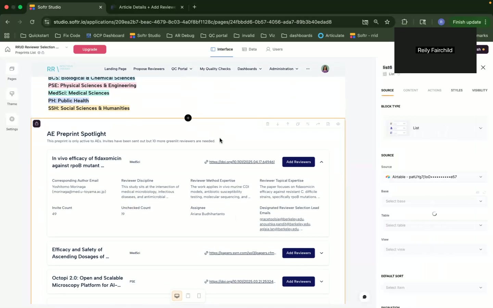
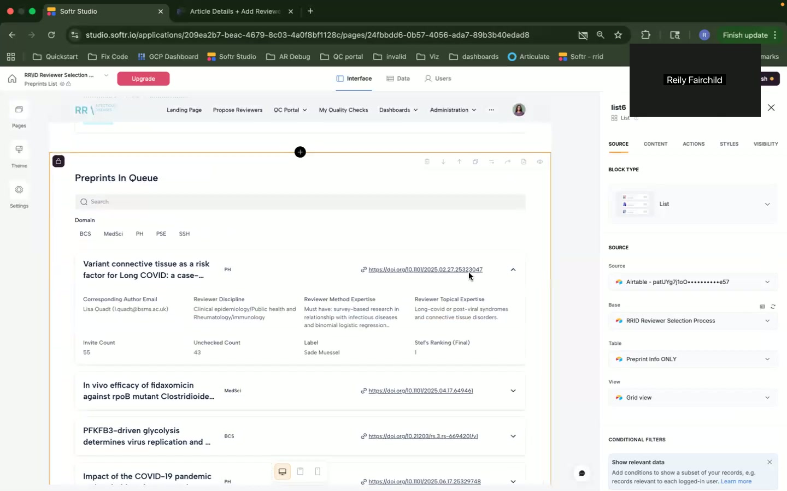

### 2.3 Article Details + Add Reviewer Page

*   **Purpose:** This page appears to combine viewing details about a selected preprint and adding potential reviewers to it.
*   **URL/Navigation Path:**  Likely accessed by clicking the "Add Reviewers" button on the Preprints List page, with the preprint ID passed as a parameter.
*   **Visual Layout:** Combination of list and form elements. The top displays article information, and below there is a form to "Propose a Reviewer".
*   **UI Components:**
    *   List of Preprint Details (see Data Displayed) with a "Add Reviewers" button (duplicate).
    *   Form to "Propose a Reviewer" (see below).
*   **Features and Functionality:**
    *   View Preprint details
    *   Propose a new reviewer via form.
*   **Data Displayed:**
    *   Preprint Title
    *   Corresponding Author Email
    *   Invite Count
    *   Reviewer Discipline
    *   Unchecked Count
    *   Reviewer Method Expertise
    *   Label
    *   Reviewer Topical Expertise
    *   Designated Reviewer Selection Lead Emails
*   **User Interactions:**
    *   Filling out the "Propose a Reviewer" form and submitting it.
*   **Business Logic:**
    *   The "Propose a Reviewer" form likely creates a new record in an Airtable table.
*   **Edge Cases/Validation:**
    *   The form likely contains required fields.
    *   Submission errors should be handled gracefully.
*   **Airtable Integration Points:**
    *   Displaying preprint details pulls data from the "Preprint Info ONLY" Airtable table.
    *   The "Propose a Reviewer" form sends data to the "Student Reviewer Inputs" table within the "RRID Reviewer Selection Process" Airtable base.
*   **Softr-Specific Components:** Form block, List block.

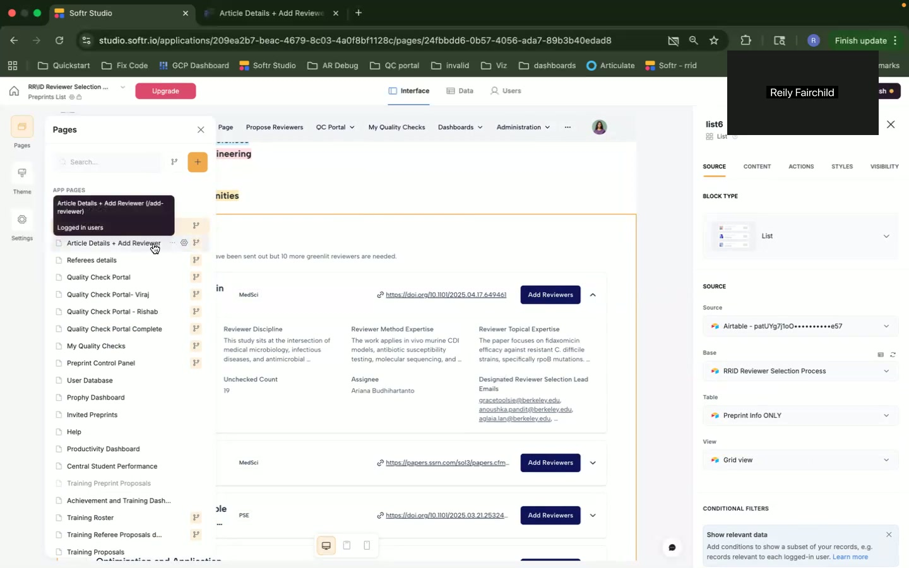

### 2.4 Propose a Reviewer (Form)

*   **Purpose:** To allow users to propose potential reviewers for a selected preprint.
*   **URL/Navigation Path:** Part of "Article Details + Add Reviewer" page, not a separate page.
*   **Visual Layout:** A standard form layout.
*   **UI Components:**
    *   Text input fields:
        *   Reviewer First Name* (required)
        *   Reviewer Last Name* (required)
        *   Reviewer Email* (required)
        *   Justification if not Institutional Email* (required)
        *   Affiliation* (required)
        *   Invite Backup? (probably a checkbox or radio button)
        *   Invite Backup for…
        *   Justify if you think the reviewer should not be the backup
        *   Affiliation Conflict of Interest
        *   Justification for Affiliation
    *   Submit button.
*   **Features and Functionality:**
    *   Collect information on potential reviewers.
    *   Submit the proposed reviewer for consideration.
*   **Data Displayed:** N/A (input form).
*   **User Interactions:**
    *   Filling out all the fields in the form.
    *   Submitting the form.
*   **Business Logic:**
    *   Required fields must be filled out before submission.
    *   Email validation on the "Reviewer Email" field.
    *   Conditional logic: display/hide "Invite Backup for..." field based on "Invite Backup?" selection.
*   **Edge Cases/Validation:**
    *   Handles invalid email formats.
    *   Handles submission errors gracefully.
*   **Airtable Integration Points:**
    *   The form data is sent to the "Student Reviewer Inputs" Airtable table.
*   **Softr-Specific Components:** Form block.

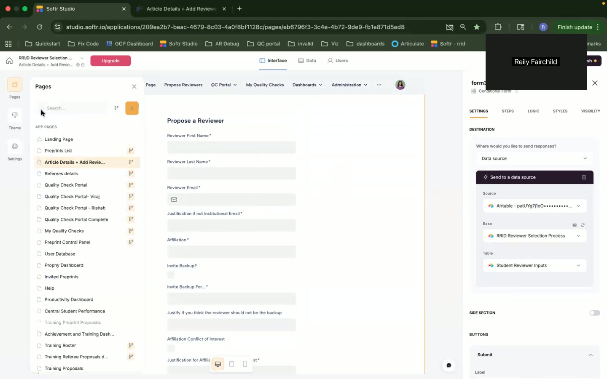
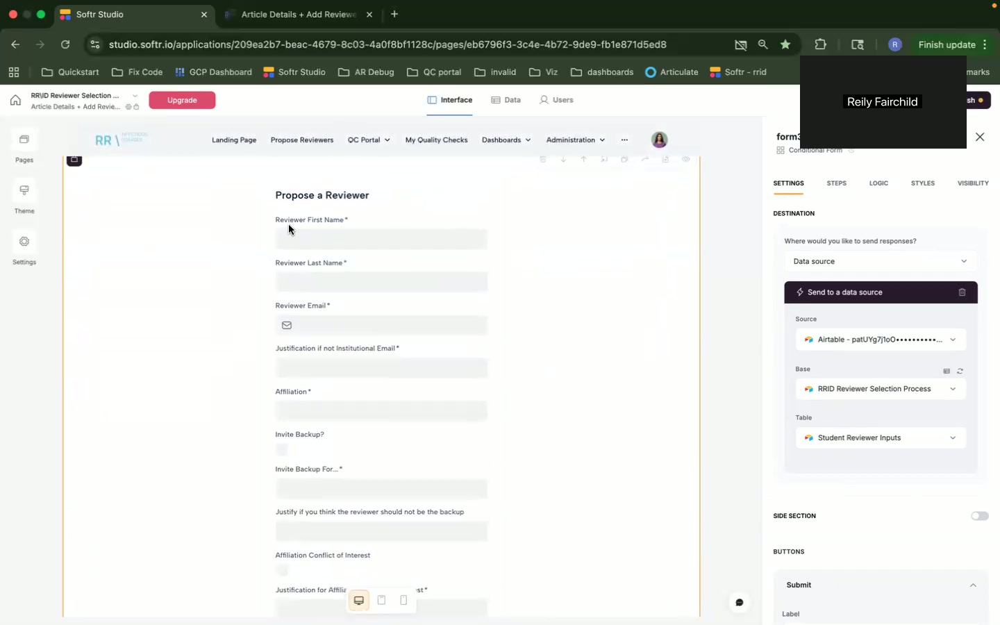
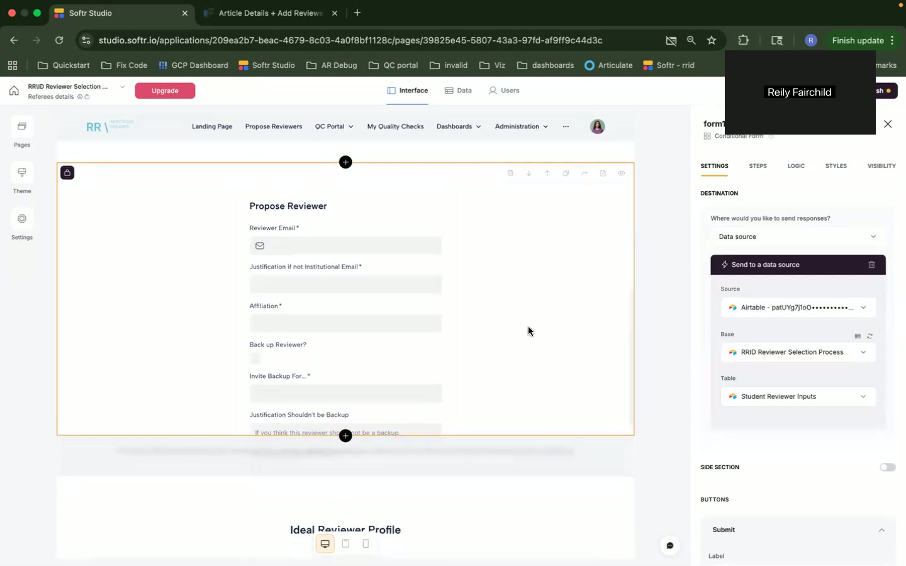

### 2.5 Reviewers List

*   **Purpose:** Displays a list of reviewers.
*   **URL/Navigation Path:** Likely "/reviewers" or from the "Reviewers" tile.
*   **Visual Layout:** A table view.
*   **UI Components:**
    *   Table with columns:
        *   Affiliation
        *   Subdiscipline
        *   Link to Profile
        *   Reviewer Email
*   **Features and Functionality:**
    *   Browse the list of reviewers and their information.
    *   Potentially navigate to a reviewer's profile page (via "Link to Profile").
*   **Data Displayed:** See "UI Components" for columns.
*   **User Interactions:**
    *   Clicking on the "Link to Profile" to navigate to the reviewer's detailed profile.
*   **Business Logic:**
    *   The table is likely paginated.
*   **Edge Cases/Validation:**
    *   Handles empty table gracefully.
*   **Airtable Integration Points:**
    *   Table data is sourced from the "Student Reviewer Inputs" table.
*   **Softr-Specific Components:** Table block.

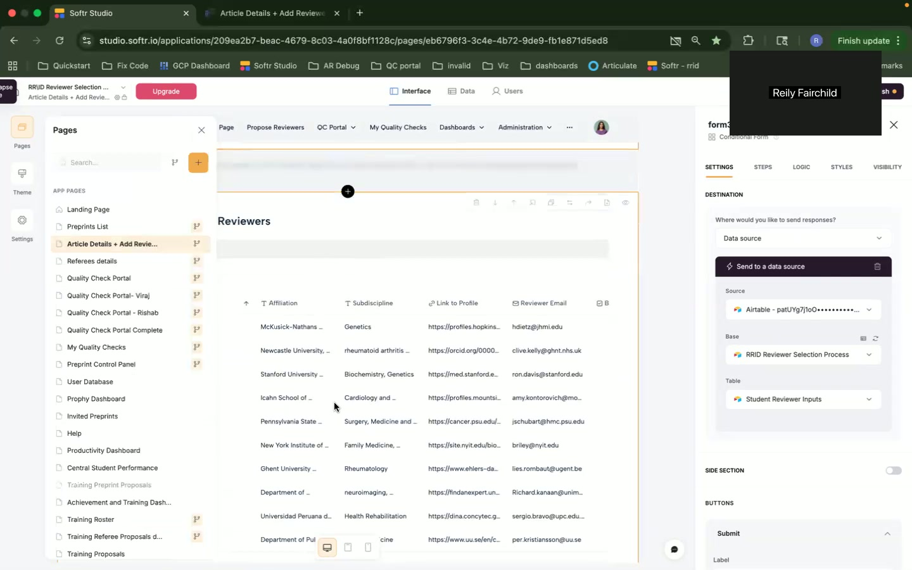

### 2.6 AI Suggested Reviewers List

*   **Purpose:**  Display a list of reviewers suggested by AI.  Allows users to claim or reject AI-suggested reviewers.
*   **URL/Navigation Path:** Unknown.
*   **Visual Layout:** A table with buttons for each row.
*   **UI Components:**
    *   Table with columns:
        *   Actions (Evaluate button)
        *   Name
        *   Status (Claimed, etc.)
        *   PubMed (Likely an external link)
        *   Student Email Claimed
        *   Author Url
    *   Evaluate button (per row).
*   **Features and Functionality:**
    *   Evaluate suggested reviewers.
    *   Claim a reviewer (likely after evaluating).
    *   Reject a reviewer.
*   **Data Displayed:** Information about AI suggested reviewers.
*   **User Interactions:**
    *   Clicking the "Evaluate" button.
    *   Claiming or Rejecting a reviewer.
*   **Business Logic:**
    *   The application likely limits the number of AI-suggested reviewers that can be claimed at a time (the message "Please note, you can only claim two AI suggested reviewers at a time. If you claim a third reviewer, the previous ones will be returned as 'Unable to Evaluate'." suggests this).
    *   The table displays "Actions" based on the reviewer's status.
*   **Edge Cases/Validation:**
    *   Handles exceeding the claim limit gracefully.
*   **Airtable Integration Points:**
        * Table data is sourced from an Airtable table, but the exact table name isn't visible.
*   **Softr-Specific Components:** Table block.


### 2.7 References Details (Reviewer Details?)

*   **Purpose:** Display detailed information about a specific reviewer. This seems to be a detailed view of a reviewer after clicking "Evaluate" or linking to their profile.  It also provides actions to reject or indicate inability to evaluate.
*   **URL/Navigation Path:** Unknown, likely accessed by clicking on a reviewer's name or "Evaluate" button on a list of reviewers.
*   **Visual Layout:** Displays information using a series of text blocks.
*   **UI Components:**
    *   Text blocks displaying reviewer details.
    *   "Reject/Unable to Evaluate Explanation" Text area to show the reviewers rationale.
    *   "Unable to Evaluate" button.
    *   "Reject Reviewer" section with "Justification for Student Reject*" (Text Area)
*   **Features and Functionality:**
    *   View detailed information about a reviewer.
    *   Mark a reviewer as unable to evaluate.
    *   Reject a reviewer and provide a justification.
*   **Data Displayed:**
    *   Helmut Burgmann details shown as example.
        *   Email
        *   Author URL
        *   ORCID
        *   Status
        *   H-Index
        *   Student Email Claimed
        *   Reject/Unable to Evaluate Explanation
*   **User Interactions:**
    *   Clicking the "Unable to Evaluate" button.
    *   Entering text in the "Justification for Student Reject" text area.
*   **Business Logic:**
    *   Clicking "Unable to Evaluate" likely updates the reviewer's status in Airtable.
    *   Rejecting a reviewer requires a justification.
*   **Edge Cases/Validation:**
    *   Requires justification before rejecting.
*   **Airtable Integration Points:**
    *   Data sourced from the appropriate reviewer table.
*   **Softr-Specific Components:** Item Details block, button, text area.

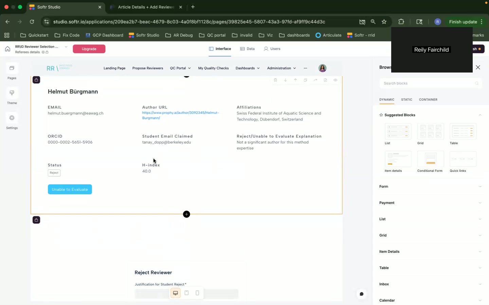

### 2.8 Code Customization

*   **Purpose:** Display Javascript Code.
*   **URL/Navigation Path:** Via Softr UI for modifying page settings.
*   **Visual Layout:** A code editor window.
*   **UI Components:**
    *   Code editor.
*   **Features and Functionality:**
    *   Customize the page's behavior by adding custom JavaScript code.
*   **Data Displayed:**
    * Javascript Code.
*   **User Interactions:**
    *   Editing the Javascript Code
*   **Business Logic:**
    *   The JavaScript code appears to be making a request to Airtable via the Airtable API to search for reviewers. The code snippet looks like:
    ```javascript
    async function fetchProposedReviewers(email){
      //const url = 'https://api.airtable.com/v0/{baseId}/{tableId}?filterByFormula=AND(FIND({fieldId} , "{articleID}")  '
      const url = 'https://api.airtable.com/v0/{baseId2}/{tableId2}?filterByFormula=AND(FIND(FieldSd, '{fieldID}'))'
      try{
          const data = await fetchUrl(url);
    ```
*   **Edge Cases/Validation:**
    *   Code will need to be properly formatted to work.
*   **Airtable Integration Points:**
    *   Makes requests to Airtable API.
*   **Softr-Specific Components:** Code blocks.

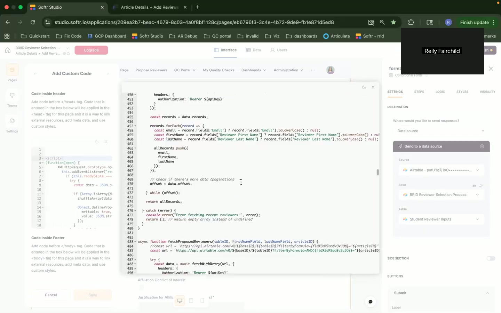

## 3. Technical Requirements

*   **Platform:** Softr.
*   **Database:** Airtable.
*   **Integration:** Softr's native Airtable integration.
*   **Authentication:** Softr's user authentication (not directly visible in screenshots, but inferred from the "Logged in users" page option).
*   **Frontend:** HTML, CSS, JavaScript (for custom code additions).
*   **API:** Airtable API (for advanced features and custom logic, as seen in the code customization).
*   **Security:** Secure storage of Airtable API keys.
*   **Performance:** Optimized Airtable queries and data loading for fast response times.
*   **Scalability:**  Scalable Airtable plans.

## 4. Data Models (Inferred)

*   **Preprints:**
    *   Title (String, Link)
    *   Corresponding Author Email (String)
    *   Reviewer Discipline (String)
    *   Invite Count (Number)
    *   Unchecked Count (Number)
    *   Reviewer Method Expertise (String)
    *   Label (String)
    *   Reviewer Topical Expertise (String)
    *   Designated Reviewer Selection Lead Emails (String, Email)
    *   Domain (String, single select or multiple select from BCS, MedSci, PSE, SSH)
*   **Reviewers:**
    *   Reviewer First Name (String)
    *   Reviewer Last Name (String)
    *   Reviewer Email (String)
    *   Affiliation (String)
    *   Subdiscipline (String)
    *   Link to Profile (URL)
    *   Invite Backup (Boolean)
    *   Invite Backup For (String)
    *   Justification (String)
    *   Affiliation Conflict of Interest (String)
    *   Justification for Affiliation (String)
*   **AI Suggested Reviewers:**
    *   Name (String)
    *   PubMed (URL)
    *   Status (String, Claimed/Rejected/Available)
    *   Student Email Claimed (String)
    *   Author URL (URL)
    *   Reject/Unable to Evaluate Explanation (String)
    *   Helmut Burgmann details shown as example.
        *   Email
        *   Author URL
        *   ORCID
        *   Status
        *   H-Index
        *   Justification for Student Reject (String)

## 5. User Workflows

1.  **Browse Preprints and Propose Reviewers:**
    *   User navigates to the Landing Page.
    *   User clicks on "Find a Preprint".
    *   User browses the list of preprints, filtering by domain or searching.
    *   User clicks the "Add Reviewers" button for a specific preprint.
    *   User fills out the "Propose a Reviewer" form with the reviewer's information.
    *   User submits the form.

2.  **Evaluate AI Suggested Reviewers:**
    *   User navigates to the AI Suggested Reviewers page.
    *   User views the list of AI suggested reviewers.
    *   User clicks "Evaluate" on a specific reviewer.
    *   User reviews the reviewer's details (likely on a separate page).
    *   User either:
        *   Claims the reviewer.
        *   Marks the reviewer as "Unable to Evaluate" or "Reject." Provides a justification if rejecting.

3. **Custom Javascript Search/Adding Reviewers**
    * The application allows the user to add custom Javascript code to add Reviewers.
    * The code allows the app to query Airtable for reviewer details.
