Okay, here's the comprehensive ISSUES AND PAIN POINTS document based on the video transcript, formatted in Markdown.

# RRID Reviewer Selection Process - Issues and Pain Points

## I. General Observations

*   **[00:19] Focus**:  The walkthrough primarily focuses on automations within the "Reviewer Selection Process" base.

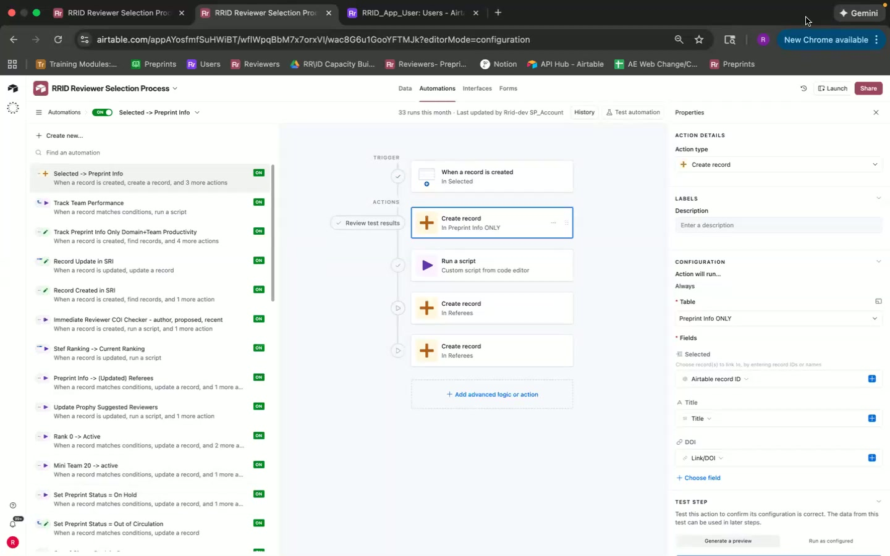

*   **[02:37] Goal**: The aim is to document the behind-the-scenes workings of this base and the required components.

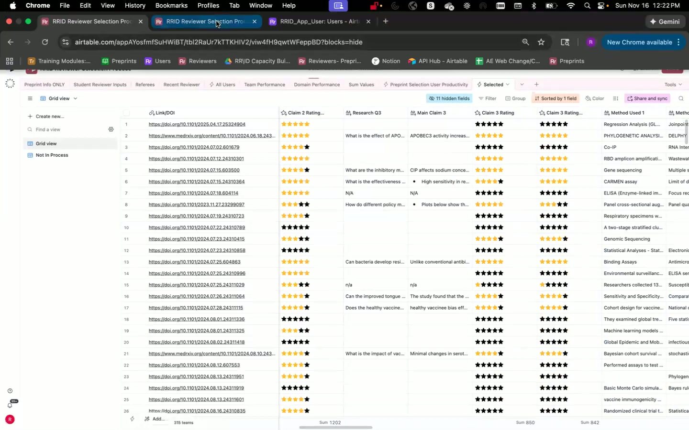

*   **[15:08, 30:25] Overall System Complexity**:  The presenter explicitly states that the overall system is "messy," needs adjustment and is needs to be rethought, suggesting significant architectural and design challenges.

## II. Problems Identified

### A. Data Inconsistencies / Integration Failures

*   **[03:11] Selected Table Sync**: An automation creates records in "Preprint Info Only" based on records in the "Selected" table. However, there's a safeguard to duplicate title and DOI information because of potential failures or changes in the "Selected" table.

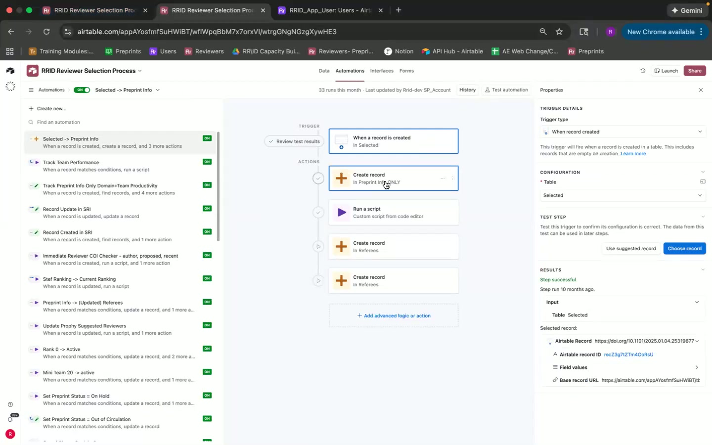

    *   **Impact**:  Addresses potential data loss or inconsistency between the two tables.
    *   **Workaround**:  Creating title and DOI backups.
    *   **Type:** Data Consistency, Integration.
    *   **System/Component:** Selected Table, Preprint Info Only Table.

*   **[35:35] Preprint Editorial Rejection**:

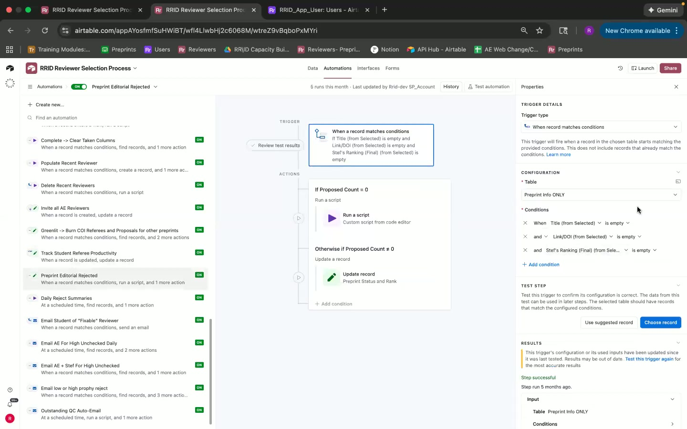

    *   **Description:** When a preprint is editorially rejected, it's removed from the "Selected" base, causing linked fields in the "Preprint Info Only" base to disappear, potentially leading to loss of information about student proposals.
    *   **Impact:** Loss of data on proposed reviewers if the preprint is removed from the "Selected" base.
    *   **Workaround:** If proposals exist, the status is set to "discarded" instead of deleting the record.
    *   **Type:** Data consistency, Integration
    *   **System/Component:** Selected Table, Preprint Info Only Table.

### B. Automation Problems & Bugs

*   **[16:07] Rank Readjustment Automation**:

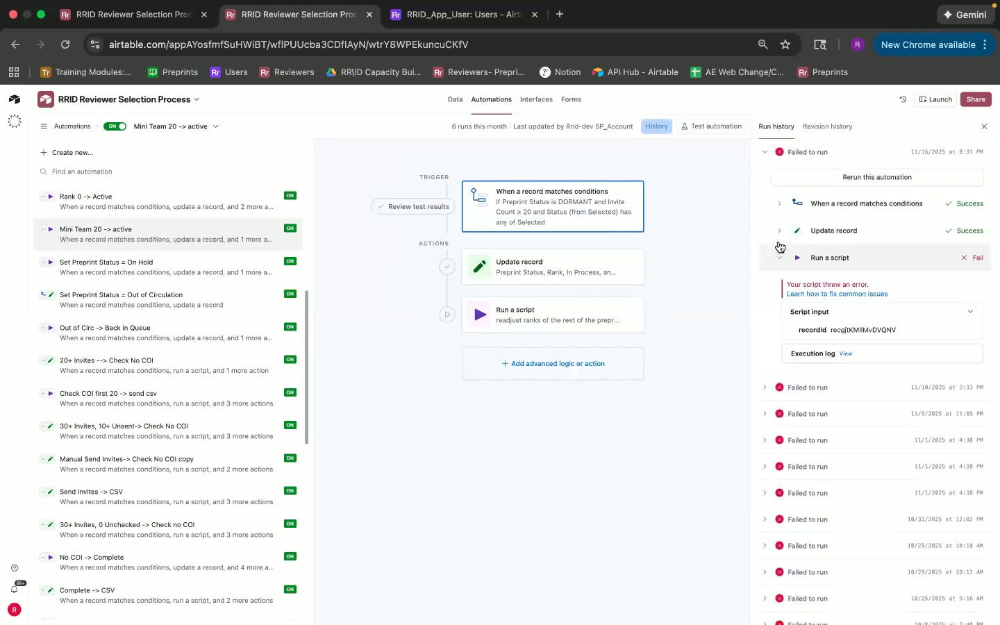

    *   **Description**: There's an identified issue and failure with the "Rank Readjustment" automation script. The description suggests it's supposed to promote mini-team dormant preprints to active status when the invite count reaches 20, and to readjust the ranks. The speaker admits there's a failure in execution, complex logic, and need a rework to function correctly.
    *   **Impact**: Automation script that is failing to function correctly.
    *   **Type:** Bug, Automation.
    *   **System/Component:** Rank Automation Script, Preprint Info Only.
*   **[24:06] Verified first 20 Automation Delay**:

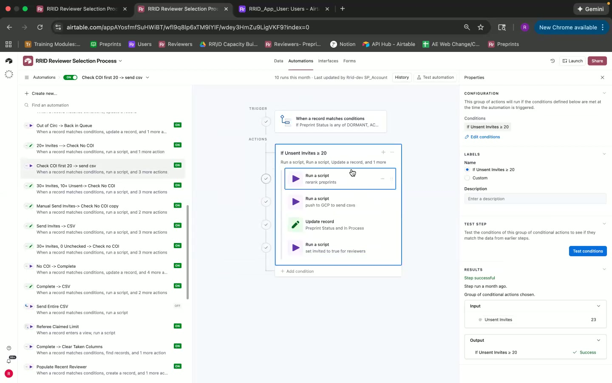

    *   **Description**: Automation had to be split into 2 to function.
    *   **Type:** Bug, Automation.
    *   **System/Component:** Preprint Info Only.

## III. Pain Points

### A. Workflow Inefficiencies & Complexity

*   **[06:52] Linking Domains to Preprints**: Linking preprints to domain performance tracking is hard to do with scripts.

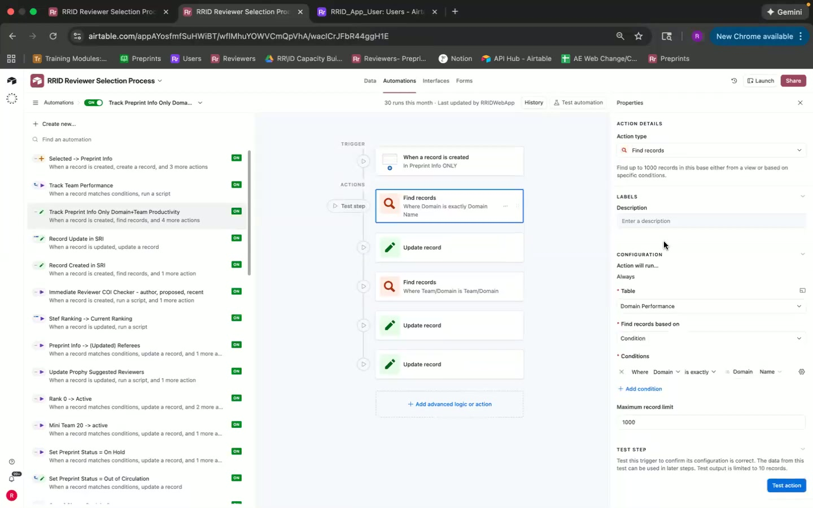

    *   **Impact**: Requires manual effort or potentially less efficient solutions.
    *   **Type:** Workflow Inefficiency, Technical Debt.
    *   **System/Component:** Domain Performance Tracking, Preprint Info Only.
*   **[14:58] Preprint Workflow Messiness**:  The entire workflow around preprint ranking, activation, holds, and invites is described as "pretty messy," and needing adjustment.

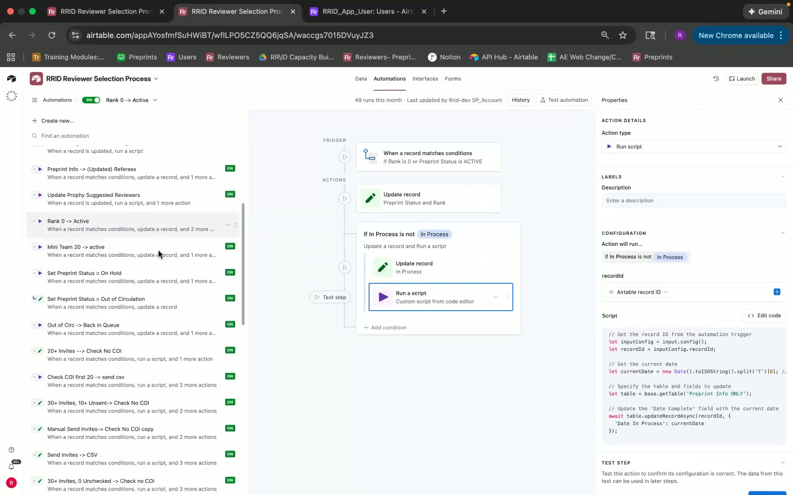

    *   **Impact**: Potential confusion, errors, and wasted time.
    *   **Type:** Workflow Inefficiency, UX, Architecture.
    *   **System/Component:** Preprint Info Only (various automations related to status).
*   **[22:15] Bringing Preprint Back Alive Messiness**: Automation that brings preprints back to live needs improvement.

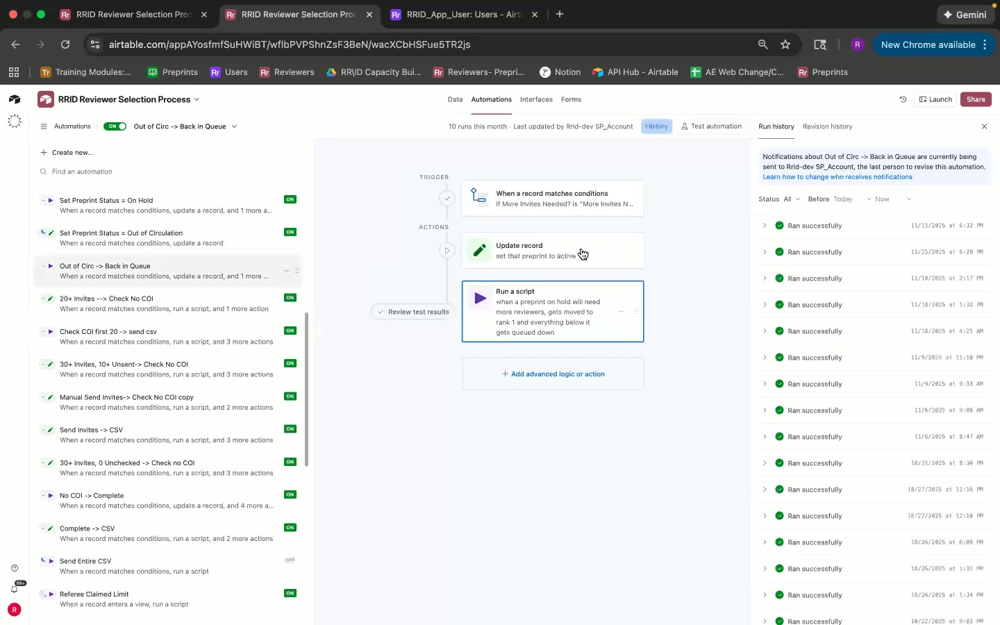

    *   **Impact**: Redundant coding and workflow.
    *   **Type:** Workflow Inefficiency, UX, Architecture.
    *   **System/Component:** Preprint Info Only (various automations related to status).
*   **[24:53] On-hold invites for reviewers and CSV issue**: The on-hold status for reviewers after the first 20 CSV emails are sent could be improved and needs follow up on if it should be active.

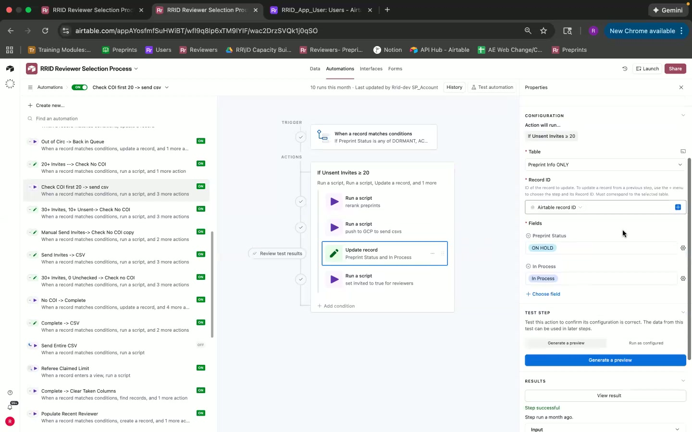

    *   **Impact**: Redundant workflow and confusing.
    *   **Type:** Workflow Inefficiency, UX, Architecture.
    *   **System/Component:** Preprint Info Only (various automations related to status).
*   **[30:00] CSV List for Reviewers**: Workflow that updates the CSV files needs to be better and that the "invited field" need to be better coded.

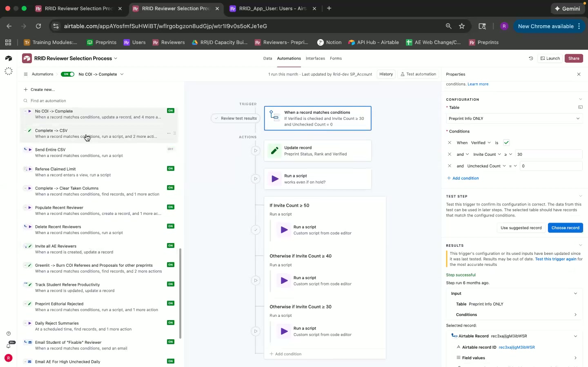

    *   **Impact**: Redundant coding and workflow.
    *   **Type:** Workflow Inefficiency, UX, Architecture.
    *   **System/Component:** Preprint Info Only (various automations related to status).
*   **[32:24] Batching Reviewers**: Automation that sends invitations to the reviewers needs to be batched.

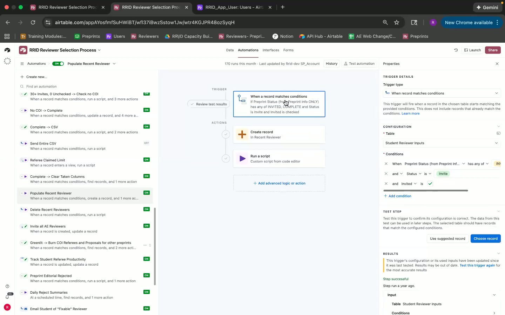

    *   **Impact**: Redundant coding and workflow.
    *   **Type:** Workflow Inefficiency, UX, Architecture.
    *   **System/Component:** Preprint Info Only (various automations related to status).

### B. User Experience

*   **[10:11] Justification for Invite Formula**: A formula is used to generate the justification for invite emails because students struggled to write them correctly.

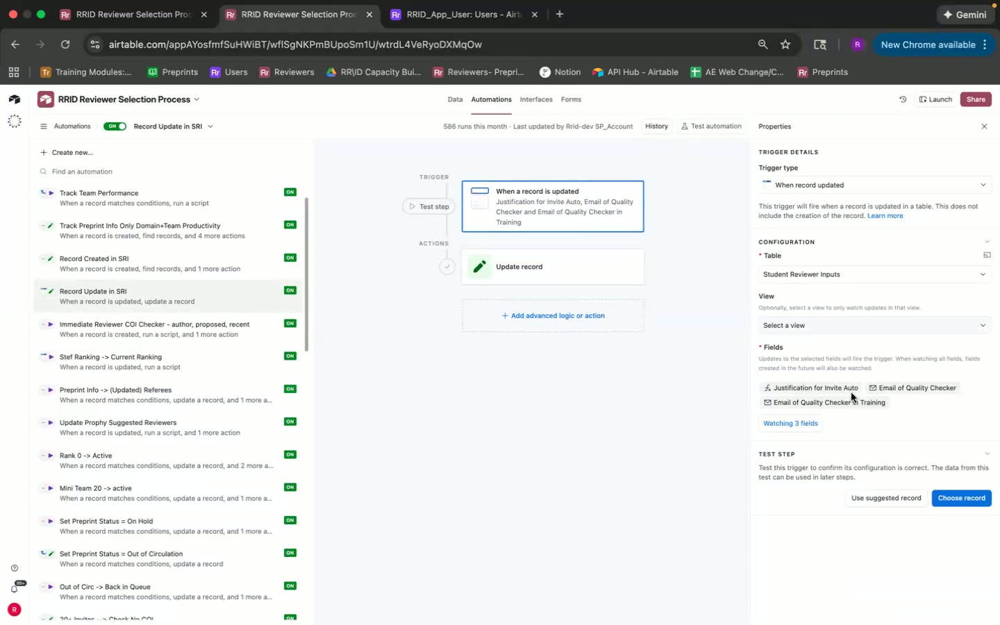

    *   **Impact**: Indicates a UX issue in the reviewer proposal process, where guidance or better tools are needed for students.
    *   **Type:** UX, Training
    *   **System/Component:** Student Reviewer Input form/process.

### C. Manual Workarounds

*   **[26:40] Editorial team manually send CSVs**: Manual intervention needed and a manual process is checked to send CSVs due to inefficiencies in the original process.

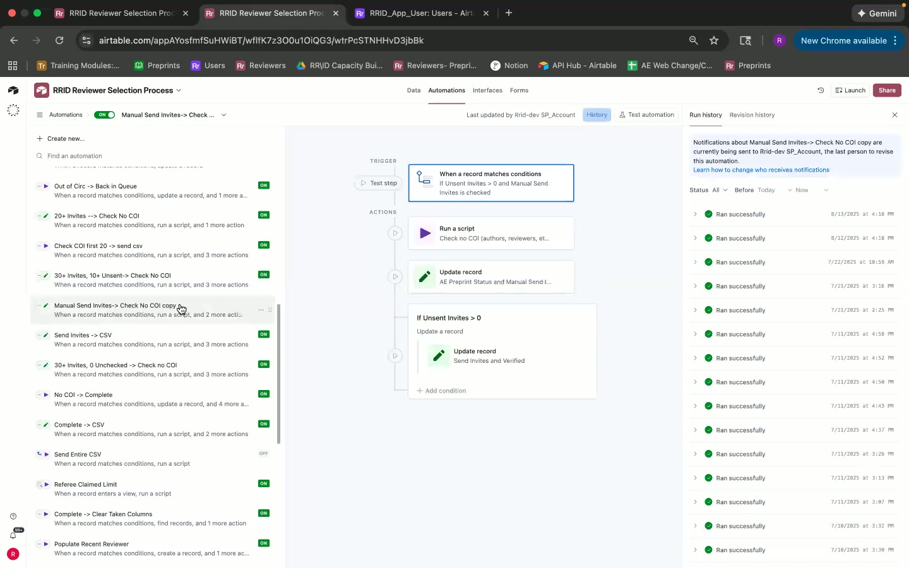

    *   **Impact**: Creates additional manual intervention and workload to the process.
    *   **Type:** Workflow Inefficiency, UX, Architecture.
    *   **System/Component:** Preprint Info Only (various automations related to status).

### D. Confusing and unclear processes

*   **[27:59] Flag those as invited for the CSVs process**: CSV email process could be clarified.

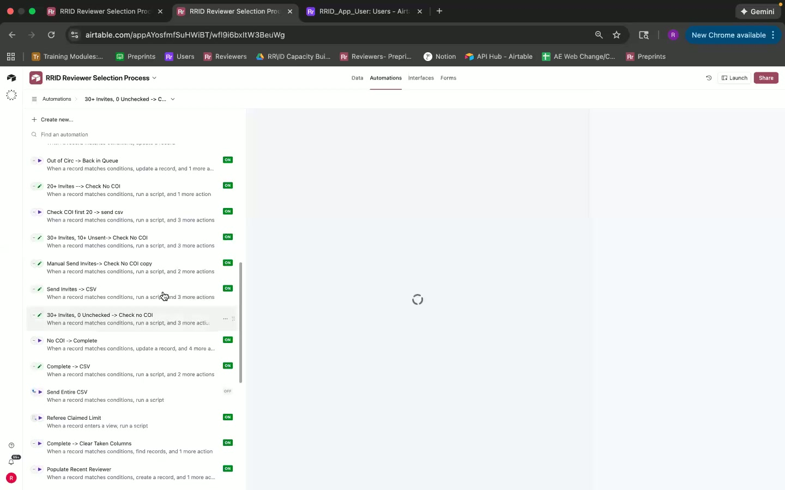

    *   **Impact**: Confusing due to unclear label.
    *   **Type:** Workflow Inefficiency, UX, Architecture.
    *   **System/Component:** Preprint Info Only (various automations related to status).

## IV. Architecture Concerns

### A. System Limitations / Technical Debt

*   **[07:06] Script Limitations**: Scripting limitations in creating linking for certain data.

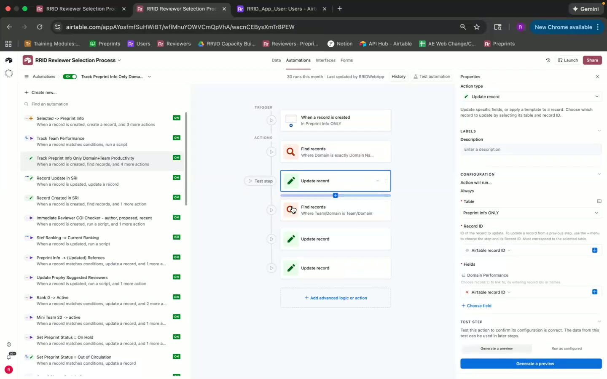

    *   **Impact**: Requires additional work to improve automation.
    *   **Type:** Technical Limitations.
    *   **System/Component:** Scripting Logic, Data Linking.

### B. Maintenance Challenges

*   **[21:14] Recommend looking at code to improve the workflow**: High likelihood of improvement.

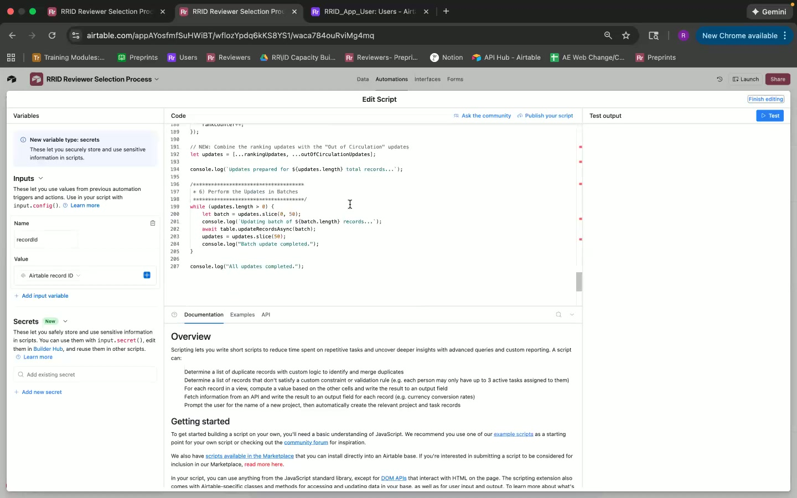

    *   **Impact**: Requires time and effort to improve.
    *   **Type:** Maintenance Challenges.
    *   **System/Component:** Scripting Logic, Data Linking.

## V. Additional Notes

* **Focus on Code**:  The presenter suggests referring to the code itself as the ultimate source of truth. This implies that the documentation or the conceptual understanding of the automations might be lacking.  (Multiple Timestamps)
* **Incomplete Knowledge**:  The presenter admits a lack of understanding for a weekly script. (39:18)  This raises concerns about knowledge silos and the ability to maintain the system long-term.

This document provides a solid foundation for prioritizing improvements and addressing the most critical pain points within the RRID Reviewer Selection Process.