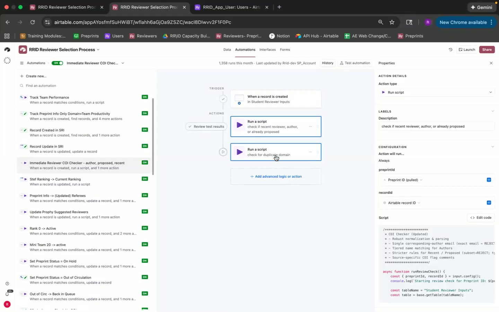
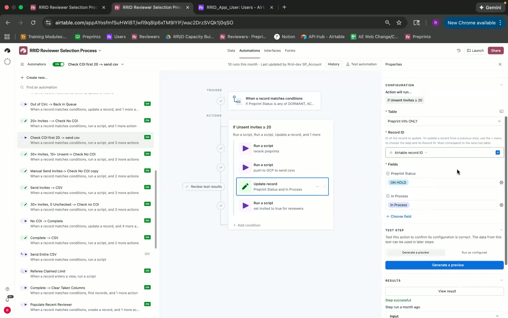
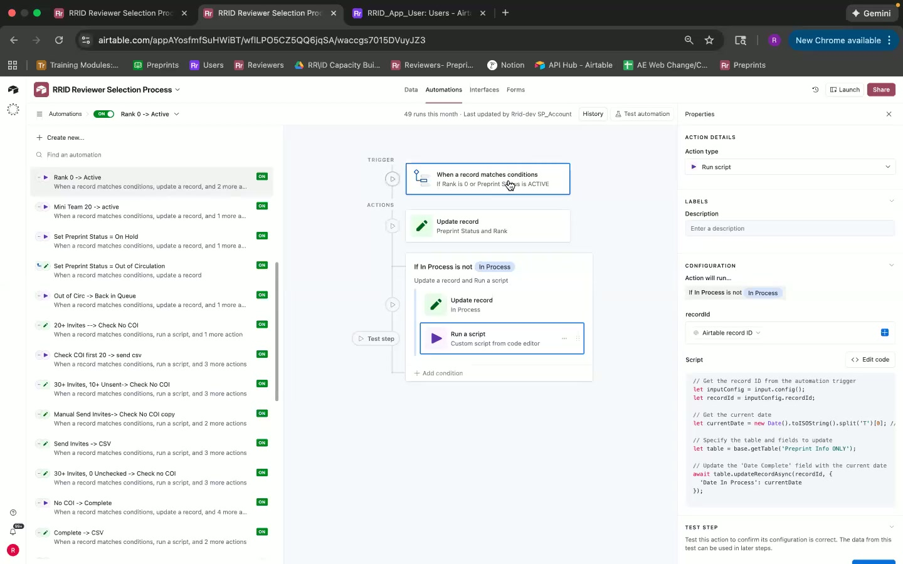
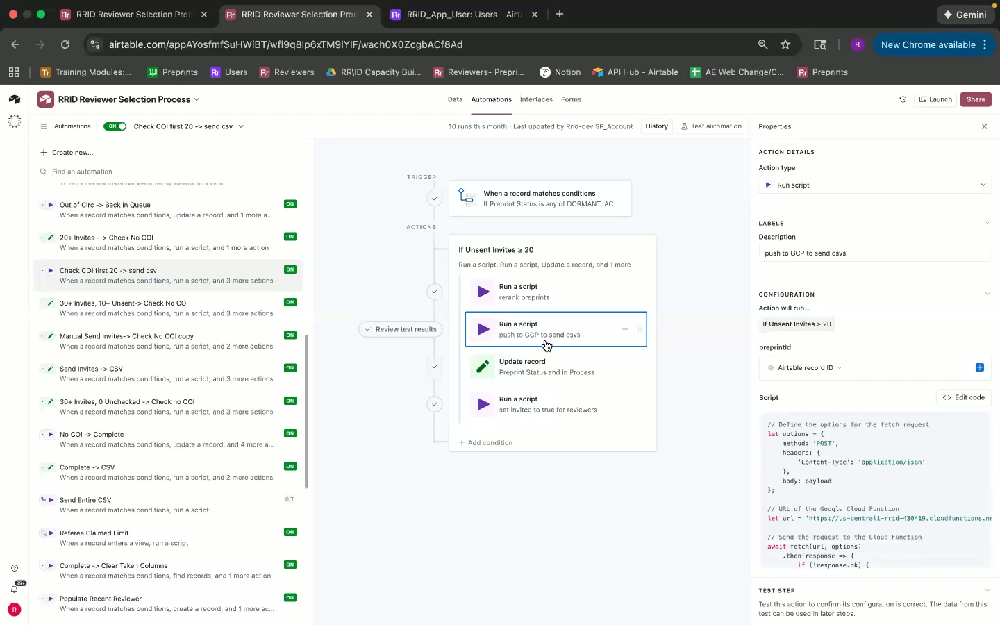
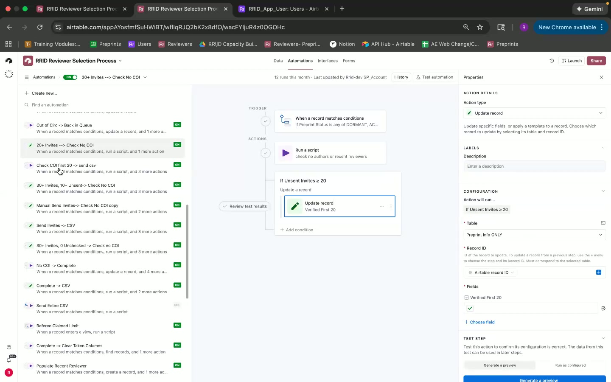
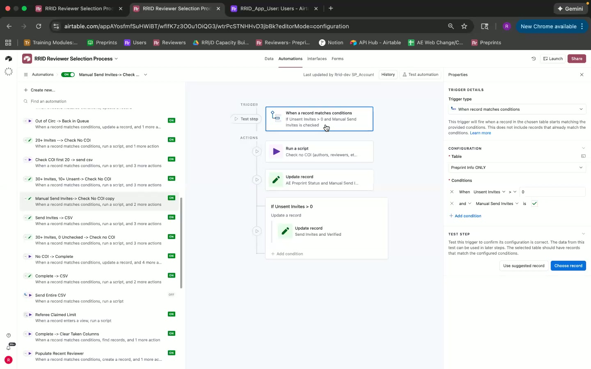
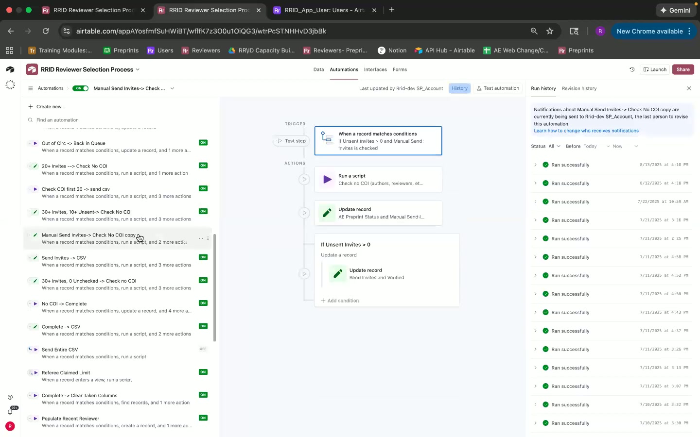
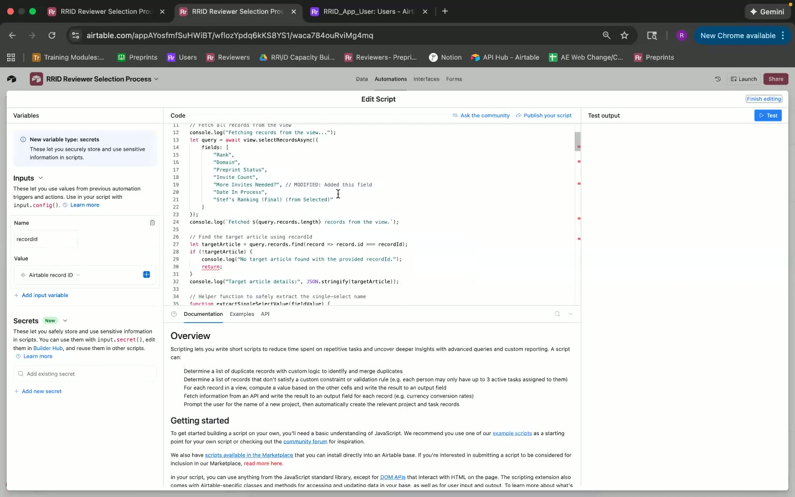
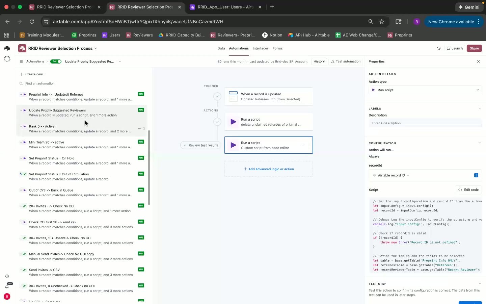

Certainly! Here's a comprehensive document organized in Markdown format that catalogs issues and pain points from the video walkthrough:

```markdown
# RRID Reviewer Selection Process: Issues and Pain Points Document

## 1. Problems Identified

### 1.1 Technical Issues
- **Problem:** Re-ranking complexity leads to errors.  
  **Timestamp:** [11:12]  



  **Impact:** Incorrect ranking of preprints.  
  **Workaround:** Manual intervention required.  
  **Priority:** High

- **Problem:** Invite status errors when preprint status transitions.
  **Timestamp:** [24:53]



  **Impact:** Incorrect preprint status updates.  
  **Workaround:** Manual check required.  
  **Priority:** Medium

### 1.2 Bugs or Errors
- **Problem:** Script fails during specific automation triggers.
  **Timestamp:** [15:19]



  **Impact:** Automation halts midway.  
  **Workaround:** Restart automation process.  
  **Priority:** High

### 1.3 Integration Failures
- **Problem:** Google Cloud server connection issues.
  **Timestamp:** [24:44]



  **Impact:** CSV updates not sent, delaying reviewer invitations.  
  **Workaround:** Manual CSV sending.  
  **Priority:** Critical

### 1.4 Data Inconsistencies
- **Problem:** Preprint information not syncing correctly.  
  **Timestamp:** [23:53]  



  **Impact:** Mismatched records and incorrect data tracking.  
  **Workaround:** Manual data adjustments.  
  **Priority:** Medium

## 2. Pain Points

### 2.1 Workflow Inefficiencies
- **Issue:** Manual intervention required for inviting reviewers.
  **Timestamp:** [26:47]



  **Impact:** Increased workload on editorial team.  
  **Priority:** High

### 2.2 User Experience Frustrations
- **Issue:** Confusing process to trigger manual sends.
  **Timestamp:** [26:40]



  **Impact:** Delays in sending invitations.  
  **Priority:** Medium

### 2.3 Scalability Concerns
- **Issue:** System struggles under large batches of data.
  **Timestamp:** [19:43]



  **Impact:** Performance bottlenecks, data backlog.  
  **Priority:** High

## 3. Architecture Concerns

### 3.1 System Limitations
- **Concern:** Dependency on Google Cloud for key operations.
  **Timestamp:** [24:44]


  **Impact:** Risk of downtime or service disruption.  
  **Priority:** Critical

### 3.2 Maintenance Challenges
- **Concern:** High maintenance due to complex custom scripts.
  **Timestamp:** [14:40]



  **Impact:** Increased development time for updates.  
  **Priority:** Medium

## 4. Issue Focus Details

### High-Critical Priority Issues
- **Re-ranking Complexity**
  - **Impact:** Incorrect rankings delay processes.
  - **Suggested Solution:** Simplify scripts or automate checks.

- **Google Cloud Server Connection**
  - **Impact:** Reviewer invitation delays.
  - **Suggested Solution:** Explore alternative hosting solutions.

### Medium Priority Issues
- **Invite Status Errors**
  - **Impact:** Potential for data inconsistency.
  - **Suggested Solution:** Implement more robust error handling scripts.

- **Manual Process Triggers**
  - **Impact:** Workflow delays.
  - **Suggested Solution:** Introduce clearer user interface cues.

## 5. Categorization by System/Component

- **Automation Scripts**
  - Type: Performance, UX
  - User Impact Level: High

- **Data Syncing**
  - Type: Bug, Data Consistency
  - User Impact Level: Medium

- **Integration Processes**
  - Type: Integration, Scalability
  - User Impact Level: Critical

---

This document should serve as a structured reference to address pressing issues, streamline process improvements, and enhance user satisfaction within the RRID Reviewer Selection Process.
```

This structured document categorizes and prioritizes key issues and pain points encountered in the system, providing a roadmap for troubleshooting and improvements.