# RRID Reviewer Selection Process Walkthrough

## Chapter 1: Introduction to the Reviewer Selection Process

### Key Takeaways
- Explanation of automations within the reviewer selection process base.
- Focus on preprint info and reviewer inputs.
- UI layout display with tables and views.

### Description
The walkthrough begins with an explanation of the automations specifically targeted at the reviewer selection process. The speaker emphasizes the importance of the preprint information and how it connects with student reviewer inputs. The interface demonstrates several tables such as "Preprint Info ONLY" and "Student Reviewer Inputs" with distinct color-coded tabs for easy navigation.

### Important UI Elements
- Tabs like "Preprint Info ONLY" and "Student Reviewer Inputs".
- Color-coded views for organization.
- Search and filter options to maneuver through records.

### Timestamps
- **[00:15]** - Introduction and overview of interface elements.

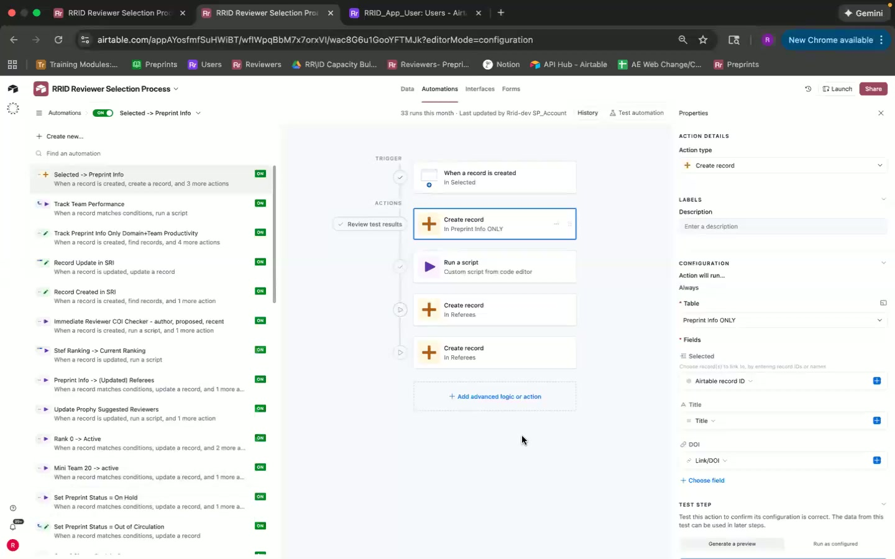

## Chapter 2: Table Relationships and User Interactions

### Key Takeaways
- Explanation of related tables and their role in the process.
- Interaction between student and AI-suggested reviewers.
- Use of linked fields within the tables.

### Description
The speaker dives into table relationships, highlighting how the preprint information connects to student reviewer inputs and referees. These tables are indexed by the preprint ID. Recent reviewers and all users are other critical elements that tie into the reviewer selection process.

### Important UI Elements
- Field linking indicators (e.g., lightning bolt icon).
- Tabs for "Recent Reviewers" and "All Users".

### Timestamps
- **[00:40]** - Explanation of preprint information and student reviewer inputs.

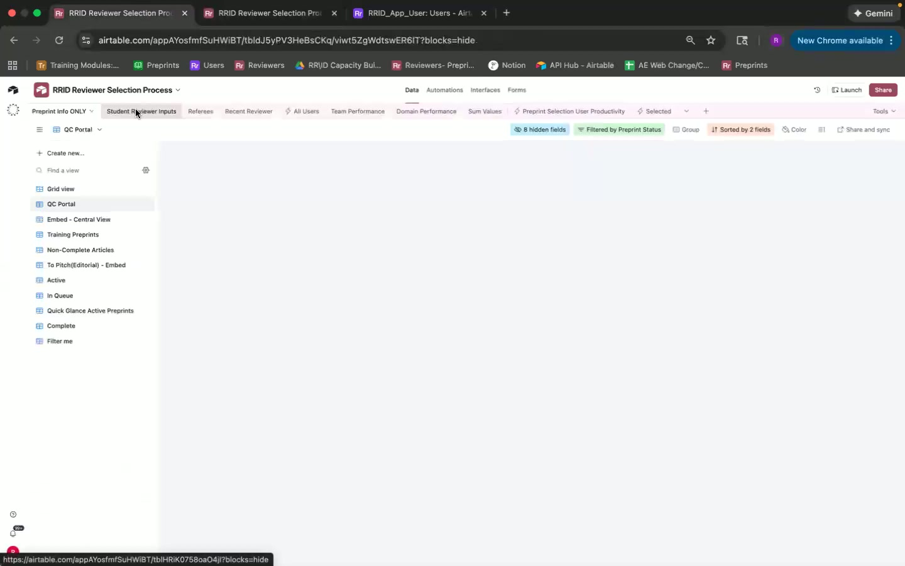

- **[01:17]** - Reference to the "All Users" view and its association with the RID app.

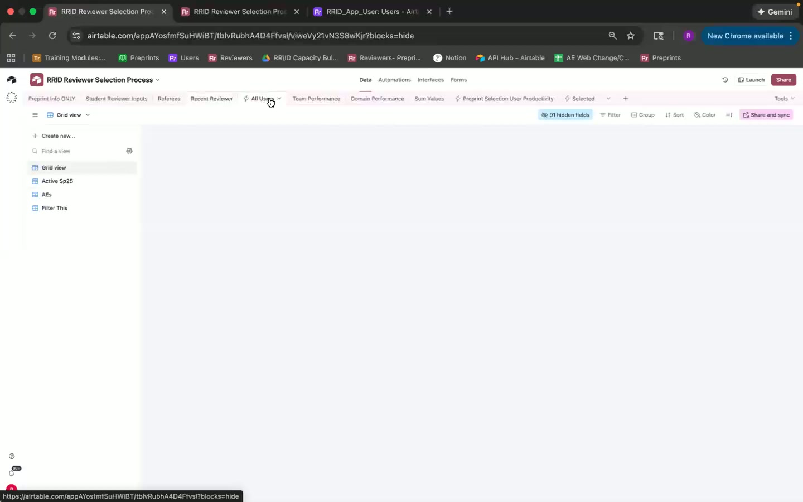

## Chapter 3: Automation Details and Processes

### Key Takeaways
- Automations for creating and linking records.
- Integration of scripts for data handling.
- Backup mechanisms for data integrity.

### Description
The speaker explains the automations used for creating records when a preprint is selected. There's a focus on the need for creating backup records to prevent data loss. Scripts run to handle rank assignments and data updates.

### Important UI Elements
- Automation triggers and actions layout.
- Script editor interface.
- Test steps and previews for automation verification.

### Timestamps
- **[02:17]** - Display of automation triggers for creating records.

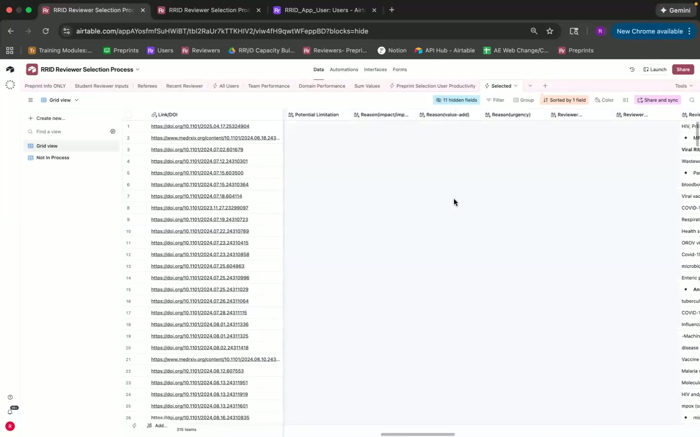

- **[03:26]** - Insight into the script editor and how automations occur.

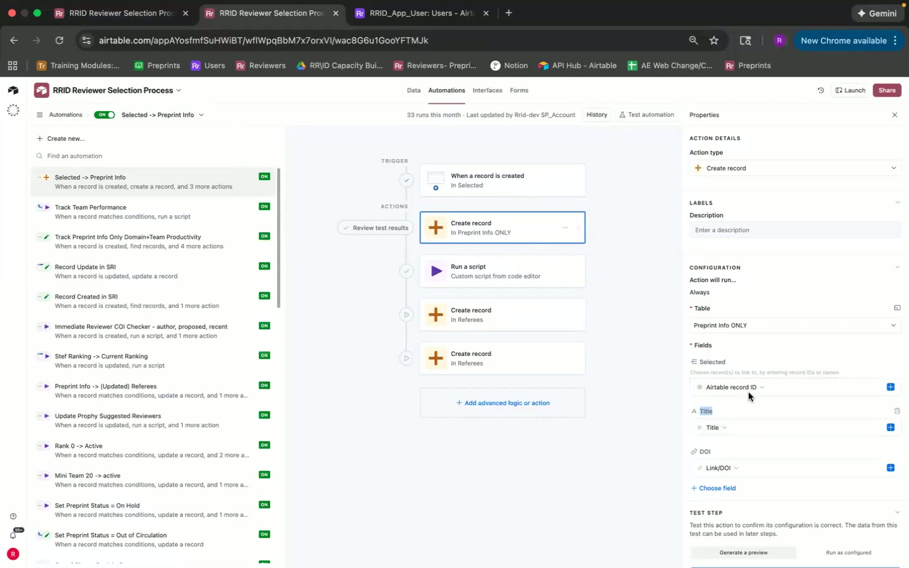

- **[04:30]** - Details about ranking logic scripts.

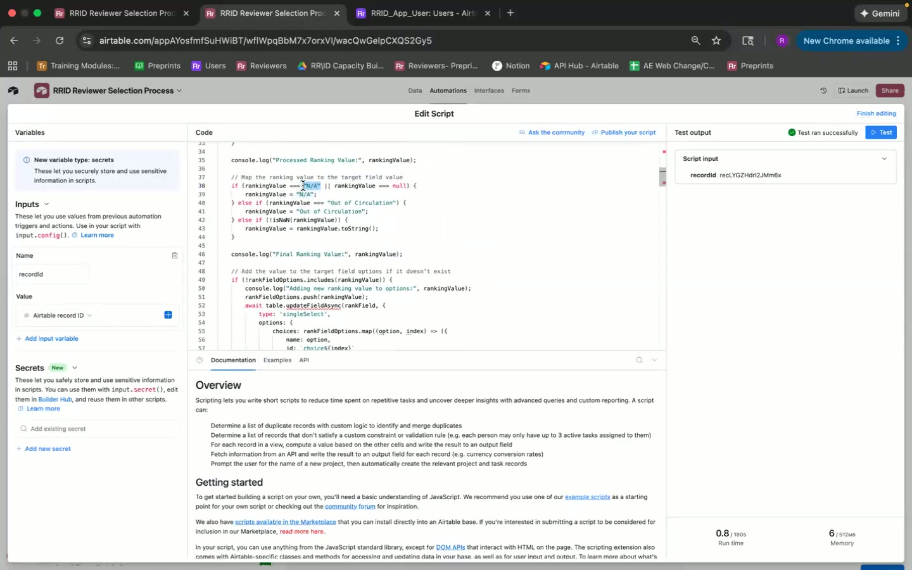

## Chapter 4: Handling Proposals and Reviewer Selection

### Key Takeaways
- Process for proposing reviewers.
- Scripts for conflict of interest checks.
- Linking proposed reviewers to teams.

### Description
This section explains how records within the "Student Reviewer Inputs" table are handled. Scripts are showcased that check for conflicts of interest, ensuring authors aren't reviewers, and manage duplicate domain proposals.

### Important UI Elements
- Conflict of interest checker settings.
- Conditions for reviewer checks.

### Timestamps
- **[07:28]** - Review of scripts checking for conflicts and author associations.

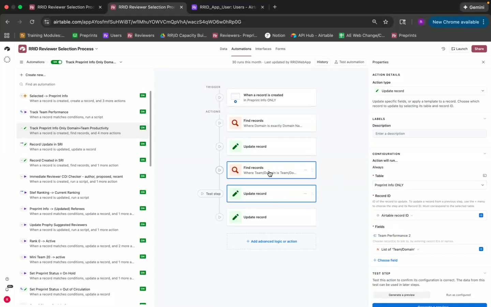

- **[08:23]** - Linking processes for team and domain productivity.

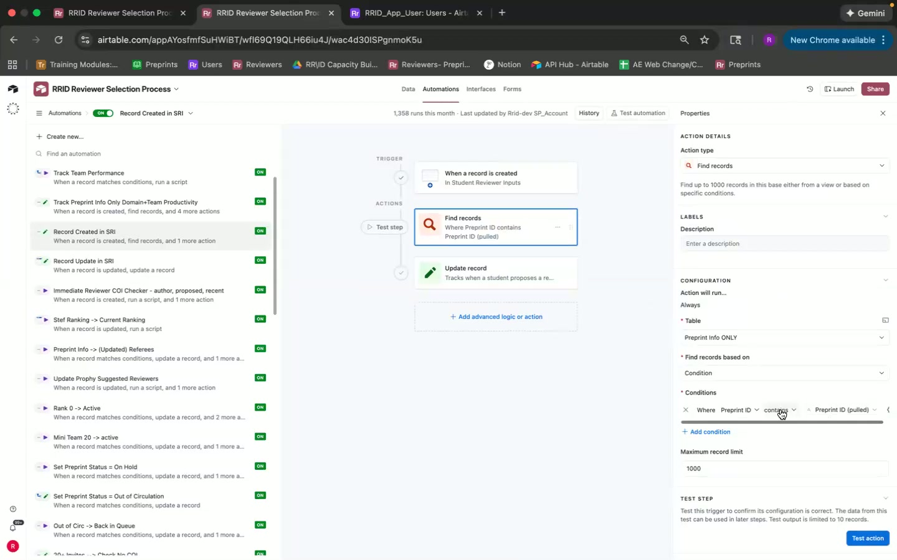

## Chapter 5: Invite Process and Ranking Management

### Key Takeaways
- Invite count triggers to determine status updates.
- Prioritization based on preprint status and ranks.
- Manual intervention options for sending invites.

### Description
The walkthrough includes setting preprint status based on invite counts and manual options for sending invites. There are detailed conditions outlined for when preprints require more reviewers and when statuses like "ON HOLD" are applicable based on internal logic.

### Important UI Elements
- Automation conditions for invite handling.
- Ranking and status update options.
- Manual send invites checkbox.

### Timestamps
- **[15:08]** - Overview of conditions that trigger preprint status changes.

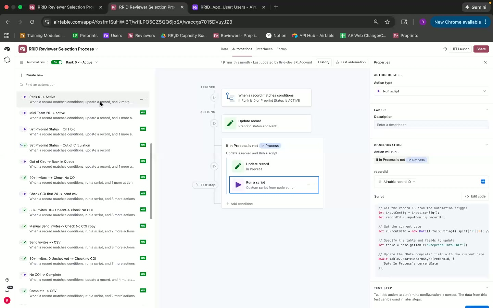

- **[19:14]** - Step-by-step on preprint status set to "ON HOLD".

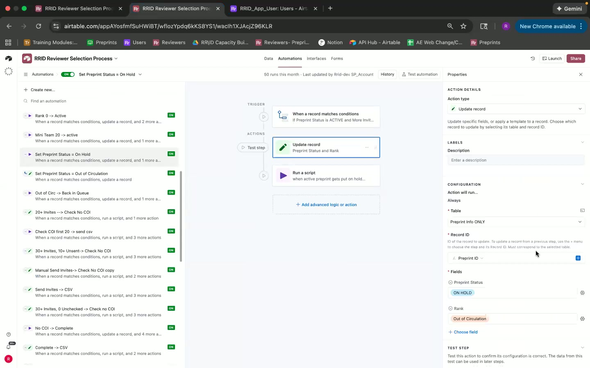

- **[25:04]** - Manual send invite feature explanation.

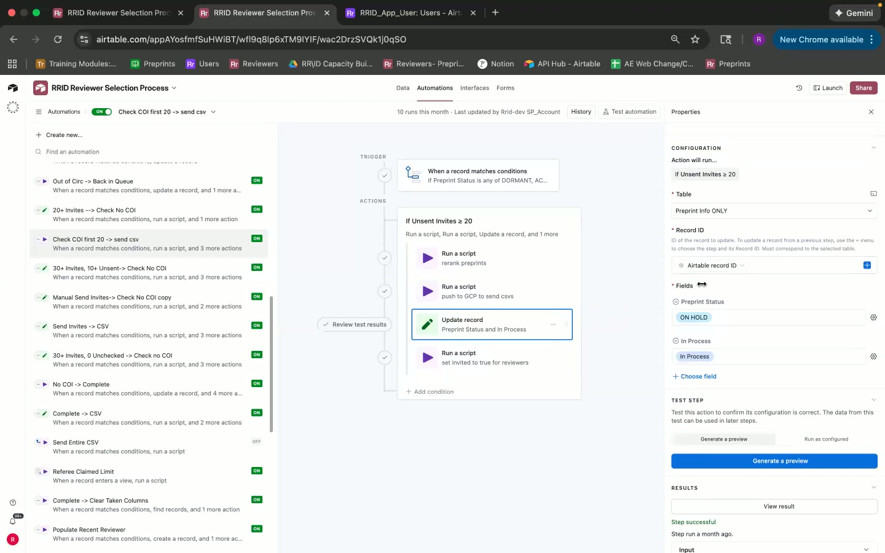

## Chapter 6: Finalization and Cleanup Activities

### Key Takeaways
- Completing the selection process and archiving.
- Clearing out unnecessary records to streamline processes.
- Automated emails for daily summaries and quality checks.

### Description
Final sections focus on the automation for completing the selection process, clearing columns, and sending daily summaries. This includes setting records as complete, running clean-up scripts, and ensuring no duplicates are left in the system.

### Important UI Elements
- Complete and clear taken columns automation.
- Daily email and summary setup.

### Timestamps
- **[28:25]** - Details on process completion and status updates.

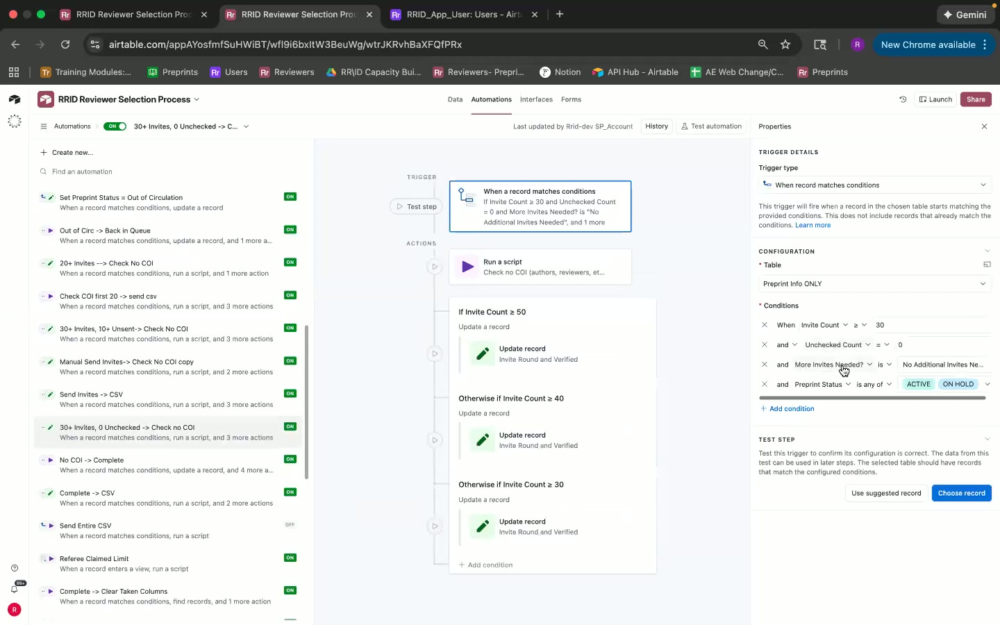

- **[31:18]** - Record creation and automation triggering for recent reviewers.

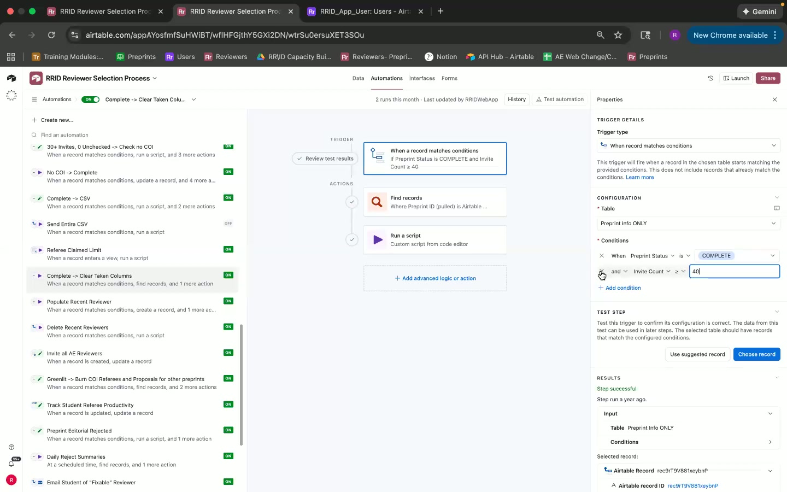

- **[37:21]** - Email automation for quality checks and daily summaries.

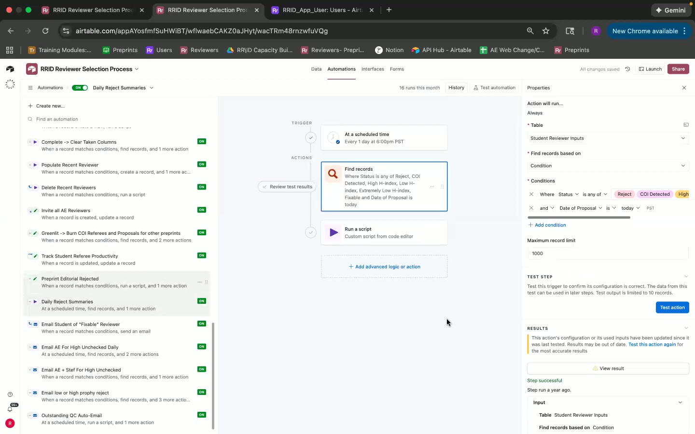
