# Product Requirements Document: RRID Reviewer Selection Process

**Version:** 1.0
**Date:** November 19, 2025
**Author:** Gemini

## Table of Contents

1.  [Executive Summary](#executive-summary)
2.  [Introduction](#introduction)
3.  [Goals](#goals)
4.  [Target Audience](#target-audience)
5.  [Scope](#scope)
6.  [Assumptions and Dependencies](#assumptions-and-dependencies)
7.  [Pages and Features](#pages-and-features)
    *   [Automations Page](#automations-page)
    *   [Preprint Info Only Table](#preprint-info-only-table)
    *   [Student Reviewer Inputs Table](#student-reviewer-inputs-table)
    *   [Referees Table](#referees-table)
    *   [All Users Table](#all-users-table)
    *   [Team Performance Table](#team-performance-table)
    *   [Domain Performance Table](#domain-performance-table)
    *   [Selected Table](#selected-table)
    *   [Recent Reviewer Table](#recent-reviewer-table)
8.  [Technical Requirements](#technical-requirements)
9.  [User Interactions and Workflows](#user-interactions-and-workflows)
10. [Data Model](#data-model)
11. [Release Criteria](#release-criteria)
12. [Future Considerations](#future-considerations)

## 1. Executive Summary

This document outlines the product requirements for rebuilding the Rapid Reviews Infectious Disease (RRID) reviewer selection process base from a video walkthrough. The application is designed to automate and streamline the process of selecting reviewers for preprints, tracking team performance, and managing reviewer data. This document details the UI components, features, functionality, business logic, and data models required to rebuild the application from scratch.  It focuses primarily on the automations and the data tables that drive those automations.

## 2. Introduction

The RRID reviewer selection process is a critical component of the RRID workflow. This application automates several aspects of this process, including importing preprint data, suggesting reviewers, tracking team performance, and managing communications. The current system appears to be built on Airtable.  This PRD aims to provide developers with a clear and comprehensive guide for rebuilding the application using modern web development technologies.

## 3. Goals

*   Rebuild the RRID reviewer selection process application with all existing features and functionality.
*   Improve the user interface and user experience.
*   Ensure the application is scalable and maintainable.
*   Document the application's architecture and data model.

## 4. Target Audience

*   Developers
*   Project Managers
*   Product Owners
*   RRID Editorial Team

## 5. Scope

This PRD covers the following aspects of the application:

*   User interface and visual design
*   Core features and functionality
*   Data model and database design
*   Automations and workflows
*   Technical requirements and dependencies

This PRD does *not* cover:

*   Server infrastructure or deployment details.
*   Detailed API specifications (beyond what's implied by the automations).
*   Specific technologies to be used (this is left to the development team).

## 6. Assumptions and Dependencies

*   Developers have a strong understanding of web development principles and modern frameworks.
*   Access to a suitable development environment is available.
*   API access to external services (e.g., PubMed, Google Cloud Functions) will be configured.
*   The video walkthrough accurately represents the current application's functionality.

## 7. Pages and Features

### 7.1 Automations Page

*   **Page Name:** Automations
*   **Purpose:** This page displays and manages all the automations within the RRID reviewer selection process.
*   **URL/Navigation Path:** `[Base URL]/Data/Automations` (implied)
*   **Visual Layout Description:** A list of automations displayed in a vertical list. Each automation has a switch to enable or disable it and a button (or similar UI element) to edit its details.  The page has a "Create new..." button. There are tabs at the top for Data, Automations, Interfaces, and Forms.
*   **UI Components:**
    *   **Automation List:** Vertical list displaying each automation.
    *   **Automation Toggle Switch:** Enables or disables individual automations.
    *   **Automation Edit Button:** Opens the automation details page for editing.
    *   **"Create new..." Button:** Creates a new automation.
    *   **Tabs:** Data, Automations, Interfaces, Forms.
*   **Features and Functionality:**
    *   List all automations.
    *   Enable/disable automations.
    *   Edit automation details.
    *   Create new automations.
*   **Data Displayed:**
    *   Automation Name
    *   Automation Description (partial, implied)
    *   Automation Status (enabled/disabled)
    *   Number of runs this month
    *   Last updated by
    *   Last run
*   **User Interactions Available:**
    *   Click on Automation Edit Button to view/edit the selected automation.
    *   Click on "Create new..." to start creation of a new automation
    *   Toggle the Automation Toggle Switch
*   **Business Logic and Rules:**
    *   Automations are triggered based on specific events or schedules.
    *   Automations perform actions on data within the system or external services.
*   **Edge Cases or Validation Mentioned:**
    *   None explicitly mentioned on the Automations overview page.  Validation exists *within* the automation definitions themselves.

Example Automation Description: **[02:57]**
"When a record is created in Selected, so once again, that's a preprint. Within the preprint scraping side of the process has been flagged as selected for…"

Details of Specific Automations:

#### 7.1.1  "Selected -> Preprint Info"
* Trigger: When a record is created in "Selected" Table
* Actions:
    * Create a record in "Preprint Info ONLY" Table
    * Run a custom script
    * Create a record in "Referees" Table
* Configuration (Action Details):
    *   Action Type: Create record
    *   Table: Preprint Info ONLY
    *   Fields:
        *   Selected: Link to record in "Selected" table.
        *   Title: Value from "Selected" table record.
        *   DOI: Value from "Selected" table record.
    * Action Type: Run script (Custom script from code editor)
    * Configuration (Action Details):
        * RecId - Airtable record ID
    * Action Type: Create record in Referees
        *   Table: Referees
        *   Name: Peer Reviewer Model 1
        *   Preprint ID: From selected

#### 7.1.2 "Track Team Performance"
*   Trigger: When a record matches conditions in All Users. (All users team is not empty)
*   Action:  Run script to match team/domain record to Team Performance table for tracking
* Scripting logic:
    *  If berkeley includes domain, then lookup key is "{SCB, GSP, etc} + domain name"
    *  Else, lookup key is "teamName"
#### 7.1.3 "Track Preprint Info Only Domain-Team Productivity"
* Trigger:  When a record is created in Preprint Info ONLY
* Actions:
    * Find records in Domain Performance Table
        *  Where Domain is exactly Domain (Name)
    *  Update record
    *  Find records in Team Performance Table
        * Where Team/Domain is Team/Domain
    *  Update record
#### 7.1.4 "Record Update in SRI" [10:11]

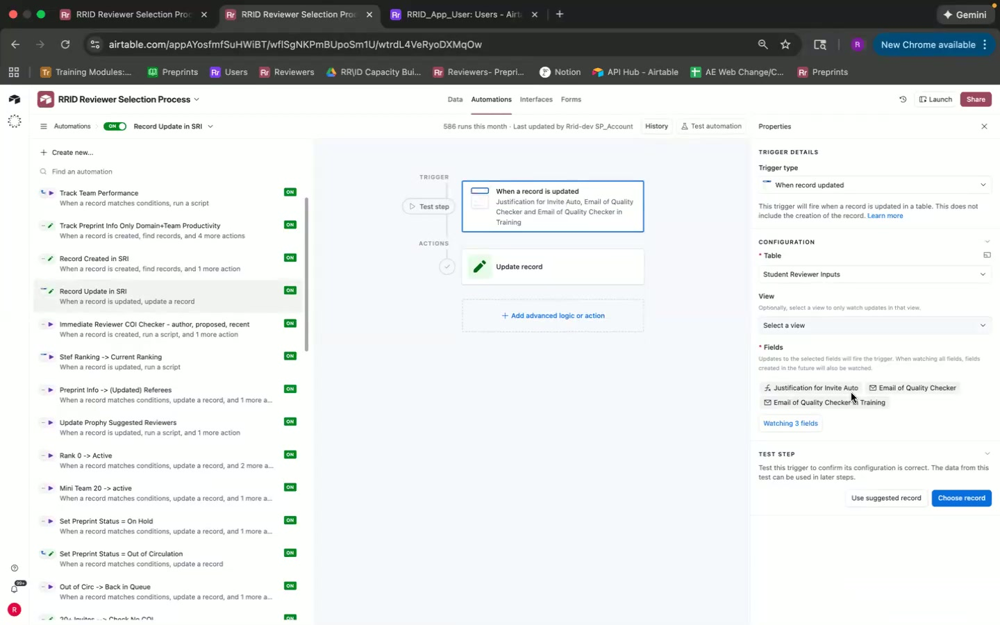

* Trigger: When a record is updated in Student Reviewer Inputs
    * Fields: "Justification for Invite Auto", "Email of Quality Checker" "Email of Quality Checker in Training"
* Action: Update record
#### 7.1.5 "Record Created in SRI" [08:39, 09:26]
* Trigger:  When a record is created in Student Reviewer Inputs
* Actions:
    * Find records where preprint ID contains preprint ID
    * Update record
        * Links student email to All Users
        * Links to publication
        * Auto link to publications in training
        * Links All users AI in Training
        * Links email of QC and QC in Training
        *  Links to Preprint Info ONLY record

#### 7.1.6 "Immediate Reviewer COI Checker" [10:53]

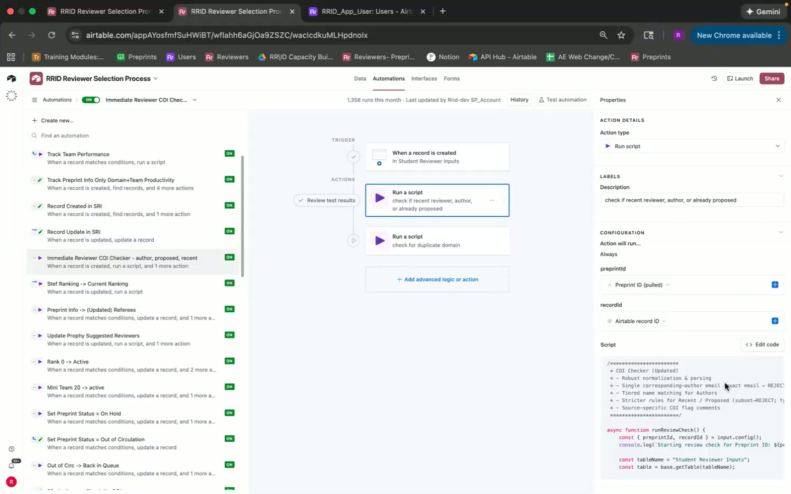

* Trigger:  When a record is created in Student Reviewer Inputs
* Actions:
    * Check if recent reviewer, author, already proposed
    *  Check for duplicate domain
#### 7.1.7 "Stef Ranking -> Current Ranking"
* Trigger:  When a record is updated, field = "Stef's ranking final (from selected)"
*  Action:  Update record, immediately change the rank as inputted

#### 7.1.8 "Preprint Info -> Updated Referees" [12:51]

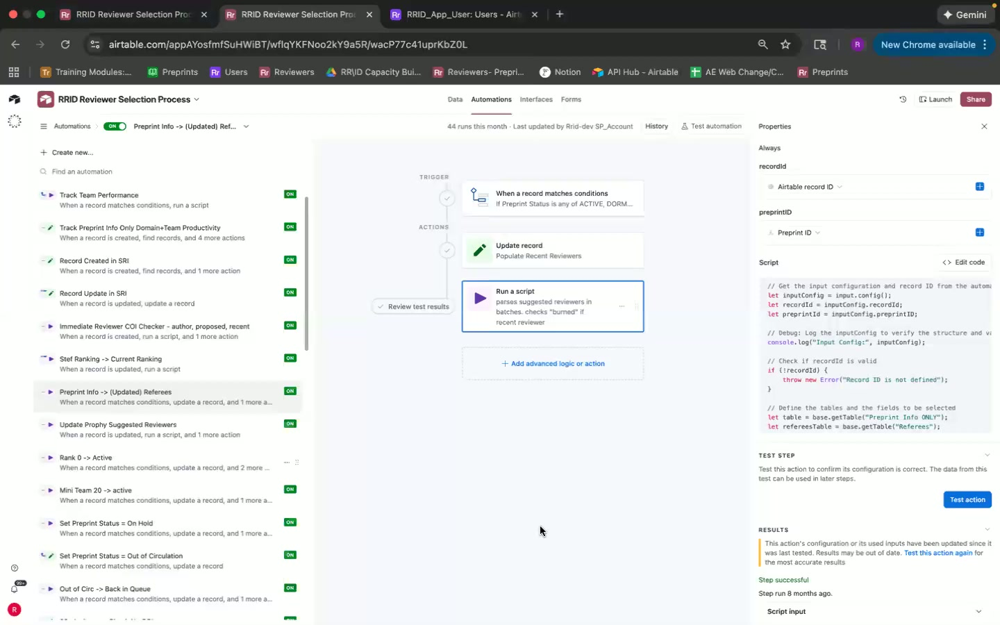

* Trigger: When a record matches conditions
    * If Preprint Status is ACTIVE/DORMANT and referees info is entered
* Action: Populate Recent Reviewer
* Scripting logic:
    *  Parse suggested reviewers in selected column named "burned" to Recent Reviewers
#### 7.1.9 "Update Prophy Suggested Reviewers"
* Trigger:  When a record matches conditions, Status is invite
*  Actions
    * Greentlit -> Burn CO referees and proposals for other preprints.

#### 7.1.10 "Rank 0 -> Active"
* Trigger: When a record matches conditions in Preprint Info ONLY
    * If Rank is 0 and Preprint Status is ACTIVE
* Action: Update Preprint Status and Rank.
#### 7.1.11 "Mini Team 20 -> active"
* Trigger: When a record matches conditions in Preprint Info ONLY
    *  If Preprint Status is DORMANT and Invite count >= 20 and Status (From Selected) = "Selected"
* Action:  Run script to readjust ranks of the rest of the preprints.

#### 7.1.12 "Set Preprint Status -> On Hold"
* Trigger: When a record matches conditions in Preprint Info ONLY
    *  Preprint Status is ACTIVE and More Invites Needed? = "No Additional Invites Needed."
* Action:  Update Preprint Status and Rank.
#### 7.1.13 "Set Preprint Status -> Out of Circulation"
* Trigger: When a record matches conditions in Preprint Info ONLY
    * More Invites Needed is No Additonal Invites needed and Rank is not "Out of Circulation"
* Action: Update record "set that preprint to active"
#### 7.1.14 "Out of Circ -> back in Queue"
* Trigger:  When a record matches conditions in Preprint Info ONLY
    *  If More Invites Needed is "More Invites Needed"
* Actions:
    * Run script

#### 7.1.15 "20+ Invites -> Check No COI"
* Trigger:  When a record matches conditions in Preprint Info ONLY
    *  If Preprint Status is DORMANT and ACTIVE, On Hold and Unsent Invites >= 20 and Status (From Selected) is exactly "Selected"
* Action: Run script to check no authors or recent reviewers.

#### 7.1.16 "Check COI first 20 -> send csv"
* Trigger: When a record matches conditions in Preprint Info ONLY
    *  If Unsent Invites > 20
* Actions:
    * Run a script to check for no authors or recent reviewers.
    *  Push to GCP to send csvs
    *  Update record, verified first 20
    *  Run script to set invited = true for reviewers

#### 7.1.17 "30+ Invites, 10+ Unsent -> Check No COI"
* Trigger:  When a record matches conditions,
    *  If Invite Count > 30 and Unsent Invites > 10
* Action:  Run a script, check no COI
#### 7.1.18 "Manual Send Invites-> Check No COI copy"
* Trigger: When a record matches conditions in Preprint Info ONLY
    *  If Unsent Invites > 0 and Manual Send Invites is checked
* Action:  Run script -  check no COI

#### 7.1.19 "Send Invites -> CSV"
* Trigger: When Send Invites is checked and verified is checked.
*  Actions:
    * Run script - Send CSV
    * Update Record - Sent and Verified
    *  Find Records where  PreprintID is PreprinID
    *  Update a list of records, Update record - Invited
#### 7.1.20 "30+ Invites, 0 Unchecked -> Check No COI"
* Trigger:  When a record matches conditions, Invite Count > 30 and Unchecked Count is 0
*  Action:  Run a script - check no COI (authors, reviewers, etc) of not yet invited reviewers
#### 7.1.21 "No COI -> Complete"
* Trigger:  When verified is checked and Invite Count is 40.
* Actions:
    *  Run script to works event or hold?

#### 7.1.22 "Complete -> CSV"
* Trigger: When a record matches conditions
    *  If Preprint Status is COMPLETE and Invite Count is 40
* Actions:
    * Find records - where PreprintID is a table
    *  Run a script
#### 7.1.23 "Send Entire CSV"
*  Actions
    *  Update a list of records

#### 7.1.24 "Referee Claimed Limit"
* Trigger:  When a record enters a view Claimed
* Actions:
    *  Run a script - custom script from code editor

#### 7.1.25 "Complete -> Clear Taken Columns"
* Trigger:  When a record matches conditions
    *  If Preprint Status is COMPLETE and Invite Count is 40
* Actions:
    *  Find records - Where preprint ID (pulled) is Airtable
    *  Run script

#### 7.1.26 "Popular Recent Reviewer"
* Trigger: When a record matches conditions in Preprint Info ONLY
    * If Preprint Status has any of invited, COMPLETE Status and invited is checked
* Action: Create Record.
#### 7.1.27 "Delete Recent Reviewers"

#### 7.1.28 "Invite AI AE Reviewers"
* Trigger:  When a record is created/updated in Student Reviewer Inputs.

#### 7.1.29 "Greentlit -> Burn CO Referees and Proposals for other preprints"
* Trigger: When a record matches conditions
    *  Status is invite
* Actions:
    * Find records -Where Reviewer Email is Reviewer Email
    *  Run a script - Check "Burned" for any referees this.
    *  If Records Airtable record ID is not empty then update record.
#### 7.1.30 "Track Student Referee Productivity"
* Trigger:  When a record is updated, Status is any of Reject / Proposed
* Action: Update Record
#### 7.1.31 "Preprint Editorial Rejected"
* Trigger:  When a record matches conditions,
    * If Title (from Selected) is empty and LinkDOI (from Selected) is empty and Stef's Ranking (Final) (from Selected) is empty
* Actions:
    * Run a script - custom script from code editor
    * Otherweise if Proposed Count is not  0 update record

#### 7.1.32 "Daily Reject Summaries"
*  Scheduler:  At a scheduled time, Every 1 day at 6:00am PST
* Actions:
    * Find records - Where Status is any of Reject / COI Detected
    *  Run a script
#### 7.1.33 "Email Student of "Fixable" Reviewer"
* Send a scheduled email
#### 7.1.34 "Email AE For High Unchecked Daily"
*  Scheduler: At a scheduled time, Every 1 day at 9:00am PST
* Find records - Where Preprint Status is ACTIVE.
*  Repeat for each record in List of records - Find records.  Where Domain has any of List of
*  Email is sent to clear choicesberkley.edu
#### 7.1.35 "Email AE + Stef for High unchecked"
* Find records - Where Preprint Status is ACTIVE and has High AI Rejects and low Referee Warning is "true"
* If high rejected AI is then send email.
*  If otherwise update status in Active
#### 7.1.36 "Email low or high prophy reject"
* Find records and then repeat same with the same functions.

#### 7.1.37 "Outstanding QC Auto-Final"
* Actions:
    * Find records and then repeat same with the same functions.

### 7.2 Preprint Info Only Table

*   **Page Name:** Preprint Info Only
*   **Purpose:** This table stores information about each preprint considered for review. It acts as the central data repository for the reviewer selection process.
*   **URL/Navigation Path:** `[Base URL]/PreprintInfoOnly` (implied)
*   **Visual Layout Description:** A standard tabular layout with columns representing different attributes of the preprint (e.g., Title, DOI, Status, Ranking, Team).  Includes a "Create new..." button. Has the list of views on the left side.
*   **UI Components:**
    *   **Table:** Displays preprint data in rows and columns.
    *   **Column Headers:** Identifies the data contained in each column.
    *   **Filters:** Allows filtering preprints based on specific criteria.  (A "Filtered by Status and 1 other field" indicator is visible at [01:01]).

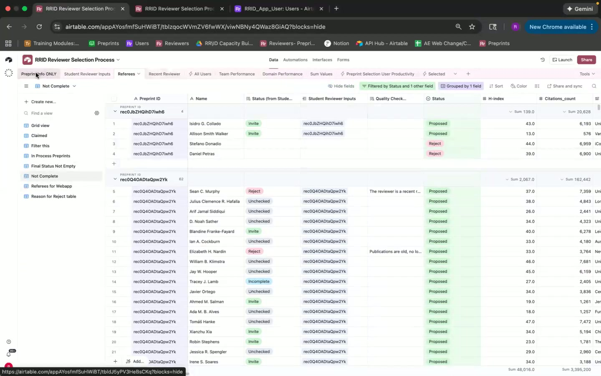

    *   **Sorting:** Allows sorting preprints based on column values.
    *   **Search Bar:** Allows searching for specific preprints.
    *   **Create New Button:** Create a new preprint
    *   **View Selection Dropdown:** Allows users to filter view by "Grid view" and "Not In Process"
*   **Features and Functionality:**
    *   Store preprint information.
    *   Filter and sort preprints.
    *   Search for preprints.
    *   Link to other tables (e.g., Student Reviewer Inputs, Referees).
*   **Data Displayed:**
    *   Preprint ID
    *   Title
    *   DOI
    *   Status (e.g., Active, On Hold, Complete, Discarded)
    *   Ranking (priority)
    *   Assigned Team
    *   Invite Count
    *   Unsent Invites
    *   More Invites Needed? (formula field)
    *   Date in Process
    *   Stef's Ranking (Final) (from Selected)
*   **User Interactions Available:**
    *   Click on a row to view/edit preprint details.
    *   Use filters to narrow down the list of preprints.
    *   Sort by column values.
    *   Search for specific preprints.
    *   Create new preprints
*   **Business Logic and Rules:**
    *   Preprint status determines its position in the workflow.
    *   Ranking influences prioritization of preprints.
    *   Invite count tracks the number of invitations sent to reviewers.
*   **Edge Cases or Validation Mentioned:**
    *   [03:26] Includes Title and DOI backups in case of issues with the "Selected" table.

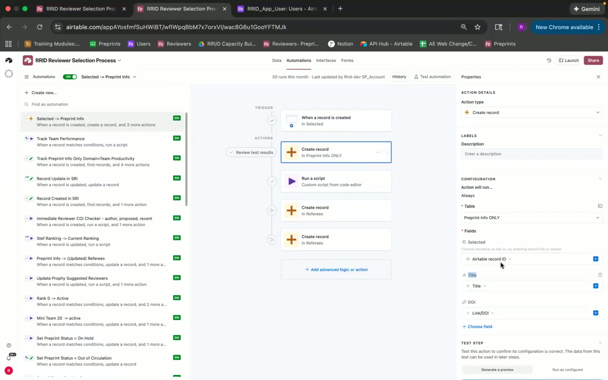

    *   [04:30] Ranking can be NA if the editorial team hasn't assigned it yet.

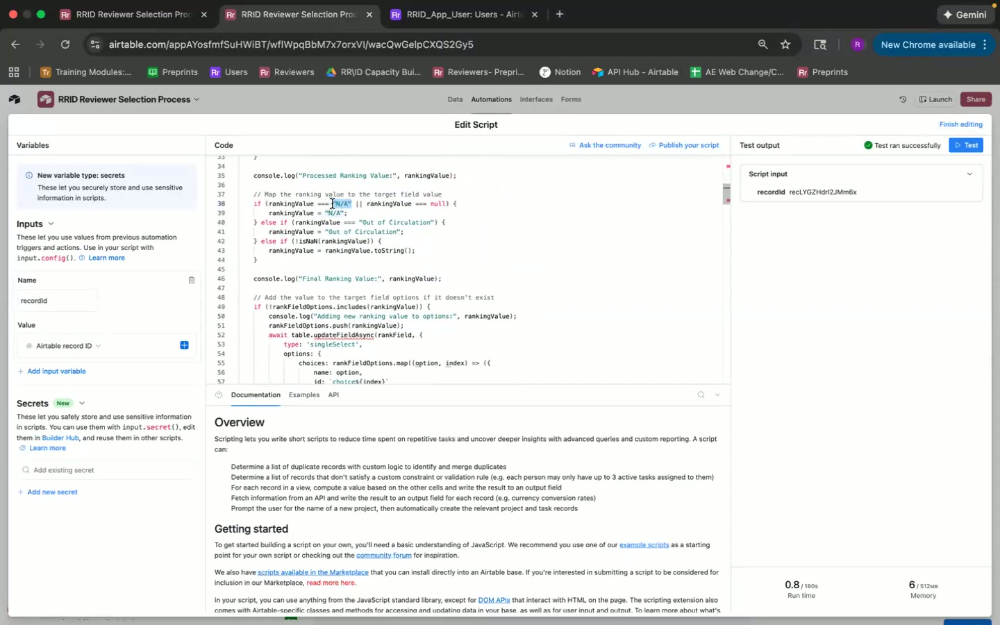

### 7.3 Student Reviewer Inputs Table

*   **Page Name:** Student Reviewer Inputs (SRI)
*   **Purpose:** This table tracks reviewer suggestions made by students for each preprint.
*   **URL/Navigation Path:** `[Base URL]/StudentReviewerInputs` (implied)
*   **Visual Layout Description:** A standard tabular layout with columns representing reviewer information, student information, and preprint information.  Includes a "Create new..." button. Includes "Filtered by Status and 1 other field" label at the top.
*   **UI Components:**
    *   **Table:** Displays reviewer suggestions in rows and columns.
    *   **Column Headers:** Identifies the data contained in each column.
    *   **Filters:** Allows filtering reviewer suggestions based on specific criteria.
    *   **Sorting:** Allows sorting reviewer suggestions based on column values.
    *   **Search Bar:** Allows searching for specific reviewer suggestions.
    *   **Create New Button:**  Create a new record
*   **Features and Functionality:**
    *   Store reviewer suggestions.
    *   Track the student who made the suggestion.
    *   Link to the associated preprint.
    *   Record the status of the suggestion (e.g., Proposed, Invited, Rejected).
    *   Quality Check
*   **Data Displayed:**
    *   Record ID
    *   Reviewer Name (implied)
    *   Student Email
    *   Preprint ID (linked to Preprint Info Only)
    *   Status (e.g., Proposed, Invited, Rejected, Unchecked)
    *   Quality Check status
    *   Justification for invite
    *   Link to Publications (PubMed, auto-generated)
    *   AI in Training (All Users)
*   **User Interactions Available:**
    *   Click on a row to view/edit reviewer suggestion details.
    *   Use filters to narrow down the list of suggestions.
    *   Sort by column values.
    *   Search for specific reviewer suggestions.
*   **Business Logic and Rules:**
    *   Reviewer suggestions must be approved by a quality checker before being invited.
    *   Students receive credit for their proposed reviewers.
*   **Edge Cases or Validation Mentioned:**
    *   [08:53] Auto-link to publications is a formula field that needs to be manually copied to the associated field.

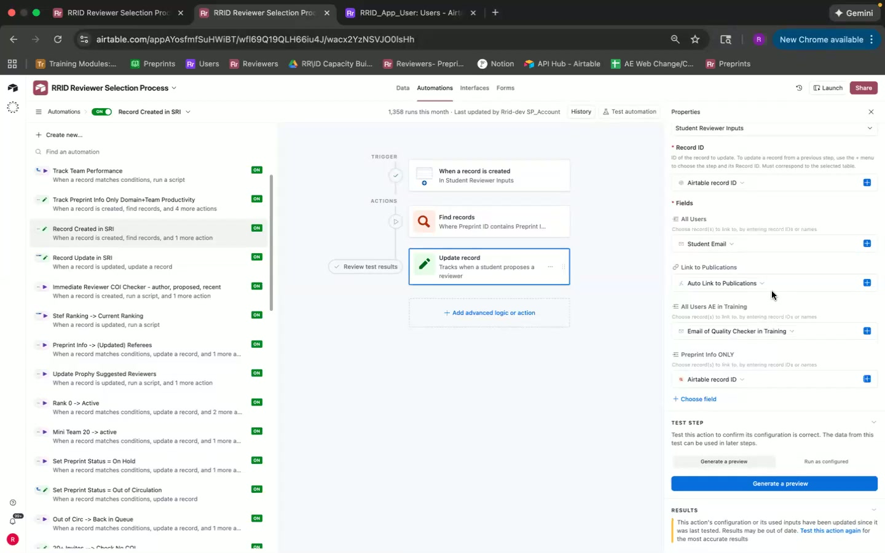

### 7.4 Referees Table

*   **Page Name:** Referees (AI-Suggested Reviewers)
*   **Purpose:** This table stores information about AI-suggested reviewers for each preprint.
*   **URL/Navigation Path:** `[Base URL]/Referees` (implied)
*   **Visual Layout Description:** A standard tabular layout with columns representing reviewer information, preprint information, and AI-specific data (e.g., H-index, affiliations).  Includes a "Create new..." button.  Includes "Filtered by Status and 1 other field" label at the top.
*   **UI Components:**
    *   **Table:** Displays AI-suggested reviewers in rows and columns.
    *   **Column Headers:** Identifies the data contained in each column.
    *   **Filters:** Allows filtering AI-suggested reviewers based on specific criteria.
    *   **Sorting:** Allows sorting AI-suggested reviewers based on column values.
    *   **Search Bar:** Allows searching for specific AI-suggested reviewers.
    *   **Claim**
*   **Features and Functionality:**
    *   Store AI-suggested reviewer information.
    *   Link to the associated preprint.
    *   Track the status of the reviewer (e.g., Available, Claimed, Invited, Rejected).
    *   Burn the reviewer if he or she matches recent reviewer.
*   **Data Displayed:**
    *   Name
    *   H-Index
    *   Affiliations
    *   Preprint ID (linked to Preprint Info Only)
    *   Status (Available, Claimed, Invited, Rejected)
    *   Other details extracted from the AI-suggested reviewer list (e.g., ORCID ID, author URL, emails)
*   **User Interactions Available:**
    *   Click on a row to view/edit reviewer details.
    *   Use filters to narrow down the list of reviewers.
    *   Sort by column values.
    *   Search for specific reviewers.
    * Claim - claimed by one of the quality check students
*   **Business Logic and Rules:**
    *   AI-suggested reviewers are automatically populated based on the preprint's content.
    *   Students can "claim" reviewers to evaluate their suitability.
    *   Reviewers are excluded based on COI
*   **Edge Cases or Validation Mentioned:**
    *   [11:26] AI-suggested reviewers are "burned" (excluded) if they share a domain with an already proposed reviewer to avoid COI.

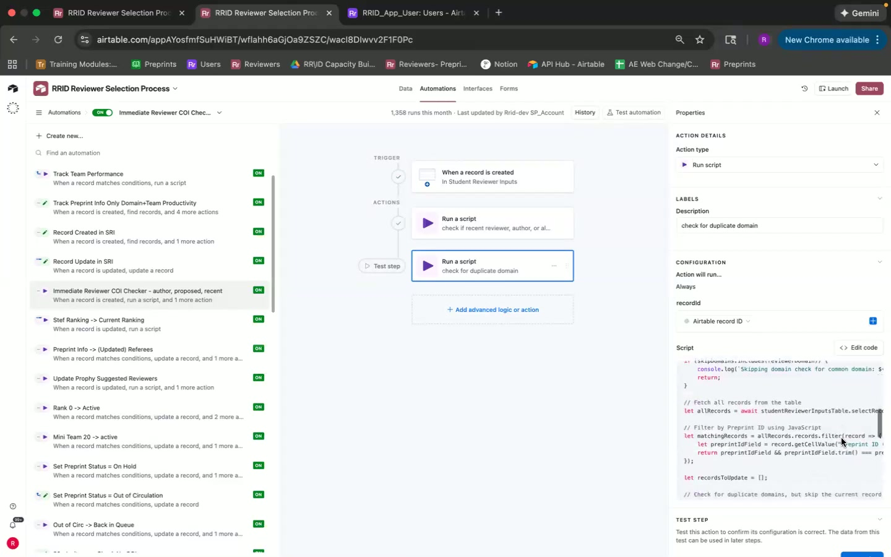

    *   [30:35] Students are limited in the number of AI-suggested reviewers they can claim simultaneously.

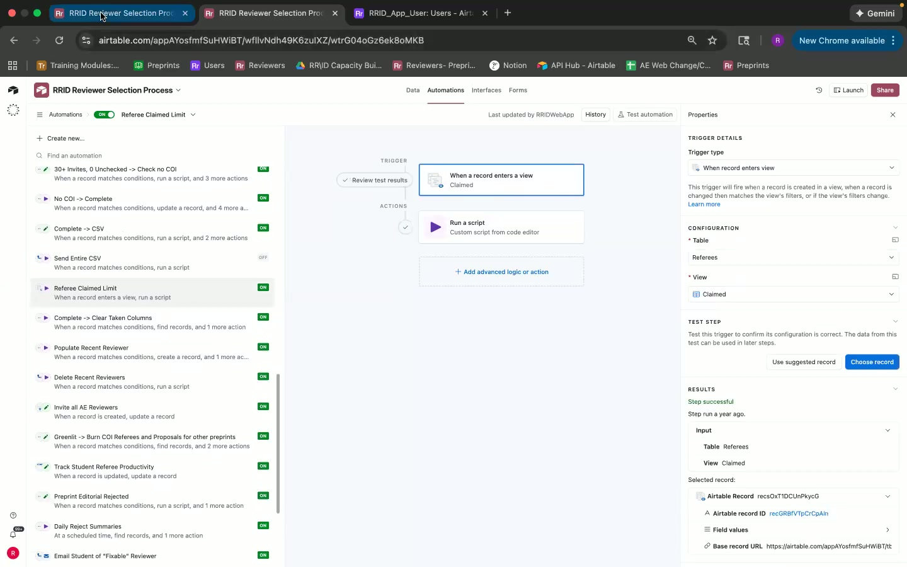

### 7.5 All Users Table

*   **Page Name:** All Users
*   **Purpose:** This table stores information about all users of the system, including students and staff.
*   **URL/Navigation Path:** `[Base URL]/AllUsers` (implied)
*   **Visual Layout Description:** A standard tabular layout with columns representing user information (e.g., email, team, role).  Includes a "Create new..." button.
*   **UI Components:**
    *   **Table:** Displays user data in rows and columns.
    *   **Column Headers:** Identifies the data contained in each column.
    *   **Filters:** Allows filtering users based on specific criteria.
    *   **Sorting:** Allows sorting users based on column values.
    *   **Search Bar:** Allows searching for specific users.
    *   **Lightning Bolt:** Symbol indicates connection to RID app user
*   **Features and Functionality:**
    *   Store user information.
    *   Track user roles and team assignments.
    *   Link to other tables (e.g., Student Reviewer Inputs).
*   **Data Displayed:**
    *   User ID
    *   Email
    *   Team
    *   Total Unchecked + Fixed
    *   Total Greenlit (TA2S)
    *   Total Reject (FA2S)
    *   Total Student Proposals
    *   Total QC Assesments
*   **User Interactions Available:**
    *   Click on a row to view/edit user details.
    *   Use filters to narrow down the list of users.
    *   Sort by column values.
    *   Search for specific users.
*   **Business Logic and Rules:**
    *   User roles determine access permissions and workflow participation.
    *   Team assignments are used for tracking performance and assigning tasks.
*   **Edge Cases or Validation Mentioned:**
    *   None explicitly mentioned.

### 7.6 Team Performance Table

*   **Page Name:** Team Performance
*   **Purpose:** This table tracks the performance of different teams in proposing reviewers.
*   **URL/Navigation Path:** `[Base URL]/TeamPerformance` (implied)
*   **Visual Layout Description:** A standard tabular layout with columns representing team information, metrics (e.g., proposals, invites, accepts).
*   **UI Components:**
    *   **Table:** Displays team performance data in rows and columns.
    *   **Column Headers:** Identifies the data contained in each column.
    *   **Filters:** Allows filtering team performance based on specific criteria.
    *   **Sorting:** Allows sorting team performance based on column values.
    *   **Search Bar:** Allows searching for specific teams.
*   **Features and Functionality:**
    *   Track team performance metrics.
    *   Link to preprints and student reviewers.
*   **Data Displayed:**
    *   Team/Domain Name
    *   Metrics related to proposals, invites, and accepts (specific metrics not detailed)
    *   Preprint Info
*   **User Interactions Available:**
    *   Click on a row to view/edit team performance details.
    *   Use filters to narrow down the list of teams.
    *   Sort by column values.
    *   Search for specific teams.
*   **Business Logic and Rules:**
    *   Performance is tracked at the team level.
    *   For Berkeley, performance is tracked by domain within Berkeley.
*   **Edge Cases or Validation Mentioned:**
    *   [06:05] Berkeley requires knowing both the team (e.g., Berkeley) and the domain.

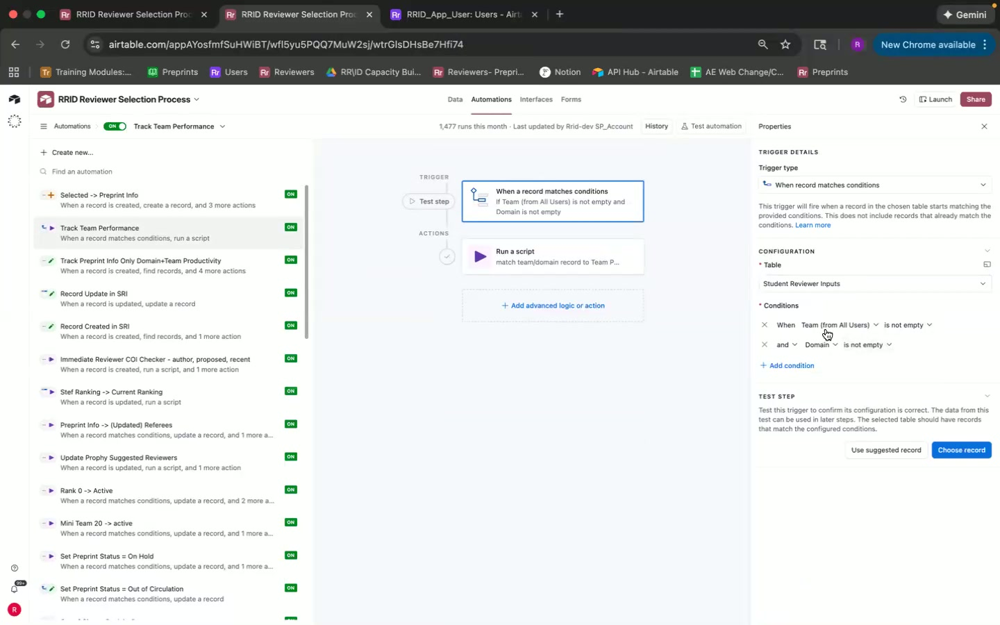

### 7.7 Domain Performance Table

*   **Page Name:** Domain Performance
*   **Purpose:** This table tracks performance based on the domain of the preprint.
*   **URL/Navigation Path:** `[Base URL]/DomainPerformance` (implied)
*   **Visual Layout Description:** A standard tabular layout with columns representing domain, and metrics.
*   **UI Components:**
    *   **Table:** Displays domain performance data in rows and columns.
    *   **Column Headers:** Identifies the data contained in each column.
    *   **Filters:** Allows filtering domain performance based on specific criteria.
    *   **Sorting:** Allows sorting domain performance based on column values.
    *   **Search Bar:** Allows searching for specific domains.
*   **Features and Functionality:**
    *   Track domain performance metrics.
    *   Link to preprints.
*   **Data Displayed:**
    *   Domain Name
    *   Metrics related to proposals, invites, and accepts (specific metrics not detailed)
*   **User Interactions Available:**
    *   Click on a row to view/edit domain performance details.
    *   Use filters to narrow down the list of domains.
    *   Sort by column values.
    *   Search for specific domains.
*   **Business Logic and Rules:**
    *   Performance is tracked at the domain level, based on the preprint.
*   **Edge Cases or Validation Mentioned:**
    *   [07:06] Difficult to implement some logic within scripts.

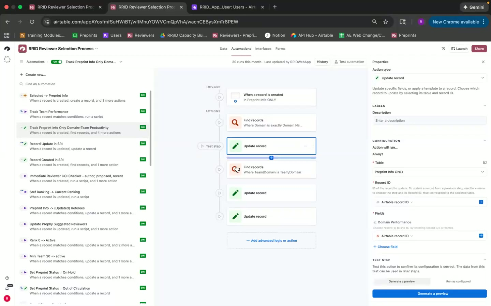

### 7.8 Selected Table

*   **Page Name:** Selected
*   **Purpose:** This table stores preprints that have been selected for review by the editorial team.
*   **URL/Navigation Path:** `[Base URL]/Selected` (implied)
*   **Visual Layout Description:** A standard tabular layout with columns representing preprint data (e.g., title, DOI, ranking, assigned team). Appears relatively empty in the screenshot.
*   **UI Components:**
    *   **Table:** Displays selected preprint data in rows and columns.
    *   **Column Headers:** Identifies the data contained in each column.
    *   **Filters:** Allows filtering selected preprints based on specific criteria.
    *   **Sorting:** Allows sorting selected preprints based on column values.
    *   **Search Bar:** Allows searching for specific preprints.
*   **Features and Functionality:**
    *   Store selected preprint information.
    *   Push selected preprints to the Preprint Info Only table.
*   **Data Displayed:**
    *   Title
    *   DOI
    *   Ranking (1,2,3,4)
    *   Assigned Team
*   **User Interactions Available:**
    *   Click on a row to view/edit preprint details.
    *   Use filters to narrow down the list of preprints.
    *   Sort by column values.
    *   Search for specific preprints.
*   **Business Logic and Rules:**
    *   Preprints are added to this table when they are selected for review.
*   **Edge Cases or Validation Mentioned:**
    *   [02:17] Only preprints with "selected for review" or "to pitch editorial" status in the Rapid Reviews Infectious Disease base are included.

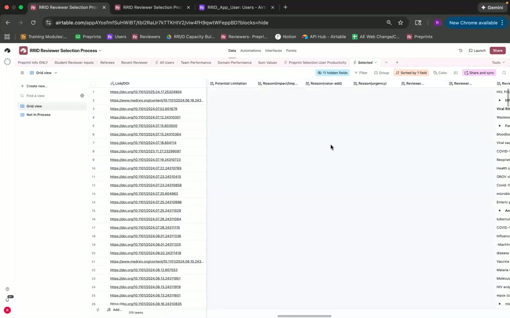

### 7.9 Recent Reviewer Table

*   **Page Name:** Recent Reviewer
*   **Purpose:** This table stores reviewers who have been recently invited to review a preprint to avoid inviting them again too soon.
*   **URL/Navigation Path:** `[Base URL]/RecentReviewer` (implied)
*   **Visual Layout Description:** Tabular layout with standard data.
*   **UI Components:**
    *   **Table:** Displays AI-suggested reviewers in rows and columns.
    *   **Column Headers:** Identifies the data contained in each column.
    *   **Filters:** Allows filtering AI-suggested reviewers based on specific criteria.
    *   **Sorting:** Allows sorting AI-suggested reviewers based on column values.
    *   **Search Bar:** Allows searching for specific AI-suggested reviewers.
*   **Features and Functionality:**
    *   Don't invite them until 3 months after.
    *  Those are people that have requested not to
*   **Data Displayed:**
    *  Date
    *  Delete Date
    *  Email
    *  Name
    * Reason for adding
*   **User Interactions Available:**
    *   Click on a row to view/edit reviewer details.
    *   Use filters to narrow down the list of reviewers.
    *   Sort by column values.
    *   Search for specific reviewers.
    * Claim - claimed by one of the quality check students
*   **Business Logic and Rules:**
*   **Edge Cases or Validation Mentioned:**
    * The delete date has an automation set for current date.

## 8. Technical Requirements

*   **Database:** A relational database (e.g., PostgreSQL, MySQL) is recommended for storing the data and relationships between tables.
*   **Backend Framework:** A modern backend framework (e.g., Node.js with Express, Python with Django/Flask, Ruby on Rails) is required for handling API requests, business logic, and data processing.
*   **Frontend Framework:** A modern frontend framework (e.g., React, Angular, Vue.js) is recommended for building the user interface.
*   **API Integration:** The application will need to integrate with external services, such as PubMed (for retrieving publication information) and Google Cloud Functions (for sending emails and processing data).
*   **Automation Engine:** A system will be needed to handle scheduled tasks and event-driven automations.
*   **Scripting Language:** Javascript is used for writing custom scripts within the application.
*   **Authentication:** secure authentication for user access

## 9. User Interactions and Workflows

1.  **Preprint Selection:** The editorial team selects preprints for review in the Rapid Reviews Infectious Disease base.

2.  **Preprint Import:** The selected preprints are automatically imported into the "Selected" table.

3.  **Preprint Data Population:** An automation creates a corresponding record in the "Preprint Info Only" table and populates it with data from the "Selected" table.

4.  **Reviewer Suggestion:** Students propose reviewers for each preprint in the "Student Reviewer Inputs" table.

5.  **AI-Suggested Reviewer Population:** AI-suggested reviewers are automatically populated in the "Referees" table based on the preprint's content.

6.  **Quality Check:** Assistant editors review the proposed reviewers and AI-suggested reviewers, flagging any potential conflicts of interest or other issues.

7.  **Invitation:** Approved reviewers are invited to review the preprint.

8.  **Team Performance Tracking:** The application tracks the performance of different teams in proposing reviewers and getting them accepted.

9.  **Status Updates:** The application automatically updates the status of preprints and reviewers based on events in the workflow.

10. **Automated Emails:** Emails are sent to users based on specific events or schedules, such as daily reject summaries or reminders to quality check reviewers.

11. **COI Check**: Checks for conflicts of interest on reviewer suggestions

## 10. Data Model

*   **Preprint Info Only:**
    *   Preprint ID (Primary Key)
    *   Title
    *   DOI
    *   Status
    *   Ranking
    *   Assigned Team
    *   Invite Count
    *   Unsent Invites
    *   More Invites Needed?
    *   Date in Process
    * Selected
*   **Student Reviewer Inputs:**
    *   Record ID (Primary Key)
    *   Reviewer Name
    *   Student Email (Foreign Key to All Users)
    *   Preprint ID (Foreign Key to Preprint Info Only)
    *   Status
    *   Quality Check status
    *   Justification for invite
    *   Link to Publications
*   **Referees:**
    *   Record ID (Primary Key)
    *   Name
    *   H-Index
    *   Affiliations
    *   Preprint ID (Foreign Key to Preprint Info Only)
    *   Status
*   **All Users:**
    *