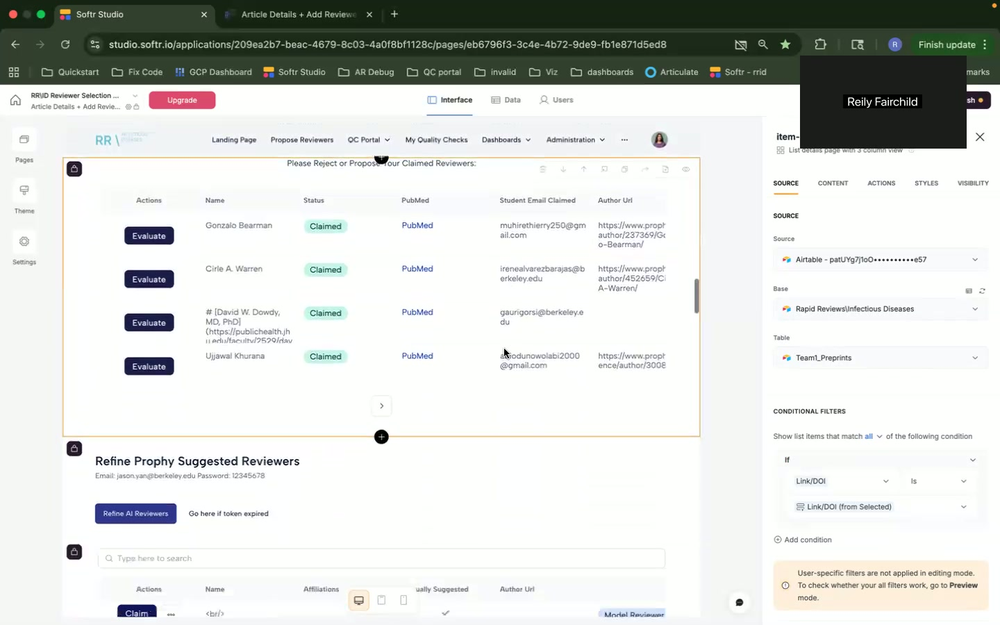
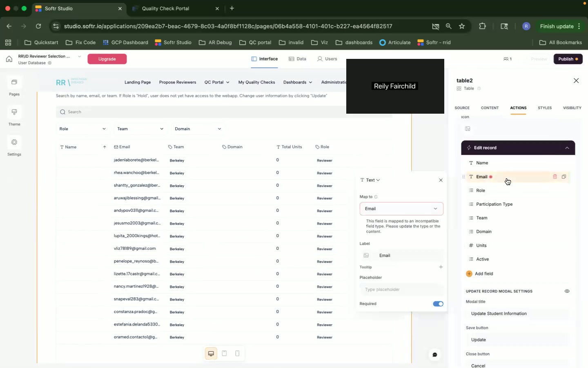
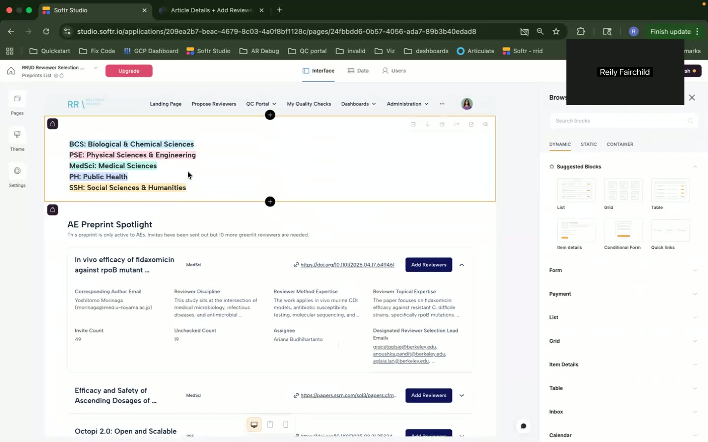
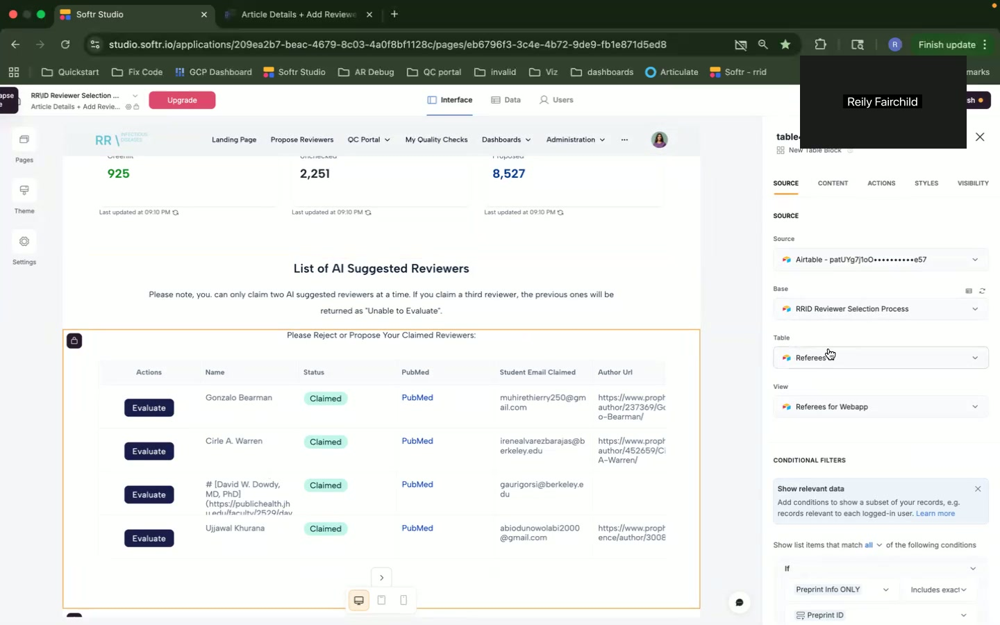
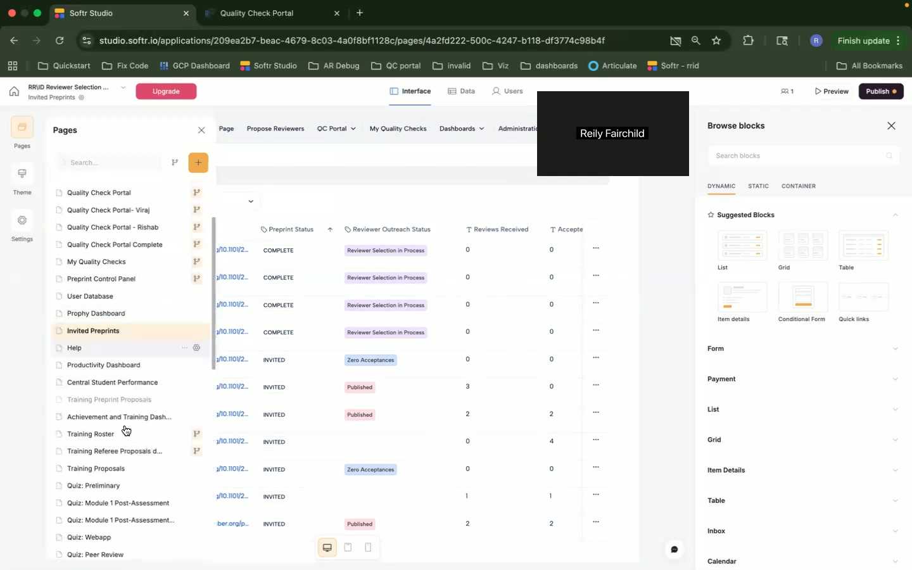
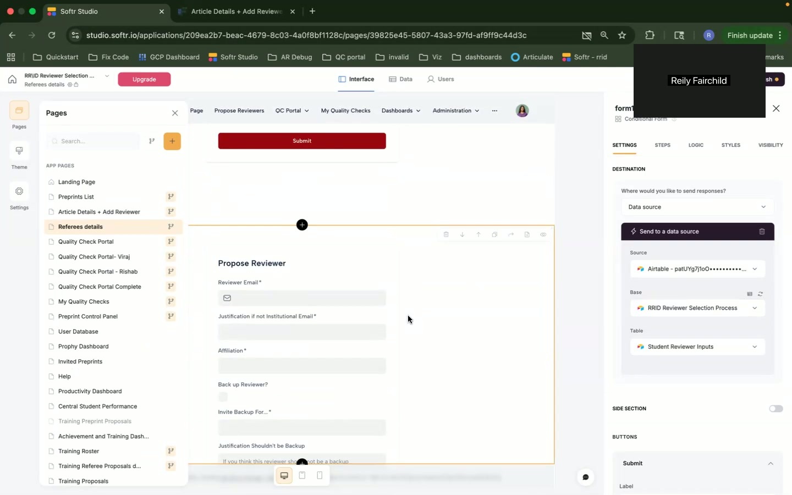
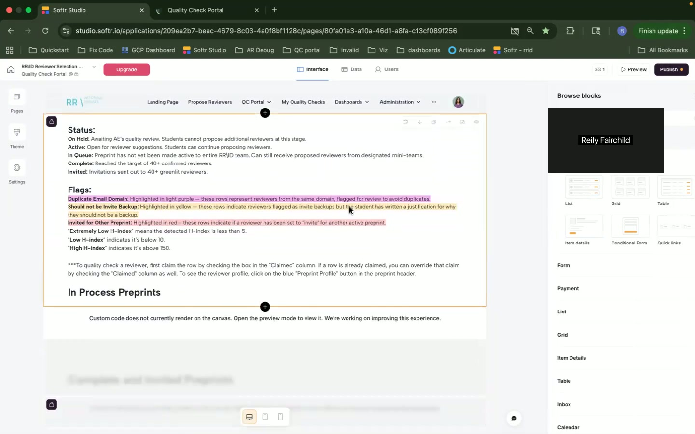
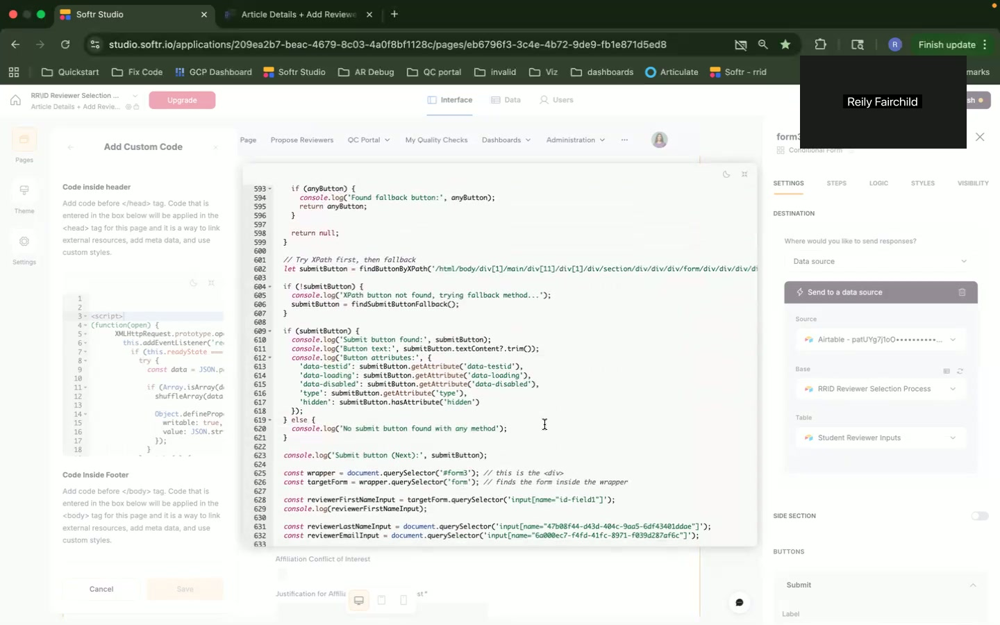
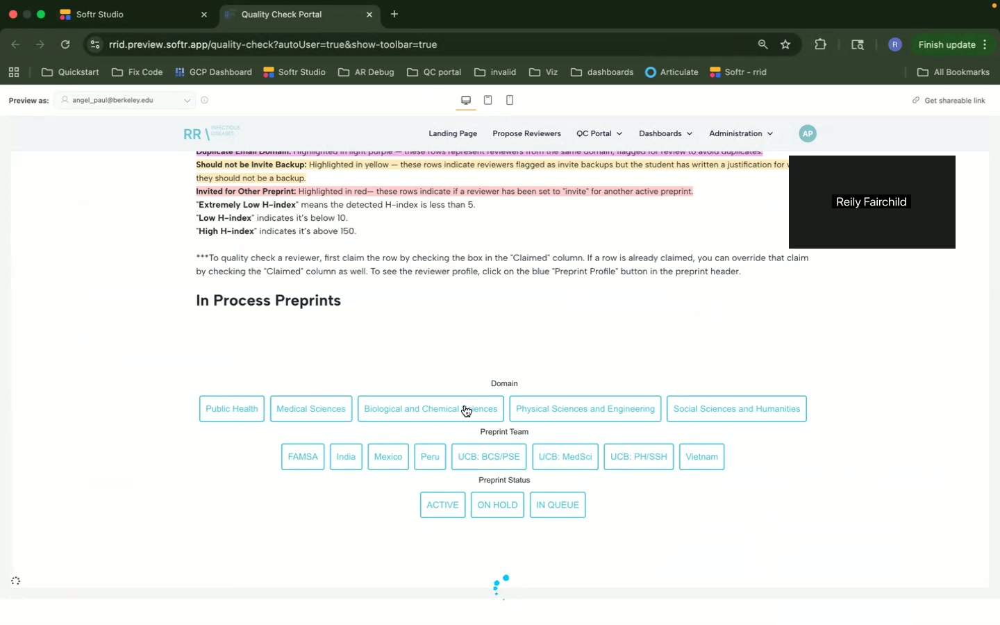
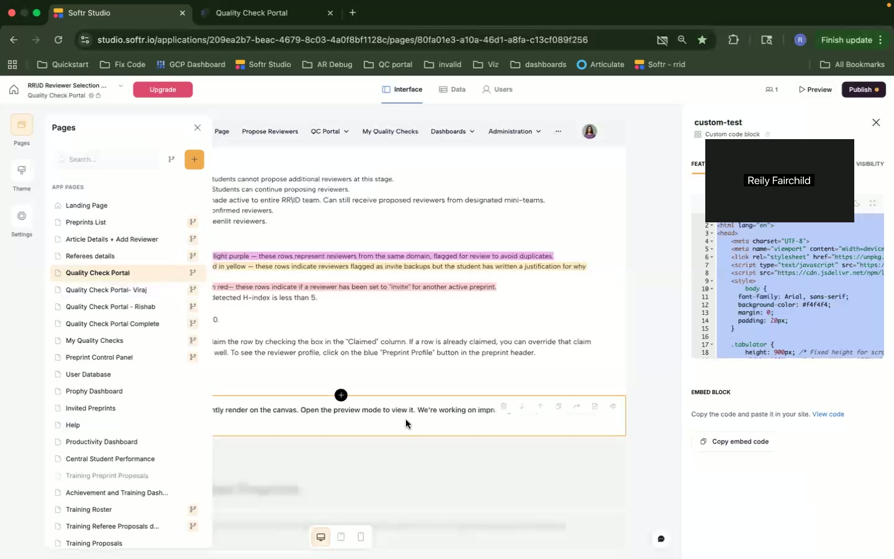

Okay, here's a breakdown of the issues and pain points discussed in the video transcript, formatted as a Markdown document.

# Issues and Pain Points Analysis

This document summarizes the issues and pain points mentioned in the video walkthrough of the software application.

## 1. Problems Identified

### 1.1 Data Parsing Failure
- **Description:** The parsing algorithm for AI-suggested reviewers failed.
- **Timestamp:** [06:07] - [06:14]

- **Impact:** Incomplete or incorrect data displayed to the user, hindering the review process.
- **Workarounds:** None mentioned.
- **Suggested Solutions:** Update or fix the parsing algorithm to handle the changed data format.
- **Priority/Severity:** High (data integrity issue).
- **Category:** Bug, Data

### 1.2 Email Mapping Issue
- **Description:** In the User Database section, mapping to email isn't working, possibly due to email being a text field.
- **Timestamp:** [17:08] - [17:19]

- **Impact:** Hinders user management capabilities for the central team.
- **Workarounds:** None mentioned.
- **Suggested Solutions:** Investigate why email mapping isn't working and fix the issue; correct the data type if necessary.
- **Priority/Severity:** Medium (affects administrative functionality).
- **Category:** Bug, Data

## 2. Pain Points

### 2.1 Softr Learning Curve
- **Description:** There's a learning curve associated with using Softr.
- **Timestamp:** [02:36]

- **Impact:** New users require time to become proficient with the system.
- **Workarounds:** None mentioned.
- **Suggested Solutions:** Documentation, training materials. The speaker estimates a two-week learning curve.
- **Priority/Severity:** Low (affects onboarding).
- **Category:** UX

### 2.2 Inefficient Naming Standards
- **Description:** Inconsistent naming standards for elements (e.g., views, tables)
- **Timestamp:** [10:18] - [10:26]

- **Impact:** Difficulty in identifying and managing components efficiently, increased chance of errors.
- **Workarounds:** None mentioned.
- **Suggested Solutions:** Normalize naming standards for better clarity and maintainability.
- **Priority/Severity:** Low (maintainability issue).
- **Category:** Architecture

### 2.3 Outdated Help Information
- **Description:** Help documentation is outdated.
- **Timestamp:** [18:23] - [18:33]

- **Impact:** Users may not have access to accurate or relevant guidance.
- **Workarounds:** Articulate might be replacing it, but is not yet implemented.
- **Suggested Solutions:** Update the help documentation.
- **Priority/Severity:** Medium (affects user support).
- **Category:** UX

### 2.4 Potential Race Conditions
- **Description:** Race conditions in automations related to AI-suggested reviewers who have been recently invited.
- **Timestamp:** [13:14] - [13:20]

- **Impact:** Inconsistent behavior in the reviewer selection process, potential for duplicate invitations.
- **Workarounds:** Some custom code is in place.
- **Suggested Solutions:** Improve automation logic and error handling.
- **Priority/Severity:** Medium (affects automation reliability).
- **Category:** Automation

### 2.5 Quality Check Portal - Custom Code Rendering
- **Description:**  Custom code does not currently render on the canvas.
- **Timestamp:** [14:14], [14:52], [18:08], [18:47]

- **Impact:**  Difficult to preview the Quality Check Portal with custom code.
- **Workarounds:** Open the preview mode to view it.
- **Suggested Solutions:**  Improve the canvas rendering experience for custom code in the Quality Check Portal.
- **Priority/Severity:**  Medium (affects usability in designing UI)
- **Category:**  UX, Bug

### 2.6 Invited Preprints - Not in Use
- **Description:** Invited Preprints is not in use and is something that needs to be improved.
- **Timestamp:** [17:38] - [17:47]

- **Impact:**  Lacking the after the fact tracking of finding reviewers to receiving the reviews.  Manual effort is needed by Angel or the central team to track and update those.
- **Workarounds:** Manual tracking and updating is needed.
- **Suggested Solutions:**  Integrate the infrastructure processes to alleviate manual labor.
- **Priority/Severity:**  High (affects the ability to track reviewers effectively)
- **Category:**  Automation, Workflow

## 3. Architecture Concerns

### 3.1 Hacky and Unreliable Custom Code
- **Description:** The custom code for checking author/reviewer matches is described as "hacky and not reliable."
- **Timestamp:** [08:50] - [08:58]

- **Impact:** Can cause incorrect matching results, potentially allowing duplicate reviewers or authors to be proposed. Requires fixing in the future.
- **Workarounds:** None mentioned.
- **Suggested Solutions:** Refactor the custom code for improved reliability and maintainability.
- **Priority/Severity:** High (affects data quality and reviewer selection).
- **Category:** Architecture, Technical Debt

### 3.2 Reliance on AirTable
- **Description:** Many functionalities rely on AirTable embeds and interfaces.
- **Timestamp:** Throughout the video, specifically at [14:46], [17:29], [19:18], [19:27]

- **Impact:** The application is dependent on AirTable's performance and availability, which could impact responsiveness and scalability.
- **Workarounds:** None mentioned.
- **Suggested Solutions:** Consider decoupling critical components from AirTable and implementing more robust APIs.
- **Priority/Severity:** Medium (dependency risk).
- **Category:** Architecture

### 3.3 Hardcoded Quality Check Table
- **Description:** The quality check table is hardcoded within the Softr field.
- **Timestamp:** [14:28]

- **Impact:** Reduces flexibility and makes it more difficult to update or change the table structure.
- **Workarounds:** None mentioned.
- **Suggested Solutions:** Decouple the table structure.
- **Priority/Severity:** Medium (maintainability risk).
- **Category:** Architecture

### 3.4 Lack of Automation for Tracking Reviews
- **Description:** Lack of automation for tracking reviews that are sent out.
- **Timestamp:** [17:38] - [18:23]

- **Impact:** Reliance on manual labor to track reviews, leading to inefficiencies and potential errors.
- **Workarounds:** None mentioned.
- **Suggested Solutions:** Integrate the review tracking process.
- **Priority/Severity:** High (affects tracking)
- **Category:** Architecture

## 4. System/Component Categorization

| System/Component | Type | User Impact Level | Description |
|---|---|---|---|
| AI-Suggested Reviewers | Data, Bug | High | Parsing algorithm failure results in incorrect data. |
| Email Mapping | Bug | Medium | User Database can't map to email |
| Softr General | UX | Low | Learning curve for new users |
| Naming Standards | Architecture | Low | Inconsistent standards make management difficult. |
| Help Information | UX | Medium | Outdated documentation affects user support. |
| Automation | Automation | Medium | Race conditions in automations affect reliability. |
| Article Details Page | Architecture, UX | High | Hacky code for reviewer matching impacts data quality. |
| AirTable | Architecture | Medium | Dependence on AirTable introduces performance risks. |
| Quality Check Table | Architecture | Medium | Table structure is hardcoded. |
| Tracking | Architecture, Automation | High | No automation for tracking reviews leads to reliance on manual labor |
| Quality Check Portal | Bug, UX | Medium | Custom code not rendering |

This document provides a detailed overview of the identified issues and pain points. Further investigation and prioritization are recommended to address these effectively.