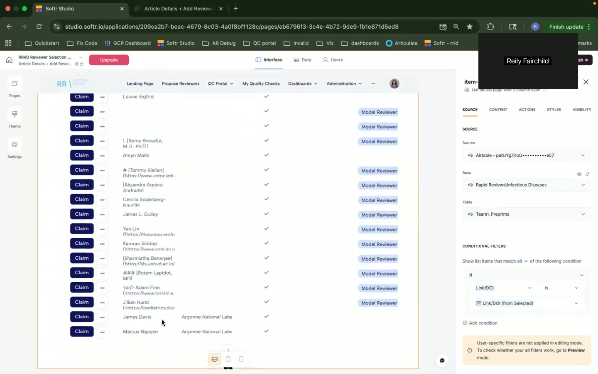
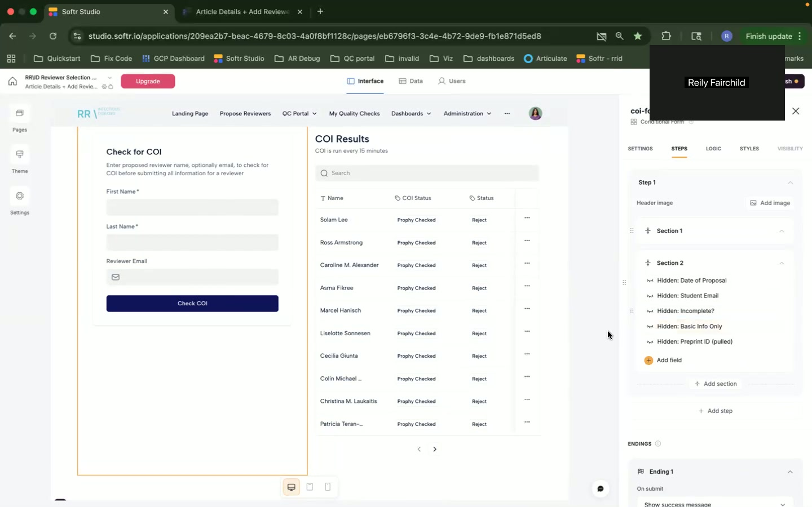
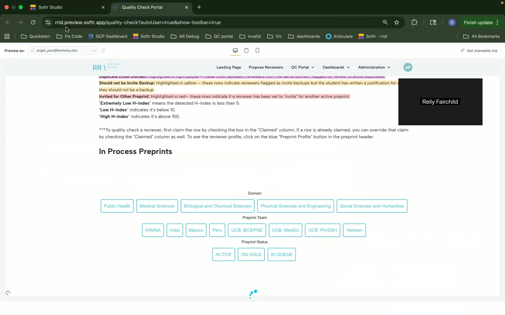
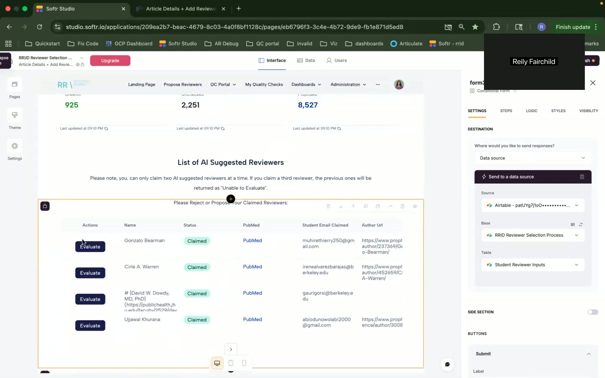
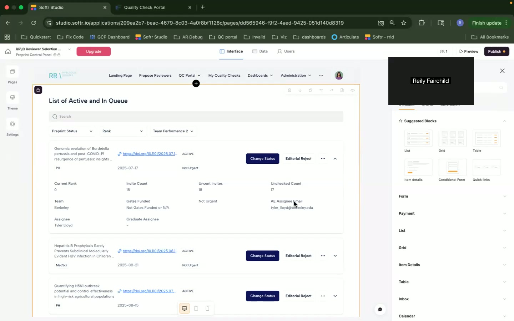
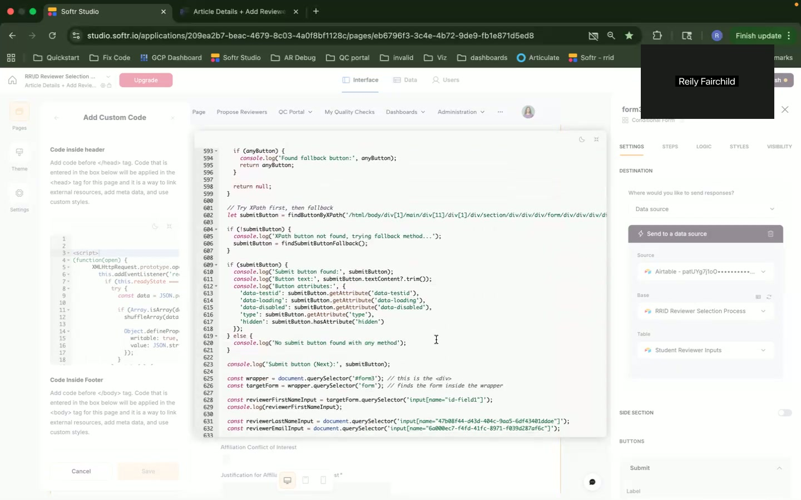

# Issues and Pain Points Document

## Technical Issues

### 1. Parsing Algorithm Failure
- **Description**: The parsing algorithm did not work correctly.
- **When/Where**: [06:14]

- **Impact**: Causes data parsing inaccuracies.
- **Workarounds**: Not mentioned.
- **Suggested Solutions**: None provided.
- **Priority**: High
- **System/Component**: Parsing system
- **Type**: Bug
- **User Impact Level**: High

### 2. Conflict of Interest (COI) Check Limitation
- **Description**: COI checks are basic and not integrated into the quality check portal.
- **When/Where**: [06:51]

- **Impact**: Leads to potential submission of conflicted reviewers.
- **Workarounds**: Manual COI check.
- **Suggested Solutions**: Update the editorial process.
- **Priority**: Medium
- **System/Component**: COI Check
- **Type**: Feature gap
- **User Impact Level**: Moderate

### 3. Custom Code Rendering Issues
- **Description**: Custom code does not currently render on the canvas.
- **When/Where**: [14:52], [15:34]

- **Impact**: Affects user interface visualization.
- **Workarounds**: None provided.
- **Suggested Solutions**: Under improvement.
- **Priority**: Medium
- **System/Component**: Custom code integration
- **Type**: Bug
- **User Impact Level**: Moderate

## Pain Points

### 4. Workflow Inefficiencies
- **Description**: Complex workflow requiring multiple manual interventions.
- **When/Where**: Throughout
- **Impact**: Slower processing times.
- **Workarounds**: Frequent manual checks.
- **Suggested Solutions**: Streamlining and automation.
- **Priority**: High
- **System/Component**: Workflow management
- **Type**: UX
- **User Impact Level**: High

### 5. Difficulty in Evaluating Reviewers
- **Description**: Evaluating reviewers manually is inefficient.
- **When/Where**: [10:02]

- **Impact**: Delays in assigning reviewers.
- **Workarounds**: Manual evaluation process.
- **Suggested Solutions**: None provided.
- **Priority**: Medium
- **System/Component**: Reviewer evaluation
- **Type**: UX
- **User Impact Level**: High

### 6. Lack of Scalability
- **Description**: System limitations as the team grows.
- **When/Where**: [16:10]

- **Impact**: Affects future growth.
- **Workarounds**: None provided.
- **Suggested Solutions**: Infrastructure updating.
- **Priority**: High
- **System/Component**: Scalability
- **Type**: Architecture
- **User Impact Level**: High

## Architecture Concerns

### 7. Dependency on Airtable
- **Description**: Heavy reliance on Airtable for data handling.
- **When/Where**: Multiple points.
- **Impact**: Limits flexibility and integration capabilities.
- **Workarounds**: None provided.
- **Suggested Solutions**: Investigating other solutions.
- **Priority**: High
- **System/Component**: Data Management
- **Type**: Architecture
- **User Impact Level**: High

### 8. Maintenance Challenges
- **Description**: Use of "hacky" code bases leading to instability.
- **When/Where**: [08:50]

- **Impact**: Potential system failures.
- **Workarounds**: Frequent checks and updates.
- **Suggested Solutions**: Code base refactoring.
- **Priority**: High
- **System/Component**: Code maintenance
- **Type**: Technical debt
- **User Impact Level**: High

Note: The issues listed above have been categorized based on the system impacted and designated as bug, feature gap, performance, UX, or architecture-related, with priority and user impact level specified for each issue.