# RRID Software Walkthrough Documentation

## Chapter 1: Introduction [00:00]

### Overview
- Introductory walkthrough of the software.
- Focus on key areas of the software, particularly the top sections.
- Overview of utility pages managed by the software.

### Key Takeaways
- Tutorial covers high-level functionality.
- Mention of core UI elements.
- Exploration of top sections in detail.

### Detailed Description
The presenter begins by introducing the walkthrough, emphasizing quick insights into the software's user interface and functionalities, with a focus on the upper section of the dashboard.

### UI Elements and Workflow
- Utility Pages: Managed automatically, covering details like account settings at the bottom.
- Top Sections: Organized for strategic interaction with core functionalities.

### Notable Timestamps
- **[00:10]**: Explanation of software structure.

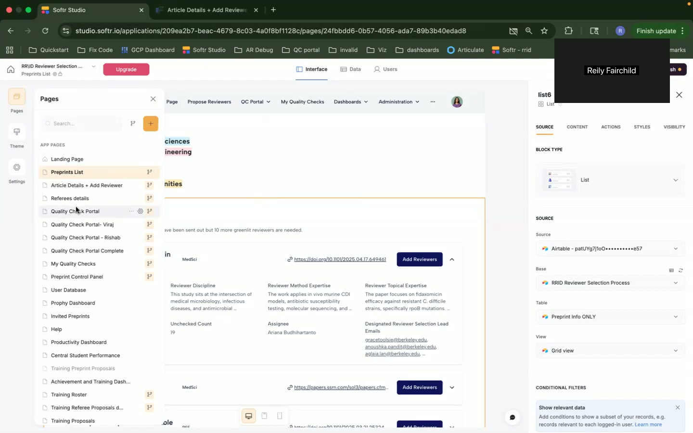

  
## Chapter 2: Landing Page [00:46]

### Overview
- Introduction to landing page views.
- Distinction between student and assistant editor views.

### Key Takeaways
- Two distinct views available.
- Specific roles with unique access privileges.
- Central navigation for primary tasks.

### Detailed Description
Exploration of landing page structure and design, showcasing different views for students and editors, enabling tailored access to functionalities.

### UI Elements and Workflow
- Views for Students and Editors: Provide targeted toolkits.
- Navigation Menus: Quick access to primary features.

### Notable Timestamps
- **[00:46]**: Discussion of landing page role-specific views.

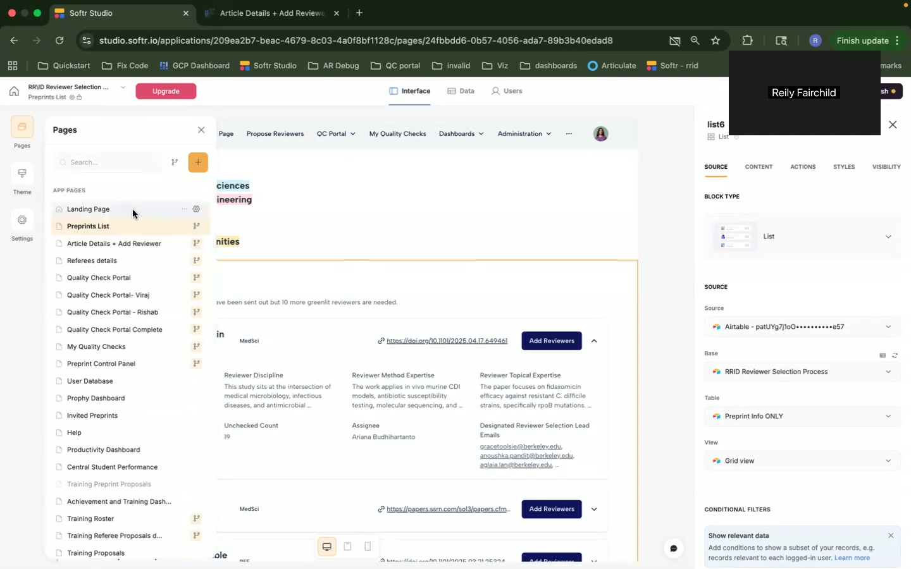

## Chapter 3: Preprints List and Management [01:51]

### Overview
- Functionality of the Preprints List.
- Detailed view into preprint statuses and processes.

### Key Takeaways
- Differentiation of preprint lists (active vs. in queue).
- Role-specific interactions (editor vs. student).
- Emphasis on visibility and permissions.

### Detailed Description
Exploring the list of preprints, describing the variances in status, and the necessary actions corresponding to those statuses for editors and students.

### UI Elements and Workflow
- Preprint Status: Active, queued, prioritized.
- Action Buttons: Add reviewers based on status and role.
- Permissions: Specific areas of access for different users.

### Notable Timestamps
- **[02:13]**: Overview of accessing the preprints list.

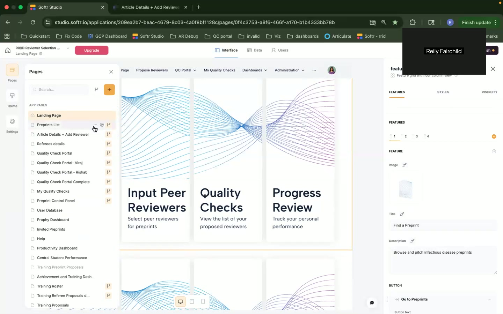

- **[03:10]**: Detailed view on prioritization and actions.

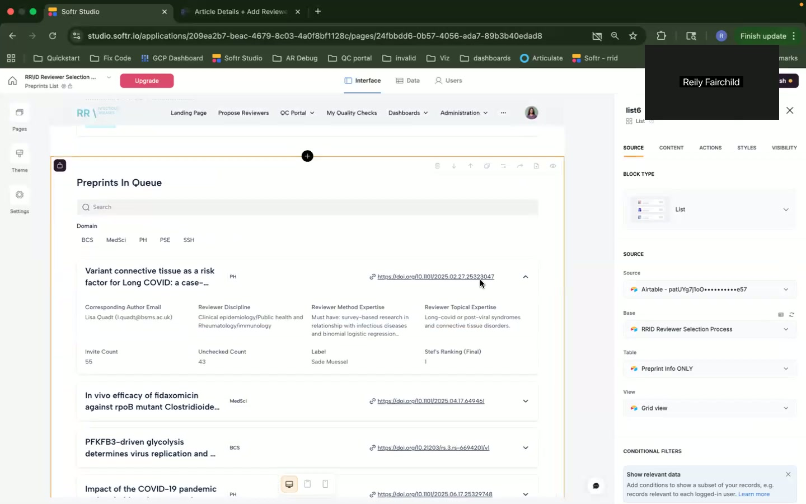

## Chapter 4: Article Details and Reviewer Management [04:57]

### Overview
- Accessing detailed article data.
- Managing peer reviewers and suggestions.

### Key Takeaways
- Detailed article inspection from the dashboard.
- Suggestions for reviewers through AI.
- Review process integrated with conflict of interest checks.

### Detailed Description
The article details section allows for enriched access to preprints, providing an in-depth look at reviewer assignments, potential conflicts of interest, and AI-generated suggestions.

### UI Elements and Workflow
- Article Details/Reviewers: Navigation to see historical data and assignments.
- Custom Scripts: Running COI checks dynamically.

### Notable Timestamps
- **[05:14]**: Article specifics and reviewer interaction.

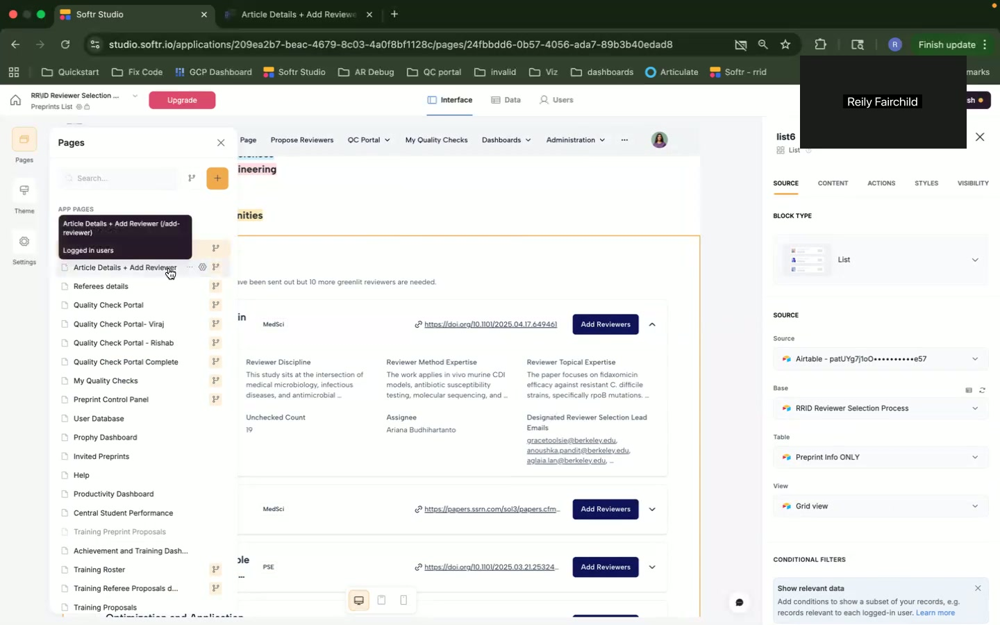

- **[06:14]**: COI (Conflict of Interest) review automation.

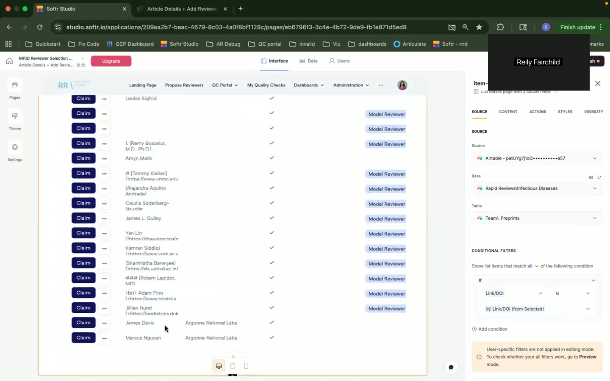

- **[07:24]**: Custom code for COI management.

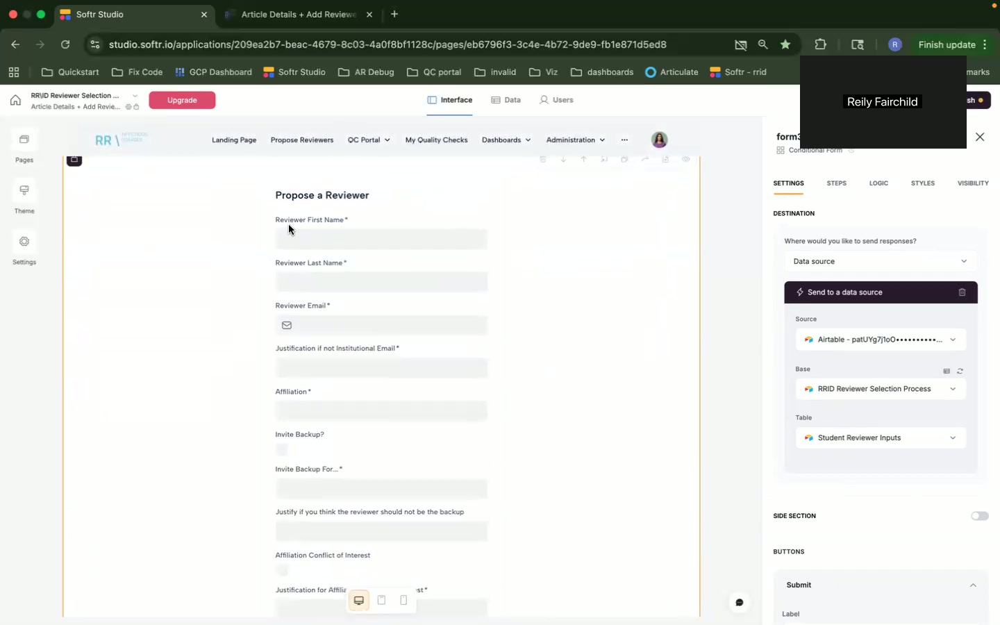

## Chapter 5: Reviewer Proposal and Quality Checks [09:39]

### Overview
- Proposal process for new reviewers.
- Quality check portal introduction.

### Key Takeaways
- Facilitates reviewer proposals.
- Ensures rigorous quality through checks.
- Role of custom code in enhancing functionality.

### Detailed Description
The process streamlines the inclusion of new reviewers, paired with a quality check mechanism that supports the selection of suitable and conflict-free reviewers.

### UI Elements and Workflow
- Proposal Forms: For reviewers with validation checks.
- Quality Check Portal: Internal tool for monitoring reviewer submissions.

### Notable Timestamps
- **[09:39]**: Entry to the reviewer proposal system.

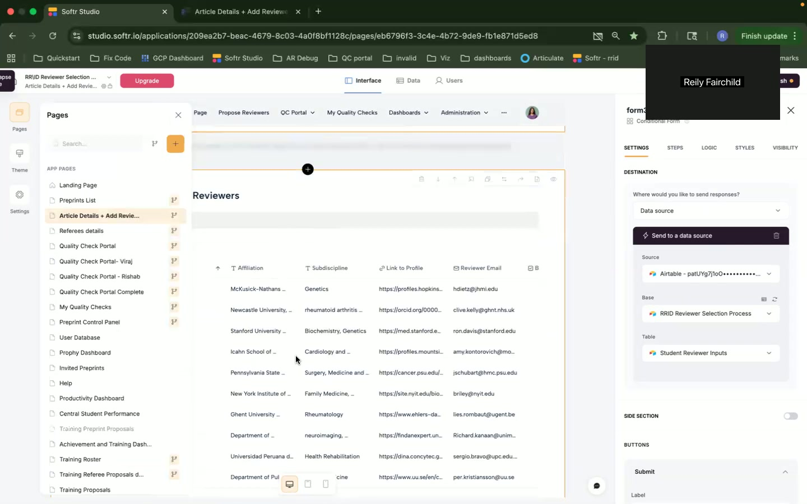

- **[13:32]**: Quality check portal functionalities.

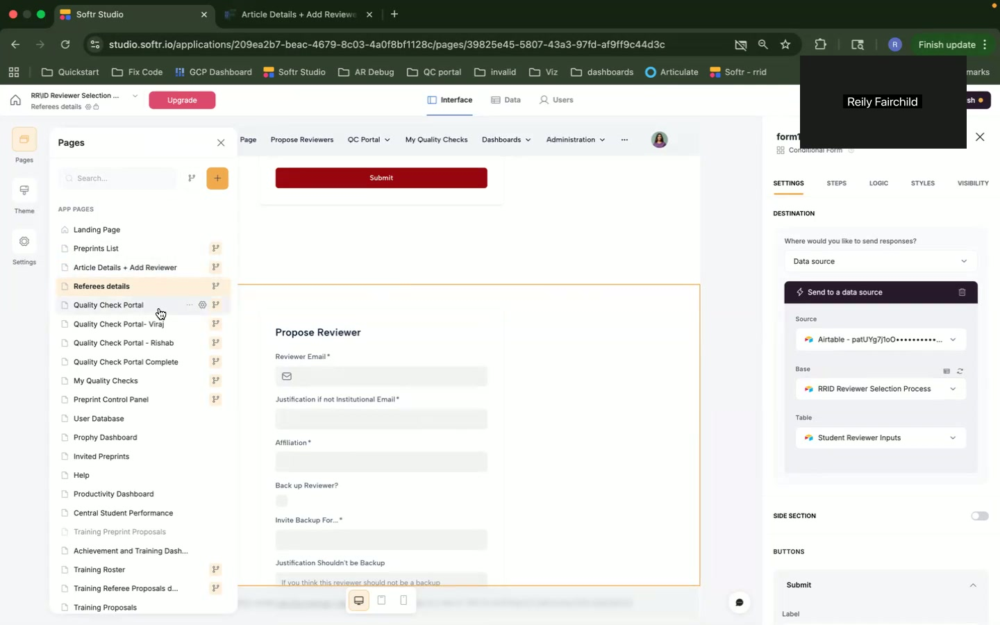

## Chapter 6: Dashboards and Control Panels [16:36]

### Overview
- Insight into various dashboards for monitoring and analytics.
- Control panels for data administration and updates.

### Key Takeaways
- Centralized control for data and metadata updates.
- Automated insights from productivity dashboards.
- Embedded interfaces for enhanced interaction.

### Detailed Description
Providing access to strategic dashboards, the chapter discusses how these panels enhance user oversight of productivity, reviewer data, and overall workflow management.

### UI Elements and Workflow
- Dashboards: Performance monitoring and strategic oversight.
- Control Panels: Direct updates without deep database access.
- Embedded Interfaces: Streamline data visualization and interaction.

### Notable Timestamps
- **[17:38]**: Productivity Dashboard exploration.

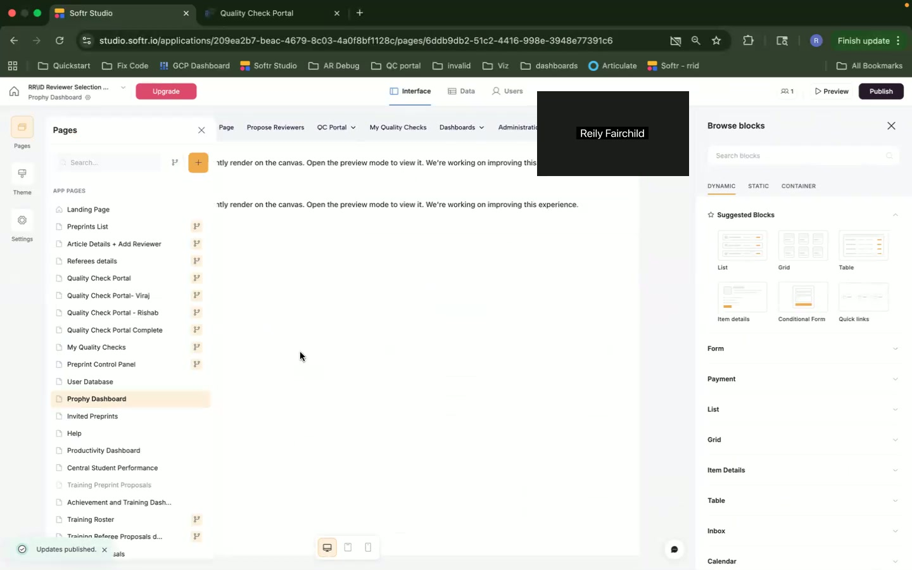

- **[19:43]**: Achievement and training insights.

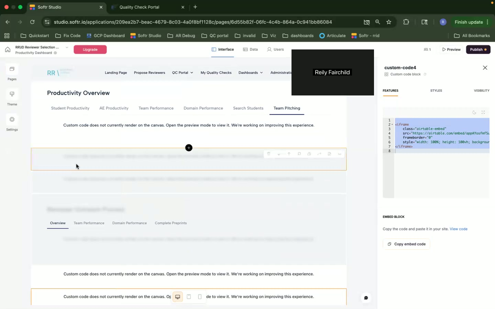

- **[18:40]**: Dashboard under custom code enhancements.

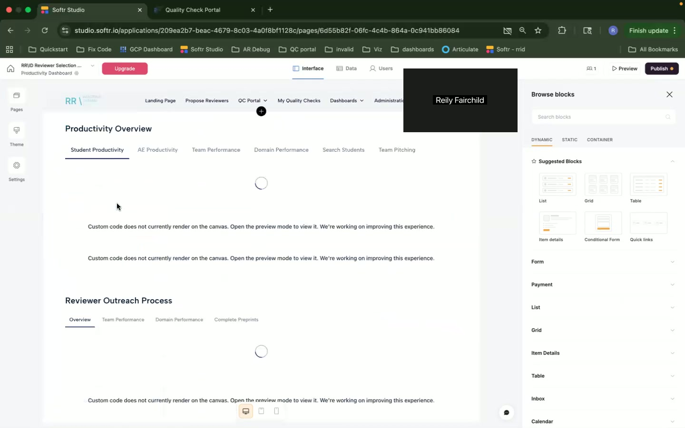

## Chapter 7: Miscellaneous and Navigation [21:21]

### Overview
- Secondary functionalities and navigation insights.
- Overview of header navigation control.

### Key Takeaways
- Quick access and customization of header navigation.
- Ensures efficient user experience through easy-to-use menus.

### Detailed Description
This section briefly underlines miscellaneous components, focusing on navigation efficiency and how users can adapt the interface to better suit their roles.

### UI Elements and Workflow
- Navigation Settings: User-specific adjustments allowed.
- Headers: Designed for fast access to priority features.

### Notable Timestamps
- **[21:26]**: Closing remarks on navigation and conclusion.

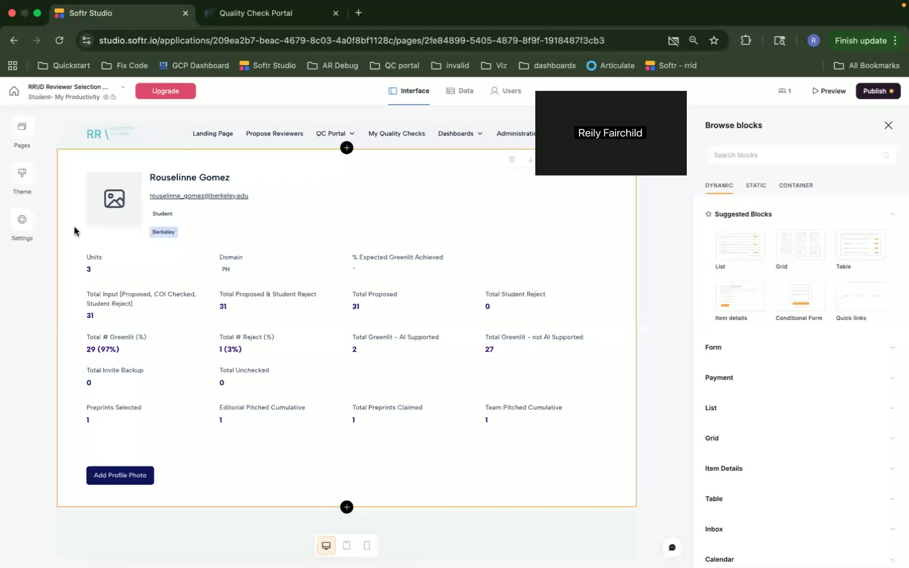
