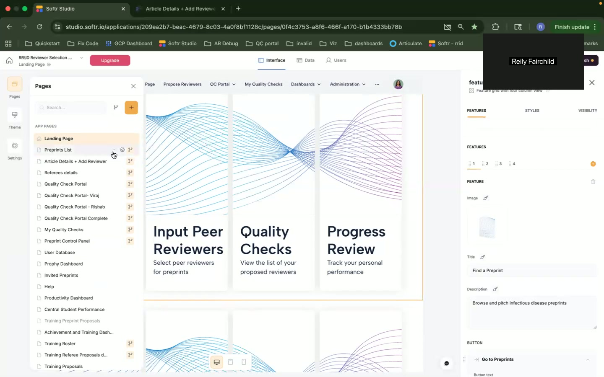
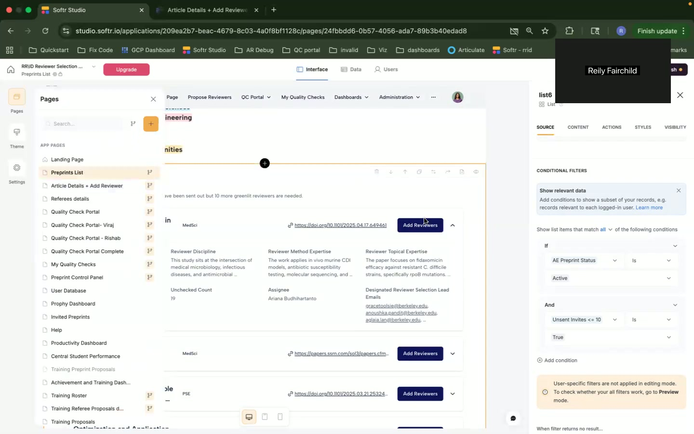
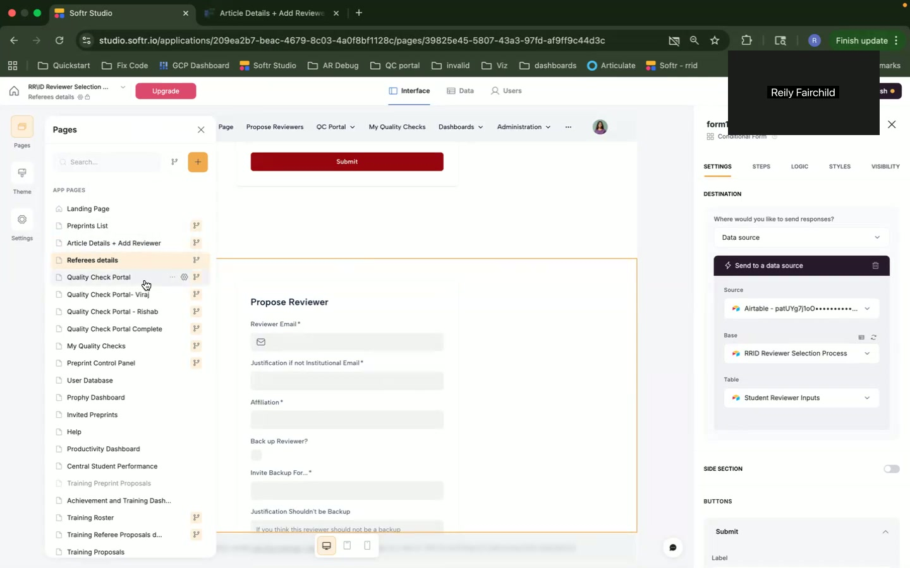
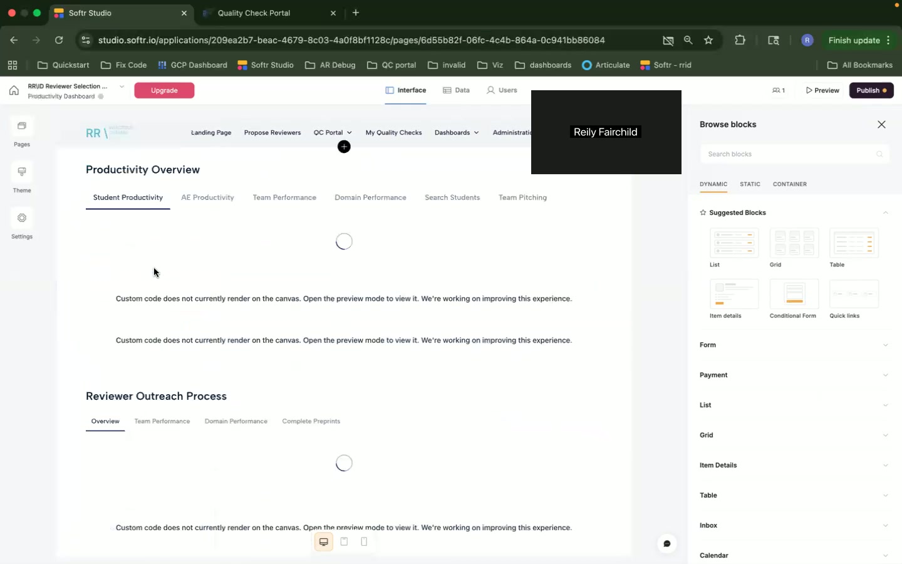
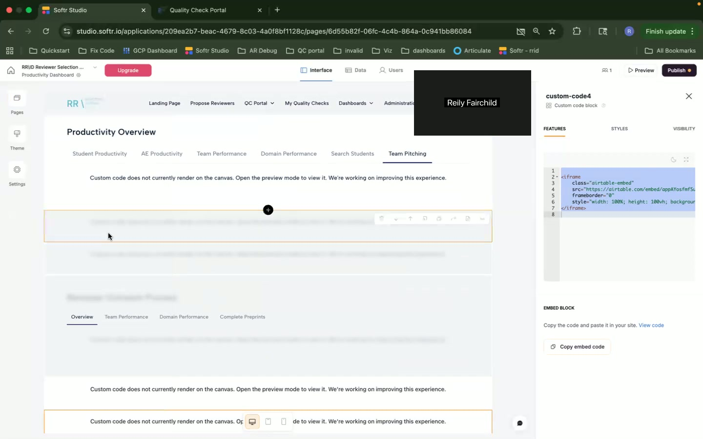

Okay, let's craft a detailed personas and user stories document based on the provided video transcript.

```markdown
# User Personas and User Stories: RID Reviewer Selection Software

This document outlines the user personas, user stories, and user journeys for the RID Reviewer Selection Software, as described in the provided video walkthrough.

## 1. User Personas

### Persona 1:  Sarah - The Student Reviewer

*   **Name:** Sarah Miller
*   **Role:** Student Reviewer/Peer Review Inputter
*   **Background and Context:** Sarah is an undergraduate student majoring in Biology. She is part of a mini-team that contributes to the RID initiative by proposing peer reviewers for preprints. She is new to academic publishing and peer review processes.
*   **Goals and Motivations:**
    *   Contribute to scientific research.
    *   Gain experience in peer review processes.
    *   Improve her understanding of scientific literature.
    *   Earn badges and recognition for her contributions.
    *   Help preprints receive quality reviews.
*   **Pain Points and Challenges:**
    *   Unfamiliar with the peer review landscape.
    *   Difficulty identifying suitable reviewers.
    *   Concern about proposing inappropriate reviewers (e.g., authors, recent reviewers).
    *   Limited understanding of conflict of interest.
    *   Needs clear guidance and feedback on her proposals.
*   **Technical Skill Level:** Comfortable with web applications, but not technically savvy.
*   **How they would use this application:** Sarah uses the application to find preprints, propose reviewers, and track the outcome of her proposals. She utilizes the AI-suggested reviewers and conflict of interest checks to improve the quality of her submissions.

### Persona 2:  David - The Assistant Editor

*   **Name:** David Chen
*   **Role:** Assistant Editor
*   **Background and Context:** David is a graduate student working as an assistant editor for the RID initiative. He is responsible for quality-checking proposed reviewers, managing preprint workflow, and monitoring student performance.
*   **Goals and Motivations:**
    *   Ensure the quality and integrity of the peer review process.
    *   Efficiently manage the flow of preprints through the system.
    *   Provide feedback and guidance to student reviewers.
    *   Identify and resolve any issues or bottlenecks in the process.
    *   Contribute to the overall success of the RID initiative.
*   **Pain Points and Challenges:**
    *   High volume of proposed reviewers to check.
    *   Ensuring consistency in quality checks.
    *   Identifying potential conflicts of interest.
    *   Managing student reviewer performance.
    *   Keeping track of preprint status and progress.
*   **Technical Skill Level:** Proficient with web applications and data management tools.
*   **How they would use this application:** David uses the application primarily for quality checking proposed reviewers, managing preprints, and monitoring student productivity. He uses the quality check portal to review proposed reviewers, identify potential issues, and take appropriate actions. He also uses the productivity dashboard to assess student performance and identify areas for improvement.

### Persona 3:  Angel - The Central Team Member

*   **Name:** Angel Ramirez
*   **Role:** Central Team Member/Administrator
*   **Background and Context:** Angel is a member of the central team responsible for the overall management and administration of the RID initiative. This includes managing preprints, updating user data, monitoring system performance, and providing support to assistant editors and student reviewers.
*   **Goals and Motivations:**
    *   Maintain the smooth operation of the RID initiative.
    *   Ensure data integrity and accuracy.
    *   Identify and resolve any system issues or bugs.
    *   Improve the efficiency and effectiveness of the peer review process.
    *   Provide support and guidance to the RID team.
*   **Pain Points and Challenges:**
    *   Managing a large volume of data.
    *   Troubleshooting system issues.
    *   Coordinating with different teams and stakeholders.
    *   Keeping the system up-to-date and secure.
    *   Automating manual tasks.
*   **Technical Skill Level:** Highly proficient with web applications, databases, and scripting.
*   **How they would use this application:** Angel uses the application for a wide range of administrative tasks, including managing preprints, updating user data, monitoring system performance, and generating reports. Angel uses the preprint control panel to update preprint information and the user database to manage user accounts.  She also uses the productivity and training dashboards to monitor team performance and track user progress.

## 2. User Stories

### Landing Page (00:46)

*   **User Story 1:** As a Student Reviewer, I want to see a clear overview of my tasks and opportunities so that I can quickly start contributing to the RID initiative.
    *   Acceptance Criteria: The landing page displays links to "Input Peer Reviewers" and provides a clear distinction between student and assistant editor views.
    *   Priority: High
    *   Related Pages/Features: Preprints List, Quality Check Portal
*   **User Story 2:** As an Assistant Editor, I want to quickly access the quality check portal so that I can efficiently review proposed reviewers.
    *   Acceptance Criteria: The landing page displays a link to "Quality Check Proposed Reviewers."
    *   Priority: High
    *   Related Pages/Features: Quality Check Portal

### Preprints List (02:13)

*   **User Story 3:** As a Student Reviewer, I want to see a list of active preprints that need reviewers so that I can choose preprints to contribute to.
    *   Acceptance Criteria: The list displays active preprints with an option to "Add Reviewers" (where applicable). Preprints are filtered based on student/assistant editor roles.
    *   Priority: High
    *   Related Pages/Features: Article Details + Add Reviewer
*   **User Story 4:** As an Assistant Editor, I want to see a list of all preprints, including those in queue, so that I can manage the overall workflow.
    *   Acceptance Criteria: The list displays all preprints, with visual cues indicating their status (e.g., active, in queue, prioritized, spotlight). It must be filterable.
    *   Priority: High
    *   Related Pages/Features: Article Details + Add Reviewer, Preprints Control Panel

### Article Details + Add Reviewer (04:57)

*   **User Story 5:** As a Student Reviewer, I want to see detailed information about a preprint so that I can determine if it is within my area of expertise.
    *   Acceptance Criteria: The page displays the preprint title, DOI, authors, affiliations, and similar articles.
    *   Priority: High
    *   Related Pages/Features: Preprints List
*   **User Story 6:** As a Student Reviewer, I want to see AI-suggested reviewers so that I can quickly identify potential candidates.
    *   Acceptance Criteria: The page displays a list of AI-suggested reviewers with their relevant information.
    *   Priority: Medium
    *   Related Pages/Features: Referee Details
*   **User Story 7:** As a Student Reviewer, I want to check for conflicts of interest before proposing a reviewer so that I can avoid suggesting inappropriate candidates.
    *   Acceptance Criteria: The page includes a form to input reviewer first name, last name, and email to check for conflicts of interest.
    *   Priority: High
    *   Related Pages/Features: Referee Details
*   **User Story 8:** As a Student Reviewer, I want to propose a reviewer with justification so that the editorial team can understand my reasoning.
    *   Acceptance Criteria: The page includes a form to propose a reviewer, including fields for justification and conflict of interest disclosure.
    *   Priority: High
    *   Related Pages/Features: Quality Check Portal
*   **User Story 9:** As a Student Reviewer, I want the system to warn me if I'm proposing a reviewer who is already an author, a recent reviewer, or a previously proposed reviewer so that I don't waste my time and effort.
    *   Acceptance Criteria: Real-time validation using custom code to check against existing data and display warning messages.
    *   Priority: High
    *   Related Pages/Features: Quality Check Portal

### Referee Details (10:37)

*   **User Story 10:** As an Assistant Editor, I want to evaluate AI-suggested reviewers so that I can improve the quality of the reviewer pool.
    *   Acceptance Criteria: The page displays detailed information about the AI-suggested reviewer, with options to "Unable to Evaluate", "Reject Reviewer", or "Propose Reviewer".
    *   Priority: High
    *   Related Pages/Features: Quality Check Portal

### Quality Check Portal (13:32)

*   **User Story 11:** As an Assistant Editor, I want to view all proposed reviewers for in-process preprints so that I can assess their suitability.
    *   Acceptance Criteria: The portal displays a list of proposed reviewers with relevant information (needs details on what that info is, based on the data model).  The data is pulled from airtable and displayed using custom code.
    *   Priority: High
    *   Related Pages/Features: Referee Details, Article Details + Add Reviewer
*   **User Story 12:** As a Student Reviewer, I want to see the outcome of my proposed reviewers so that I know if my suggestions were accepted.
    *   Acceptance Criteria: Filtered view showing only the outcomes of the reviewer proposals by the currently logged-in student.
    *   Priority: High
    *   Related Pages/Features: Referee Details, Article Details + Add Reviewer

### Preprint Control Panel (15:34)

*   **User Story 13:** As a Central Team Member, I want to be able to update preprint information and status so that I can keep the system accurate and up-to-date.
    *   Acceptance Criteria: The panel allows updating preprint status, ranking, and other relevant information.
    *   Priority: High
    *   Related Pages/Features: Preprints List, Article Details + Add Reviewer

### User Database (16:46)

*   **User Story 14:** As a Central Team Member, I want to update user information and roles so that I can manage user access and permissions.
    *   Acceptance Criteria: The panel allows updating user status, team affiliation, and other relevant information.
    *   Priority: High

### Productivity Dashboard (18:40)

*   **User Story 15:** As an Assistant Editor, I want to see student productivity metrics so that I can track their performance and identify areas for improvement.
    *   Acceptance Criteria: Displays student productivity, AE productivity, team performance, and domain performance using AirTable embeds.
    *   Priority: Medium

### Achievement and Training Dashboard (19:52)

*   **User Story 16:** As a Student Reviewer, I want to track my progress and earn badges so that I am motivated to contribute to the RID initiative.
    *   Acceptance Criteria: Displays progress towards badges in various categories (RID specific, reviewer proposal, preprint pitching).
    *   Priority: Medium

## 3. Feature Mapping

| Feature                   | Sarah (Student) | David (Assistant Editor) | Angel (Central Team) |
| ------------------------- | --------------- | ------------------------ | -------------------- |
| Landing Page              | X               | X                        |                      |
| Preprints List            | X               | X                        |                      |
| Article Details           | X               |                          |                      |
| Add Reviewer              | X               |                          |                      |
| Referee Details         | X               | X                        |                      |
| Quality Check Portal      | X               | X                        |                      |
| Preprint Control Panel    |                 |                          | X                    |
| User Database            |                 |                          | X                    |
| Productivity Dashboard    |                 | X                        | X                    |
| Training Dashboard        | X               |                          |                      |

## 4. User Journeys

### User Journey 1: Sarah - Proposing a Reviewer

1.  **Entry Point:** Landing Page (00:46)
2.  Sarah clicks "Input Peer Reviewers" -> Preprints List (02:13)
3.  Sarah browses the list of active preprints and chooses one that interests her.
4.  Sarah clicks "Add Reviewers" for the selected preprint -> Article Details + Add Reviewer (04:57)
5.  Sarah reviews the preprint details and the list of AI-suggested reviewers.
6.  Sarah checks for conflicts of interest using the COI check form.
7.  Sarah proposes a reviewer by filling out the "Propose a Reviewer" form.
8.  The system validates the input and displays a warning if there's a match with existing reviewers or authors.
9.  Sarah submits the proposal.
10. **Exit Point:** Quality Check Portal ("My Quality Checks" view) (13:32) where Sarah can track the status of her proposal.

### User Journey 2: David - Quality Checking a Proposed Reviewer

1.  **Entry Point:** Landing Page (00:46)
2.  David clicks "Quality Check Proposed Reviewers" -> Quality Check Portal (13:32)
3.  David reviews the list of proposed reviewers.
4.  David selects a reviewer to evaluate.
5.  David clicks on the reviewer’s name and opens the referee details -> Referee Details (10:37)
6.  David reviews the reviewer's profile and the student's justification.
7.  David makes a decision:
    *   Unable to evaluate -> The system logs the evaluation.
    *   Reject reviewer -> The system flags the reviewer as rejected in the reviewer inputs.
    *   Propose reviewer -> The system marks the referee as approved for invitation.
8.  **Exit Point:** Quality Check Portal (13:32), with the reviewer marked as processed.

### User Journey 3: Angel - Updating Preprint Status

1.  **Entry Point:** Landing Page (00:46)
2.  Angel navigates to the Preprint Control Panel (15:34)
3.  Angel searches for a specific preprint.
4.  Angel edits the preprint details (e.g., status, ranking).
5.  Angel saves the changes.
6.  **Exit Point:** Preprint Control Panel (15:34), with the preprint information updated.

## 5. Screenshots and Context

*   **[00:00] - Landing Page:** This is the main entry point for all users. It provides a high-level overview of the system and links to the most important features.  Different views exist for different user roles.


*   **[02:13] - Preprints List:** This page displays a list of preprints that need reviewers. Users can filter the list based on various criteria.



*   **[04:57] - Article Details + Add Reviewer:** This page provides detailed information about a specific preprint and allows users to propose reviewers.



*   **[10:37] - Referee Details:** Shows the details on an AI suggested reviewer.


*   **[13:32] - Quality Check Portal:** This portal is used by assistant editors to quality-check proposed reviewers.



*   **[15:34] - Preprint Control Panel:** Used by central team members to manage preprint information.


*   **[18:40] - Productivity Dashboard:** Displays productivity metrics for students, assistant editors, and teams.



*   **[19:43] - Achievement and Training Dashboard:** Tracks user progress and provides access to training materials.




```

This provides a solid starting point. To make it even better, you could:

*   **Expand on Acceptance Criteria:**  Be more specific about the data displayed, the actions available, and the expected behavior of the system.
*   **Detail Feature Interdependencies:** Describe how actions in one area of the application affect other areas.  For example, when a reviewer is proposed, it impacts the quality check portal.
*   **Add Mockups/Wireframes:** If available, include simple mockups of key screens to illustrate the user interface.  Even hand-drawn sketches would be helpful.
*   **Include Error Handling:** Add user stories related to how the system should handle errors or unexpected situations.  For example, what happens if the COI check service is unavailable?
*   **Address Technical Debt:**  The video mentions "hacky" custom code. Capture user stories around refactoring or replacing that code with more robust solutions.  For example, "As a developer, I want to replace the custom code for COI checking with a standard library so that the application is more reliable and maintainable."
*   **Consider Accessibility:**  Add user stories that explicitly address accessibility concerns (e.g., screen reader compatibility).
*   **Prioritize Based on Impact and Effort:** Include an estimate of the relative effort required to implement each user story so that you can prioritize based on both impact and feasibility.

By fleshing out these details, you'll have a comprehensive document to guide the development and improvement of the RID Reviewer Selection Software.